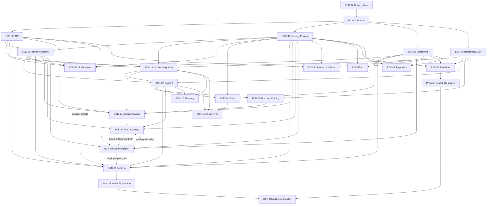

# Recharge Backend — единая карта документов и дальнейшей реализации

- ID: **BCK-02**
- Version: **2.4.108**
- Date: **2026-09-30**
- Spec status: **Approved — canonical coordination baseline, documentation only**
- Runtime status: **N/A — documentation-only coordination**
- Accountable owner: **Architecture owner**
- Local R1 technical decision: **Accepted and locally verified — no cloud authority**
- Production Security/Privacy/Legal and cloud approval: **Pending**
- Approved: **2026-08-10, Product owner**
- Registry amendments: **2026-08-15, 2026-08-16, 2026-08-20, 2026-08-21,
  2026-08-24, 2026-08-25, 2026-08-26, 2026-08-27, 2026-08-28,
  2026-09-06, 2026-09-07, 2026-09-08, 2026-09-09, 2026-09-12 and
  2026-09-15, 2026-09-16, 2026-09-17, 2026-09-19, 2026-09-20 and
  2026-09-21, 2026-09-23, 2026-09-25 and 2026-09-26, Product owner
  instructions; documentation traceability only, semantics/gates/checksum
  unchanged**
- Назначение: единая распределительная карта backend-работ Recharge
- Заменяет в плане отдельный `BACKEND_CAPABILITY_OWNERSHIP_MATRIX.md`
- Runtime effect: **none**

## 0. Changelog

**v2.4.108.** Registers stage 3.1 (BCK-05 v0.2.42 §36), the execution manifest and
infrastructure code, without widening cloud, spend or market authority:

- a closed file map for a machine-readable manifest, shared IaC modules with a
  root per environment, two verifiers, a credential-free validation workflow and
  Draft runbooks; nothing is created in any cloud and **writing IaC does not
  authorize apply**;
- decisions: Firebase CLI alone owns Rules, indexes, TTL and Functions
  deployment; no automatic billing detach and containment never blocks
  cancelling an existing Booking or a mandatory privacy operation; one state
  bucket per environment with bootstrap and destroy protection; minimal workflow
  permissions;
- the pinned Terraform 1.15.9 and google provider 7.43.0 already exist as
  verified local copies, so no download is needed;
- BCK05-OD-03/04/05/08 stay Proposed and keep blocking provisioning.

**v2.4.107.** Third remediation pass of the independent audit, without widening
cloud, spend or market authority:

- BCK-14 v0.7 (AC-87): the deletion hold is fenced with a holder id and its own
  lease, so an expired worker cannot delete an asset that became referenced;
- LAUNCH_STATUS versions synchronized (BCK-07 v0.14 / 109 AC, BCK-14 v0.7);
- the ROADMAP (A1 v1.31 §3.6) tightens the proposed merge conditions: one final
  SHA for all checks, the full Flutter gate before the final Done/merge (AGENTS.md)
  and approval of the conditions is not permission to merge.

**v2.4.106.** Second remediation pass of the independent audit, without widening
cloud, spend or market authority:

- BCK-07 v0.14 (AC-109) and BCK-14 v0.6 (AC-86): a deletion hold no longer lifts
  an authoritative restriction, and a completed Content command replays without
  consulting Media;
- the BCK-14 registry row separates local/fake Present from production Absent;
- the window between media evidence and publication stays a recorded limit, with
  a detection/reaction mechanism required before a real Media adapter;
- the ROADMAP (A1 v1.30 §3.6) records the stage-to-slice map for stages 1-2 and
  the proposed, not yet accepted, conditions for a future merge.

**v2.4.105.** Synchronizes the registry rows and records the remediation of an
independent audit of stages 1-2, without widening cloud, spend or market
authority:

- BCK-07 v0.13 (105 -> 108 AC) and BCK-14 v0.5 (82 -> 85 AC) record: replays
  re-check authority, no cross-module port call under a repository transaction,
  a verified Firestore client endpoint, paged effect reads and recovery of an
  abandoned Media attempt; all inside the existing closed maps;
- status drift removed: the BCK-07 row no longer says the Content aggregate is
  absent (it is Present locally and in an Emulator-only Firestore repository,
  production Absent) and the BCK-14 row records the local Media foundation
  (fake adapters, production Absent); no production status is raised;
- the five Create types without source rules (Route, Scenario, Session,
  Class/Workshop, Find People) stay disabled with explicit reasons and are not
  covered by this change.

**v2.4.104.** Registers `BCK07-PERSIST-01` (BCK-07 v0.12 §38), the
Emulator-only Content persistence slice, without widening cloud, spend or market
authority:

- a candidate outside the 22-document checksum with a closed collection and
  file manifest; default-off, Emulator-only (exact `demo-recharge`, loopback
  endpoint), no callable, export, worker or cloud resource;
- adds the additive failure code `storage_limit_exceeded`;
- 2.6 is complete only after a successful Emulator and Rules run on the exact
  toolchain; production approval remains a separate decision.

**v2.4.103.** Registers the local Media slice `BCK14-LOCAL-01` (BCK-14 v0.4
§34) and the matching BCK-07 v0.11 §37 amendment, without widening cloud, spend
or market authority:

- BCK14-LOCAL-01 is a bounded local/test-only slice with a closed exact file
  map; it is a candidate outside the 22-document checksum and BCK-14 stays
  Review, so production approval, real Storage/scanner/processor adapters,
  delivery signer, Firebase, cloud, push and merge stay separate decisions;
- BCK-07 gains one new file and a closed list of existing Content files for
  generation-pinned media attachments;
- no type, family or market activation.

**v2.4.102.** Records the BCK-07 v0.8 amendment of the closed BCK07-LOCAL-01
map without widening cloud, spend, market or publication authority:

- BCK07-LOCAL-01 gains thirteen exact files for typed source rules
  (`domain/type_rules/` plus unit tests); `content_type_registry.ts` remains the
  registry;
- rules cover only Place, Event (C0 + schedule-C1), Activity, Rental and
  Collection; the other five types stay registered but unavailable with an
  explicit reason;
- no export, Firebase, cloud, push, merge, type or market activation.

**v2.4.101.** Records the Product owner's Release R1 decisions of 2026-09-29 without widening cloud, spend or market authority:

- Release R1 is Latvia-first; scope, Deferred items (Payments/paid Booking, AI, external Providers, Event Ingestion runtime), Import migration condition and the SLO/cost/RPO-RTO verification baseline live in Latvia roadmap v1.29 §3.5;
- registers BCK-23 as a Draft candidate under item `6E` in §5 outside the 22-document checksum; its Draft/Proposed status is unchanged;
- numeric error-budget/burn-rate thresholds are required before stage; RPO/RTO stays unconfirmed until a successful PITR/restore drill.

**v2.4.100.** Reconciles the bounded Booking reconfirmation `2A/2B` vertical
without widening cloud or market authority:

- records BCK-09 v1.25 manual exact-revision reconfirmation and the default-off
  deadline worker with transaction-safe release, fenced leases, bounded retry,
  dead-letter and audited replay;
- records the exact-toolchain gate at commit `8946cbb`: 93 unit, 28 contract,
  16 integration, 84 Emulator/Rules and 701 Flutter tests, with analyzer,
  boundary, layout/export/no-cloud/reproducibility and diff checks green;
- sets the bounded verdict `Local Booking vertical complete`; BCK-13 delivery,
  persistent escrow, dev cloud, staging, production and all markets remain
  absent or disabled;
- keeps deployment, activation, push and merge closed.

**v2.4.99.** Reconciles the bounded Stage-1 Event delivery and Privacy repair
without widening cloud or market authority:

- records BCK-09 v1.23 server-owned outbox time, durable discovery, fenced
  delivery leases, audited replay and legal-hold-safe erasure follow-up;
- records BCK-04 v0.4.35 and BCK-05 v0.2.41 retention, Privacy and Operations
  ownership with 103 and 100 AC respectively;
- records 93 unit, 28 contract, 16 integration and 73 Emulator/Rules tests on
  the exact local toolchain; Flutter evidence remains governed separately;
- keeps dev cloud, staging, production, deployment, activation, push and merge
  closed.

**v2.4.98.** Reconciles the local Session lifecycle and dev-only mobile Auth
Emulator transport without widening cloud or market authority:

- records BCK-06 v0.8 one-installation replacement, 60-minute snapshot,
  30-day idle expiry and recent-auth recovery;
- records BCK-18 v1.1 lazy dev-Emulator Firebase Auth adapter, one forced token
  refresh and release builds that never initialize Firebase;
- records BCK-07 v0.7 delegated-import inputs and a non-executable Event
  Ingestion reservation while ADR 0020/BCK-23 remain physically absent;
- preserves production Auth, real Google/Apple verification, cloud,
  deployment, activation, push and merge as closed gates.

**v2.4.97.** Records the Booking Stage 8 integrated Emulator preflight without
widening cloud or market authority:

- reconciles BCK-04 v0.4.34, BCK-06 v0.7, BCK-09 v1.22 and BCK-18 v1.0;
- records one Auth→Identity→Event→Booking→notification-outbox→Privacy/retention
  flow plus convergent Event-projection retry under exact Node 22.23.2,
  npm 10.9.8 and Temurin 21.0.12+8;
- records 92 unit, 28 contract, 13 integration, 66 Emulator/Rules and 699
  Flutter tests with analyzer, no-cloud, layout/export, reproducibility and
  boundary gates green;
- sets `Ready for physical dev backend` as a bounded next-stage readiness
  verdict only. Project creation, IAM, billing, credentials, deployment,
  activation, push and merge remain closed.

**v2.4.96.** Records the owner-approved local Abuse Controls pass without
widening cloud or market authority:

- reconciles BCK-04 v0.4.34, BCK-06 v0.7, BCK-09 v1.21 and BCK-18 v0.9;
- records atomic finite/unlimited caps, typed rolling request limits, explicit
  Session ceiling/rotation, exact local App Check bypass and stable mobile
  operation/reconciliation states;
- records green unit/contract/integration evidence and keeps the new Emulator
  evidence Pending until Java 21 is available on this host; deployment,
  activation, push and merge remain closed.

**v2.4.95.** Records the approved local Booking closure pass, without cloud or
market authority:

- reconciles BCK-03/04/05/06/07/09/18 to the implemented Firebase UID→opaque
  Session→domain User bridge and disabled Identity callable;
- records the immutable Event outbox, idempotent Booking delivery checkpoint,
  occurrence lifecycle effects and Firestore Privacy/DSR repositories;
- keeps workers, schedules, real provider Auth, dev cloud, deployment,
  activation, production, push and merge closed; the full Emulator gate is
  currently inconclusive only because the pre-existing 100-way unlimited
  contention test exceeded its 120-second timeout.

**v2.4.94.** Records the bounded Booking integration/privacy completion without
widening cloud or market authority:

- reconciles BCK-07 v0.5 and BCK-09 v1.19 with the local Event projection
  consumer, disabled mobile adapter and persistent local reconciliation state;
- records all nine Booking collections, domain-separated user-usage IDs,
  atomic Privacy dispatch and accepted 90/7/30/365-day technical owner policy;
- keeps qualified Legal/Privacy, Firebase cloud, deployment, production mobile
  binding, activation, push and merge closed.

**v2.4.93.** Records the bounded Identity/Booking authority hardening without
widening runtime scope:

- reconciles BCK-01 v0.4.84, BCK-03 v0.3.21, BCK-04 v0.4.32, BCK-05
  v0.2.39, BCK-06 v0.5 and BCK-09 v1.18;
- records role-bounded ManagedPage grants, last-owner protection, revision
  fences, opaque Session handles and Emulator-only Firestore persistence;
- records common R1 feature flags and atomic Booking authorization/mutation,
  with Identity callables, cloud, deployment, activation, push and merge still
  closed.

**v2.4.92.** Records Booking Stages 7–8 without widening cloud authority:

- fixes owner-approved normal/popular/mass demand profiles and records bounded
  single-ledger Emulator load evidence with zero oversell but unacceptable
  popular/mass contention;
- selects a disabled fixed-capacity escrow target with 16/64 shards and pure
  migration/reconciliation tests, without adding persistence or activation;
- reconciles BCK-09 v1.17, BCK-05 v0.2.38, backend README, AGENTS and
  LAUNCH_STATUS into separate local/Emulator/dev/staging/production/market
  verdicts; no cloud, deployment, activation, push or merge is authorized.

**v2.4.91.** Reconciles the preserved Stage 8 implementation and defines the
next product boundary without expanding runtime:

- synchronizes BCK-03 v0.3.20, BCK-04 v0.4.31, BCK-05 v0.2.37 and BCK-20
  v0.2.29 with their verified local R1 evidence;
- defines `item 6` as separately approved, disabled-by-default product-domain
  rollout rather than an unnamed monolithic backend stage;
- selects BCK07-LOCAL-01 as the next bounded local/test-only slice, while
  cloud, callable exports, product activation, push and merge remain closed.

**v2.4.90.** Records the Stage 8 local integrated verification for items 1–5:

- verifies the platform/API, Reference Data, Security/Privacy and
  Identity/Publisher foundations with credential-free unit, contract,
  integration, reproducibility and no-cloud gates;
- verifies disposable `demo-recharge` Emulator execution, default-deny
  Firestore/Storage Rules, exact collections/index posture, transaction
  contention, revocation, market isolation, pointer CAS and rollback;
- verifies the local/test-only mobile seam with 16 focused tests, a clean
  analyzer, all 680 Flutter tests, zero boundary violations and a clean diff;
- records `Ready for local integrated backend` only for the implemented
  platform/reference/security/identity/mobile seam. Dev cloud,
  staging/production, product remote cutover and separately planned item 6
  remain closed and are not implied by this verdict.

**v2.4.89.** Records BCK-18 v0.7 local/test-only mobile seam evidence:

- authoritative mobile Money now uses integer minor units with explicit
  currency across the migrated Create, Discover, Favorites and Scenario
  surfaces; legacy numeric reads remain bounded compatibility only;
- provider-neutral command/query clients, typed local/cache/server states,
  reversible bindings and an idempotent resumable import pipeline are Present
  locally with focused contract evidence;
- product remote adapters/cutover, Firebase SDK, cloud, deployment and
  production activation remain Absent and gated; BCK-18 remains a seam and
  never becomes writer of imported domain aggregates.

**v2.4.88.** Records BCK-06 v0.4 bounded local Identity/Publisher evidence:

- canonical Identity v1 schemas and provider-neutral in-memory authority are
  Present locally with explicit deny-all future collections;
- Firebase Auth, Firestore persistence, mobile cutover, cloud deployment and
  production authority remain Absent and gated;
- no other BCK owner, status or production decision changes.

**v2.4.87.** Exact local-R1 foundation technical-approval preflight:

- reconciles BCK-01 v0.4.81, BCK-03 v0.3.19, BCK-04 v0.4.30, BCK-05
  v0.2.36 and BCK-20 v0.2.28 to the 120-row §26 manifest;
- separates combined-owner local implementation acceptance from independent/
  qualified production Security/Privacy/Legal and cloud readiness;
- confirms one structure, one schema authority, five single-writer collections,
  ordered migration/rollback, default-off flags and credential-free no-cloud CI;
- prepares exact owner wording in §29 without approving or executing R1.

**v2.4.86.** Stage 9 independent readiness verdicts:

- records `Ready with controls` for the exact R1 local foundation without
  treating readiness as implementation authority;
- keeps product modules and Flutter adapters behind their own exact Approved
  slices rather than silently expanding R1;
- records dev cloud and staging/production as `Not Ready` with exact missing
  owner inputs, external reviews, drills and measured evidence;
- preserves all no-cloud/no-deploy/no-activation/no-push/no-merge boundaries.

**v2.4.85.** Stage 8 final documentation audit and atomic reconciliation:

- verifies the exact 22/22 BCK registry, resolves every local BCK link, checks
  header/registry version and status parity, gap-free acceptance-criterion
  sequences and the single-writer ledger;
- normalizes the remaining lifecycle enum values to lower camel case while
  retaining snake case for stable error/reason codes, and rechecks Money,
  currency, timezone, client-authority and provider-portability invariants;
- reconciles BCK-01 v0.4.79, BCK-06/10/11/16/17/22 v0.3.1 and BCK-20
  v0.2.27; records the interim Payments ownership boundary without relaxing
  the Accepted-ADR blocker;
- adds the final audit result in this canonical map rather than creating a
  wrapper document; no runtime, Firebase, deployment, activation, push or
  merge authority is granted.

**v2.4.84.** Stage 7 exact executable implementation map:

- adds the sole file-by-file R1 manifest with exact create/modify/retain/
  compatibility-only classification, owners, layers, tests, migration and rollback;
- reconciles existing R0/disabled RAW-C files with new platform/shared/contracts/
  config/security roots and forbids product exports/workers in R1;
- reconciles BCK-01 v0.4.78, BCK-03 v0.3.18, BCK-04 v0.4.29,
  BCK-05 v0.2.35, BCK-20 v0.2.26 and BCK-02-A1 v1.25 without creating files
  or granting G1/R1 execution, Firebase, provisioning or deployment authority.

**v2.4.83.** Stage 6 Latvia/Baltics and compliance hardening:

- adds one canonical 22-BCK `market × capability` readiness matrix instead of
  duplicating country-specific rules inside every domain specification;
- requires separate LV/EE/LT evidence for locale/copy, residency, provider,
  Legal/Privacy, age, UGC/DSA, retention/DSR, support and rollout/rollback;
- reconciles BCK-01 v0.4.77, BCK-04 v0.4.28, BCK-05 v0.2.34, BCK-20 v0.2.25
  and BCK-02-A1 v1.24 without promoting any runtime or market status.

**v2.4.82.** Stage 5 Planning and gated-integration closure:

- reconciles BCK-10/11/15/16/17 v0.3 without changing their Draft/blocked or
  runtime statuses;
- fixes Planning/Route/GPX sync and privacy boundaries plus provider-neutral
  AI/provider and complete-but-blocked Payments contracts;
- reconciles BCK-01 v0.4.76 and BCK-02-A1 v1.23 while retaining the Payments
  ADR blocker and every G1/network/credential/runtime/activation gate.

**v2.4.81.** Stage 4 user/operational-domain closure:

- reconciles BCK-09 v1.15 and BCK-12/13/14/19/21/22 v0.3 without changing
  their authoritative writers or runtime status;
- fixes one cross-domain effect/receipt/reconciliation ledger for Booking,
  Library/Reviews, Notifications, Media, Admin, Analytics and Trust & Safety;
- reconciles BCK-01 v0.4.75 and BCK-02-A1 v1.22 while retaining every OD,
  independent/qualified, G1, Firebase, execution and activation gate.

**v2.4.80.** Stage 3 Identity→Mobile→Content→Discover chain closure:

- reconciles BCK-06 v0.3, BCK-18 v0.6, BCK-07 v0.3 and BCK-08 v0.3 as one
  Review-level technical chain with unchanged writers;
- fixes typed handoffs, revision/freshness propagation and safe local/mock
  rollback without promoting local state into server authority;
- reconciles BCK-01 v0.4.74 and BCK-02-A1 v1.21 while retaining all OD,
  specialist, schema, Firebase, execution and activation gates.

**v2.4.79.** Stage 2 cross-BCK normalization baseline:

- records the one-writer ledger for all authoritative record families owned by
  BCK-03–22 and the documentation-only ownership of BCK-01/02;
- requires every BCK to inherit the BCK-01 entity checklist and canonical
  vocabulary without creating parallel aliases;
- reconciles execution annex BCK-02-A1 to factual documentation revision v1.20;
- preserves every existing runtime, specialist, Legal, Firebase, deployment
  and activation gate.

**v2.4.78.** D1 technical baseline closure without runtime authority:

- reconciles BCK-01 v0.4.72, BCK-03 v0.3.16, BCK-04 v0.4.26,
  BCK-05 v0.2.32 and BCK-20 v0.2.23 as one Review-level technical baseline;
- fixes one backend source layout, one JSON Schema source, common transport,
  idempotency, pagination, versioning and minimum-client rules;
- records OD-07, OD-09 and OD-10 as Accepted technical contracts with retained
  executable/source/Legal gates, and OD-11 as Proposed without numeric age;
- fixes logical environment and project-naming rules and opens only exact R1
  design; G1, execution, Firebase, deployment and activation remain closed.

**v2.4.77.** Canonical 22/22 physical specification completion without
changing Approved v2.4 coordination semantics:

- records BCK-10, BCK-11, BCK-15, BCK-16, BCK-17 and BCK-22 v0.1 as
  physically Present documentation with 60 sequential acceptance criteria
  each and runtime Absent;
- preserves Draft status for all six documents and preserves the hard BCK-17
  block pending a new Accepted Payments ADR;
- creates no review wrapper or parallel coverage package and grants no
  Firebase, provider, payment, deployment or market-activation authority;
- reconciles BCK-01 v0.4.71 and BCK-02-A1 v1.18 while D1/G1 and every
  runtime/cloud gate remain closed.

**v2.4.76.** D1 Owner Batch F consolidation without changing Approved v2.4
coordination semantics:

- pins Batch B–E as four exact source packages and preserves fifteen separate
  bounded verdicts;
- prepares one exact owner response, one atomic docs-only reconciliation plan
  and one post-owner specialist/qualified review queue;
- keeps all fifteen verdicts Pending until explicit Batch F acceptance and
  does not fabricate assignments, independence or qualification;
- reconciles BCK-01 v0.4.70/review v1.33, D1 review v1.36, ledger v1.35 and
  workbook v1.31 while D1/G1 and every runtime/cloud gate remain closed.

**v2.4.75.** D1 Owner Batch E and parent-preflight preparation without
changing Approved v2.4 coordination semantics:

- prepares BCK-03 parent-review routing, a fourteen-row Security assignment
  manifest and the four-parent Approval preflight;
- freezes Batch E as three separate Pending verdicts while Batch B/C/D remain
  separately Pending;
- reconciles BCK-01 v0.4.69/review v1.32, BCK-03 v0.3.15,
  BCK-04/coverage v0.4.25/v0.3.25, D1 review v1.35, ledger v1.34 and workbook
  v1.30;
- keeps all fourteen assignments/verdicts empty, every parent blocked, D1/G1
  Blocked and all runtime/cloud gates closed.

**v2.4.74.** D1 Owner Batch D and internal-blocker preparation without
changing Approved v2.4 coordination semantics:

- prepares one OD-11 Product boundary, one five-verdict Operations specialist
  package and one factual internal blocker/work-order matrix;
- freezes Batch D as three separate Pending verdicts while Batch B/C remain
  separately Pending;
- reconciles BCK-01 v0.4.68/review v1.31, BCK-04/coverage v0.4.24/v0.3.24,
  BCK-05/coverage v0.2.31, D1 review v1.34, ledger v1.33 and workbook v1.29;
- keeps OD-11 and BCK05-OD-06 Open, BCK05-OD-03/04/05/08 Proposed,
  D1/G1 Blocked and all runtime/cloud gates closed.

**v2.4.73.** D1 Owner Batch C and external-review handoff preparation without
changing Approved v2.4 coordination semantics:

- prepares one Product mandatory-copy classification, one four-lane external
  review handoff and one factual D1/G1 closure matrix;
- freezes Batch C as three separate Pending bounded verdicts while Batch B
  remains separately Pending;
- reconciles BCK-01 v0.4.67/review v1.30, BCK-20/coverage v0.2.22, D1 review
  v1.33, ledger v1.32 and workbook v1.28;
- keeps every external lane unassigned, BCK20-OD-05 Open, OD-10 Proposed,
  OD-11 Open, D1/G1 Blocked and all runtime/cloud gates closed.

**v2.4.72.** D1 Owner Batch B review preparation without changing Approved
v2.4 coordination semantics:

- freezes one exact owner action over five separate OD-10 documentation
  perspectives and one separate source-governance boundary;
- records all six verdicts as Pending until exact owner acceptance;
- reconciles BCK-20/coverage v0.2.21, D1 review v1.32, ledger v1.31,
  workbook v1.27 and BCK-01-REV-01 v1.29;
- advances no source, OD, D1/G1 or runtime state and keeps every qualified,
  schema, fixture, Firebase, deployment, push and merge gate closed.

**v2.4.71.** EXT-A–D and OD-10 documentation reconciliation without changing
Approved v2.4 coordination semantics:

- records the exact EXT-A–D technical baseline with no source eligibility;
- records OD10-DOC-DEC-01 and amended localization evidence v0.2 while OD-10
  remains Proposed;
- reconciles BCK-20/coverage v0.2.20, D1 review v1.31, ledger v1.30 and
  BCK-01-REV-01 v1.28;
- keeps BCK20-OD-02/05 Open, EXT-G5/G6, specialist/Legal, schema, fixture,
  runtime, Firebase, deployment, push and merge gates closed.

**v2.4.70.** BCK20 external-evidence plan decision reconciliation without
changing Approved v2.4 coordination semantics:

- records BCK20-OD02-EXT-EV-PLAN-DEC-01 and satisfies EXT-G0 only;
- reconciles BCK-20/coverage v0.2.18, BCK-01 v0.4.66 and
  BCK-01-REV-01 v1.26;
- reconciles D1 review v1.30, ledger v1.28, workbook v1.26, decision package
  v0.18 and BCK-02-A1 v1.17;
- keeps EXT-G1–G6, all markets, network/external evidence/independent/
  qualified/schema/runtime gates closed.

**v2.4.69.** BCK20 source-record decision reconciliation without changing
Approved v2.4 coordination semantics:

- records BCK20-OD02-SRC-REC-DEC-01, 23 accepted documentation inputs and the
  eight-source external evidence work queue under zero-independence ownership;
- reconciles BCK-20/coverage v0.2.17, BCK-01 v0.4.65 and
  BCK-01-REV-01 v1.25;
- reconciles D1 review v1.29, ledger v1.27, workbook v1.25, decision package
  v0.17 and BCK-02-A1 v1.16;
- keeps all markets disabled and every external/source-copy/independent/
  qualified/network/schema/runtime gate open.

**v2.4.68.** BCK20 source-authority decision reconciliation without changing
Approved v2.4 coordination semantics:

- records BCK20-OD02-SRC-AUTH-DEC-01 and bounded acceptance of the frozen
  source-authority design matrix under six combined roles with zero independence;
- reconciles BCK-20/coverage v0.2.16, BCK-01 v0.4.64 and
  BCK-01-REV-01 v1.24;
- reconciles D1 review v1.28, ledger v1.26, workbook v1.24, decision package
  v0.16 and BCK-02-A1 v1.15;
- retains actual source records, external-source license/terms and pinned
  ingestion evidence, independent/qualified review and all implementation gates.

**v2.4.67.** BCK20 exact-v0.4 combined-owner verdict reconciliation without
changing Approved v2.4 coordination semantics:

- records BCK20-OD02-V04-COMB-DEC-01 and four separately attributable design
  verdicts under one disclosed owner with zero independence;
- reconciles BCK-20/coverage v0.2.15, BCK-01 v0.4.63 and
  BCK-01-REV-01 v1.23;
- reconciles D1 review v1.27, ledger v1.25, workbook v1.23, decision package
  v0.15 and BCK-02-A1 v1.14;
- retains source-authority, independent Security/Privacy and applicable
  qualified Legal evidence as Pending;
- retains BCK20-OD-02/05 Open, OD-10 Proposed, BCK-20 Draft, BCK20-OD-03
  Deferred and every provider/schema/IAM/runtime/Firebase/deployment gate.

**v2.4.66.** BCK20 Mobile/Security pre-review correction reconciliation
without changing Approved v2.4 coordination semantics:

- records BCK20-OD02-MS-PRE-DEC-01 and exact corrected workflow v0.4;
- reconciles BCK-20/coverage v0.2.14, BCK-01 v0.4.62 and BCK-01-REV-01 v1.22;
- reconciles D1 review v1.26, ledger v1.24, workbook v1.22, decision package
  v0.14 and BCK-02-A1 v1.13;
- records separate Proposed Mobile and Security/Privacy reviews without making
  either verdict effective;
- preserves Product/Content v0.3 verdicts as historical exact-hash evidence
  pending v0.4 revalidation;
- retains BCK20-OD-02/05 Open, OD-10 Proposed, BCK-20 Draft, BCK20-OD-03
  Deferred and every provider/schema/runtime/Firebase/deployment gate.

**v2.4.65.** BCK20 Product/Content combined-owner verdict reconciliation
without changing Approved v2.4 coordination semantics:

- records two separate effective SIG-L10N/SIG-CONTENT verdicts through
  BCK20-OD02-PC-COMB-DEC-01 for exact workflow v0.3/hash;
- reconciles BCK-20/coverage v0.2.13 and Product/Content package v0.3;
- reconciles BCK-01 v0.4.61, BCK-01-REV-01 v1.21, D1 review v1.25, ledger
  v1.23, workbook v1.21, decision package v0.13 and BCK-02-A1 v1.12;
- preserves zero-independence disclosure and retains OD-02/05 Open, OD-10
  Proposed, BCK-20 Draft and all remaining specialist/Legal/runtime gates;
- adds no source-authority content, provider, schema, Firebase, deployment,
  push or merge authority.

**v2.4.64.** BCK20 Product/Content pre-review correction reconciliation
without changing Approved v2.4 coordination semantics:

- records BCK20-OD02-PC-PRE-DEC-01 and integrates F-001–F-008 in workflow
  v0.3 and BCK-20/coverage v0.2.12;
- re-freezes Product/Content review package v0.2 with both specialist
  signatures Pending and unnamed;
- reconciles BCK-01 v0.4.60, BCK-01-REV-01 v1.20, D1 review v1.24, ledger
  v1.22, workbook v1.20, decision package v0.12 and BCK-02-A1 v1.11;
- retains BCK20-OD-02/05 Open, OD-10 Proposed, BCK-20 Draft and every
  specialist/Legal/D1/G1/runtime gate;
- adds no source-authority content, provider, schema, runtime, Firebase,
  deployment, push or merge authority.

**v2.4.63.** BCK20-OD02 technical workflow reconciliation without changing
Approved v2.4 coordination semantics:

- records BCK20-OD02-DEC-01 and integrates sixteen amendments in workflow
  v0.2 and BCK-20/coverage v0.2.11;
- reconciles BCK-01 v0.4.59, BCK-01-REV-01 v1.19, D1 review v1.23, ledger
  v1.21, workbook v1.19, decision package v0.11 and BCK-02-A1 v1.10;
- retains BCK20-OD-02/05 Open, OD-10 Proposed, BCK-20 Draft and every
  specialist/Legal/D1/G1/runtime gate;
- adds no provider, schema, runtime, Firebase, deployment, push or merge
  authority.

**v2.4.62.** BCK-20 owner-decision reconciliation without changing Approved
v2.4 coordination semantics:

- records BCK20-OWN-DEC-01 and integrates twelve amendments in BCK-20 v0.2.10;
- defers BCK20-OD-01/03/04/06/07 and retains BCK20-OD-02/05 Open, OD-10
  Proposed and BCK-20 Draft;
- reconciles BCK-01 v0.4.58, BCK-01-REV-01 v1.18, BCK-D1-REV-01 v1.22,
  ledger v1.20, workbook v1.18, decision package v0.10 and BCK-02-A1 v1.9;
- adds no schema, runtime, Firebase, deployment, push or merge authority.

**v2.4.61.** BCK04-OD-01 technical threat-model reconciliation without
changing Approved v2.4 coordination semantics:

- records BCK04-OD01-DEC-01 v0.1 and integrates twenty amendments in
  BCK04-OD01-TM-01 v0.2;
- advances BCK-04 to Draft v0.4.23 and BCK-03 to traceability v0.3.14;
- reconciles BCK-01 v0.4.57, BCK-05 v0.2.30, BCK-18 v0.5, BCK-20 v0.2.9,
  BCK-D1-REV-01 v1.21, ledger v1.19, workbook v1.17, decision package v0.9
  and BCK-02-A1 v1.8;
- BCK04-OD-01 remains Proposed pending independent Security/Privacy and
  required cross-boundary confirmations;
- no schema, runtime, Firebase, credential, deployment, push or merge authority
  is added.

**v2.4.60.** BCK-04 technical owner-verdict reconciliation without changing
Approved v2.4 coordination semantics:

- records BCK04-SEC-DEC-01 v0.1 and the combined-owner technical BCK-04
  `Accept with required amendments` verdict;
- advances BCK-04 to Draft v0.4.22 and BCK-03 to traceability v0.3.13;
- reconciles BCK-01 v0.4.56, BCK-05 v0.2.29, BCK-18 v0.4, BCK-20 v0.2.8,
  BCK-D1-REV-01 v1.20, ledger v1.18, workbook v1.16, decision package v0.8
  and BCK-02-A1 v1.7;
- BCK04-OD-01/09, independent Security/Privacy, qualified Legal, OD-11,
  remaining D1 signatures, D1/G1-G7/R1 and product/cloud runtime remain
  blocked;
- no schema, generated file, runtime, Firebase, deployment, push or merge
  authority is added.

**v2.4.59.** D1-SIG-MOBILE traceability amendment without changing Approved
v2.4 coordination semantics:

- records BCK03-MOB-DEC-01 v0.1 and bounded D1-SIG-MOBILE `Accept with
  required amendments` for the BCK-03 Mobile boundary only;
- advances BCK-03 to Draft v0.3.12 and Mobile Architecture to v3.1.1 with
  per-attempt request ID and stable logical idempotency semantics;
- reconciles BCK-01 v0.4.55, BCK-04 v0.4.21, BCK-05 v0.2.28, BCK-20 v0.2.7,
  BCK-18 v0.3, BCK-D1-REV-01 v1.19, ledger v1.17, workbook v1.15 and
  BCK-02-A1 v1.6;
- BCK-18/BCK-20 Approval, independent Mobile evidence, all remaining D1
  signatures, D1/G1-G7/R1 and product/cloud runtime remain blocked;
- no schema, generated file, runtime, Firebase, deployment, push or merge
  authority is added.

**v2.4.58.** D1-SIG-SEC traceability amendment without changing Approved
v2.4 coordination semantics:

- records BCK03-SEC-DEC-01 v0.1 and bounded D1-SIG-SEC `Accept with required
  amendments` for the BCK-03 Security/Privacy boundary only;
- advances BCK-03 to Draft v0.3.11 and integrates ten security-boundary
  amendments; BCK-04, Legal and independent Security evidence remain open;
- reconciles BCK-01 v0.4.54, BCK-04 v0.4.20, BCK-05 v0.2.27, BCK-20 v0.2.6,
  BCK-D1-REV-01 v1.18, ledger v1.16, workbook v1.14 and BCK-02-A1 v1.5;
- D1-SIG-MOBILE and all remaining owner/signature blockers stay Pending;
  D1/G1-G7/R1 and product/cloud runtime blockers are unchanged;
- no schema, runtime, Firebase, deployment, push or merge authority is added.

**v2.4.57.** D1-SIG-OPS traceability amendment without changing Approved
v2.4 coordination semantics:

- records BCK03-OPS-DEC-01 v0.1 and the bounded D1-SIG-OPS verdict `Accept
  with required amendments` for the BCK-03 operations boundary only;
- advances BCK-03 to Draft v0.3.10 and its operations boundary review to
  v0.2; independent Operations evidence and BCK-05 approval remain absent;
- reconciles BCK-01 v0.4.53, BCK-04 v0.4.19, BCK-05 v0.2.26, BCK-20 v0.2.5,
  BCK-D1-REV-01 v1.17, ledger v1.15, workbook v1.13 and BCK-02-A1 v1.4;
- D1-SIG-SEC, D1-SIG-MOBILE and all remaining owner/signature blockers stay
  Pending; D1/G1-G7/R1 and product/cloud runtime blockers are unchanged;
- no runtime, Firebase, deployment, push or merge authority is added.

**v2.4.56.** D1 Owner Batch A traceability amendment without changing Approved
v2.4 coordination semantics:

- records BCK-D1-OWN-A-DEC-01 v0.1 and D1-SIG-API `Accept with required
  amendments`; BCK-03 v0.3.9 remains Draft;
- preserves Accepted Booking-v1 API-DEC-01/03, defers their broader platform
  scope and API-DEC-02/04/05, and retains OD-09 Proposed;
- reconciles BCK-01 v0.4.52, BCK-04 v0.4.18, BCK-05 v0.2.25, BCK-20 v0.2.4,
  BCK-D1-REV-01 v1.16, ledger v1.14, workbook v1.12 and BCK-02-A1 v1.3;
- all other Pending/Inconclusive/Open/Proposed statuses, D1/G1-G7/R1 and
  product/cloud runtime blockers remain unchanged;
- no runtime, Firebase, contract, deployment, push or merge authority is added.

**v2.4.55.** D1-B atomic traceability reconciliation without changing Approved
v2.4 coordination semantics:

- BCK-01 advances to Review v0.4.51; BCK-03/04/05/20 and their coverage
  matrices advance only by docs-only reconciliation revisions and remain Draft;
- BCK-01-REV-01 v1.11, BCK-D1-DEC-01 v0.3, BCK-D1-REV-01 v1.15,
  BCK-D1-SIG-01 v1.13 and workbook v1.11 form one current review snapshot;
- BCK05-OD-01/02/07 are explicitly separated from cross-domain OD-01/02/07;
- all Pending/Inconclusive verdicts, OD-10 Proposed, OD-11 Open, G1-G7/R1 and
  product/cloud runtime blockers remain unchanged;
- BCK-02-A1 advances to Draft v1.2; no runtime, Firebase, contract, ADR,
  deployment or activation change is authorized.

**v2.4.54.** Post-RAW-C state reconciliation without changing Approved v2.4
coordination semantics:

- BCK-01 advances to Review v0.4.50 and BCK-02-A1 to Draft v1.1;
- BCK-09 v1.13, ECL-03C v1.11, coverage v1.12, API review v0.10,
  specialist package v0.12 and RAW-C v0.3 are reconciled to the exact hosted
  implementation evidence at `75818f78c67e9bcfa06edbc12820424235c39627`;
- bounded R0 remains Pass and the disabled Emulator-only RAW-C source remains
  Present, while all nine independent BCK-09 signatures remain Pending;
- G1-G7, R1, cloud provisioning, deployment, activation, production data and
  mobile integration remain absent or unauthorized; D1/G1 closure is the next
  sequential stage.

**v2.4.53.** Booking RAW-B evidence reconciliation without changing Approved
v2.4 coordination semantics:

- BCK09-API-RAW-B-01 v0.1 is Done after 19/19 disposable Emulator raw-body
  vectors passed on Ubuntu and Windows at `e043218`;
- BCK-09 v1.11, ECL-03C v1.9, coverage v1.10, API review v0.8 and specialist
  package v0.10 remain Review/Hold with all nine signatures Pending;
- BCK09-API-RAW-C-01 v0.1 is Proposed; BCK-03 advances to v0.3.7 and BCK-01 to
  v0.4.49; product runtime, Firestore/Admin access, Firebase changes, callable
  exports, deployment and `main` remain blocked.

**v2.4.52.** Booking-v1 canonical Node 22 parity closure without changing
Approved v2.4 coordination semantics:

- hosted runs `33127684319` and `33127686757` pass exact Node 22.23.2 on
  Ubuntu/Windows; BCK09-API-PAR-01 v0.3 advances to Done;
- BCK-09 v1.10, ECL-03C v1.8, coverage v1.9, API review v0.7 and specialist
  package v0.9 remain Review/Hold with all nine signatures Pending;
- BCK-03 advances to v0.3.6 and BCK-01 to v0.4.48; callable raw-body
  feasibility, independent evidence, Firebase, deployment and `main` remain
  blocked.

**v2.4.51.** Booking-v1 contracts/test parity reconciliation without changing
Approved v2.4 coordination semantics:

- commit `a7296f5`, BCK09-API-PAR-01 v0.2 and `api_contracts` v0.3.0 implement
  bounded query/read/page/availability and Dart/TypeScript hash evidence;
- BCK-09 v1.9, ECL-03C v1.7, coverage v1.8, API review v0.6 and specialist
  package v0.8 remain Review/Hold with all nine signatures Pending;
- BCK-03 advances to v0.3.5 and BCK-01 to v0.4.47; Node 22, callable raw-body
  feasibility, independent evidence, Firebase, deployment, push and `main`
  remain blocked.

**v2.4.50.** Booking-v1 named API decision acceptance without changing
Approved v2.4 coordination semantics:

- BCK09-API-NAMED-DEC-01 v0.2 accepts API-DEC-01/03 with the revision-field
  amendment and explicit no-runtime/Firebase controls;
- BCK-09 v1.8, ECL-03C v1.6, coverage v1.7, API review v0.5 and specialist
  package v0.7 remain Review/Hold with all nine signatures Pending;
- BCK-01 advances to v0.4.46; TypeScript/query/hash/runtime parity,
  independent evidence, Firebase, deployment, push and `main` remain blocked.

**v2.4.49.** BCK09-API-CORR-01 repository-gate closure without changing
Approved v2.4 coordination semantics:

- BCK09-API-CORR-01 v0.3 is Done after 664/664 mobile tests and a clean
  analyzer/boundary gate; the Windows Route raster baseline is separate from
  the unchanged canonical non-Windows baseline and retains an exact layout guard;
- BCK-09 v1.7 and ECL-03C v1.5 remain Review, all nine signatures remain
  Pending, and TypeScript/query/runtime parity remains blocked;
- BCK-01 advances to v0.4.45; Firebase, deployment, push and `main` remain
  unauthorized.

**v2.4.48.** BCK09-API-CORR-01 implementation without changing Approved v2.4
coordination semantics:

- `api_contracts` v0.2.1 now has a closed nine-command union and exact D12
  Schema/Dart parity with 13/13 package tests; correction remains Review only
  because the unrelated Route golden gate is red;
- BCK-09 v1.7, ECL-03C v1.5, coverage v1.6, API review v0.4 and specialist
  package v0.6 retain Review/Hold and runtime Absent;
- named API-DEC-01/03, TypeScript/query/runtime parity and all nine signatures
  remain blockers;
- BCK-01 advances to v0.4.44; Firebase, deployment, push and `main` remain
  unauthorized.

**v2.4.47.** ECL03-D12 parent reconciliation without changing the Approved
v2.4 coordination semantics:

- ECL-03 v1.3 and decision package v1.3 accept opaque bounded Booking request
  IDs while preserving D11 and all runtime gates;
- BCK-09 v1.6, ECL-03C v1.4, coverage v1.5, API review v0.3 and specialist
  package v0.5 remove only the parent semantic conflict;
- BCK09-API-CORR-01 v0.2 remains unapproved and now owns exact D12 artifact
  conformance alongside the closed command matrix;
- BCK-01 advances to v0.4.43; runtime, Firebase, deployment, push and `main`
  remain unauthorized.

**v2.4.46.** BCK-09 Product API baseline selection without changing the
Approved v2.4 coordination semantics:

- BCK09-API-DEC-01 v0.1 selects exact request-binding, hash, transport and
  request-ID targets without substituting for named specialist decisions;
- BCK09-API-CORR-01 v0.1 bounds the pre-runtime schema/DTO correction but does
  not authorize its implementation;
- BCK-09 v1.5, ECL-03C v1.3, coverage v1.4, API review v0.2 and specialist
  package v0.4 remain Review/Hold with all nine signatures Pending;
- BCK-01 advances to v0.4.42; runtime, Firebase, deployment, push and `main`
  remain unauthorized.

**v2.4.45.** BCK-09 API specialist pre-review without changing the Approved
v2.4 coordination semantics:

- BCK09-API-REV-01 v0.1 records a technical Hold for six exact API findings;
- BCK09-REV-01 advances to v0.3 with every named signature still Pending;
- BCK-09 v1.4, ECL-03C v1.2 and runtime status remain Review/Absent;
- BCK-01 traceability advances to v0.4.41; Firebase, deployment, production
  data, contract/runtime edits and `main` remain unauthorized.

**v2.4.44.** BCK-09 technical review reconciliation without changing the
Approved v2.4 coordination semantics:

- BCK-09 v1.4, ECL-03C v1.2 and BCK-09-PRE v1.2 resolve BCK09-TR-09..11 with
  one deterministic active key, exact BCK-19/BCK-09 repair ownership and
  suppressed-versus-required outbox handoff;
- BCK09-REV-01 v0.2 is ready for nine named specialist reviews; every signature
  remains Pending and Product acceptance is not reused as specialist approval;
- BCK-01 traceability advances to v0.4.40; BCK-09/ECL-03C remain Review and
  runtime, Firebase, production data, deployment and `main` remain blocked.

**v2.4.43.** BCK-09 Product baseline decision without changing the Approved
v2.4 coordination semantics:

- BCK09-DEC-01 v0.2 records Product acceptance of
  `BCK09-A1-STAGED-FREE-BOOKING-v1` with controls;
- BCK-09 v1.3 and BCK-09-PRE v1.1 remain Review/Present/runtime Absent: six
  decisions are Accepted only at bounded design scope and four are
  Deferred/Open;
- BCK-01 traceability advances to v0.4.39; independent specialist verdicts,
  ECL-03C authorization, OD-09/11, Firebase, product runtime, deployment and
  `main` remain blocked.

**v2.4.42.** BCK-09 final Review reconciliation without changing the Approved
v2.4 coordination semantics:

- BCK-09 v1.2 and BCK-09-PRE v1.0 are Present in Review with 22/22 mandatory
  design coverage, 75 target AC, 24 preparatory AC and ten Open decisions;
- Booking v1, exact ECL-03C records and the first-core/later-stage boundary are
  preserved; Content, Discover, Notifications, Operations and Admin retain
  their single-writer authority;
- BCK-01 traceability advances to v0.4.38; ECL-03C authorization, OD-09/11,
  dependencies, Firebase, product runtime, deployment and `main` remain blocked.

**v2.4.41.** BCK-21 Review reconciliation without changing the Approved v2.4
coordination semantics:

- BCK-21 v0.2 and BCK-21-PRE v0.2 are Present in Review with 22/22 mandatory
  design coverage, 60 AC and ten explicit BCK21 decisions;
- product analytics remains separate from operational telemetry/domain/audit;
- current 66/27 event/catalog drift and unsafe IDs block migration;
- BCK-01 traceability advances to v0.4.37; OD-05, destination, privacy/DSR,
  contracts, IAM, runtime and `main` remain blocked.

**v2.4.40.** BCK-12 Review reconciliation without changing the Approved v2.4
coordination semantics:

- BCK-12 v0.2 and BCK-12-PRE v0.2 are Present in Review with 22/22 mandatory
  design coverage, 60 AC and ten explicit BCK12 decisions;
- Library and Reviews remain separate; Visit History stays explicit Place-only
  self-report and rating stays a rebuildable Reviews projection;
- BCK-01 traceability advances to v0.4.36; contracts, privacy decisions,
  BCK-22 integration, Firebase, runtime and `main` remain blocked.

**v2.4.39.** BCK-19 Review reconciliation without changing the Approved v2.4
coordination semantics:

- BCK-19 v0.2 and BCK-19-PRE v0.2 are Present in Review with 22/22 mandatory
  design coverage, 60 AC and ten explicit BCK19 decisions;
- Admin/Support owns cases/read audit/repair workflow but never Identity/IAM,
  domain records, Privacy, T&S, flags or notification state;
- BCK-01 traceability advances to v0.4.35; staff access, domain repair commands,
  RUN-03/G5, Firebase, runtime and `main` remain blocked.

**v2.4.38.** BCK-13 Review reconciliation without changing the Approved v2.4
coordination semantics:

- BCK-13 v0.2 and BCK-13-PRE v0.2 are Present in Review with 22/22 mandatory
  design coverage, 60 AC and ten explicit BCK13 decisions;
- source lifecycle, inbox/read state and channel attempts have separate writers;
  inbox is authoritative while push is a minimized query hint;
- BCK-01 traceability advances to v0.4.34; BCK-20/OD-10 are explicit
  localization coordination inputs, while OD-02/09, contracts, FCM/email,
  token policy, migration, Firebase, runtime and `main` remain blocked.

**v2.4.37.** BCK-08 Review reconciliation without changing the Approved v2.4
coordination semantics:

- BCK-08 v0.2 and BCK-08-PRE v0.2 are Present in Review with 22/22 mandatory
  design coverage, 60 AC and ten explicit BCK08 decisions;
- Feed/Map/Search share one query fingerprint, compatible projection-set
  revision and freshness; availability sources retain separate writers;
- BCK-01 traceability advances to v0.4.33; OD-01/03, BCK-07 runtime, contracts,
  indexes, migration, Firebase, production and `main` remain blocked.

**v2.4.36.** BCK-07 Review reconciliation without changing the Approved v2.4
coordination semantics:

- BCK-07 v0.2 and BCK-07-PRE v0.2 are Present in Review with 22/22 mandatory
  design coverage, 60 AC and ten explicit BCK07 decisions;
- exactly ten publishable types use Scenario as the planning slot; Quick Plan
  stays legacy-read/private and source-domain/Media/Catalog writers remain separate;
- BCK-14 traceability advances to v0.2.1 and BCK-01 to v0.4.32; OD-03/10/11,
  Approval, contracts, Firebase, migration, runtime and `main` remain blocked.

**v2.4.35.** BCK-14 Review reconciliation without changing the Approved v2.4
coordination semantics:

- BCK-14 v0.2 and BCK-14-PRE v0.2 are Present in Review with 22/22 mandatory
  design coverage, 60 AC and ten explicit fail-closed BCK14 decisions;
- Media owns asset/upload/blob/variant/delivery technical truth while BCK-07,
  still Planned/Absent, remains the content attachment/lifecycle writer;
- BCK-01 traceability advances to v0.4.31; Storage, Firebase, contracts,
  processing, migration, provisioning, runtime and `main` authority remain absent.

**v2.4.34.** BCK-18 Review reconciliation without changing the Approved v2.4
coordination semantics:

- BCK-18 v0.2 and BCK-18-PRE v0.2 are Present in Review with 22/22 mandatory
  design coverage, 60 target AC and eight explicit BCK18 decisions;
- BCK-03 split-key semantics override the logged Mobile v3.1 AC-42 request-ID
  wording at the wire seam; the stable mobile AC remains an editorial erratum;
- OD-04/08/10, M2 Money, contract generation, BCK-18 Approval, adapters,
  Firebase, migration and every R3/runtime gate remain unresolved;
- BCK-01 traceability advances to v0.4.30 with no runtime or `main` authority.

**v2.4.33.** BCK-06 Review reconciliation without changing the Approved v2.4
coordination semantics:

- BCK-06 v0.2 and BCK-06-PRE v0.3 are Present in Review with 22/22 mandatory
  design coverage, 60 target AC and nine explicit fail-closed BCK06 decisions;
- OD-08/OD-11, BCK04-OD-03/08/09, capability/quota/retention decisions,
  qualified Legal/Privacy, BCK-18 and every R2/runtime gate remain unresolved;
- BCK-01 traceability advances to v0.4.29; no Firebase, product backend,
  mobile adapter, deployment, push or `main` merge authority exists.

**v2.4.32.** BCK05-OD-07 owner-verdict reconciliation without changing the
Approved v2.4 coordination semantics:

- exact BCK05-OD07-DEC-01 v0.2 records Acceptance of
  `BCK05-REL-A1-DUAL-PROV-v1` with controls;
- BCK-04/BCK-05 remain Draft; executable release/IAM/policy/provider evidence,
  complete D1/G1, separately Approved R0/R1 and all cloud/product gates remain
  independent;
- BCK-01/BCK-04/BCK-05 traceability advances to v0.4.28/v0.4.16/v0.2.23;
  no workflow, GitHub/cloud mutation, runtime effect or `main` merge authority
  exists.

**v2.4.31.** BCK05-OD-07 decision-readiness reconciliation without changing
the Approved v2.4 coordination semantics:

- `BCK05-OD07-REL-01 v0.2` selects `BCK05-REL-A1-DUAL-PROV-v1`, and
  `BCK05-OD07-DEC-01 v0.1` supplies the unsigned exact-verdict contract;
- BCK05-OD-07 remains Proposed; every workflow, repository setting, release,
  WIF/cloud resource, executable R0/R1, deployment and production gate remains
  independent;
- BCK-01/BCK-04/BCK-05 traceability advances to v0.4.27/v0.4.15/v0.2.22;
  no runtime effect or `main` merge authority exists.

**v2.4.30.** BCK05-OD-02 owner-verdict reconciliation without changing the
Approved v2.4 coordination semantics:

- exact BCK05-OD02-DEC-01 v0.2 records Acceptance of
  `BCK05-IAM-A1-ENV-WIF-v1` with controls;
- BCK-04/BCK-05 remain Draft; executable claims/permissions/bindings/JIT,
  complete D1/G1, exact R1 authorization and all cloud/product gates remain
  independent;
- BCK-01/BCK-04/BCK-05 traceability advances to v0.4.26/v0.4.14/v0.2.21;
  no GitHub/GCP mutation, runtime effect or `main` merge authority exists.

**v2.4.29.** BCK05-OD-02 decision-readiness reconciliation without changing
the Approved v2.4 coordination semantics:

- `BCK05-OD02-IAM-01 v0.2` selects `BCK05-IAM-A1-ENV-WIF-v1` and
  `BCK05-OD02-DEC-01 v0.1` supplies the unsigned exact-verdict contract;
- BCK05-OD-02 remains Proposed until that verdict is recorded; D1/G1/R1,
  executable claims/permissions/bindings and every cloud/product gate remain
  independent;
- BCK-01/BCK-04/BCK-05 traceability advances to v0.4.25/v0.4.13/v0.2.20;
  no GitHub/GCP mutation, runtime effect or `main` merge authority exists.

**v2.4.28.** OD-07 owner-verdict reconciliation without changing the Approved
v2.4 coordination semantics:

- exact `OD07-DEC-01 v0.2` records Acceptance of
  `OD07-A1-EU-MR-v1` with controls and evidence v0.6;
- BCK-04/BCK-05 remain Draft; qualified production Legal/Privacy, complete
  D1/G1, exact R1 approval and all cloud/product gates remain independent;
- BCK-01/BCK-04/BCK-05 traceability advances to v0.4.24/v0.4.12/v0.2.19;
  no cloud resource, runtime effect or `main` merge authority exists.

**v2.4.27.** OD-07 decision-readiness reconciliation without changing the
Approved v2.4 coordination semantics:

- `BCK-D1-OD07-EV-01 v0.5` selects the exact review candidate
  `OD07-A1-EU-MR-v1` and `OD07-DEC-01 v0.1` supplies the unsigned verdict
  contract;
- OD-07 remains Proposed until the exact owner phrase; qualified production
  Legal/Privacy, D1/G1/R1 and cloud/product gates remain independent;
- BCK-01/BCK-04/BCK-05 traceability advances to v0.4.23/v0.4.11/v0.2.18;
  no cloud resource or runtime effect exists.

**v2.4.26.** BCK05-OD-01 owner-decision reconciliation without changing the
Approved v2.4 coordination semantics:

- exact `BCK05-OD01-DEC-01 v0.2` records Acceptance of baseline v0.3.3 with
  controls;
- BCK-05 remains Draft, all other listed operations decisions remain Proposed,
  and complete D1/G1 plus R1 execution remain blocked;
- BCK-01/BCK-05 traceability advances to v0.4.22/v0.2.17; product/cloud runtime
  remains Absent.

**v2.4.25.** Post-R0 D1 evidence reconciliation without changing the Approved
v2.4 coordination semantics:

- current D1 review/workbook/sign-off records now reflect bounded R0 Pass
  instead of the historical pre-execution state;
- `BCK05-OD01-DEC-01` is added as a Review owner-decision candidate; OD-01
  remains Proposed and G1/R1 remain blocked;
- BCK-01/BCK-05 traceability advances to v0.4.21/v0.2.16; product/cloud runtime
  remains Absent.

**v2.4.24.** Bounded R0 advisory-disposition reconciliation without changing
the Approved v2.4 coordination semantics:

- Product owner explicitly accepted `BCK-R0-TCH-ADV-01` for the two root
  Moderate advisories under expiring demo-only/no-cloud controls;
- R0 advances to Pass for bounded tooling feasibility only, while
  `BCK05-OD-01`, BCK-05, R1/G1 and every cloud/product gate remain unapproved;
- BCK-01/BCK-05 traceability advances to v0.4.20/v0.2.15; product/cloud runtime
  remains Absent.

**v2.4.23.** Hosted R0 evidence reconciliation without changing the Approved
v2.4 coordination semantics:

- hosted `ubuntu-24.04` and `windows-2025` matrices passed in draft PR #7,
  run `32684234236`;
- the hosted-parity blocker is closed while the Moderate-advisory disposition
  remains open and R0 remains Amendments Required;
- BCK-01/BCK-05 traceability advances to v0.4.19/v0.2.14; product/cloud runtime
  remains Absent.

**v2.4.22.** Approved R0 execution traceability amendment without changing the
Approved v2.4 coordination semantics:

- bounded R0 v0.2 was Approved and implemented locally under its exhaustive
  file map;
- exact local build/emulator/default-deny Rules/Terraform/reproducibility
  evidence is Present, while hosted parity and the Moderate-advisory
  disposition remain open;
- BCK05-OD-01 remains Proposed, product/cloud runtime remains Absent and
  BCK-01/BCK-05 traceability advances to v0.4.18/v0.2.13.

**v2.4.21.** R0 supply-chain and decision-record traceability amendment without
changing the Approved v2.4 coordination semantics:

- three permitted Actions now have exact verified full SHAs and secure inputs;
- the unsigned reviewed Terraform Action is rejected in favor of signed,
  checksummed Terraform 1.15.9 archives;
- BCK-R0-TCH-DEC-01 provides the exact owner/security/architecture decision
  record, but all verdicts remain Pending and R0 remains not Approved;
- BCK-01/BCK-05 traceability is v0.4.17/v0.2.12 and runtime remains Absent.

**v2.4.20.** Runtime/toolchain technical-review and R0-plan traceability
amendment without changing the Approved v2.4 coordination semantics:

- BCK05-OD01-TCH-REV-01 records Pass with blocking evidence, not an owner or
  security sign-off;
- BCK-R0-TCH-01 defines the exact local-only file map, commands, rollback and
  52 AC but remains Review/not Approved;
- BCK05-OD-01 remains Proposed; BCK-01/BCK-05 traceability is
  v0.4.16/v0.2.11 and runtime remains Absent.

**v2.4.19.** Runtime/toolchain evidence traceability amendment without
changing the Approved v2.4 coordination semantics:

- BCK05-OD01-TCH-01 selects a dated Node.js 22, TypeScript/npm, Firebase CLI
  and Terraform candidate with deterministic build, emulator and IaC contracts;
- BCK05-OD-01 advances from Open to Proposed, while exact remaining pins,
  compatibility, owner/security and executable R0 evidence remain blocked;
- BCK-01/BCK-05 traceability is v0.4.15/v0.2.10; checksum/gates/runtime unchanged.

**v2.4.18.** IAM and trusted-release evidence traceability amendment without
changing the Approved v2.4 coordination semantics:

- BCK05-OD02-IAM-01 defines keyless OIDC/WIF trust, environment/task identity
  isolation, permission review, approvals, lifecycle and break-glass;
- BCK05-OD07-REL-01 defines immutable manifests, verified provenance, honest
  Functions/container enforcement boundaries, promotion and rollback;
- BCK05-OD-02/07 advance from Open to Proposed, while exact specialist and
  executable evidence remains blocked;
- BCK-01/BCK-05 traceability is v0.4.14/v0.2.9; checksum/gates/runtime unchanged.

**v2.4.17.** Bounded numerical Product-owner disposition traceability
amendment without changing the Approved v2.4 coordination semantics:

- SLO v0.1, Cost v0.2 and Recovery v0.1 are accepted only as non-production
  stage-validation/recovery-drill baselines;
- Operations/Security remain evidence-conditioned and Finance/Legal remain
  Inconclusive; no broader specialist sign-off is inferred;
- OD-03/04/05 remain Proposed, BCK-05 remains Draft and runtime remains Absent;
- BCK-01/BCK-05 traceability is v0.4.13/v0.2.8; checksum/gates unchanged.

**v2.4.16.** Operations numerical owner-review traceability amendment without
changing the Approved v2.4 coordination semantics:

- BCK05-NUM-REV-01 reviews exact SLO v0.1, corrected cost v0.2 and recovery
  v0.1 baselines and records ten cross-model findings;
- retained-backup cost now matches 14 daily + 12 weekly prod copies; L3 budget,
  same-project compromise, stage RTO and Legal/Finance evidence remain explicit;
- OD-03/04/05 remain Proposed, BCK-05 remains Draft and no verdict/runtime is
  inferred from the technical recommendation;
- BCK-01/BCK-05 traceability is v0.4.12/v0.2.7; checksum/gates unchanged.

**v2.4.15.** Reliability/recovery evidence traceability amendment without
changing the Approved v2.4 coordination semantics:

- BCK05-OD03-SLO-01 and BCK05-OD05-REC-01 are Present with numerical
  journey-scoped SLO/error budgets and record-family RPO/RTO/isolated-restore
  proposals;
- BCK05-OD-03 and BCK05-OD-05 advance from Open to Proposed, while owner
  verdicts, stage/restore proof, executable controls, OD-07 and runtime remain
  blocked;
- BCK-01/BCK-05 traceability is v0.4.11/v0.2.6;
- registry checksum, D/R waves, G1–G7 and runtime authority are unchanged.

**v2.4.14.** Infrastructure/cost evidence traceability amendment without
changing the Approved v2.4 coordination semantics:

- BCK05-OD04-COST-01 is Present with five workload envelopes, reproducible
  formulas, directional provider estimates and proposed EUR budget controls;
- BCK05-OD-04 advances from Open to Proposed, while owner/Finance/Operations
  verdict, actual EUR SKU/stage evidence, OD-07, provisioning and runtime remain
  blocked;
- BCK-01/BCK-05 traceability is v0.4.10/v0.2.5;
- registry checksum, D/R waves, G1–G7 and runtime authority are unchanged.

**v2.4.13.** Tabletop-preparation traceability amendment without changing the
Approved v2.4 coordination semantics:

- BCK04-OD09-TTX-01 is Present as a ready-but-unexecuted exercise package with
  scenario injects, evaluator key, blank execution record and 30 AC;
- BCK04-OD-09/BCK05-OD-08 remain Proposed; preparation is not an executed
  exercise, owner/Legal verdict, runtime route or operational proof;
- BCK-01/BCK-04/BCK-05 traceability is v0.4.9/v0.4.10/v0.2.4;
- all checksums, gates and runtime authority remain unchanged.

**v2.4.12.** Incident-response evidence traceability amendment without changing
the Approved v2.4 coordination semantics:

- BCK04-OD09-IR-01 is Present as a Draft incident-response proposal preserving
  the canonical `SEV-1`/`SEV-2`/`SEV-3` vocabulary and separating operational
  severity from the GDPR personal-data-breach risk assessment;
- BCK04-OD-09 and BCK05-OD-08 advance from Open to Proposed, while owner,
  qualified Legal/Privacy, tabletop and executable-route evidence remains
  Pending;
- BCK-01/BCK-04/BCK-05 traceability is v0.4.8/v0.4.9/v0.2.3;
- all other statuses, checksums, gates and runtime authority are unchanged.

**v2.4.11.** Threat-model evidence traceability amendment without changing the
Approved v2.4 coordination semantics:

- BCK04-OD01-TM-01 is Present as a complete Draft threat-model proposal;
- BCK04-OD-01 advances from Open to Proposed, but owner verdict, independent
  security review, BCK-04 Approval and runtime remain blocked;
- BCK-01/BCK-04 traceability is v0.4.7/v0.4.8;
- all other statuses, checksums, gates and runtime authority are unchanged.

**v2.4.10.** Combined-owner assignment traceability amendment without changing
the Approved v2.4 coordination semantics:

- `RechargeN / Product owner` is assigned to every D1 review role with explicit
  self-review/concentration disclosure;
- all verdicts remain Pending and qualified Legal/Privacy evidence remains a
  separate prerequisite where professional legal judgment is required;
- BCK-01/03/04/05/20 traceability is
  v0.4.6/v0.3.3/v0.4.7/v0.2.2/v0.2.2;
- no BCK/OD status, checksum, gate or runtime authority changes.

**v2.4.9.** D1-C technical pre-review traceability amendment without changing
the Approved v2.4 coordination semantics:

- BCK-D1-SIG-01 records every required named reviewer as Unassigned/Pending;
- BCK-03 no longer depends on the future D2 BCK-18 document for D1 review;
- OD-07 separates pre-decision published/modelled evidence and thresholds from
  post-provision synthetic validation before traffic;
- BCK-01/03/04/05/20 traceability is
  v0.4.5/v0.3.2/v0.4.6/v0.2.1/v0.2.1;
- statuses, 22-spec/6-runbook checksum, D/R waves, G1–G7 and runtime authority
  are unchanged.

**v2.4.8.** D1 evidence-package traceability amendment without changing the
Approved v2.4 coordination semantics:

- BCK-D1-REV-01 and separate OD-07/09/10/11 evidence artifacts are Present;
- BCK-01/03/04/05/20 traceability is v0.4.4/v0.3.1/v0.4.5/v0.2/v0.2;
- OD-07/09/10 remain Proposed and OD-11 remains Open; evidence presence is not
  decision acceptance;
- BCK-03/04/05/20 remain Draft, D1 exit/G1–G7/runtime remain blocked and the
  checksum stays 22 BCK specs and 6 runbooks.

**v2.4.7.** D1 reconciliation amendment without changing Approved v2.4
coordination semantics:

- BCK-D1-DEC-01/ECL03-D11 accepts split request/idempotency identity and
  reconciles committed Booking v1 fixtures without wire/runtime changes;
- BCK-01/03/04/05/20 traceability is v0.4.3/v0.3/v0.4.4/v0.1.1/v0.1.1;
- BCK-03/04/05/20 remain Draft, BCK-01 and BCK-09 remain Review;
- OD-07/09/10 remain Proposed, OD-11 remains Open, D1 exit and G1–G7 remain
  blocked; checksum remains 22 BCK specs and 6 runbooks.

**v2.4.6.** D1 document-presence amendment without changing Approved v2.4
coordination semantics:

- BCK-05 Operations v0.1 and BCK-20 Reference Data v0.1 plus their coverage
  matrices are now `Draft — Present`, runtime `Absent`;
- BCK-01/03/04 traceability revisions are v0.4.2/v0.2.4/v0.4.3;
- OD-07 and OD-10 now have explicit `Proposed` contracts in BCK-05/BCK-20;
  existing OD-09 proposal is reconciled from BCK-03; none is Accepted and all
  continue to block their Accepted-required gates;
- checksum remains 22 BCK specs and 6 runbooks; no G1/runtime authorization.

**v2.4.5.** BCK-01 Review-entry status amendment without changing the
Approved v2.4 coordination semantics:

- `RechargeN / Product owner` recorded as interim combined BCK-01 review
  coordinator by explicit Product owner instruction dated 2026-08-20;
- BCK-01 moved to `Review v0.4.1 — Present`; runtime remains `Absent`;
- BCK-03/BCK-04 traceability patches are v0.2.3/v0.4.2; both remain Draft
  with runtime `Absent`;
- combined Review evidence does not replace independent Security/Privacy,
  Legal or Operations approvals before BCK-01 Approval/G1;
- registry checksum, dependencies, ODs, risks, gates and runtime authority are
  unchanged.

**v2.4.4.** BCK-01 Review-readiness traceability amendment without changing
the Approved v2.4 coordination semantics:

- BCK-01 advanced to `Draft v0.4.1 — Present` and gained a formal
  reconciliation report; named review-owner evidence remains the only direct
  BCK-01 Review blocker;
- BCK-03/BCK-04 received documentation-only parent-traceability patch
  revisions v0.2.2/v0.4.1; their runtime remains `Absent`;
- registry checksum, owners, dependency graph, OD/risks and G0–G7 are
  unchanged; G1–G7 and all runtime/provisioning remain unauthorized.

**v2.4.3.** Documentation registry and traceability reconciliation without
changing v2.4 coordination semantics:

- BCK-01 advanced to `Draft v0.4 — Present`; runtime remains `Absent`;
- BCK-03 received documentation-only traceability revision `Draft v0.2.1`;
- BCK-04 and its preparatory coverage matrix are now physically present as
  `Draft v0.4` and `Draft v0.3`; BCK-04 runtime remains `Absent`;
- BCK-04 remains blocked from Review by the blockers recorded in its coverage
  matrix; G1–G7 and all runtime/provisioning remain unauthorized;
- registry checksum remains 22 BCK-specs and 6 runbooks.

**v2.4.2.** Factual registry reconciliation without changing v2.4 semantics:

- BCK-03 advanced from `Draft v0.1 — Present` to `Draft v0.2 — Present` after
  incorporating review-navigation, Booking reconciliation and fixture-evidence
  clarity; runtime remains `Absent`;
- BCK-01 remains `Draft v0.3 — Present`, runtime `Absent`;
- registry checksum remains 22 BCK-specs and 6 runbooks; G0 remains Passed,
  G1–G7 and any runtime remain unauthorized;
- downstream semantic references to v2.4 remain valid because v2.4.2 is a
  status-only registry amendment.

**v2.4.1.** Factual registry reconciliation без изменения v2.4 semantics:

- BCK-01 обновлён с `Planned` до `Draft v0.3 — Present`; runtime остаётся
  `Absent`;
- BCK-03 создан как `Draft v0.1 — Present`; runtime остаётся `Absent`, переход
  в Review заблокирован до Review BCK-01 и выполнения собственного DoR;
- реестр по-прежнему содержит 22 BCK-specs и 6 runbooks; G0 остаётся Passed,
  G1–G7 и любой runtime не разрешены;
- downstream semantic references to v2.4 остаются валидными: v2.4.1 изменяет
  только factual registry и не меняет coordination semantics/checksum.

**v2.4.** Финальный reconciliation-аудит v2.3:

- Product owner утвердил ревизию как canonical backend coordination baseline;
  G0 пройден, G1–G7 и любой runtime остаются отдельными gates;
- устранён version drift: текущая ревизия одинаково указана в metadata,
  registry checksum, documentation waves, acceptance criteria и review package;
- OD-11 проведён через BCK-04/06/07/09/22, documentation/runtime waves и
  G1–G6 с feature-scoped fail-closed gates;
- production account creation, Find People, age-restricted publication и
  применимые Booking paths запрещены до `Accepted` OD-11, но базовый disabled
  Booking Emulator core не получает ложной глобальной блокировки;
- для всех OD добавлен явный current status; OD-11 включён в следующий review
  package с owner и initial proposal;
- уточнено, что minors/age policy требует Legal/Privacy validation для каждого
  поддерживаемого региона и не выводится из одной ссылки на GDPR Article 8.

**v2.3.** Аудит-исправления v2.2 с расширением governance без изменения
существующих Accepted domain invariants:

- устранён конфликт волн для OD-09: D1 требует минимум `Proposed` envelope в
  BCK-03, `Accepted` обязателен до D3 effects/workers (закрывающий документ
  BCK-13 принадлежит D3 и не может быть условием exit D1);
- зафиксированы переименования файлов BCK-18/21/22 относительно v2.1 с
  требованием атомарного обновления ссылок (AC-61);
- добавлено недостающее ребро `BCK-20 -> BCK-16` в dependency graph
  (реестр уже содержал эту зависимость);
- entry D3 уточнён с `stable` до проверяемого `Approved`;
- добавлены OD-11 (minors/age-eligibility policy) и RSK-13: возраст аккаунта,
  consent age по регионам, age-restricted классификация, eligibility Booking и
  Find People.

**v2.2.** Ревизия завершает полный аудит v2.0–v2.1:

- сохранён реестр из 22 BCK-документов и 6 production runbooks;
- каждому документу назначен один accountable owner и отдельный runtime status;
- устранена циклическая зависимость `BCK-19 <-> RUN-03`;
- Trust & Safety отделён от Admin/Support и от ownership контента/отзывов;
- internal, provider и public availability закреплены за тремя разными writers;
- disabled Emulator transaction core отделён от persistent staging gate;
- product analytics отделена от operational monitoring;
- BCK-03/05/20/21 привязаны к уже действующим API, environment, Category и
  Analytics policies, а не создают параллельные стандарты;
- добавлены governance открытых решений, Firebase resource-location gate,
  account-migration и cross-domain event/outbox decisions;
- добавлены risk register, G7 General Availability и проверяемые entry/exit
  criteria документационных и runtime-волн.

Документ не создаёт `apps/backend`, Firebase resources, schema, secrets,
mobile adapters или production data processing.

## 1. Цель и область действия

Карта управляет проектированием и последовательной реализацией единого backend
Recharge. Она определяет:

- versioned registry backend-specs и runbooks;
- accountable owner каждого документа;
- единственного writer каждого authoritative record type;
- зависимости, открытые решения и риски;
- порядок документационных и runtime-волн;
- gates перед Emulator, staging, production cohort и General Availability;
- доказательства, отличающие proposal от работающего runtime.

Карта не заменяет Accepted ADR или domain-spec. Она распределяет работу между
ними и запрещает скрытые параллельные модели.

После утверждения v2.4 и documentation amendments v2.4.1–v2.4.16 этот файл является
канонической coordination-основой
для реестра BCK/RUN, ownership, sequencing, open decisions, risks и gates.
Нижестоящие документы обязаны ссылаться на BCK-02 и проходить reconciliation,
но при конфликте по-прежнему применяется приоритет §3.

## 2. Что означает «единый backend»

Единый backend — не монолитный документ и не одна Cloud Function. Это одна
платформа с общими правилами и изолированными bounded domains:

```text
one identity and capability authority
one PublisherRef model
one API/versioning/error/idempotency standard
one environment/security/IAM model
one reference-data/localization distribution standard
one writer per authoritative record type
one migration and mobile compatibility standard
one operations/observability/cost model
many isolated domain modules
```

Связи проходят через stable IDs, typed contracts, domain commands/events,
facades и explicit projections. Составная read projection может объединять
данные нескольких source owners, но сама имеет одного writer и не получает
authority над источниками.

Непересматриваемые границы:

- Booking, hold, ledger, usage, audit и outbox не хранятся внутри Event;
- Route, Scenario и Quick Plan — разные aggregates;
- Creator — User с дополнительными verified capabilities;
- Professional Page — отдельный publisher/workspace context;
- Admin tools — capability-gated surface, не role switch, workspace или
  publisher;
- client/mock/cache не становится production authority;
- provider Booking, internal Booking и Payments не смешиваются;
- UI/domain не знают Firestore и не исполняют backend business rules;
- public availability — freshness-labelled read projection, не источник
  решения Booking transaction;
- offline mutation никогда не создаёт локально подтверждённый Booking.

## 3. Источники истины и reconciliation anchors

При конфликте действует следующий приоритет:

1. Accepted ADR.
2. Approved spec конкретного domain/runtime slice.
3. Frozen Architecture Baseline и принятые cross-cutting policies.
4. Эта delivery map.
5. Product vision и Draft/Review proposals.

### 3.1. Обязательные anchors

| Область | Канонический источник | Что новый BCK обязан сделать |
|---|---|---|
| Architecture/runtime authorization | [Architecture Baseline](../architecture/ARCHITECTURE_BASELINE.md), [ADR 0019](../adr/0019-authoritative-internal-booking-ledger.md) | Расширять принятый target; не считать target разрешением на runtime |
| Identity/Publisher | [ADR 0015](../adr/0015-authenticated-viewer-verified-creator-professional-page.md) | Сохранить mandatory auth, verified Creator, page-scoped capabilities и PublisherRef |
| Domain/security baseline | [ADR 0013](../adr/0013-domain-policy-baseline.md) | Сохранить lifecycle, moderation, UTC/IANA, IDs, privacy, abuse и audit; учитывать superseding ADR |
| API contracts | [API Contracts Workflow](../api/API_CONTRACTS_WORKFLOW.md) | Расширять source/codegen/fixture policy; не создавать второй workflow |
| Category/reference data | [Category System v1.4.3](CATEGORY_SYSTEM.md) | Распространять versioned canonical IDs; не переименовывать и не дублировать taxonomy |
| Event classification | [Event Classification v2.2.3](EVENT_CLASSIFICATION_SPEC.md) | Расширять принятые 34 archetypes и aggregate boundaries |
| Booking | [Booking full spec](EVENT_BOOKING_BACKEND_FIREBASE_FULL_SPEC.md), ADR 0019 | Сохранять authoritative ledger, online mutation и staged activation |
| Scenario | [Scenario Builder spec](SCENARIO_BUILDER_SPEC.md) | Не превращать Scenario в Route или Quick Plan |
| Route | [Route Builder spec](ROUTE_BUILDER_SPEC.md) | Сохранять Route-only track/GPX semantics |
| Analytics naming/catalog | [Analytics Taxonomy](../analytics/ANALYTICS_TAXONOMY.md), [Event Catalog](../analytics/EVENT_CATALOG.md) | BCK-21 добавляет backend transport/governance, но не переизобретает event names |
| Environments/secrets | [Env, Flavors and Secrets](../architecture/ENV_FLAVORS_SECRETS.md) | BCK-05 уточняет backend topology и не дублирует secret policy |

Уже принятые baseline-решения не являются open decisions:

- entity IDs — immutable ULID/UUID; `loc_*` допустим только для несохранённых
  local drafts и заменяется permanent ID при authoritative create/import;
- authoritative timestamps — UTC instant, локальная occurrence/place semantics
  — IANA timezone;
- связи выполняются по ID, не по display name;
- Category IDs и aliases подчиняются Category System v1.4.3.

## 4. Статусы и evidence

Статус документа и статус реализации ведутся независимо.

### 4.1. Spec status

```text
Planned -> Draft -> Review -> Approved -> Superseded
```

### 4.2. Runtime status

```text
Absent -> Doing -> Review -> Done -> Enabled -> Disabled/Retired
```

Правила:

- `Approved` не означает `Done` или `Enabled`;
- `Done` требует tests/evidence, но может оставаться disabled;
- Emulator/staging evidence не доказывает production readiness;
- status меняется только с датой, owner и ссылкой на evidence;
- timeout, незапущенная проверка или proposal не являются pass;
- документационный BCK-02 имеет runtime status `N/A`.

## 5. Реестр проектных документов — 22 (v2.4.100)

| ID | Файл | Accountable owner | Уникальная область | Основные зависимости | Spec | Runtime |
|---|---|---|---|---|---|---|
| BCK-01 | `RECHARGE_BACKEND_MASTER_SPEC.md` | Platform Architecture | Target architecture, module boundaries, shared invariants | Accepted ADR, BCK-02, §3 anchors | Review v0.4.84 — local integrated foundation plus atomic Identity/Booking authority seam verified; production gates retained; 146 AC | Local R0/R1 platform, reference, security, identity and mobile-seam foundations Present; product/cloud runtime Absent |
| BCK-02 | `RECHARGE_BACKEND_DELIVERY_MAP.md` | Architecture owner | Registry, ownership, dependencies, waves, risks and gates | Current repository facts | Approved v2.4.100 coordination baseline; local Booking reconfirmation vertical reconciled without cloud authority | N/A |
| BCK-03 | `BACKEND_API_CONTRACT_STANDARD.md` | API Platform | Envelopes, typed errors, versioning, pagination, idempotency, event envelope, schema evolution, minimum client | BCK-01, API Contracts Workflow, OD-09 | Review v0.3.22 — Identity Session request/result schemas and UID/User separation added; 114 AC; product/cloud evidence retained | Local platform/Identity contract runtime Present; deployed/product API runtime Absent |
| BCK-04 | `BACKEND_SECURITY_PRIVACY_SPEC.md` | Security/Privacy owner | AuthN/Z controls, App Check, Rules/IAM, data classes, consent, retention/deletion, rate limits | BCK-01, ADR 0013, ADR 0015, environment policy, OD-07, OD-11 | Review v0.4.35 — legal-hold-safe paged erasure and linked follow-up added; 103 AC; independent/qualified/production gates retained | Local ports/Rules/Emulator evidence Present; product/cloud Absent |
| BCK-05 | `BACKEND_DEPLOYMENT_OPERATIONS_SPEC.md` | Platform Operations owner | Environments, projects/resources, CI/CD, server flags, SLO, operational monitoring, cost, backup/DR | BCK-01, BCK-04, environment policy, OD-07, OD-09 | Review v0.2.41 — durable Event discovery, fenced delivery and audited replay; 100 AC; cloud evidence retained | Local R0/R1 operations foundation Present; product/cloud Absent |
| BCK-06 | `IDENTITY_PUBLISHER_BACKEND_SPEC.md` | Identity owner | User, sessions, Creator verification, Page/membership/capabilities, PublisherRef, Find People consent | ADR 0015, BCK-03, BCK-04, OD-08, OD-11 | Review v0.8 — establish/refresh/recovery, three-installation ceiling, idle expiry and persisted UID→User authority; production decisions remain gated | Present locally — in-memory and Emulator-only Firestore/callables; cloud/production Absent |
| BCK-07 | `CONTENT_PUBLICATION_BACKEND_SPEC.md` | Content Platform owner | 10 Create types, drafts/import, publish lifecycle, PublisherRef, moderation handoff, seeded provenance | BCK-03, BCK-04, BCK-06, BCK-18, BCK-20, domain specs, OD-03, OD-10, OD-11 | Review v0.13 — Event delivery handoff, delegated-import inputs, BCK07-LOCAL-01 (five of ten types, all disabled) and Emulator-only BCK07-PERSIST-01; 108 AC | Local Content aggregate Present (in-memory and Emulator-only Firestore); production, Event Ingestion runtime and activation absent |
| BCK-08 | `DISCOVER_SEARCH_CATALOG_BACKEND_SPEC.md` | Discover owner | Catalog, search/filter/geo, ranking, freshness and composed availability projection | BCK-03, BCK-04, BCK-07, BCK-20, OD-01, OD-03 | Review v0.3 — Stage 3 unified query/snapshot/freshness contract complete; OD/source/Approval blockers remain | Absent |
| BCK-09 | `EVENT_BOOKING_BACKEND_FIREBASE_FULL_SPEC.md` | Booking owner | Internal free Booking, holds, inventory ledger, active key, usage, audit, outbox and internal availability source | Hard: ADR 0019, ECL-03, BCK-03, BCK-04, BCK-05, BCK-06, BCK-07; policy gate: OD-11; gated effect peer: BCK-13 | Review v1.25 — manual reconfirmation and transaction-safe deadline release verified on exact toolchain; fixed escrow selected but disabled; qualified/cloud gates pending | Six disabled Booking callables, Event trigger plus two schedules, default-deny collections and disabled mobile adapter; cloud/deployed production binding Absent |
| BCK-10 | `PLANNING_SCENARIO_QUICK_PLAN_BACKEND_SPEC.md` | Planning owner | Scenario sync/publish and separate private/invited Quick Plan collaboration | BCK-03, BCK-04, BCK-06, BCK-07, BCK-18, BCK-20, Scenario spec | Draft v0.3.1 — Stage 5 contract; lifecycle vocabulary normalized; review pending | Absent |
| BCK-11 | `ROUTE_GPX_BACKEND_SPEC.md` | Route owner | Route aggregate, GPX/media, privacy, sync and publication | BCK-03, BCK-04, BCK-06, BCK-07, BCK-14, BCK-18, BCK-20, Route spec | Draft v0.3.1 — Stage 5 contract; lifecycle vocabulary normalized; review pending | Absent |
| BCK-12 | `USER_LIBRARY_REVIEWS_BACKEND_SPEC.md` | User Platform owner | Two bounded aggregates: favorites/visits and reviews/ratings; report cases excluded | BCK-03, BCK-04, BCK-06, BCK-08, BCK-18 | Review v0.3 — Stage 4 explicit Visit/Review/T&S effect contract; Approval/privacy/runtime blockers remain | Absent |
| BCK-13 | `NOTIFICATIONS_BACKEND_SPEC.md` | Notifications owner | Inbox, push tokens/FCM, preferences, deep links, outbox consumers and optional email | BCK-03, BCK-04, BCK-05, BCK-06, BCK-18, BCK-20, OD-02, OD-09, OD-10 | Review v0.3 — Stage 4 inbox/delivery/receipt contract; provider/runtime gates remain | Absent |
| BCK-14 | `MEDIA_STORAGE_BACKEND_SPEC.md` | Media Platform owner | Upload/finalize, metadata, ownership, transforms, protected access, deletion/orphan cleanup | BCK-03, BCK-04, BCK-05, BCK-06, BCK-07 | Review v0.5 — Stage 4 upload/scan/variant/deletion plus local BCK14-LOCAL-01 (fake adapters) chain; Approval/runtime blockers remain | Local Media foundation Present (in-memory, `fake_*` adapters); production Storage/scanner/processor Absent |
| BCK-15 | `AI_BACKEND_SPEC.md` | AI Platform owner | Provider-neutral server proxy, quota, redaction, prompts/evals and kill switches | ADR 0018, BCK-03, BCK-04, BCK-05, BCK-06 | Draft v0.3 — Stage 5 provider-neutral gateway/fallback/evaluation contract; all production gates pending | Absent |
| BCK-16 | `PROVIDER_INTEGRATION_BACKEND_SPEC.md` | Integrations owner | Provider adapters, provider availability source, provenance/freshness, cache, live-check/handoff | BCK-03, BCK-04, BCK-05, BCK-08, BCK-20 | Draft v0.3.1 — Stage 5 contract; lifecycle vocabulary normalized; all provider gates pending | Absent |
| BCK-17 | `PAYMENTS_BACKEND_SPEC.md` | RechargeN / Product owner (interim); permanent Payments owner assigned by new Accepted ADR | Payment authority, ledger, webhooks, refunds, disputes and compliance | Hard: new Accepted ADR, BCK-03, BCK-04, BCK-05, BCK-06; integration peer: BCK-13 | Draft v0.3.1 — complete design with normalized lifecycle vocabulary; still hard-blocked pending new Accepted Payments ADR | Absent |
| BCK-18 | `MOBILE_BACKEND_INTEGRATION_STANDARD.md` | Mobile Platform owner | Typed ports/adapters, shared fixtures, local/cache/server states, compatibility and import orchestration | BCK-03, BCK-04, BCK-06, BCK-20, API workflow, OD-04, OD-08, OD-10 | Approved v1.1 — loopback callable/Auth Emulator transport, durable operation journal, opaque Session refresh and reversible binding; no UI cutover | Present locally; production Firebase/cloud binding absent |
| BCK-19 | `ADMIN_SUPPORT_BACKEND_SPEC.md` | Admin Operations owner | Privileged staff surface, cases, read audit, repair proposal/approval, emergency disable | BCK-03, BCK-04, BCK-05, BCK-06 | Review v0.3 — Stage 4 privileged-read/domain-repair protocol; runtime gates remain | Absent |
| BCK-20 | `REFERENCE_DATA_LOCALIZATION_SPEC.md` | Reference Data owner | Versioned distribution/governance for taxonomy, regions, currencies, languages and localized wire values | BCK-01, BCK-03, Category System v1.4.3, OD-10 | Review v0.2.29 — synthetic disabled local-R1 config verified; 99 AC; source/production gates retained | Local synthetic disabled LV/EE/LT foundation Present; external-source/production runtime Absent |
| BCK-21 | `ANALYTICS_TELEMETRY_BACKEND_SPEC.md` | Data Platform owner | Privacy-safe product-event ingestion, governed datasets, aggregation and retention | BCK-03, BCK-04, BCK-05, existing analytics taxonomy/catalog, OD-05 | Review v0.3 — Stage 4 governed analytics chain; OD-05/privacy/destination/runtime blockers remain | Absent |
| BCK-22 | `TRUST_SAFETY_MODERATION_BACKEND_SPEC.md` | Trust & Safety owner | UGC reports, block/mute, spam controls, sanctions, appeals and enforcement audit | Hard: BCK-03, BCK-04, BCK-06, BCK-07, BCK-12, OD-06; policy gate: OD-11; integration peer: BCK-19 | Draft v0.3.1 — Stage 4 contract; lifecycle/outcome vocabulary normalized; OD-06/OD-11, independent/qualified and runtime gates pending | Absent |

BCK-09 v1.19 и его 22/22 coverage matrix v1.12 существуют как Review-документы:
[Event Booking Backend/Firebase full spec](EVENT_BOOKING_BACKEND_FIREBASE_FULL_SPEC.md).
Design reconciliation с BCK-01/03/04/05/06/07/08/13/19 завершена без
переписывания принятых Event/Booking инвариантов. BCK09-DEC-01 v0.3 сохраняет
Product baseline с controls. BCK09-API-NAMED-DEC-01 v0.2 принимает exact
Booking-v1 API-DEC-01/03, но не заменяет независимые specialist signatures.
ECL03-D12, BCK09-API-CORR-01, BCK09-API-PAR-01 v0.3 и RAW-B v0.1 закрывают
parent semantics, command artifact, bounded query/hash parity и disposable
Emulator raw-body feasibility. RAW-C v0.3 добавляет ровно пять disabled
Emulator-only callable exports и nine-collection transaction core; exact local
and hosted gates are green. Перед `Approved` всё ещё нужны девять независимых
verdicts из BCK09-REV-01 v0.12; BCK09-API-REV-01 v0.10 сохраняет Hold.
Production Identity, Event projection handoff, effects, repair, deployment,
activation и mobile integration остаются отдельными последующими gates.

**Зарегистрированные кандидаты (вне checksum 22, v2.4.101).**

| ID | Файл | Item | Accountable owner | Spec | Runtime |
|---|---|---|---|---|---|
| BCK-23 | `EVENT_SOURCE_INGESTION_BACKEND_SPEC.md` | 6E | Content Platform owner | Draft v0.4 (ADR 0020 Proposed; решения BCK23-D01…D18 в основном ждут владельца) — не Approved | Absent; вне Release R1 |

Регистрация не меняет статус, не разрешает runtime и не включает BCK-23 в checksum до отдельной ревизии после Approved.

Число 22 — checksum текущей ревизии, не вечный invariant. Новый BCK требует
уникального ID, одного accountable owner, непересекающегося scope, dependencies,
wave, migration impact и новой ревизии BCK-02.

Переименования файлов относительно v2.1 фиксируются здесь и обновляются во
всех ссылках атомарно в той же ревизии (AC-61):
`MOBILE_COMPANION_CONTRACT_SPEC.md` → `MOBILE_BACKEND_INTEGRATION_STANDARD.md`
(BCK-18); `ANALYTICS_TELEMETRY_SPEC.md` → `ANALYTICS_TELEMETRY_BACKEND_SPEC.md`
(BCK-21); `TRUST_SAFETY_BACKEND_SPEC.md` →
`TRUST_SAFETY_MODERATION_BACKEND_SPEC.md` (BCK-22).

## 6. Production runbooks — 6 (v2.4.16)

| ID | Файл | Accountable owner | Основан на | Обязателен и проверяется |
|---|---|---|---|---|
| RUN-01 | `docs/runbooks/backend-incident.md` | Incident Commander | BCK-05, active domain topology | До production cohort; tabletop ежеквартально и после major topology change |
| RUN-02 | `docs/runbooks/backend-rollback.md` | Release Operations owner | BCK-05, deployed artifacts and flags | До первого deployment каждого типа; dry-run при изменении deployment path |
| RUN-03 | `docs/runbooks/backend-reconciliation-repair.md` | Admin Operations owner | BCK-19 и фактические domain repair commands | До persistent staging mutations; после изменения invariant/repair command |
| RUN-04 | `docs/runbooks/backend-privacy-deletion.md` | Privacy owner | BCK-04, BCK-06, BCK-14 и полный data inventory | До production personal data; тест DSR/deletion минимум раз в полгода |
| RUN-05 | `docs/runbooks/backend-disaster-recovery.md` | Platform Operations owner | BCK-05, фактические backup/PITR/export facts | До production source of truth; restore drill минимум ежеквартально |
| RUN-06 | `docs/runbooks/backend-security-abuse.md` | Security owner | BCK-04, BCK-19, BCK-22, RUN-01, existing secret runbooks | До production credentials/personal data/UGC; quarterly security/abuse tabletop |

RUN-06 не дублирует существующие
[secrets-rotation.md](../runbooks/secrets-rotation.md),
[secret-leak-response.md](../runbooks/secret-leak-response.md) и общий
[incident.md](../runbooks/incident.md); он связывает их с backend IAM,
personal-data breach triage и abuse containment. Уведомление supervisory
authority в течение 72 часов применяется только при условиях
[Article 33 GDPR](https://eur-lex.europa.eu/legal-content/EN/TXT/?uri=CELEX%3A02016R0679-20160504),
поэтому runbook требует documented risk assessment и Legal/DPO escalation.

Текущий комплект: **22 specs + 6 runbooks = 28 документов**, включая BCK-02.

## 7. Capability и authoritative data ownership

| Capability / record type | Единственный writer | Owning spec | Что могут делать consumers | Current/target |
|---|---|---|---|---|
| Account/session/access snapshot | Identity | BCK-06 | Читать bounded access result | Mock -> production gate |
| Creator verification | Identity | BCK-06 | Проверять capability; не выдавать grant | Production gate |
| ManagedPage/membership/capabilities | Identity | BCK-06 | Exact-page authorization queries | Local/mock today |
| Find People consent/profile projection | Identity | BCK-06 | Discover выполняет privacy-filtered query | Privacy gate |
| Reference datasets/revisions | Reference Data | BCK-20 | Domains хранят stable IDs и читают versioned datasets | Static/local today |
| Localized wire/fallback policy | Reference Data | BCK-20 | Content хранит значения по принятому contract | Not configured end-to-end |
| Personal Create drafts | Content Publication | BCK-07 | Mobile хранит local revision через port | Local-first today |
| Published 10 Create types | Content Publication | BCK-07 | Catalog строит projection; Booking читает Event config | Backend after Identity |
| Publication lifecycle/moderation state | Content Publication | BCK-07 | Trust & Safety может применить sanctioned visibility command | Gated |
| Catalog/feed projection | Discover | BCK-08 | Mobile выполняет bounded queries | Mock/local today |
| Search/filter/geo index | Discover | BCK-08 | Consumers не пишут индекс напрямую | OD-01 |
| Published Event classification fields | Content Publication | BCK-07 | Event domain contract валидирует; Discover читает | Local config today |
| Internal availability source | Booking | BCK-09 | BCK-08 compositor читает ledger-derived source | Gated |
| Provider availability source | Provider Integration | BCK-16 | BCK-08 compositor читает provenance/freshness | External handoff beta |
| Public availability projection | Discover | BCK-08 | UI показывает source/freshness; Booking не доверяет | Mock/external today |
| Internal Booking/hold/ledger/usage/audit/outbox | Booking | BCK-09 | Только trusted commands и authorized projections | Absent/gated |
| External booking reference/provenance | Provider Integration | BCK-16 | UI выполняет honest handoff/live-check | External handoff beta |
| Scenario aggregate | Planning | BCK-10 | Catalog читает только published projection | Local-first today |
| Quick Plan aggregate | Planning utility | BCK-10 | Явный one-way expand создаёт новый Scenario | Partial local today |
| Route/GPX aggregate and track refs | Route | BCK-11 | Media хранит blobs; Catalog читает projection | Local-first today |
| Favorites and explicit Visit History | User Library | BCK-12 | Actor-bound reads/writes | Local-first today |
| Reviews and rating aggregates | Reviews | BCK-12 | Catalog читает aggregate projection | Planned MVP |
| Report cases, block/mute, sanctions, appeals | Trust & Safety | BCK-22 | Content/Reviews подают stable references; Admin renders tools | Required before UGC production |
| Notification inbox/preferences/delivery state | Notifications | BCK-13 | Domains пишут outbox, но не delivery state | Local foundation today |
| Media metadata/blob ownership | Media | BCK-14 | Domains хранят protected media refs | Gated |
| Import session/checkpoint/mapping | Mobile Integration | BCK-18 | Каждый domain command валидирует и пишет свой aggregate | Must precede migration |
| Product analytics ingestion/datasets | Analytics | BCK-21 | Domains emit catalogued, minimized events | Optional until enabled |
| Operational logs/metrics/alerts | Operations | BCK-05 | Domains emit structured signals по shared standard | Required before staging |
| Privacy request/deletion orchestration | Privacy Orchestration | BCK-04 | Domain-owned deletion handlers исполняют scoped work | Production gate |
| Server feature flags/kill switches | Operations | BCK-05 | Domains проверяют server flag before mutation | Default off |
| AI requests/quota/eval metadata | AI Platform | BCK-15 | Product domains consume provider-neutral facade | Gated |
| Payment intent/ledger/webhook state | Payments | BCK-17 | Booking/Content используют typed payment result only | New ADR/post-MVP |
| Admin case/repair proposal/approval/audit refs | Admin Operations | BCK-19 | Domain-owned trusted command исполняет approved repair | Staging gate |

Правила ownership:

1. Один authoritative record type имеет одного writer.
2. Import orchestration не пишет domain aggregate в обход domain command.
3. Admin/Support предлагает и утверждает repair, но не меняет чужую коллекцию
   прямой записью.
4. Analytics и operational logs никогда не становятся domain authority.
5. Booking transaction проверяет собственный ledger в atomic transaction и
   никогда не принимает решение по public projection, cache или provider hint.

## 8. Firebase/GCP target map

| Capability | Platform owner | Consumers / ограничения |
|---|---|---|
| Firebase Auth | Identity | Identity input; capability grants остаются server-owned |
| App Check | Security | Дополняет Auth/rate limits/Rules, но не заменяет их |
| Cloud Functions v2 | Backend Platform | Trusted domain commands/workers; exact service identities |
| Firestore | Domain owners | Отдельные domain-owned collections; direct client writes только явно разрешённым actor records |
| Cloud Storage | Media | Blob storage; ownership и access решаются по protected metadata |
| FCM | Notifications | Delivery channel, не lifecycle authority |
| Cloud Scheduler / task mechanism | Operations | Только idempotent bounded workers; конкретный transport решает BCK-05/OD-09 |
| Secret Manager | Security | Provider/AI/Payments/search credentials; никогда не Flutter |
| Cloud Logging/Monitoring | Operations | Operational SLO/alerts, не product analytics warehouse |
| Product analytics pipeline | Analytics | Опциональный transport после OD-05; no automatic BigQuery assumption |
| CI/CD and Artifact Registry | Deployment | Environment-scoped identities, approvals and rollback artifacts |
| Search/geo engine | Discover | Выбирается OD-01 совместно с BCK-05 cost/operations; внешний платный vendor не предполагается автоматически |

Firebase — принятый target, но эта карта не разрешает provisioning. Locations
задаются по resource, а location default Firestore нельзя изменить после
provisioning; поэтому OD-07 закрывается до R1 по актуальным
[Firebase resource-location rules](https://firebase.google.com/docs/projects/locations)
и [Firestore locations](https://firebase.google.com/docs/firestore/locations).

App Check — один слой защиты, а не доказательство отсутствия abuse; Firebase
прямо указывает, что он дополняет Authentication и не гарантирует устранение
всех злоупотреблений ([Firebase App Check](https://firebase.google.com/docs/app-check)).

Remote Config/client flags могут управлять presentation hints. Authoritative
mutation flags проверяются server-side и default-off.

## 9. Dependency graph



Dashed arrows — integration/gate, не ownership и не обязательная compile-time
dependency. `BCK-19` не блокирует disabled Emulator core; он обязателен до
persistent staging repair access. RUN-03 зависит от BCK-19 и фактических
domain commands, но BCK-19 не зависит от runbook.

## 10. Волны документации

| Wave | Entry | Документы / допустимый параллелизм | Exit evidence |
|---|---|---|---|
| D0 Coordination | Current repo facts and Accepted anchors read fully | BCK-02 only | v2.4.16 registry/ownership/dependencies/risks accepted; runtime none |
| D1 Platform | D0 accepted | BCK-01 first; затем BCK-03, BCK-04, BCK-05 и BCK-20 parallel | Technical baseline Review/reconciled; OD-07/09/10 technical Accepted, OD-11 Proposed; exact R1 design allowed, execution still gated by G1 |
| D2 Authority/client/content | D1 technical baseline closed; applicable specs still require their own Approval | BCK-06, затем BCK-18; BCK-07 и BCK-08 после applicable contracts | Approved authority/import/content/catalog specs; OD-01, OD-03, OD-04 и OD-08 Accepted; OD-11-gated functions явно disabled до решения |
| D3 User actions/safety | Applicable D1/D2 contracts Approved | BCK-13, BCK-14, BCK-19 и BCK-21 parallel; BCK-09 reconciliation; BCK-12; затем BCK-22 integration | Каждый spec Approved независимо; OD-02, OD-05, OD-06 и OD-09 Accepted перед соответствующим runtime; OD-11 Accepted перед age-sensitive paths |
| D4 Planning | BCK-06, BCK-07, BCK-18 и BCK-20 Approved | BCK-10 and BCK-11 parallel without shared aggregate | Separate Scenario/Quick Plan/Route sync, privacy and rollback contracts Approved |
| D5 Gated integrations | Platform standards Approved | BCK-15 и BCK-16 contracts parallel; BCK-17 only after new Accepted ADR | Provider-neutral contracts; no production enablement claim |
| D6 Operations readiness | Actual APIs/IAM/topology exist in authorized runtime | RUN-01–06 derived from facts | Named owners, commands, dry-runs, evidence and exercise dates |

Booking transaction-core documentation может быть reconciled в D3 без
Approved BCK-19. Notification-dependent workers остаются disabled до BCK-13;
persistent staff repair access — до BCK-19 и RUN-03 proof.

## 11. Волны runtime-реализации

Ни одна wave не начинается только потому, что документ написан.

| Wave | Scope | Mandatory entry | Exit evidence |
|---|---|---|---|
| R0 | Toolchain/Emulator feasibility | Explicit post-stabilization backend authorization; Approved bounded slice | Reproducible local toolchain proof; no cloud resource/data |
| R1 | Environment scaffold, all mutations off | R0 complete; G1, OD-07, exact file plan and rollback | Environment isolation, IAM/secret/flag tests; no production traffic |
| R2 | Production Identity/capability authority | R1 complete; G2, OD-08, OD-11, privacy/session migration | Auth/account/age-eligibility/capability/revocation tests; mock grants excluded |
| R3 | Typed mobile adapters, content publication, read catalog | R2 complete; G3, BCK-18 import contract; OD-11 for enabled age-sensitive surfaces | Contract/mock/emulator parity; provenance, age-policy enforcement, freshness and rollback proof |
| R4 | Library, notifications and media foundations | R2 complete; BCK-12, BCK-13 и BCK-14 Approved; relevant ODs closed | Actor ownership, delivery idempotency, storage access/deletion tests |
| R5 | Disabled Event Booking Emulator core | G4 and explicit ECL-03C authorization | Lifecycle/idempotency/Rules/retention suites green; single-ledger load characterized; fixed escrow remains default-off; flags off |
| R6 | Persistent staging mutations and Booking extensions | R5 complete; G5; BCK-19 and RUN-03; BCK-13 for enabled effects; OD-11 for age-sensitive paths | Staff-only cohort, eligibility/repair/reconciliation/load/alert evidence |
| R7 | Scenario/Route sync and publication | R3 complete; BCK-10 and BCK-11 Approved; BCK-18/domain migrations | Conflict/import/privacy/rollback evidence per aggregate |
| R8 | Reviews and Trust & Safety | R4 complete; BCK-12 and BCK-22, OD-06, OD-11 where minors or age-restricted content are in scope, applicable store/legal policy | Report/block/filter/enforcement/appeal, age-policy and abuse tests |
| R9 | Bounded provider/AI integrations | R1 complete; BCK-15 and BCK-16 plus vendor/security/cost approval | Honest provenance/fallback/kill-switch/cost evidence |
| R10 | Payments | New Accepted ADR and BCK-17 | Financial/legal/security/reconciliation evidence; separate rollout |
| R11 | Production cohort | G6 | Bounded cohort metrics, drills, rollback readiness and review |
| R12 | General Availability | G7 | Sustained SLO/error-budget/cost/support evidence |

Каждый runtime slice имеет собственные scope, exact files, AC, migration,
rollback, tests, owner и evidence links.

## 12. Разрешённый параллелизм

После Approved BCK-01:

- BCK-03, BCK-04, BCK-05 и BCK-20;
- canonical-anchor inventory и risk analysis;
- vendor-neutral research без provisioning/credentials.

После стабильных BCK-03 и BCK-04 и Approved BCK-06:

- BCK-18 и BCK-19 base privileged contract;
- Notifications и Media;
- Planning/Route authority mapping;
- Analytics backend transport design с сохранением существующей taxonomy.

После Approved BCK-07:

- Discover projections;
- Booking operational Event reconciliation;
- Trust & Safety content-reference integration;
- Media publication integration.

Параллелизм допустим только при одном shared contract owner и обязательном
reconciliation перед Approved.

## 13. Запрещённые параллельные модели

- domains не создают собственные User/Role/PublisherRef;
- domains не создают альтернативные ULID/UUID, timezone, locale, category или
  currency standards;
- Content и Booking не создают разные Event/Occurrence IDs;
- Discover и Content не владеют двумя published catalog records;
- Booking не доверяет public availability и не принимает offline mutation;
- Booking/Provider не пишут composed public projection напрямую;
- Scenario, Quick Plan и Route не используют один aggregate;
- Notifications не определяет lifecycle исходного domain;
- Admin/Support не пишет domain collections в обход trusted commands;
- Trust & Safety не становится owner Content или Review aggregate;
- Product Analytics не заменяет operational monitoring и domain audit;
- Media не определяет publication authority;
- AI/provider/payment adapter не становится domain truth;
- client Remote Config не включает server mutation;
- Firestore schema не проектируется отдельно от API, retention, indexes,
  migration и Rules;
- BCK-20 не меняет Category System IDs без новой принятой ревизии;
- BCK-21 не создаёт второй event catalog;
- mobile adapter не импортирует Firebase в presentation/domain и не выдаёт
  local/cache/mock state за server confirmation.

## 14. Обязательная структура каждого BCK-spec

1. ID, version, date, spec status, runtime status and accountable owner.
2. Parent ADR/specs, canonical anchors and conflict priority.
3. Product outcome and measurable non-goals.
4. Included/excluded scope.
5. Aggregate, record writer and consumer ownership.
6. Data classification and public/protected/private projections.
7. Commands, queries, events and typed error envelope.
8. Schema/API/event versions, evolution and minimum supported client.
9. Authorization/capability matrix and revocation behavior.
10. Persistence, indexes, source/projection and transaction boundaries.
11. IDs, references, UTC/IANA and reference-data semantics.
12. Idempotency, concurrency, retries and partial-failure behavior.
13. Offline/cache/freshness and honest degraded states.
14. Migration, local-to-cloud import, backward/forward compatibility.
15. Outbox/event delivery and replay/deduplication where applicable.
16. Privacy, consent, retention, export/deletion and Legal review points.
17. Abuse, rate limiting, App Check limitations and fraud controls.
18. Operational logs/SLO/alerts, product analytics separation and cost budget.
19. Server flags, rollout, rollback and emergency-disable behavior.
20. Exact implementation file map without generated-file manual edits.
21. Unit/contract/fixture/emulator/Rules/security/load/DR test matrix.
22. Sequential AC, Definition of Ready/Done and explicit unimplemented list.

Неприменимый раздел содержит `not applicable` с причиной. Placeholder,
`TBD` без owner/decision date или ссылка на несуществующий документ блокирует
`Approved`.

## 15. Cross-document reconciliation contract

Перед `Approved` проверяется:

- все BCK/RUN/OD references существуют и имеют owner;
- Accepted ADR/domain invariants не переписаны нижестоящим документом;
- API/schema/event rules расширяют API Contracts Workflow;
- IDs/references и UTC/IANA semantics едины;
- Category IDs/aliases совпадают с Category System v1.4.3;
- Identity/Publisher authority совпадает с ADR 0015;
- каждый authoritative record type имеет одного writer;
- source facts и composed projections разделены;
- public/protected/private projections не смешаны;
- Event/Booking/Scenario/Quick Plan/Route boundaries сохранены;
- local/cache/server states различимы, а import проходит domain command;
- schema evolution имеет backward/forward tests и minimum client policy;
- unknown/newer contract fail-closed без silent downgrade;
- retention/deletion class существует для каждой коллекции, blob, log, audit,
  idempotency и analytics record;
- Security учитывает Auth, App Check, Rules/IAM, rate limits и abuse вместе;
- operational monitoring принадлежит BCK-05, product analytics — BCK-21;
- analytics events существуют в canonical Event Catalog и минимизированы;
- environment/project/resource location, secrets, flags и IAM соответствуют
  BCK-05/OD-07;
- cross-domain effects используют accepted event/outbox semantics OD-09;
- account creation, Find People, age-restricted publication, Booking eligibility
  и Trust & Safety enforcement используют одну Accepted minors/age policy OD-11;
- неразрешённый age-policy scope fail-closed и не маскируется client-side gate;
- Trust & Safety изменяет visibility/sanction через typed domain command;
- Admin repair использует propose/approve/execute и immutable audit;
- provider/payment/AI claims остаются честно gated;
- LAUNCH_STATUS отражает evidence, а не намерение.

Конфликт authority, privacy, aggregate, migration, compatibility или
irreversible infrastructure блокирует `Approved` до принятого решения.

## 16. Open decision governance

Decision status:

```text
Open -> Proposed -> Accepted | Deferred | Superseded
```

`Deferred` содержит owner, причину, срок пересмотра и запрещённый runtime.
Перенос не позволяет обойти указанный gate.

| ID | Current status | Accountable owner | Решение и обязательное evidence | Закрывается в | Блокирует |
|---|---|---|---|---|---|
| OD-01 | Open | Discover owner | Firestore Standard geohash/query, Firestore Enterprise text/geo или внешний index; quality/latency/cost/privacy comparison | BCK-08, BCK-05 | G3 / search runtime |
| OD-02 | Open | Notifications owner | Transactional email include/exclude, provider, templates, consent, bounce/suppression and retention | BCK-13 | Email channel enablement |
| OD-03 | Open | Content owner | Cold-start catalog source, license, provenance, refresh, correction and removal | BCK-07, BCK-08 | G3 catalog population |
| OD-04 | Open | Mobile Platform owner | Import identity mapping, conflict policy, checkpoint, retry, dedupe, rollback and user disclosure | BCK-18 + domain specs | Any local-to-cloud migration |
| OD-05 | Open | Data Platform owner | Product analytics transport/destination, consent classes, residency, access, retention and deletion | BCK-21 | Product analytics enablement |
| OD-06 | Open | Trust & Safety owner | Enforcement levels, auto-hide reconciliation with ADR 0013, response targets, appeal and evidence retention | BCK-22 | Production UGC cohort |
| OD-07 | Accepted — `OD07-A1-EU-MR-v1` with controls | Platform owner | exact verdict in [OD07-DEC-01 v0.2](BACKEND_OD_07_INFRASTRUCTURE_OWNER_DECISION.md) with [evidence v0.6](BACKEND_OD_07_INFRASTRUCTURE_EVIDENCE.md); no runtime authority | BCK-04, BCK-05 | revalidation plus G1 and exact R1 approval before provisioning |
| OD-08 | Open | Identity owner | Provider account linking, recovery, deletion, duplicate accounts and local/mock-to-production identity mapping | BCK-06, BCK-18 | R2 production Identity |
| OD-09 | Accepted technical contract; executable evidence retained | API Platform owner | Cross-domain event/outbox envelope, ordering, at-least-once delivery, dedupe, replay, poison handling and retention | BCK-03, BCK-05, BCK-13 | worker/effect activation |
| OD-10 | Accepted technical contract; source/content/Legal/runtime gates retained | Reference Data owner | LocalizedText v1, deterministic market fallback, revisioning, missing translation and content-language policy | BCK-20, BCK-03 | production publication/market activation |
| OD-11 | Proposed technical policy shape; no numeric age | Security/Privacy owner + qualified Legal | Market/surface/purpose policy revision, affected-surface fail-closed, later numeric/guardian/verification decision | BCK-04, BCK-06, BCK-07, BCK-09, BCK-22 | affected R2 account paths; Find People; age-restricted publication/discovery; applicable Booking; G6 |

OD-11 не устанавливает юридический возраст непосредственно этой картой и не
сводится к GDPR Article 8: owner обязан зафиксировать применимую правовую базу,
регион, продуктовый scope, способ подтверждения и дату Legal/Privacy review.
До `Accepted` соответствующие age-sensitive функции остаются server-disabled
и fail-closed; unrelated local/dev and non-age-sensitive backend work is not a
global blocker.

Search/geo comparison использует актуальные официальные возможности:
[Firestore text search](https://firebase.google.com/docs/firestore/solutions/search)
и [Firestore geoqueries](https://firebase.google.com/docs/firestore/solutions/geoqueries).

## 17. Risk register

| ID | Risk | Accountable owner | Preventive control | Gate/evidence |
|---|---|---|---|---|
| RSK-01 | Client or mock becomes authority | Security owner | Trusted commands, Rules, typed source states | G2/G4 authorization tests |
| RSK-02 | Irreversible wrong region/edition or vendor lock-in | Platform owner | OD-07 decision, cost/data-residency review, export plan | G1 before R1 |
| RSK-03 | Booking oversell/duplicate/partial write | Booking owner | Atomic ledger, active key, idempotency, contention tests | G4 |
| RSK-04 | Stale/misleading availability | Discover owner | Separate sources, provenance, freshness, public projection only | G3 + contract tests |
| RSK-05 | Import loss, duplication or wrong owner | Mobile Platform owner | Checkpoint/dedupe/domain command/dry-run/rollback | OD-04, G2, per-domain migration |
| RSK-06 | Personal data leaks through logs/analytics | Privacy owner | Data classes, redaction, allowlist schemas, access/retention | G5/G6 |
| RSK-07 | UGC abuse or unsafe users | Trust & Safety owner | Filter/report/block/contact/enforcement/appeal | OD-06, G6 when UGC enabled |
| RSK-08 | Privileged repair misuse | Admin Operations owner | Least privilege, two-person approval, immutable audit | G5, RUN-03 drill |
| RSK-09 | Provider/AI/email outage or retry storm | Platform Operations owner | Circuit breaker, bounded retry, idempotency, fallback/kill switch | Domain staging proof |
| RSK-10 | Cost runaway | Platform Operations owner | Budgets/alerts/quotas/cardinality limits/bounded workers | G5/G6 |
| RSK-11 | Contract or client-version drift | API Platform owner | Shared fixtures, compatibility window, minimum client, rollback artifacts | G2/G3 |
| RSK-12 | Runbook describes imaginary topology | Platform Operations owner | Generate from deployed facts and exercise it | D6/G6 |
| RSK-13 | Minor exposure to age-restricted content or unlawful minor data processing | Security/Privacy owner | Region-versioned OD-11, server-side age/eligibility policy, restricted classification, Booking/Find People enforcement, Legal/Privacy review | R2/G2, G3, G5 and G6 as applicable |

Для UGC BCK-22 трассирует filtering, reporting, blocking и contact/response
flow из [Apple App Review Guideline 1.2](https://developer.apple.com/app-store/review/guidelines/#user-generated-content).

## 18. Gates

### G0 — Map accepted

- BCK-01–22, RUN-01–06, OD-01–11 и RSK-01–13 согласованы;
- у каждого документа/решения/риска есть accountable owner;
- ownership map не содержит двойных writers;
- следующий documentation package выбран явно;
- runtime effect остаётся none.

**Состояние gate:** `Passed — 2026-08-10`. Это разрешает следующий
documentation package из §20, но не G1, runtime wave или provisioning.

### G1 — Platform execution authorization

- D1 technical baseline BCK-01/03/04/05/20 remains atomically
  Review/reconciled with §3 anchors; every item required by the exact R1 slice
  has the additional approval/evidence that its narrower gate demands;
- OD-07 и OD-10 Accepted; OD-09 и OD-11 минимум Proposed;
- API evolution, environments, IAM, data classes, resource locations, cost,
  backup/export и rollback согласованы;
- BCK-04 фиксирует fail-closed границы всех функций, зависящих от OD-11;
- exact R1 executable slice, named files/commands/rollback and explicit
  post-stabilization authorization are mandatory.

### G2 — Identity and mobile boundary ready

- BCK-06 и BCK-18 Approved;
- OD-04 и OD-08 Accepted для применимого migration scope;
- OD-11 Accepted до production account creation и включения Find People;
- mandatory Auth, verification, page membership, revocation и cross-page tests
  определены;
- mock/local state не выдаёт production grants;
- mobile не зависит от Firestore schema и не пишет domain authority в обход
  command API.

### G3 — Content/catalog contract ready

- BCK-07 и BCK-08 Approved, BCK-20 datasets compatible;
- OD-01 и OD-03 Accepted, OD-10 реализован в contracts;
- OD-11 Accepted до публикации, поиска или рекомендаций age-restricted
  content; до этого соответствующий scope server-disabled и fail-closed;
- published content имеет stable ID/revision/PublisherRef/provenance;
- search/geo/freshness/zero-result behavior и cost budget доказуемы;
- availability compositor сохраняет source/freshness и не является Booking
  transaction authority;
- seed/mock data не становится production authority автоматически.

### G4 — Disabled Booking Emulator core ready

- BCK-09 Approved после platform/Identity reconciliation;
- ECL-03C exact plan принят и получено отдельное post-stabilization backend
  authorization, требуемое ADR 0019/Architecture Baseline;
- transaction/idempotency/Rules/contention/invariant suites зелёные;
- Booking использует ledger и backend time, offline mutation отсутствует;
- OD-11 не блокирует общий transaction core, пока age-sensitive paths
  отсутствуют или server-disabled и это покрыто negative tests;
- все mutation/effect flags default-off, cloud production data отсутствует;
- BCK-19 и RUN-03 не блокируют этот disabled Emulator gate.

### G5 — Persistent staging mutations ready

- production Identity/capability prerequisites работают в staging;
- BCK-19 Approved; least-privilege staff access и two-person repair определены;
- RUN-03 проверен на фактических commands/topology;
- BCK-05 operational logs, alerts, budgets, backup/export и emergency disable
  работают;
- BCK-13 Approved до включения notification-dependent effects;
- BCK-22 и OD-06 обязательны, если staging cohort включает UGC;
- OD-11 Accepted до persistent age-sensitive Booking, Find People или
  age-restricted content paths; enforcement подтверждён server-side tests;
- load/retry/reconciliation/rollback/security evidence зелёные.

### G6 — Production cohort ready

- все specs, затрагиваемые cohort, Approved и runtime Done, но ещё могут быть
  disabled;
- applicable RUN-01–06 прошли drills/tabletops с датой и evidence;
- Privacy/Legal/Platform/store gates закрыты для включённых функций;
- OD-11 Accepted до любого end-user account creation и для всех включённых
  minors/age-sensitive функций и регионов;
- retention/deletion/DSR, restore, abuse, support, SLO, load и cost доказаны;
- cohort bounded, flags server-owned, automatic stop и rollback доступны;
- LAUNCH_STATUS обновлён фактическим evidence.

### G7 — General Availability ready

- production cohort прошёл заранее установленное observation window;
- SLO/error budget, latency, invariant drift, abuse, support load и cost находятся
  в принятых пределах;
- нет unresolved SEV-1/SEV-2 или privacy/security blocker;
- backup/restore, rollback, on-call/support ownership и capacity plan актуальны;
- go/no-go подписан Product, Engineering, Security/Privacy и Operations owners;
- GA status и rollback window зафиксированы evidence.

## 19. Acceptance criteria этой карты

1. Ревизия v2.4.88 содержит 22 BCK-specs и 6 runbooks; все 22 BCK-файла
   физически Present, но их индивидуальные статусы и runtime gates различаются.
2. Count является versioned checksum, а не вечным fixed-count invariant.
3. Каждый BCK/RUN/OD/RSK имеет уникальный ID и accountable owner.
4. Spec status отделён от runtime status.
5. Planned/Review document не называется implemented/deployed/enabled.
6. Все локальные ссылки и referenced IDs существуют.
7. BCK-09 остаётся Review с runtime Absent до отдельного runtime evidence.
8. BCK-02 не создаёт backend/Firebase/mobile runtime.
9. Каждый authoritative record type имеет одного writer.
10. Personal drafts и published content распределены через BCK-07 без UI authority.
11. BCK-20 распространяет Category System v1.4.3 и не переизобретает taxonomy.
12. BCK-21 расширяет существующие Analytics Taxonomy/Event Catalog, а не
    создаёт второй event catalog.
13. Operational monitoring принадлежит BCK-05, product analytics — BCK-21.
14. Internal availability source принадлежит Booking.
15. Provider availability source принадлежит Provider Integration.
16. Public composed availability принадлежит Discover.
17. Booking transaction проверяет internal ledger, а не public/cache/provider hint.
18. Find People consent/profile projection принадлежит Identity; Discover — consumer.
19. User Library и Reviews остаются разными aggregates внутри BCK-12.
20. Report/block/mute/sanction/appeal принадлежат BCK-22, не Reviews/Admin.
21. Admin/Support proposal/approval не пишет domain collections напрямую.
22. BCK-19 не зависит от RUN-03; RUN-03 строится по BCK-19 и domain commands.
23. Import orchestration BCK-18 не становится writer импортируемого aggregate.
24. Local-to-cloud import проходит idempotent domain command с dry-run/rollback.
25. Booking не поддерживает offline confirmation или capacity mutation queue.
26. Identity authority предшествует authoritative user/content mutations.
27. Mobile presentation/domain не импортируют Firestore contracts.
28. API standard определяет schema evolution и minimum supported client.
29. Unknown/newer contract fail-closed без silent downgrade.
30. IDs остаются ULID/UUID без неутверждённых type prefixes.
31. Time хранится UTC instant с IANA zone для локальной семантики.
32. OD-01 закрывает search/geo quality, latency, cost и privacy до G3.
33. OD-03 закрывает license/provenance/refresh/removal cold-start content.
34. Transactional email явно включён или исключён OD-02; GDPR не используется
    как автоматическое обоснование канала.
35. OD-07 закрыт до irreversible Firebase provisioning.
36. OD-08 закрывает account linking/recovery/deletion и identity mapping.
37. OD-09 задаёт event/outbox delivery/replay/dedupe contract.
38. OD-10 задаёт LocalizedText/fallback/revision policy до Content Approval.
39. Analytics имеет consent/data-class/residency/access/retention policy.
40. Auth, App Check, Rules/IAM, rate limits и abuse controls применяются слоями.
41. Каждая collection/blob/log/audit/idempotency/analytics запись имеет retention.
42. RUN-06 использует conditional Article 33 assessment и существующие secret runbooks.
43. BCK-22 покрывает применимые UGC filtering/report/block/contact obligations.
44. Notifications не владеет lifecycle исходного domain.
45. Provider handoff не называется internal confirmation или live inventory без proof.
46. Server mutation flags server-owned и default-off.
47. Route, Scenario и Quick Plan не объединены.
48. AI, Provider и Payments остаются gated; Payments требует новый Accepted ADR.
49. Каждая documentation wave имеет entry и exit evidence.
50. Каждый runtime slice имеет exact files, owner, migration, rollback, tests и evidence.
51. G4 требует explicit ECL-03C/backend authorization, но не BCK-19/RUN-03.
52. G5 требует BCK-19/RUN-03 и фактический operational monitoring.
53. UGC gate применяется только когда UGC входит в cohort, без ложного global blocker.
54. Production cohort отделён от General Availability.
55. Runbooks создаются по фактическому runtime и регулярно проверяются.
56. Cost budgets/alerts/quotas и bounded workers проверяются до production.
57. Risk register имеет preventive control и gate evidence для каждого риска.
58. LAUNCH_STATUS меняется только по фактическому evidence.
59. Current repository state сверяется перед каждым Done/Enabled claim.
60. Финальный exported artifact byte-identical проверенной canonical версии.
61. Переименования файлов реестра фиксируются в changelog, и все внутренние
    ссылки обновляются атомарно в той же ревизии.
62. OD-09 Accepted as a technical envelope at D1; exact effects/workers still
    require their domain and executable evidence.
63. Каждый OD имеет явный current status из разрешённого lifecycle.
64. OD-11 reconciled с BCK-04, BCK-06, BCK-07, BCK-09 и BCK-22 и имеет одного
    accountable owner.
65. OD-11 Accepted до production account creation, Find People,
    age-restricted publication/discovery и применимых Booking paths.
66. Нерешённый OD-11 fail-closed для age-sensitive функций, но не создаёт
    ложный global blocker для disabled general Booking transaction core.
67. BCK20-OD02-MS-PRE-DEC-01 изменяет только документационный workflow v0.4:
    сам по себе не создаёт Product/Content/Mobile/Security verdict,
    BCK20-OD-03 Deferred и implementation authority отсутствует.
68. BCK20-OD02-V04-COMB-DEC-01 записывает четыре раздельных exact-v0.4
    combined-owner verdict с нулевой независимостью; source-authority,
    independent Security/Privacy, qualified Legal и все implementation gates
    остаются открыты.
69. BCK20-OD02-SRC-AUTH-DEC-01 принимает только frozen source-authority design
    boundary; actual source records, external license/terms, pinned ingestion
    evidence, independent/qualified review и все implementation gates остаются
    открыты.
70. BCK20-OD02-SRC-REC-DEC-01 принимает 23 internal records только как
    documentation inputs и восемь external candidates только как work queue;
    все markets disabled, а external/source-copy/independent/qualified/runtime
    gates остаются открыты.
71. На момент принятия BCK20-OD02-EXT-EV-PLAN-DEC-01 удовлетворял только
    EXT-G0 и сам не давал network/evidence/parser/ingestion/runtime authority.
72. BCK20-OD02-EXT-AD-SRC-TERMS-DEC-01 и OD10-DOC-DEC-01 фиксируют их
    historical technical/documentation evidence; D1 separately accepts OD-10
    technical semantics, while every source/specialist/Legal/EXT-G5/G6/
    schema-fixture/runtime gate remains closed.
73. BCK-D1-OWN-B-REV-01 объединяет только review logistics: пять OD-10
    perspective verdicts и один source-governance verdict остаются раздельными
    и Pending до exact owner response; источник, OD, D1/G1 и runtime не
    повышаются.
74. BCK-D1-OWN-C-REV-01, BCK-D1-XREV-HANDOFF-01 и
    BCK-D1-G1-CLOSE-01 готовят Product copy boundary, четыре external-review
    lanes и factual blocked baseline: ни один внешний verdict, OD, BCK, D1/G1,
    market или runtime status не повышается.
75. BCK-D1-OWN-D-REV-01, BCK-D1-OD11-PROD-REV-01,
    BCK05-OPS-REV-02 и BCK-D1-INT-BLOCK-01 готовят только Product boundary,
    specialist routing и factual work queue: все три Batch D verdict остаются
    Pending, OD/BCK/D1/G1 и runtime statuses не повышаются.
76. BCK-D1-OWN-E-REV-01, BCK03-PARENT-REV-01,
    BCK04-OD01-XASSIGN-01 и BCK-D1-PARENT-PREFLIGHT-01 готовят только review
    routing, assignment bookkeeping и factual preflight: reviewer/verdict не
    выдумывается, parent/D1/G1/runtime statuses не повышаются.
77. BCK-D1-OWN-F-REV-01 консолидирует только owner-response logistics для
    пятнадцати раздельных Batch B–E verdicts: до exact acceptance каждый
    остаётся Pending, а после acceptance допустим только atomic docs-only
    reconciliation без source/OD/BCK/D1/G1/runtime promotion.
78. D1 technical baseline is closed across BCK-01/03/04/05/20 for exact R1
    design; this does not pass G1 or authorize execution.
79. JSON Schema Draft 2020-12 under
    `packages/api_contracts/schema/<domain>/vN` is the single wire-schema source.
80. Canonical backend source layout is `platform/`, `modules/<domain>/`,
    `workers/`, `generated/`; legacy RAW-C paths remain compatibility-only.
81. Logical environments are local/dev/stage/prod; real provider project IDs
    are availability-checked in R1 and never invented in documentation.
82. OD-07/09/10 technical acceptance preserves provisioning, executable,
    source, content, Legal and activation gates.
83. OD-11 Proposed policy disables only affected age-sensitive surfaces and
    selects no numeric age.
84. Глобальный writer ledger §21 назначает каждому authoritative record family
    ровно одного writer; новый record family fail-closed до явного назначения
    owning BCK в следующей ревизии BCK-02.
85. Stage 3 сохраняет единственную Identity/Publisher authority за BCK-06.
86. BCK-18 является typed seam/import orchestrator, но не writer BCK-06/07/08
    records и не серверная authority.
87. BCK-07 единолично пишет Content draft/publication/published revision/pointer
    для десяти зарегистрированных типов.
88. BCK-08 единолично пишет Catalog/Feed/Map/Search projections и не меняет
    Content, Booking или Provider source records.
89. Feed/Map/Search одного applied query используют совместимый snapshot token,
    revision и freshness; silent divergence запрещён.
90. Remote-to-local/mock rollback сохраняет server receipts/truth, маркирует
    cache/local provenance и запрещает mock confirmation.
91. Stage 3 closure documentation-only и не проходит G1, R1 execution,
    Firebase, deployment или activation gates.
92. Stage 4 assigns every user/operational effect one producer, one consumer
    writer and a typed terminal/reconcilable receipt.
93. Booking truth is unaffected by notification, analytics or projection
    delivery success/failure.
94. Visit History remains explicit-only and Reviews remain separate from T&S
    report/sanction/appeal authority.
95. Media bytes/processing remain BCK-14-owned while source domains retain
    attachment/visibility lifecycle authority.
96. Admin repair is propose/approve/domain-execute; direct domain storage write
    remains forbidden.
97. Product analytics, operational telemetry, domain audit and privileged-read
    evidence remain purpose/retention-separated.
98. Stage 4 closure is documentation-only and does not pass G1 or authorize
    Firebase, runtime, privileged access, automation, deployment or activation.
99. Scenario, Quick Plan and Route remain separate aggregates with no implicit
    storage, publication or live synchronization conversion.
100. Planning sync/conflict/publication and GPX/Media/recording boundaries are
     typed, revisioned, privacy-scoped and rollback-capable.
101. AI remains provider-neutral, redacted before dispatch, quota/cost bounded,
     deterministic-fallback capable and proposal-only.
102. Provider cache/live-check, provenance/freshness, resilience and external
     handoff remain explicit and never confirm internal Booking/Payment.
103. AI/provider capability activation is independent per use case/provider/
     market and default-off.
104. Payments is design-complete but remains hard-blocked by a new Accepted
     Payments ADR plus named financial/legal/security gates.
105. Stage 5 closure authorizes no network, provider/PSP, credential,
     financial runtime, Firebase, deployment or activation.
106. Every runtime-capable BCK is mapped to a launch-profile role, exact
     per-market evidence, accountable owner and fail-closed behavior in §25.
107. Each §25 row expands into separate LV, EE and LT records; no `Baltics`
     aggregate approval or Latvia evidence can satisfy another market.
108. Activation is keyed by environment, market, capability and release
     revision; client/UI visibility and MarketConfig alone are not authority.
109. Mandatory copy, age, UGC/DSA, residency/transfer, retention/DSR, provider
     and support references are exact revisions or explicit not-applicable
     decisions, never assumptions.
110. Currency is explicit in Money and timezone follows the owning object;
     market defaults cannot reinterpret historical or transactional facts.
111. A missing market prerequisite disables the smallest affected capability
     unless a shared security, IAM, schema or data-integrity defect requires a
     broader stop.
112. Optional/default-off capabilities do not block a market when required
     flows remain truthful, complete and independent of them.
113. A data-subject request cannot be narrowed to home/current market and is
     dispatched to every applicable owning BCK with typed evidence.
114. Market release evidence includes support/incident routing, cohort
     thresholds, observation window, stop conditions and verified rollback.
115. Shared code, schemas and module boundaries serve LV/EE/LT; a country fork
     requires measured necessity and a new Accepted ADR.
116. Stage 6 changes documentation only and grants no specialist/Legal
     approval, runtime, Firebase, deployment, activation, push or merge.
117. BCK-02 §26 is the sole exact R1 file manifest; no BCK or developer may
     add, rename or omit an R1 path without a versioned reconciliation change.
118. Every R1 row has exact action, owner, layer, responsibility, dependency,
     tests, migration, disabled default, rollback and gate.
119. Existing R0 and RAW-C paths are classified explicitly; compatibility-only
     files are not silently adopted, moved, enabled or deleted.
120. Canonical schemas remain in `packages/api_contracts/schema`; backend
     contract files are generated/parity-proven consumers, never a second source.
121. R1 creates no product module, product callable export, worker, schedule,
     outbox consumer, mobile adapter or production data migration.
122. Firestore collections/indexes and Rules/IAM ownership are exact and direct
     client access remains deny-by-default for all R1 records.
123. New R1 dependency direction is mechanically enforceable and forbids
     lower-layer imports of platform/bootstrap, Firebase in shared/contracts,
     and product dependencies in platform foundation.
124. Logical service identities and environment variables are mapped without
     inventing project IDs, credentials, secret values or cloud resources.
125. R1 migration is ordered and additive; no wholesale RAW-C move or schema/
     fixture rewrite is allowed.
126. Repository/config/infra rollback commands are bounded, compatible and
     non-destructive by default; data rollback is not applicable in R1.
127. Every future executable BCK must extend the manifest pattern with exact
     files before implementation, but R2+ paths are not pre-created in R1.
128. Stage 7 is documentation-only and authorizes no physical file creation,
     package installation, Firebase, provisioning, deployment, push or merge.
129. Stage 8 confirms that exactly 22 canonical BCK rows map to 22 present
     canonical BCK files; historical support artifacts are not counted as BCKs.
130. Every local Markdown link in the 22 canonical BCK files resolves to a
     present repository target after the atomic reconciliation.
131. Registry versions, spec statuses and runtime statuses match the canonical
     document headers; historical changelog references remain historical.
132. Every canonical acceptance-criterion sequence is unique, ordered and
     gap-free within its owning BCK revision.
133. Every normalized authoritative record family has exactly one writer;
     classification rows and read models do not create a second writer.
134. Lifecycle and wire enum values use lower camel case; stable error and
     reason codes remain snake case by the BCK-03 contract.
135. Authoritative Money uses integer minor units plus explicit ISO currency;
     timezone follows the owning object and is never inferred from market.
136. No mobile client, public projection, AI response or external-provider
     result becomes authority for domain mutations, Booking or Payments.
137. Firebase remains an infrastructure adapter behind domain/application
     ports; provider-neutral domain contracts contain no hidden vendor lock-in.
138. Every unresolved decision has an accountable owner, a blocking gate and
     an explicit fail-closed default; BCK-17 has an interim owner until its ADR.
139. Every future runtime module is mapped to tests, ordered migration and
     bounded rollback before executable implementation can be authorized.
140. Stage 8 is documentation-only: it records no false Legal, independent
     Security, production, deployed or enabled evidence and grants no runtime,
     Firebase, deployment, activation, push or merge authority.
141. Stage 9 publishes separate local, dev-cloud and staging/production
     verdicts; readiness never propagates from one tier to another.
142. Exact R1 local foundation is Ready with controls for TypeScript, canonical
     schema/fixtures, disposable Emulator, Rules/indexes and credential-free CI.
143. Local implementation uses synthetic data and disabled flags without PSP,
     providers, real users, production data or production Firebase.
144. Disabled product modules and Flutter adapters remain separate exact
     slices and are not implicit R1 files or permissions.
145. Dev cloud remains Not Ready until explicit project, billing/budget,
     IAM/access, GitHub environment/secrets, Auth, network and deploy inputs exist.
146. Accepted `eur3`/`europe-west1` topology is a revalidation input, not proof
     of project availability, billing, provisioning or deployment.
147. Staging/production remains Not Ready until independent Security,
     applicable Legal/Privacy, financial/provider and executable operational/
     market evidence passes every applicable gate.
148. The Stage 9 readiness record does not pass G1 execution authorization or
     authorize files, downloads, Emulator runs, cloud, deployment, push or merge.
149. The local-R1 preflight reconciles exactly BCK-01 v0.4.81, BCK-02
     v2.4.87, BCK-03 v0.3.19, BCK-04 v0.4.30, BCK-05 v0.2.36 and BCK-20
     v0.2.28; another version set requires a new reconciliation revision.
150. The sole §26 manifest contains exactly 122 unique literal paths: 92
     create, 6 modify and 24 retain/compatibility rows, with no wildcard or
     duplicate path.
151. R1 has one module and file structure: the exact §26 manifest; examples,
     historical evidence and prose in another BCK cannot add an implementation
     path.
152. `packages/api_contracts/schema` is the only hand-authored wire-schema
     authority; generated backend/mobile artifacts and fixtures are consumers
     whose parity must be proven.
153. The five R1 collection families in §26.7 each have one named writer;
     clients, Rules, projections, rollback controllers and audit readers do not
     become alternate writers.
154. R1 migration is additive and ordered by §26.9; rollback uses an exact
     repository revert and a prior compatible immutable config revision, never
     broad deletion, `terraform destroy` or destructive RAW-C replacement.
155. Local technical acceptance, dev-cloud authorization and production
     Security/Privacy/Legal approval are separate decisions. Until their own
     gates pass, all market/capability flags remain disabled and CI is
     credential-free and no-cloud.
156. The prepared decision wording in §29 grants no authority by its presence;
     only an explicit owner response matching that scope may open local R1,
     and this revision itself changes documentation only.

## 20. Следующий шаг после утверждения

D1 documentation baseline is reconciled and its local-R1 technical decision is
prepared but not yet accepted. The next deliverable after owner approval is one
exact R1 non-production platform slice. It must enumerate exact files, pinned tools,
schema/fixture inputs, environment/project mapping, IAM claims and bindings,
default-deny Rules, secret references, server flags, deployment/rollback
commands and reproducible evidence. It must keep all mutations off and use no
production credentials, traffic or personal data.

Independent specialist, qualified Legal, source/content and measured operations
evidence remains mandatory at its named later gate. It is not a prerequisite to
write the R1 design, but it cannot be inferred from this D1 closure. G1 and
separate execution authorization remain required before any provisioning or
runtime change.

```text
D1 technical baseline Review/reconciled
  -> exact R1 slice design
  -> G1 and explicit execution authorization
  -> bounded non-production implementation/evidence
```

BCK-01 фиксирует target contracts и reconciliation anchors, не дублируя domain
flows. Существующие bounded R0 и RAW-C файлы не разрешают расширение product runtime.
До G1 и отдельного Approved executable slice не создаются дополнительные
product handlers, Firebase projects, Firestore/Storage cloud resources,
production schemas, credentials или deployments.

The following historical evidence remains traceable but is not another required
wrapper package before R1 design:

1. BCK-01 v0.4.81 Review с traceability/reconciliation к §3 и
   [`BCK-01-REV-01 v1.33`](BACKEND_MASTER_RECONCILIATION_REPORT.md) owner evidence;
2. BCK-02 v2.4.88 traceability/checksum;
3. BCK-03 v0.3.19, BCK-04 v0.4.30, BCK-05 v0.2.36 и BCK-20 v0.2.28
   coverage/blocker evidence без ложного повышения статуса;
4. linked review evidence for
   [OD-07](BACKEND_OD_07_INFRASTRUCTURE_EVIDENCE.md),
   [OD-09](BACKEND_OD_09_EVENT_DELIVERY_EVIDENCE.md),
   [OD-10](BACKEND_OD_10_LOCALIZATION_EVIDENCE.md) and
   [OD-11](BACKEND_OD_11_AGE_POLICY_LEGAL_BRIEF.md), interpreted through the
   current OD statuses in §16 rather than their historical routing state;
5. [BCK04-OD09-IR-01](BACKEND_SECURITY_INCIDENT_RESPONSE_MODEL.md) as a
   proposal only; owner/Legal verdict and tabletop evidence remain Pending;
6. [BCK04-OD09-TTX-01](BACKEND_SECURITY_INCIDENT_TABLETOP_EXERCISE.md) as a
   ready package only; execution and result remain absent;
7. [BCK05-OD04-COST-01](BACKEND_INFRASTRUCTURE_COST_MODEL.md) as a numerical
   proposal only; owner/Finance/Operations verdict and actual EUR evidence
   remain Pending;
8. [BCK05-OD03-SLO-01](BACKEND_SERVICE_RELIABILITY_SLO_MODEL.md) and
   [BCK05-OD05-REC-01](BACKEND_BACKUP_RECOVERY_MODEL.md) as numerical
   reliability/recovery proposals only; owner/stage/restore verdict evidence
   remains Pending;
9. [BCK05-NUM-REV-01 v0.2](BACKEND_OPERATIONS_NUMERIC_OWNER_REVIEW.md) with
   the bounded Product-owner baseline recorded; specialist evidence remains
   Pending and no decision/runtime status is promoted;
10. [BCK05-OD01-TCH-01](BACKEND_RUNTIME_TOOLCHAIN_STANDARD.md),
    [BCK05-OD01-TCH-REV-01](BACKEND_RUNTIME_TOOLCHAIN_TECHNICAL_REVIEW.md),
    [BCK-R0-TCH-01](BACKEND_R0_TOOLCHAIN_EMULATOR_SLICE_SPEC.md),
    [BCK-R0-TCH-DEC-01](BACKEND_R0_APPROVAL_DECISION_RECORD.md),
    [BCK05-OD01-DEC-01](BACKEND_RUNTIME_TOOLCHAIN_OWNER_DECISION.md),
    [BCK05-OD02-IAM-01](BACKEND_IAM_WORKLOAD_IDENTITY_MODEL.md),
    [BCK05-OD02-DEC-01](BACKEND_IAM_WORKLOAD_IDENTITY_OWNER_DECISION.md) and
    [BCK05-OD07-REL-01 v0.2.1](BACKEND_RELEASE_PROVENANCE_PROMOTION_MODEL.md) and
     exact [BCK05-OD07-DEC-01 v0.2](BACKEND_RELEASE_PROVENANCE_PROMOTION_OWNER_DECISION.md):
     bounded R0 is Pass, BCK05-OD-01/02/07 and cross-domain OD-07 are Accepted;
    R1 and product/cloud release evidence remain absent;
11. accepted BCK-D1-DEC-01 plus
   [BCK-D1-OWN-A-DEC-01 v0.1](BACKEND_PLATFORM_D1_OWNER_BATCH_A_DECISION.md) and
    [BCK-D1-REV-01](BACKEND_PLATFORM_D1_REVIEW_EVIDENCE_PACKAGE.md), whose
   historical `D1 exit blocked` snapshot is superseded for technical R1-design
   readiness only; its independent/qualified gates remain valid;
12. [BCK-D1-SIG-01](BACKEND_PLATFORM_D1_OWNER_SIGNOFF_LEDGER.md) and
    [BCK-D1-OWN-REV-01](BACKEND_PLATFORM_D1_COMBINED_OWNER_REVIEW_WORKBOOK.md)
    with Owner Batch A, bounded
    [BCK03-OPS-DEC-01 v0.1](BACKEND_API_OPERATIONS_OWNER_DECISION.md),
    [BCK03-SEC-DEC-01 v0.1](BACKEND_API_SECURITY_PRIVACY_OWNER_DECISION.md),
    [BCK03-MOB-DEC-01 v0.1](BACKEND_API_MOBILE_OWNER_DECISION.md),
    [BCK04-SEC-DEC-01 v0.1](BACKEND_SECURITY_PRIVACY_OWNER_DECISION.md),
    [BCK04-OD01-DEC-01 v0.1](BACKEND_SECURITY_THREAT_MODEL_OWNER_DECISION.md),
    [BCK20-OWN-DEC-01 v0.1](REFERENCE_DATA_LOCALIZATION_OWNER_DECISION.md),
    [BCK20-OD02-DEC-01 v0.1](REFERENCE_DATA_TRANSLATION_GOVERNANCE_OWNER_DECISION.md),
    [BCK20-OD02-PC-PRE-DEC-01 v0.1](REFERENCE_DATA_TRANSLATION_PRODUCT_CONTENT_PRE_REVIEW_DECISION.md),
    [BCK20-OD02-PC-COMB-DEC-01 v0.1](REFERENCE_DATA_TRANSLATION_COMBINED_OWNER_DECISION.md),
    [BCK20-OD02-MS-PRE-DEC-01 v0.1](REFERENCE_DATA_TRANSLATION_MOBILE_SECURITY_PRE_REVIEW_DECISION.md),
    [BCK20-OD02-V04-COMB-DEC-01 v0.1](REFERENCE_DATA_TRANSLATION_V04_COMBINED_OWNER_DECISION.md),
    [BCK20-OD02-SRC-AUTH-DEC-01 v0.1](REFERENCE_DATA_SOURCE_AUTHORITY_OWNER_DECISION.md),
    [BCK20-OD02-SRC-REC-DEC-01 v0.1](REFERENCE_DATA_SOURCE_RECORDS_OWNER_DECISION.md),
    [BCK20-OD02-EXT-EV-PLAN-DEC-01 v0.1](REFERENCE_DATA_EXTERNAL_EVIDENCE_COLLECTION_OWNER_DECISION.md),
    BCK05-OD-01/02/07 and cross-domain OD-07 verdicts, and incomplete broader
    D1 specialist sign-offs;
13. доказательство отсутствия product/cloud runtime changes.

## 21. Stage 2 global writer ledger

The ledger below is normative for cross-document ownership. “Writer” means the
only module allowed to change the authoritative record through its application
commands. Firestore Rules, clients, projections, workers, Admin tools and
provider callbacks enforce or request changes; they are not additional writers.

| Record family | Single writer / owning BCK | Readers and projections |
|---|---|---|
| Architecture baseline metadata | Platform Architecture / BCK-01 | All BCK authors and gates; documentation only |
| Delivery registry, ownership ledger and gate metadata | Architecture owner / BCK-02 | All BCK authors and gates; documentation only |
| Wire schemas, error registry and compatibility policy | API Platform / BCK-03 | Every transport/client; domain meaning remains with owning BCK |
| Privacy requests/tasks and security policy evidence | Privacy Orchestration / BCK-04 | Domain deletion handlers, Identity, Admin, Operations |
| Environment config, server flags, release/deploy/backup evidence | Platform Operations / BCK-05 | Every module; product policy stays with owning BCK |
| Account, session, access snapshot, verification, ManagedPage, membership and publisher eligibility | Identity / BCK-06 | All capability-gated modules and mobile projections |
| Content draft, publication workflow and immutable published revision | Content Publication / BCK-07 | Discover, Media, Booking configuration, T&S, Mobile |
| Catalog/feed/map/search and composed availability projections | Discover / BCK-08 | Mobile/public readers; never source aggregate authority |
| Booking, hold, internal inventory/usage ledger and Booking idempotency/audit | Booking / BCK-09 | Authorized mobile/admin views and Discover availability composition |
| Scenario and separate Quick Plan aggregates/collaboration records | Planning / BCK-10 | Mobile; Content/Discover consume only publication handoff/projection |
| Route, authored track/GPX metadata and Route revision | Route / BCK-11 | Mobile, Media and Content publication handoff |
| Favorite, explicit Visit History, Review and rating aggregate | User Platform / BCK-12 | User library, Discover rating projection, T&S report consumer |
| Inbox item, notification preference, push registration and delivery attempt | Notifications / BCK-13 | Mobile and Support; source-domain lifecycle remains external |
| Media asset, upload session, variant, access and deletion state | Media Platform / BCK-14 | Content, Route, Identity, T&S and authorized delivery surfaces |
| Prompt definition, AI request/evaluation and AI cost ledger | AI Platform / BCK-15 | Owning product use case receives validated proposal only |
| Provider registry, observation/snapshot and external handoff | Integrations / BCK-16 | Discover and owning domain; never internal Booking authority |
| Payment intent/attempt, immutable ledger, refund and dispute | Payments / BCK-17 | Booking consumes typed payment result only; blocked pending ADR |
| Import session/checkpoint and local-to-permanent ID mapping | Mobile Integration / BCK-18 | Owning domain commands and mobile adapters |
| Support case, privileged-read evidence and repair proposal/approval/execution | Admin Operations / BCK-19 | Owning domains execute typed repair commands |
| Dataset/source/MarketConfig revision, LocalizedText policy and activation pointer | Reference Data / BCK-20 | All market-aware modules and clients |
| Governed product event, dataset and aggregate | Data Platform / BCK-21 | Authorized product/analyst readers; not operational monitoring |
| Report, block/mute, enforcement/sanction and appeal | Trust & Safety / BCK-22 | Content/Discover/Admin/Notifications consume bounded decisions |

### 21.1 Cross-BCK collision rules

1. A source module emits facts; only the projection owner writes its read model.
2. Admin proposes/approves/requests repair; the owning domain executes it.
3. Privacy Orchestration coordinates deletion; each owning domain mutates only
   its records and returns versioned evidence.
4. Provider, availability, Payment and Booking records remain separate ledgers.
5. Content owns publication state; Media owns blobs; Discover owns catalog
   projections; T&S owns enforcement decisions.
6. Identity owns current actor/capability authority; no domain caches grants as
   permanent authority.
7. Any new record family absent from this ledger requires a BCK-02 revision
   naming one writer before implementation.

## 22. Stage 3 chain handoff ledger

| Step | Authoritative producer | Consumed contract | Consumer/write boundary | Disabled default |
|---|---|---|---|---|
| 1. Authenticate and resolve access | BCK-06 | SessionState, AccessSnapshot, exact PublisherRef eligibility and revisions | BCK-18 maps to typed mobile state; BCK-07 rechecks on command | no remote identity/publish command |
| 2. Import or author draft | BCK-18 local/import orchestration; BCK-07 authoritative draft writer | typed draft command, idempotency/hash, permanent ID mapping | BCK-18 stores checkpoint/mapping only after BCK-07 result | local-only draft, explicitly not server truth |
| 3. Submit/moderate/publish | BCK-07; BCK-22 owns moderation decision | immutable PublishedRevision, pointer and versioned outbox effect | BCK-08 consumes committed fact only | type/publish disabled |
| 4. Project Catalog | BCK-08 | content/source revision, visibility, mapper/reference/policy revisions and tombstone | BCK-08 projection set activation only | projection/query disabled |
| 5. Query Feed/Map/Search | BCK-08 | DiscoverSnapshotToken, cursor/cluster, component freshness and provenance | BCK-18 preserves token and typed state; no local filter drift | remote read disabled/local demo isolated |
| 6. Revoke/withdraw/rollback | owning BCK-06/07/08 writer | monotonic authority/content/projection effect and receipts | downstream caches/projections reconcile; no source rewrite | commands off, cache stale/offline, local-only namespace |

The chain is not a distributed transaction. An accepted Content publication may
temporarily be absent from Catalog, represented as delayed/stale projection and
repaired by replay. It is never rolled back by a Catalog worker. Likewise,
mobile timeout remains unknown until receipt reconciliation and never creates
local success.

## 23. Stage 4 user and operational effect ledger

| Effect chain | Source writer | Consumer writer | Receipt/reconciliation owner | Fail-closed boundary |
|---|---|---|---|---|
| Booking transition → inbox/push hint | BCK-09 | BCK-13 | BCK-09 obligation plus BCK-13 terminal receipt | delivery never changes Booking |
| Booking ledger → public availability | BCK-09 | BCK-08 | BCK-08 projection receipt/rebuild | stale projection cannot allocate capacity |
| Favorite/Visit/Review → user/public read | BCK-12 | BCK-12/BCK-08 projection | owning projection worker | Visit only by explicit command |
| Review/report → enforcement → visibility | BCK-22 case/sanction; BCK-12 Review | BCK-12 visibility/rating projection | BCK-22 tracks domain acknowledgements | no direct T&S write to Review storage |
| Upload/scan/variant → attachment/delivery | BCK-14 | source-domain attachment writer | BCK-14 processing/deletion receipts | unready/quarantined media unavailable |
| Repair proposal → domain mutation | BCK-19 | named owning-domain command | BCK-19 case plus domain execution receipt | no arbitrary patch/console fallback |
| Domain fact → product dataset | owning BCK | BCK-21 | BCK-21 ingestion/build receipt | analytics never becomes source/audit authority |

All chains use stable effect/correlation/causation IDs, source/schema/policy
revisions, minimized payloads, idempotent consumers and bounded retry. Missing,
partial, stale and dead-letter acknowledgements are explicit reconciliation
states. Correction and rollback use compensating instructions or projection
rebuilds; no consumer overwrites source history.

Retention is assigned independently to source record, audit, idempotency,
outbox/receipt, delivery attempt, media/evidence, privileged-read record and
analytics dataset. Cross-domain envelopes never transport unrestricted
narratives, secrets, tokens, signed URLs, media bytes or reporter evidence.

## 24. Stage 5 Planning and gated-integration ledger

| Capability | Source authority | Integration/result boundary | Default/gate |
|---|---|---|---|
| Personal/public Scenario | BCK-10 | BCK-07 publishes; BCK-08 projects | personal draft allowed by target contract; remote/public runtime off |
| Private/invited Quick Plan | BCK-10 | one-way expansion creates independent Scenario | never Catalog-published |
| Route/GPX/recording | BCK-11; BCK-14 owns bytes | validated privacy-trimmed revision to BCK-07/08 | import/sync/publication off |
| AI assistance | BCK-15 request/quota/cost/eval | owning domain accepts validated proposal | provider/use-case/model/market off; production-provider ADR/gates |
| Provider observation/handoff | BCK-16 | BCK-08 reads signal; owning domain may accept typed command | provider/capability/market off; no internal confirmation |
| Payment intent/ledger/result | BCK-17 only after new ADR | Booking consumes typed internal result | hard blocked; no PSP/ledger/webhook/runtime |

Scenario/Quick Plan/Route conversion, AI/provider inference and client/provider
payment signals never bypass the owning command. Every optional integration
records exact policy/schema/adapter/provider/market revisions, provenance,
freshness, idempotency, quota/budget and rollback/kill-switch evidence.

LV, EE and LT activation is independent for every provider capability, AI use
case and future PSP/payment method. Shared security/writer defects may stop all
markets, but one market's approval or evidence never enables another.

## 25. Stage 6 market-capability readiness matrix

### 25.1 Matrix semantics

This is the single coordination matrix for Latvia, Estonia and Lithuania. It
does not duplicate domain logic or confer runtime authority. Every
runtime-capable row expands into three separately signed records:

```text
marketCapabilityReadinessId
environmentId
marketId: LV | EE | LT
capabilityId
launchProfileRole: required | optional | gated | blocked
owningBckId
domainContractRevision
marketConfigRevision
mandatoryCopyManifestRevision?
securityPrivacyEvidenceRevision
legalDecisionRevision?
agePolicyRevision?
ugcDsaPolicyRevision?
retentionDsrRevision
residencyTransferRevision
providerCoverageRevision?
supportRoutingRevision
releaseManifestRevision
status: disabled | evidencePending | internal | cohort | enabled | suspended
checkedAtUtc
```

`legalDecisionRevision` and other optional fields are optional only when the
owning policy records an explicit, reviewable `not_applicable` decision for the
exact market/capability. Absence is not `not_applicable`. BCK-20 supplies
reference/policy pointers, BCK-04 supplies compliance evidence, BCK-05 owns
operational release state, and the domain BCK owns lifecycle meaning.

### 25.2 22-BCK coverage

| BCK | Capability/authority | Latvia launch profile | EE/LT initial state | Required market evidence | Fail-closed behavior |
|---|---|---|---|---|---|
| BCK-01 | Architecture and shared invariants | Required design baseline | Same shared baseline | Accepted ADR compatibility; no country fork | R1 design/activation blocked on conflict |
| BCK-02 | Registry, owners and gates | Required coordination | Same matrix, separate evidence rows | Current file/status/owner/gate reconciliation | Unmapped capability cannot enter a release manifest |
| BCK-03 | API/schema/error/minimum-client platform | Required platform | Shared artifact, independently activated consumers | schema/error/version/minimum-client and locale-copy compatibility | unsupported contract rejected; no silent downgrade |
| BCK-04 | Security, Privacy and DSR orchestration | Required | Disabled until independent market evidence | processing purpose/basis, classification, age/UGC where applicable, residency/transfer, retention/DSR | affected processing disabled; shared security defect may stop all markets |
| BCK-05 | Environments, release, flags and operations | Required | Disabled until own M3 evidence | artifact/config provenance, IAM, SLO/budget, support/incident, cohort and rollback | no deploy/traffic; safest compatible state retained |
| BCK-06 | Account, session, PublisherRef and capabilities | Required | Shared account allowed only with accepted market paths | auth notices, account eligibility/OD-11 where applicable, support and revocation | affected account/capability path unavailable |
| BCK-07 | Create, moderation and publication | Required for enabled ten-type profile | Publication disabled per type/market | mandatory copy, publisher eligibility, content/age/UGC policy, service area | type/market submit/publish disabled; drafts remain honest |
| BCK-08 | Catalog, Feed, Map and Search | Required | Public projections disabled | service area, locale/search data, content/T&S policy, source/freshness revision | omit disabled market; stale/partial state typed |
| BCK-09 | External booking handoff; optional internal free Booking | Handoff required where advertised; internal Booking gated | Both independently disabled until evidence | occurrence timezone, inventory/admission policy, provider coverage; age where applicable; support/reconciliation | handoff hidden if unsupported; no internal confirmation |
| BCK-10 | Scenario and Quick Plan sync/publication | Gated by advertised cloud profile | Disabled | locale/copy, privacy/collaboration, service area and publication policy | local/private fallback only; no server/public claim |
| BCK-11 | Route/GPX sync and publication | Gated by advertised cloud profile | Disabled | map/provider coverage, GPX/media/privacy, support and rollback | local/import-only path; no fabricated continuity/live data |
| BCK-12 | Favorites, explicit Visit History, Reviews | Library required; Reviews required when visible | Sync/reviews disabled independently | retention/DSR, place-timezone semantics, UGC/T&S and localized copy | local library remains namespaced; Reviews hidden, no auto-visit |
| BCK-13 | Inbox and delivery channels | Required for mandatory transactional effects | Channels/templates disabled separately | locale/template revision, lawful channel basis, provider coverage, support and retry policy | durable inbox/fallback or originating capability disabled |
| BCK-14 | Upload, scan, variants and delivery | Required for media-bearing enabled flows | Disabled | storage/residency, media policy, scanner/processor, retention/deletion and support | upload/delivery unavailable; unready media never public |
| BCK-15 | Production AI gateway | Optional/default-off | Disabled | named use case/model/provider, language evaluation, redaction, basis, quota/cost and kill switch | deterministic non-AI fallback or feature hidden |
| BCK-16 | External provider observations/handoff | Handoff coverage required where advertised; live checks optional | Disabled per provider/capability | contract/terms, geographic coverage, provenance/freshness, quota/circuit breaker and support | cache/live state explicit; no provider signal becomes internal truth |
| BCK-17 | Payments | Blocked pending new Accepted ADR | Blocked | operating entity, PSP/funds flow, tax/accounting, consumer copy, disputes/refunds, residency/security and market order | no PSP credential/schema/webhook/ledger/runtime |
| BCK-18 | Mobile/backend typed seam and import | Required for enabled remote flows | Adapters disabled per market | API/minimum-client, MarketConfig/copy compatibility, import consent/DSR and rollback | local/mock provenance retained; no fabricated remote success |
| BCK-19 | Admin and Support | Required | Market queue disabled until staffed | localized contacts/hours, escalation, privileged access, repair and incident routing | no privileged action; user gets honest unavailable/escalation state |
| BCK-20 | Market/reference/localization authority | Required | MarketConfig prepared but disabled | locale/fallback, mandatory copy, currency/timezone, source/license, service area and policy pointers | no activation/fallback to another market or unsafe copy |
| BCK-21 | Product analytics/datasets | Optional unless named measurement is a cohort gate | Disabled independently | purpose/basis, taxonomy, minimization, residency/retention and deletion treatment | collection off; operational safety metrics remain BCK-05-owned |
| BCK-22 | Reports, block/mute, sanctions and appeals | Required for enabled UGC | UGC disabled until market gate | applicable DSA/service classification, notices, points of contact, language, response/appeal/retention and Legal review | affected UGC create/publication disabled; existing safety controls remain |

### 25.3 Cross-market and cross-capability rules

1. `LV enabled` never implies `EE enabled` or `LT enabled`; the converse also
   holds. There is no `Baltics approved` shortcut.
2. Currency is carried by every Money value in minor units and never inferred
   from market. Calendar interpretation uses the owning Place/occurrence/Route
   IANA timezone; market default is bootstrap/display metadata only.
3. Mandatory legal/safety copy is exact-market and exact-locale. A normal
   product fallback cannot satisfy it unless the approved copy policy names
   that fallback explicitly.
4. One user's DSR follows the verified subject across all markets and owning
   BCK handlers. `homeMarketId`, current market and locale cannot narrow scope.
5. Optional/gated failure is isolated to its `market × capability` when the
   required launch profile remains complete and truthful.
6. Shared artifact, schema, IAM, secret, cross-market authorization or
   data-integrity defects require broader containment than one market flag.
7. Rollback restores a previously verified compatible tuple of artifact,
   config, policies and data compatibility; it never resurrects erased data or
   rewrites immutable Booking/Payment/audit facts.
8. Any future BCK/capability absent from this matrix starts `disabled` and
   requires a BCK-02 revision before executable planning.

### 25.4 Stage 6 completion boundary

Stage 6 is complete when this matrix and BCK-01/04/05/20 plus BCK-02-A1 agree
on ownership, revision references, disabled defaults and rollback semantics;
links and AC numbering pass repository checks. It supplies no qualified Legal
or independent Security/Privacy verdict and does not create schema, runtime,
Firebase resources, credentials, deployment or market activation.

## 26. Stage 7 exact R1 executable implementation map

### 26.1 Manifest rules

This section is the sole exact R1 path manifest. `C` means create, `M` modify,
`R` retain unchanged unless its row's test proves a required compatible edit,
and `K` compatibility-only. A path absent below is outside R1. No wildcard,
placeholder directory or developer-selected alternative is permitted.

Every `C`/`M` row remains documentation-only until separate G1 and exact R1
execution authorization. `K` files remain disabled and are not moved, renamed,
generalized, deleted or counted as R1 product readiness.

### 26.2 Root, toolchain, config and verification files

| Action | Exact path | Owner/layer | Responsibility | Verification / rollback |
|---|---|---|---|---|
| R | `apps/backend/.firebaserc.example` | BCK-05 / operations | existing alias shape only; no real project IDs or credentials | config review; no change |
| R | `apps/backend/.tool-versions` | BCK-05 / tooling | existing local runtime pins | toolchain parity check |
| M | `apps/backend/README.md` | BCK-05 / operations | exact R0/R1 commands, disabled defaults and authority warnings | link/command review; revert commit |
| M | `apps/backend/firebase.json` | BCK-05 / platform config | emulator and source wiring; cloud deploy guard retained | config fixture + emulator isolation; revert manifest |
| M | `apps/backend/firestore.rules` | BCK-04 / Rules | explicit default-deny for R1 and existing RAW-C collections | `firestore_platform_rules.test.ts`; restore prior verified Rules |
| M | `apps/backend/firestore.indexes.json` | BCK-05 + owning BCKs / infra | retain two RAW-C indexes; add only three exact R1 composites from §26.7 | JSON/index assertion; revert index manifest |
| R | `apps/backend/storage.rules` | BCK-04 / Rules | global deny; no R1 Storage capability | `storage_platform_rules.test.ts`; no change |
| R | `apps/backend/toolchain.lock.json` | BCK-05 / tooling | exact Node/npm/Firebase/Java/Terraform pins | existing toolchain verification |
| R | `apps/backend/functions/eslint.config.mjs` | BCK-05 / tooling | lint policy | lint gate |
| R | `apps/backend/functions/.prettierrc.json` | BCK-05 / tooling | existing deterministic format policy | format gate |
| M | `apps/backend/functions/package.json` | BCK-05 / tooling | exact R1 scripts; no provider/product dependency | lock/script parity; revert commit |
| R | `apps/backend/functions/package-lock.json` | BCK-05 / tooling | reproducible existing dependencies; changes only if separately approved dependency is added | `npm ci`; lock diff rejection |
| R | `apps/backend/functions/tsconfig.json` | BCK-05 / tooling | strict NodeNext compilation | typecheck |
| M | `apps/backend/functions/src/index.ts` | BCK-05 / transport registry | preserve R0 plus six disabled Booking callables, three disabled Identity Session callables, one Event trigger and two schedules; register no other product export | export snapshot test; revert commit |
| R | `apps/backend/functions/src/r0_toolchain_probe.ts` | BCK-05 / R0 | historical non-product probe | existing unit test |
| R | `apps/backend/functions/test/unit/r0_toolchain_probe.test.ts` | BCK-05 / R0 | historical probe evidence | existing unit gate |
| R | `apps/backend/functions/test/emulator/r0_emulator_isolation.test.ts` | BCK-05 / R0 | disposable-project isolation evidence | existing emulator gate |
| R | `apps/backend/functions/test/emulator/rules_default_deny.test.ts` | BCK-04 / R0 | existing global-deny evidence | existing Rules gate |
| C | `apps/backend/config/environment.schema.json` | BCK-05 / config schema | local/dev/stage/prod shape and unknown-environment rejection | config fixture tests; revert file |
| C | `apps/backend/config/region-policy.schema.json` | BCK-05 / config schema | OD-07 resource-location input shape; no chosen project IDs | region fixture tests; revert file |
| C | `apps/backend/config/market-capability.schema.json` | BCK-20 + BCK-05 / config schema | exact market/capability pointer and disabled default | market-isolation fixtures; revert file |
| C | `apps/backend/config/release-manifest.schema.json` | BCK-05 / config schema | immutable artifact/config/policy binding | release-manifest fixtures; revert file |
| C | `apps/backend/config/secret-reference.schema.json` | BCK-04 + BCK-05 / config schema | secret identifiers only; values prohibited | secret scan/negative fixtures; revert file |
| C | `apps/backend/config/fixtures/valid.json` | BCK-05 / config fixture | bounded valid cases for all five config schemas; every market/capability disabled | `verify-r1-config.mjs`; revert file |
| C | `apps/backend/config/fixtures/invalid.json` | BCK-04 + BCK-05 / negative fixture | unknown environment, enabled defaults, inline secrets and incompatible pointers | `verify-r1-config.mjs`; revert file |
| C | `apps/backend/config/fixtures/forward.json` | BCK-03 + BCK-05 / compatibility fixture | newer critical schema/enum fails closed | `verify-r1-config.mjs`; revert file |
| R | `apps/backend/scripts/deny-cloud-deploy.mjs` | BCK-05 / safety | blocks cloud deployment in current scope | negative deploy test |
| R | `apps/backend/scripts/install-terraform.mjs` | BCK-05 / tooling | pinned local Terraform acquisition | checksum verification |
| R | `apps/backend/scripts/run-booking-raw-body-probe.mjs` | BCK-09 / compatibility | RAW-B evidence only | existing probe |
| R | `apps/backend/scripts/run-emulator-tests.mjs` | BCK-05 / test runner | existing bounded emulator orchestration | existing isolation test |
| R | `apps/backend/scripts/verify-generated-clean.mjs` | BCK-03 / generated guard | no manual generated drift | existing verification |
| R | `apps/backend/scripts/verify-no-cloud-context.mjs` | BCK-05 / safety | rejects cloud context for bounded local evidence | existing verification |
| R | `apps/backend/scripts/verify-reproducibility.mjs` | BCK-05 / tooling | repeatable build evidence | existing verification |
| R | `apps/backend/scripts/verify-toolchain.mjs` | BCK-05 / tooling | exact pin verification | existing verification |
| C | `apps/backend/scripts/verify-r1-layout.mjs` | BCK-01 / architecture gate | exact allowlisted paths and forbidden-directory check | self-test; revert file |
| C | `apps/backend/scripts/verify-r1-config.mjs` | BCK-05 / config gate | validate five config schemas and fail-closed defaults | valid/invalid fixtures; revert file |
| C | `apps/backend/scripts/verify-r1-exports.mjs` | BCK-05 / transport gate | proves no new product export/worker | export snapshot; revert file |
| C | `apps/backend/scripts/run-r1-gates.mjs` | BCK-05 / orchestration | ordered local checks only; no deploy/provision command | runner self-test; revert file |

### 26.3 New R1 TypeScript source files

| Action | Exact path | Owner/layer | Sole responsibility | Required tests |
|---|---|---|---|---|
| C | `apps/backend/functions/src/shared/ids.ts` | BCK-01 / shared | opaque ID syntax and non-empty bounded references | `unit/shared/ids.test.ts` |
| R | `apps/backend/functions/src/shared/server_clock.ts` | BCK-01 / shared | UTC server clock; adopted only with RAW-C parity | existing Booking tests + `unit/shared/server_clock.test.ts` |
| C | `apps/backend/functions/src/shared/utc_instant.ts` | BCK-01 / shared | UTC instant parse/format validation | `unit/shared/utc_instant.test.ts` |
| C | `apps/backend/functions/src/shared/immutable.ts` | BCK-01 / shared | readonly/deep-freeze test helper for config values | `unit/shared/immutable.test.ts` |
| C | `apps/backend/functions/src/contracts/platform_v1.ts` | BCK-03 / generated consumer | generated/parity-proven platform wire types | `contract/platform_fixture_parity.test.ts` |
| C | `apps/backend/functions/src/contracts/schema_registry.ts` | BCK-03 / contract registry | exact schema IDs/versions/hashes | `contract/platform_schema_registry.test.ts` |
| C | `apps/backend/functions/src/contracts/validate_platform_contract.ts` | BCK-03 / validator adapter | AJV validation with bounded typed result | `contract/platform_fixture_parity.test.ts` |
| C | `apps/backend/functions/src/config/environment.ts` | BCK-05 / config | typed environment and no-local-to-cloud confusion | `unit/config/environment.test.ts` |
| C | `apps/backend/functions/src/config/region_policy.ts` | BCK-05 / config | typed resource-location policy input | `unit/config/region_policy.test.ts` |
| C | `apps/backend/functions/src/config/market_capability.ts` | BCK-20 / config | market/capability/policy pointer model | `unit/config/market_capability.test.ts` |
| C | `apps/backend/functions/src/config/feature_flags.ts` | BCK-05 / config | generic server-owned default-off flag evaluation | `unit/config/feature_flags.test.ts` |
| C | `apps/backend/functions/src/config/secret_refs.ts` | BCK-04 / config | validate reference names; reject values/material | `unit/config/secret_refs.test.ts` |
| C | `apps/backend/functions/src/config/release_manifest.ts` | BCK-05 / config | immutable release manifest model and compatibility check | `unit/config/release_manifest.test.ts` |
| C | `apps/backend/functions/src/config/load_config.ts` | BCK-05 / application adapter | compose validated config without hidden defaults | `integration/r1_composition_root.test.ts` |
| C | `apps/backend/functions/src/security/actor_context.ts` | BCK-04 / security port | server-resolved actor/access revision shape | `unit/security/actor_context.test.ts` |
| C | `apps/backend/functions/src/security/authorizer.ts` | BCK-04 / security port | capability decision interface only | `unit/security/default_deny_authorizer.test.ts` |
| C | `apps/backend/functions/src/security/default_deny_authorizer.ts` | BCK-04 / security policy | deny absent/stale/unsupported grants | `unit/security/default_deny_authorizer.test.ts` |
| C | `apps/backend/functions/src/security/app_check_port.ts` | BCK-04 / security port | App Check evidence interface; no bypass | `unit/security/app_check_port.test.ts` |
| C | `apps/backend/functions/src/security/rate_limit_port.ts` | BCK-04 / security port | bounded rate-decision interface | `unit/security/rate_limit_port.test.ts` |
| C | `apps/backend/functions/src/security/security_audit_port.ts` | BCK-04 / security port | minimized append-only audit interface | `unit/security/security_audit_port.test.ts` |
| C | `apps/backend/functions/src/platform/bootstrap/app.ts` | BCK-01 / platform bootstrap | construct platform services from explicit dependencies | `integration/r1_composition_root.test.ts` |
| C | `apps/backend/functions/src/platform/bootstrap/composition_root.ts` | BCK-01 / composition | only R1 dependency wiring; no product module | `integration/r1_composition_root.test.ts` + `verify-r1-exports.mjs` |
| C | `apps/backend/functions/src/platform/adapters/firebase_app.ts` | BCK-05 / infrastructure adapter | environment-guarded Admin app creation | `emulator/r1_platform_isolation.test.ts` |
| C | `apps/backend/functions/src/platform/adapters/firestore_config_reader.ts` | BCK-05 / infrastructure adapter | read exact active config pointers only | `emulator/r1_config_repository.test.ts` |
| C | `apps/backend/functions/src/platform/observability/structured_logger.ts` | BCK-05 / infrastructure | allowlisted structured operational log fields | `unit/platform/structured_logger.test.ts` |
| C | `apps/backend/functions/src/platform/observability/metrics.ts` | BCK-05 / infrastructure | bounded metric names/dimensions | `unit/platform/metrics.test.ts` |
| C | `apps/backend/functions/src/platform/config/feature_flag_repository.ts` | BCK-05 / infrastructure | immutable flag revisions and exact active reads | `emulator/r1_config_repository.test.ts` |
| C | `apps/backend/functions/src/platform/config/firestore_feature_flag_gate.ts` | BCK-05 / infrastructure | transaction-aware active flag resolution; no kill-switch cache | Booking security Emulator tests |
| C | `apps/backend/functions/src/platform/bootstrap/booking_composition_root.ts` | BCK-01 / composition | wires disabled local Booking to shared flag and Identity authority adapters | layout/export/no-cloud plus Booking security tests |
| C | `apps/backend/functions/src/platform/config/market_config_repository.ts` | BCK-20 / infrastructure | immutable market revisions and expected-revision pointer swap | `emulator/r1_config_repository.test.ts` |
| C | `apps/backend/functions/src/platform/config/config_service.ts` | BCK-05 + BCK-20 / application | validate/publish/resolve config through owning repositories | `unit/platform/config_service.test.ts` |
| C | `apps/backend/functions/src/platform/release/release_manifest_repository.ts` | BCK-05 / infrastructure | release manifest/pointer persistence only | `emulator/r1_release_repository.test.ts` |
| C | `apps/backend/functions/src/platform/release/release_service.ts` | BCK-05 / application | validate/publish/activate release with expected revision | `unit/platform/release_service.test.ts` |
| C | `apps/backend/functions/src/platform/recovery/rollback_guard.ts` | BCK-05 / application | compatible-target and unsafe-downgrade rejection | `unit/platform/rollback_guard.test.ts` |
| C | `apps/backend/functions/src/contracts/identity_session_v1.ts` | BCK-03 + BCK-06 / contract boundary | strict Emulator-only Session command inspection and typed result mapping | Identity contract fixtures + Emulator Identity flow |
| C | `apps/backend/functions/src/modules/identity_publisher/application/emulator_identity_session_service.ts` | BCK-06 / local application | server-issued opaque Session and atomic AccessSnapshot creation; no custom-claim authority | Identity repository + end-to-end Emulator tests |
| C | `apps/backend/functions/src/booking/event_projection_delivery.ts` | BCK-07 + BCK-09 / delivery application | idempotent Event outbox delivery, revision checkpoint and explicit dead-letter outcome | Event projection Emulator tests |
| C | `apps/backend/functions/src/booking/occurrence_lifecycle.ts` | BCK-09 / domain application | occurrence cancellation and material-reschedule Booking effects | Event lifecycle Emulator tests |
| C | `apps/backend/functions/src/booking/reconfirmation_deadline_worker.ts` | BCK-09 / application + infrastructure | bounded expired-reconfirmation discovery, fenced execution, exact-once release, dead-letter and audited replay | Reconfirmation deadline Emulator tests |
| C | `apps/backend/functions/src/booking/firestore_booking_privacy_record_store.ts` | BCK-09 + BCK-04 / data adapter | transactional Booking DSR access/erase/restrict operations | Firestore Privacy Emulator tests |
| C | `apps/backend/functions/src/modules/privacy_orchestration/application/privacy_domain_task_runner.ts` | BCK-04 / application | bounded task attempts, evidence and terminal reconciliation | Firestore Privacy Emulator tests |
| C | `apps/backend/functions/src/modules/privacy_orchestration/infrastructure/firestore_privacy_orchestration_repository.ts` | BCK-04 / data adapter | atomic request/task dispatch and revision-checked outcome persistence | Firestore Privacy Emulator tests |

`shared` imports no Firebase SDK, config, security, platform or product code.
`contracts` imports only shared/generated artifacts. `config` imports shared and
contracts. `security` imports shared/contracts/config interfaces. `platform`
composes those layers and owns Firebase adapters. `index.ts` is the only export
registry. No new file imports a RAW-C `booking`, `audit`, `inventory`,
`notifications` or `policy` path.

### 26.4 Canonical platform schemas and fixtures

| Action | Exact path | Mapping |
|---|---|---|
| C | `packages/api_contracts/schema/platform/v1/request_context.schema.json` | request context → `contracts/platform_v1.ts`; never client authority |
| C | `packages/api_contracts/schema/platform/v1/result_envelope.schema.json` | typed success/failure/cancelled/unknown envelope |
| C | `packages/api_contracts/schema/platform/v1/error.schema.json` | stable error code/message-key/details bounds |
| C | `packages/api_contracts/schema/platform/v1/cursor_page.schema.json` | opaque cursor and snapshot/freshness metadata |
| C | `packages/api_contracts/schema/platform/v1/event_envelope.schema.json` | outbox event shape only; no R1 consumer |
| C | `packages/api_contracts/schema/platform/v1/async_operation.schema.json` | operation status shape only; no R1 worker |
| C | `packages/api_contracts/schema/platform/v1/fixtures/valid.json` | minimal/full valid cases for all six schemas |
| C | `packages/api_contracts/schema/platform/v1/fixtures/invalid.json` | type/required/bounds/authority rejection cases |
| C | `packages/api_contracts/schema/platform/v1/fixtures/forward.json` | unknown additive-field behavior |
| C | `packages/api_contracts/schema/platform/v1/fixtures/backward.json` | supported prior-minor behavior |
| C | `packages/api_contracts/schema/identity/v1/identity_session_command.schema.json` | strict Emulator-only Session command envelope; Firebase UID is transport evidence, not domain User ID |
| C | `packages/api_contracts/schema/identity/v1/identity_session_result.schema.json` | typed opaque Session handle, domain User reference and AccessSnapshot revision result |

The schemas above are the only R1 wire sources. `platform_v1.ts`, validators
and any future generated output are consumers; R1 creates no Dart output, no
domain schema and
does not alter `packages/api_contracts/schema/booking/v1` or its fixtures.

### 26.5 New exact R1 test files

| Action | Exact path | Proves |
|---|---|---|
| C | `apps/backend/functions/test/unit/shared/ids.test.ts` | bounded IDs/references |
| C | `apps/backend/functions/test/unit/shared/server_clock.test.ts` | valid UTC clock and RAW-C parity |
| C | `apps/backend/functions/test/unit/shared/utc_instant.test.ts` | UTC parse/format rejection |
| C | `apps/backend/functions/test/unit/shared/immutable.test.ts` | immutable config behavior |
| C | `apps/backend/functions/test/unit/config/environment.test.ts` | exact environments and fail-closed unknown |
| C | `apps/backend/functions/test/unit/config/region_policy.test.ts` | resource location validation |
| C | `apps/backend/functions/test/unit/config/market_capability.test.ts` | LV/EE/LT isolation and policy pointers |
| C | `apps/backend/functions/test/unit/config/feature_flags.test.ts` | server-owned default-off flags |
| C | `apps/backend/functions/test/unit/config/secret_refs.test.ts` | secret values/material rejected |
| C | `apps/backend/functions/test/unit/config/release_manifest.test.ts` | immutable compatibility and expected revision |
| C | `apps/backend/functions/test/unit/security/actor_context.test.ts` | no client-declared authority |
| C | `apps/backend/functions/test/unit/security/default_deny_authorizer.test.ts` | absent/stale/unsupported deny |
| C | `apps/backend/functions/test/unit/security/app_check_port.test.ts` | App Check cannot replace AuthZ |
| C | `apps/backend/functions/test/unit/security/rate_limit_port.test.ts` | bounded typed decisions |
| C | `apps/backend/functions/test/unit/security/security_audit_port.test.ts` | minimized audit contract |
| C | `apps/backend/functions/test/unit/platform/structured_logger.test.ts` | PII/secret/raw-payload redaction |
| C | `apps/backend/functions/test/unit/platform/metrics.test.ts` | bounded low-cardinality dimensions |
| C | `apps/backend/functions/test/unit/platform/config_service.test.ts` | validation, ownership and fail-closed config outcomes |
| C | `apps/backend/functions/test/unit/platform/release_service.test.ts` | immutable publication, expected revision and idempotency |
| C | `apps/backend/functions/test/unit/platform/rollback_guard.test.ts` | compatible rollback or disable |
| C | `apps/backend/functions/test/contract/platform_fixture_parity.test.ts` | schemas/TS validator exact parity |
| C | `apps/backend/functions/test/contract/platform_schema_registry.test.ts` | unique IDs/versions/hashes |
| C | `apps/backend/functions/test/emulator/r1_platform_isolation.test.ts` | local-only project/environment isolation |
| C | `apps/backend/functions/test/emulator/r1_config_repository.test.ts` | exact collection paths and optimistic pointers |
| C | `apps/backend/functions/test/emulator/r1_release_repository.test.ts` | immutable manifest and active-pointer transaction |
| C | `apps/backend/functions/test/rules/firestore_platform_rules.test.ts` | all direct client access denied |
| C | `apps/backend/functions/test/rules/storage_platform_rules.test.ts` | Storage remains deny-all |
| C | `apps/backend/functions/test/integration/r1_composition_root.test.ts` | only allowlisted R1 services composed |
| C | `apps/backend/functions/test/support/platform_fixtures.ts` | immutable test builders only; no authority |
| C | `apps/backend/functions/test/unit/config/firestore_feature_flag_gate.test.ts` | missing/invalid flags deny while Firestore operational failures remain typed and observable |
| C | `apps/backend/functions/test/emulator/r1_privacy_firestore.test.ts` | atomic Privacy dispatch, Booking pseudonymization and terminal reconciliation |

### 26.6 Existing disabled RAW-C compatibility paths

All paths below are `K`: retained exactly for historical/local Emulator parity,
excluded from R1 architecture completion and prohibited from cloud activation.

```text
apps/backend/functions/src/audit/booking_audit.ts
apps/backend/functions/src/booking/availability_query.ts
apps/backend/functions/src/booking/booking_queries.ts
apps/backend/functions/src/booking/cancel_internal_booking.ts
apps/backend/functions/src/booking/create_internal_booking.ts
apps/backend/functions/src/booking/domain.ts
apps/backend/functions/src/booking/idempotency.ts
apps/backend/functions/src/booking/transactions.ts
apps/backend/functions/src/contracts/booking_v1.ts
apps/backend/functions/src/inventory/active_key.ts
apps/backend/functions/src/inventory/ledger.ts
apps/backend/functions/src/notifications/outbox.ts
apps/backend/functions/src/policy/concurrency.ts
apps/backend/functions/src/shared/auth_context.ts
apps/backend/functions/src/shared/failures.ts
apps/backend/functions/src/shared/feature_flags.ts
apps/backend/functions/test/contract/booking_callable_raw_body.test.ts
apps/backend/functions/test/contract/booking_fixture_parity.test.ts
apps/backend/functions/test/contract/booking_query_parity.test.ts
apps/backend/functions/test/contract/booking_semantic_hash.test.ts
apps/backend/functions/test/emulator/booking_callable_raw_body_probe_client.ts
apps/backend/functions/test/emulator/booking_callable_raw_body_probe.ts
apps/backend/functions/test/emulator/booking_cancel.test.ts
apps/backend/functions/test/emulator/booking_contention.test.ts
apps/backend/functions/test/emulator/booking_create.test.ts
apps/backend/functions/test/emulator/booking_queries.test.ts
apps/backend/functions/test/emulator/booking_security.test.ts
apps/backend/functions/test/support/booking_callable_raw_body.ts
apps/backend/functions/test/support/booking_emulator.ts
apps/backend/functions/test/support/booking_fixtures.ts
apps/backend/functions/test/support/booking_raw_json.ts
apps/backend/functions/test/support/booking_schema_registry.ts
apps/backend/functions/test/support/booking_semantic_hash.ts
apps/backend/functions/test/support/fake_clock.ts
apps/backend/functions/test/unit/booking_active_key.test.ts
apps/backend/functions/test/unit/booking_domain.test.ts
apps/backend/functions/test/unit/booking_idempotency.test.ts
apps/backend/functions/test/unit/booking_outbox.test.ts
```

The two existing Booking composite indexes and nine RAW-C collection denies
remain compatibility evidence. A later BCK-09 migration map must enumerate
them again and prove behavior-preserving movement before any physical change.

### 26.7 R1 collections, indexes and direct-access posture

| Collection | Single writer | Readers | Required composite index | Direct client |
|---|---|---|---|---|
| `platformReleaseManifests` | BCK-05 release controller | release/rollback controller, authorized audit | `environmentId ASC, marketId ASC, capabilityId ASC, createdAtUtc DESC` | deny read/write |
| `platformActiveReleasePointers` | BCK-05 activation controller | platform bootstrap and rollback controller | none; exact document lookup only | deny read/write |
| `platformFeatureFlagRevisions` | BCK-05 config publisher | platform config reader | `environmentId ASC, marketId ASC, capabilityId ASC, createdAtUtc DESC` | deny read/write |
| `platformActiveFeatureFlagPointers` | BCK-05 config activation controller | platform config reader and transaction-time gates | none; exact document lookup only | deny read/write |
| `referenceMarketConfigRevisions` | BCK-20 market-config publisher | platform config reader | `marketId ASC, status ASC, publishedAtUtc DESC` | deny read/write |
| `referenceActivationPointers` | BCK-20 activation controller | platform bootstrap and rollback controller | none; exact document lookup only | deny read/write |

R1 defines no generic domain idempotency, outbox, audit or product collection.
No worker consumes `event_envelope` in R1. Existing RAW-C collections/indexes
remain K and cannot be reused by platform records.

### 26.8 Infrastructure and CI files

| Action | Exact path | Responsibility |
|---|---|---|
| R | `apps/backend/infra/terraform/versions.tf` | pinned Terraform/provider versions |
| R | `apps/backend/infra/terraform/providers.tf` | R0 empty provider; R1 execution may bind variables only after approval |
| R | `apps/backend/infra/terraform/.terraform.lock.hcl` | existing provider checksum lock; refresh requires explicit toolchain review |
| C | `apps/backend/infra/terraform/variables.tf` | environment/project/location variable declarations; no defaults for real IDs |
| C | `apps/backend/infra/terraform/locals.tf` | deterministic labels and logical identity names |
| C | `apps/backend/infra/terraform/main.tf` | composition of approved R1 resources only; initially plan-gated |
| C | `apps/backend/infra/terraform/outputs.tf` | non-secret resource identifiers/evidence outputs |
| C | `apps/backend/infra/env/dev.tfvars.example` | key names only; no real project/credential values |
| C | `apps/backend/infra/env/stage.tfvars.example` | key names only; no real project/credential values |
| C | `apps/backend/infra/env/prod.tfvars.example` | key names only; no real project/credential values |
| C | `.github/workflows/backend-r1.yml` | no-deploy install/lint/typecheck/schema/rules/emulator/infra-plan gates |

The R1 workflow cannot authenticate to cloud, apply Terraform, deploy Firebase,
create secrets or write data. Provider/project binding and workload identity
require a later explicit authorization and real user-supplied project inputs.

### 26.9 Migration, flags and rollback sequence

1. Record baseline hashes for every R/R/K file and current R0/RAW-C gates.
2. Add canonical platform schemas/fixtures and prove parser parity.
3. Add shared primitives; preserve `server_clock.ts` behavior.
4. Add typed config and security ports with every flag/market disabled.
5. Add platform composition/adapters without a new callable export.
6. Update Rules/indexes and prove direct-client denial plus exact indexes.
7. Add infra examples and no-cloud CI plan validation.
8. Run existing R0/RAW-C tests plus all exact R1 tests and layout/export gates.

R1 uses the dynamic key `environmentId × marketId × capabilityId`; it creates
no hardcoded enabled product flag. Repository rollback is `git revert <exact
R1 commit>` followed by `npm ci` and the unchanged R0 plus R1 gate commands.
Config rollback points to an earlier compatible immutable manifest through the
typed rollback controller. Infrastructure rollback is a reviewed plan against
the prior revision; `terraform destroy`, broad Firestore deletion and RAW-C
removal are forbidden defaults. Production data rollback is not applicable.

### 26.10 Stage 7 boundary

The manifest eliminates implementation-time architectural choice but is not
implementation permission. No C/M action, dependency installation, schema
generation, Rules/index change, workflow creation, Terraform plan/apply,
Firebase project/resource, callable export, deployment, push or merge occurs
until G1 and the exact R1 executable slice are separately approved.

## 27. Stage 8 final documentation audit

This section is the canonical audit result; no separate audit-wrapper document
is created. The checked set is exactly the 22 BCK files registered in §5.

| Check | Result | Preserved boundary |
|---|---|---|
| Canonical presence | 22 registry rows / 22 present files | Support and review artifacts are not additional BCKs |
| Local links | All canonical-BCK local Markdown targets resolve | External evidence is not inferred from link presence |
| Metadata | Header version/spec/runtime status agrees with §5 | Historical changelog versions stay immutable history |
| Acceptance criteria | Every BCK sequence is unique and gap-free | Count changes only in an explicit document revision |
| Writers | One authoritative writer per normalized record family | Readers, projections and classification tables are not writers |
| Vocabulary | Shared terms and lifecycle enums follow BCK-01/BCK-03 | Error/reason codes retain stable snake case |
| Values and time | Money is integer minor units + currency; time is UTC instant + owning IANA zone | No currency/timezone inference from market |
| Authority and portability | No client/projection/AI/provider authority; Firebase remains an adapter | Existing RAW-C stays disabled compatibility evidence |
| Decisions and status | Owner, gate and fail-closed default exist for unresolved decisions | Draft/Review/Approved/Implemented/Deployed/Enabled remain distinct |
| Delivery readiness | Tests, migration and rollback are mapped for future runtime modules | Mapping is not implementation or production evidence |

The documentation baseline is sufficiently reconciled to prepare the exact R1
execution request described in §26. It does not pass G1, authorize any C/M row,
or claim independent Security/Privacy, qualified Legal, production or launch
readiness. Runtime remains exactly as recorded in §5 and LAUNCH_STATUS.

## 28. Stage 9 final readiness decision

| Verdict | Decision | Ready scope | Still required / fail-closed result |
|---|---|---|---|
| A — Local implementation | **Ready with controls: exact R1 foundation** | TypeScript platform foundation, canonical schemas/synthetic fixtures, disposable Emulator, default-deny Rules/indexes, credential-free CI | Separate explicit execution instruction; product modules and Flutter adapters require their own exact slices; otherwise no files or commands start |
| B — Dev cloud | **Not Ready** | Accepted technical location input only: Firestore `eur3`; Functions/media `europe-west1`; disabled export `EU` | Owner must authorize project creation, project ID check, billing/budgets, IAM/access, GitHub environments/secrets, Auth, network/downloads and dev deploy; otherwise no cloud mutation |
| C — Staging/production | **Not Ready** | Documentation and market-gate model only | Independent Security, applicable Legal/Privacy, Payments Tax/Accounting/PCI, provider agreements, restore/incident/rollback drills, SLO/cost and separate LV/EE/LT go/no-go; affected capability remains disabled |

Verdict A requires no PSP, production Firebase, real users or production data.
It is a readiness assessment rather than G1 execution authorization. When the
owner explicitly starts R1, the instruction must pin the exact slice/base and
retain synthetic-only, no-cloud, no-deploy and no-push/no-merge controls.

Dev-cloud permission cannot be inferred from local Emulator permission. A dev
project cannot be created merely because OD-07 selected a topology; immutable
locations and current service availability/cost must be revalidated immediately
before provisioning. Staging evidence cannot be inferred from dev success, and
Latvia approval cannot enable Estonia or Lithuania.

## 29. Foundation technical-approval decision package

### 29.1 Preflight result

| Control | Verified local-R1 baseline | Boundary retained |
|---|---|---|
| Architecture | BCK-01 v0.4.81, Review; local decision prepared | Production architecture/readiness is not claimed |
| API | BCK-03 v0.3.19, Review; one schema authority and typed wire policy | No endpoint, export or generated runtime exists |
| Security/Privacy | BCK-04 v0.4.30, Review; default deny, synthetic data and logical IAM/secret references | Independent/qualified Security, Privacy and Legal remain Pending |
| Operations | BCK-05 v0.2.36, Review; logical dev/stage/prod topology, no-cloud CI, migration and rollback | No project, billing, credential, resource or deployment is authorized |
| Reference data | BCK-20 v0.2.28, Review; disabled synthetic LV/EE/LT config and explicit Money/time/localization contracts | External sources, mandatory copy and market activation remain Pending |
| Coordination | BCK-02 v2.4.87, Approved coordination baseline | Approval of this map is not R1 execution authority |
| Exact files | Historical v2.4.87 preflight: 120 paths; current v2.4.95 fixes §26 at 133 unique literal paths — 103 C, 6 M and 24 R/K; zero duplicates/wildcards | Any path change requires a versioned reconciliation |
| Storage writers | Five §26.7 collection families, five named single writers | Direct client access remains denied |
| Migration/rollback | Additive §26.9 order; exact repository/config rollback; non-destructive infra posture | RAW-C deletion, broad data rollback and `terraform destroy` remain forbidden |

The preflight is complete for a combined-owner decision about local R1 only.
It does not convert the five Review specifications into production-approved
documents, close their retained specialist/Legal gates or prove runtime.

### 29.2 Separate acceptance levels

1. **Local R1 technical acceptance** may authorize only the exact §26 paths,
   synthetic fixtures, disposable `demo-recharge` Emulator evidence,
   default-deny Rules/indexes and credential-free no-cloud CI.
2. **Dev cloud authorization** remains a later explicit decision requiring
   owner-supplied project, region revalidation, billing/budget, access, secrets,
   Auth, network/download and deployment scope.
3. **Staging/production approval** remains a later independent/qualified
   Security, Privacy, Legal and operational decision with exact market gates.

No level is inherited from another. Missing evidence leaves the affected
capability disabled and cannot be replaced by a document status or local test.

### 29.3 Exact owner approval wording

The following response is the complete bounded authorization. Its presence in
this document is a proposal only; it becomes effective only when the owner
explicitly sends it after reviewing this exact version set.

```text
Одобряю BCK-R1-FOUNDATION-TECH-DEC-01:
Accept for local implementation BCK-01 v0.4.81, BCK-03 v0.3.19,
BCK-04 v0.4.30, BCK-05 v0.2.36, BCK-20 v0.2.28 и BCK-02 v2.4.87 §26
как единый exact R1 foundation with controls.

Разрешаю локальную реализацию только 120 exact actions BCK-02 §26:
90 create, 6 modify и 24 retain/compatibility; synthetic fixtures,
disposable demo-recharge Emulator, default-deny Rules/indexes и
credential-free no-cloud CI. Перед первым изменением зафиксировать exact git
base и dirty-worktree inventory; не изменять файлы вне §26.

Independent/qualified Security, Privacy и Legal approval, dev/staging/
production cloud, реальные Google/Apple Auth, external datasets/providers/PSP,
product modules, Flutter adapters, production data, network downloads,
Firebase/GCP resource creation, credentials, billing, deployment, activation,
push и merge не разрешаю.
```

The owner subsequently granted the bounded local authority through the staged
Stage 1–7 instructions. Section 30 records the resulting verification. The
historical wording above grants no additional cloud, deployment, activation,
push or merge authority.

## 30. Stage 8 local integrated verification

### 30.1 Verified chain

The locally verified chain is bounded to already implemented items 1–5:

```text
Mobile local/test adapter
  -> typed API contract
  -> Security boundary
  -> Identity/Publisher authority
  -> platform/reference repositories
  -> disposable Emulator or in-memory storage
  -> typed result/receipt
  -> local/cache/server state
```

This is not a claim that a production mobile remote transport, production
Firebase Auth, a dev project or every product BCK is implemented.

| Gate | Evidence on 2026-09-23 | Result |
|---|---|---|
| Platform R1 | 54 unit, 28 contract and 9 integration tests; layout/config/export/no-cloud gates | Pass |
| Reproducibility | Logical build digest `8b6be30c393e4dc0bb9466da6bba05786f1ee280c5b0bdda11bf4272aaddfdfc` | Pass |
| Reference Data | Unit/contract/integration tests including immutable revisions, compatible rollback and independent disabled LV/EE/LT | Pass |
| Security/Privacy | Authentication, authorization, App Check, rate limit, age-policy, retention/DSR, redaction and fail-closed schema tests | Pass |
| Identity/Publisher | Provider-link collision, session/account revocation, Creator lifecycle, exact-page membership and non-publisher Admin negatives | Pass |
| Emulator/Rules | Exact Node 22.23.2 and Temurin 21.0.12+8; 33 Emulator/Rules tests under `demo-recharge` | Pass |
| Transactions | Idempotent create/cancel/query, 100-way contention, capacity bounds and one expected-revision pointer swap | Pass |
| Client access | Firestore and Storage default deny, cross-user/page deny and unknown-path deny | Pass |
| Mobile seam | 16 focused Money/import/dedupe/retry/conflict/cancel/unknown-outcome/cache tests | Pass |
| Flutter | `flutter analyze`: 0 issues; full `flutter test`: 680 passed | Pass |
| Boundaries | 380 Dart files; 71 approved suppressions; 0 violations/stale/expired exceptions | Pass |
| Diff hygiene | `git diff --check` | Pass |

### 30.2 Verdict and retained gates

**Verdict: Ready for local integrated backend.** The implemented foundation
may be extended by separately approved local product-domain slices using the
typed contracts, default-deny security boundary and reversible mobile seam.

The verdict does not authorize or assert:

1. Firebase/GCP project creation, credentials, billing or dev deployment;
2. staging or production readiness, activation or real-user processing;
3. independent Security review or qualified Legal/Privacy approval;
4. production Google/Apple Auth, external datasets/providers or Payments;
5. product remote adapter cutover or activation of the disabled RAW-C exports;
6. implementation of the separately planned item 6.

Dev cloud and staging/production retain the independent requirements in §28.
No push, merge, deployment or market activation is part of this evidence.

## 31. Item 6 — bounded product-domain backend rollout

`Item 6` is not a sixth shared platform component and not permission to build
the whole backend at once. It is the ordered rollout of product authorities on
top of the verified items 1–5 foundation. Every child is a separate exact
slice, disabled by default, locally testable and independently reviewable:

| Child | Domain group | First authority boundary |
|---|---|---|
| 6A | Content publication | BCK-07 drafts, submissions, immutable published revisions and pointer |
| 6B | Catalog and Discover | BCK-08 projections/query consistency after committed BCK-07 events |
| 6C | User and operational domains | BCK-09/12/13/14/19/21/22 in separately approved order |
| 6D | Planning and gated integrations | BCK-10/11, then separately gated BCK-15/16/17 |

Completion of one child does not authorize another. The shared API, Security,
Identity, Reference Data and mobile seam remain dependencies; no product slice
may redefine their contracts, writers or authority.

### 31.1 Reserved Event Ingestion extension — not yet a registered BCK

The product owner has reserved a future venue-owned Event Ingestion module for
official iCalendar and schema.org JSON-LD sources only. It must map one real
external Event to one stable Recharge Event, update through BCK-07 commands,
preserve unknown price as unknown, never infer cancellation from disappearance
and pass ordinary validation/moderation. Social sources, arbitrary HTML
scraping, ticket-platform ingestion and moderation bypass are excluded.

Reserved implementation identities are:

- module path `functions/src/modules/event_ingestion/` with domain,
  application/ports and infrastructure layers;
- collection prefix `eventIngestion*`, single writer `event-ingestion` and
  explicit direct-client deny;
- future workload identity `runtime-event-ingestion`, cost label/module
  `event-ingestion` and outbound-network allowlisting only for explicitly
  authorized modules;
- restore choreography: disable all ingestion flags first, then restore EVS
  binding/run state and Event authority from one compatible recovery point.

This reservation creates no schema, collection, index, TTL, IAM identity,
secret, Storage object, network request, runtime export or cloud resource.
The candidate cannot enter the 22-document registry or runtime waves until the
referenced ADR 0020 and BCK-23 files physically exist and are reconciled.
Current `6D` already owns Planning/gated integrations, so an Event Ingestion
child number must be assigned atomically by that future BCK-02 revision rather
than silently reusing `6D`.

### 31.2 Next bounded slice

The approved next slice (file map per BCK-07 v0.8 §34.2) is `BCK07-LOCAL-01 — Disabled local Content
Publication foundation`, defined in BCK-07 v0.4. It may create only canonical
Content schemas/fixtures, framework-neutral TypeScript domain/application
code, in-memory repositories and local tests for the exact ten Create types.

It must revalidate BCK-06 PublisherRef eligibility and pin BCK-20 references.
It may not add mobile/UI changes, callable exports, Firestore/Firebase product
runtime, Media processing, Catalog indexing, workers, cloud resources,
deployment or activation. Its implementation requires a separate execution
turn and must land as its own reviewable commit; this documentation decision
does not implement it.

## 32. Booking Stage 7–8 scalability and readiness reconciliation

### 32.1 Factual local evidence

The Booking owner accepted capacity-planning profiles per exact inventory
identity: normal 5 sustained requests/s and 20 burst, popular 25/100, mass
100/500. One disposable local Emulator run preserved zero oversell in all six
sustained/burst scenarios. The current single ledger nevertheless produced
94 retryable failures at popular burst and 98/498 at mass sustained/burst,
with p95 up to 93 seconds. It is not eligible for popular or mass production.

This evidence selects `booking_fixed_escrow_v1`: fixed capacity divided across
16 popular or 64 mass shards, an explicit legacy shard for migrated Bookings,
revisioned capacity transfer, fail-closed reconciliation and an atomic
activation pointer. Only the pure/default-off model and tests are present.
Firestore persistence, dual-write migration, callable activation and cloud
load evidence were not added and are not authorized.

### 32.2 Honest R5 verdict

| Dimension | Verdict | Missing before the next level |
|---|---|---|
| Local implementation | `Local Booking vertical complete` for the bounded free-Booking scope, with controls | Persistent escrow adapter and separately approved ECL-03D–H work remain outside this vertical |
| Emulator | Present for Identity/Event/Booking/reconfirmation/Privacy correctness, retention and single-ledger load characterization | Escrow transaction/Rules evidence after its exact implementation approval |
| Dev cloud | Not Ready | Project, billing/budgets, IAM/secrets, deployment approval and measured cloud evidence |
| Staging | Not Ready | Migration/rollback/restore/incident drills, independent Security/Privacy review and SLO/cost evidence |
| Production | Not Ready | Qualified applicable Legal/Privacy, operational proof and explicit go/no-go |
| Markets | None enabled | Independent LV/EE/LT evidence and activation decision |

The percentage describes only the bounded local R5 implementation, not the
whole backend and not production readiness. The historical 45–50% estimate
described the pre-hardening implementation; Stages 2–5 raised it to about
65–75%, and retention/revocation plus Stage 7 evidence now support the
75–82% range. No numeric estimate overrides a named gate.

### 32.3 Additional acceptance criteria

157. Booking peak profiles are recorded as owner inputs, not achieved SLOs.
158. Zero oversell in a local Emulator does not prove cloud throughput.
159. The measured single-ledger implementation is ineligible for popular and
     mass production pools.
160. Fixed escrow is selected with 16 popular and 64 mass shards but remains
     default-off and has no persistent writer.
161. Existing allocations migrate to one explicit legacy shard; the current
     ledger remains authority until a separately approved atomic cutover.
162. No migration may run two authoritative inventory writers.
163. Reconciliation distinguishes legitimate over-capacity/cancel-only state
     from structural corruption and blocks new allocation fail closed.
164. Local, Emulator, dev, staging, production and market readiness remain
     separate verdicts and cannot promote one another.
165. R5 percentage applies only to bounded local Booking implementation and
     cannot be presented as whole-backend or production readiness.
166. Stage 7–8 adds no cloud project, credential, deployment, activation,
     enabled market, push or merge authority.
