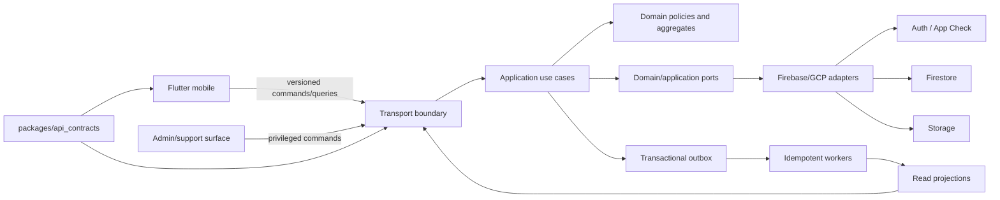

# Recharge Backend — Master Specification and Initial Architecture Audit

- ID: **BCK-01**
- Version: **0.4.83**
- Date: **2026-09-23**
- Spec status: **Review — local integrated foundation verified; dev/staging/production approvals pending**
- Runtime status: **Local R0/R1 platform, reference, security, identity and mobile-seam foundations Present; product/cloud runtime Absent**
- Accountable owner: **Platform Architecture owner**
- Review coordinator: **RechargeN / Product owner**
- Local R1 technical decision: **Accepted and verified locally — no cloud authority**
- Production Security/Legal/readiness approval: **Pending**
- Markets: **Latvia first; Estonia and Lithuania prepared but disabled independently**
- Runtime effect of this revision: **none**
- Canonical repository path: `docs/product/RECHARGE_BACKEND_MASTER_SPEC.md`
- Link base: all relative links resolve from repository directory
  `docs/product/`, even when a review copy is distributed through Downloads

## 0. Changelog

### v0.4.83 — 2026-09-23

- defines item 6 as a sequence of independently approved product-domain
  slices over the verified items 1–5 foundation, not a monolithic backend
  authorization;
- selects BCK07-LOCAL-01 as the next disabled local/test-only boundary while
  explicitly retaining all mobile/UI, Firebase, cloud, deployment and
  activation exclusions;
- reconciles BCK-03 v0.3.20, BCK-04 v0.4.31, BCK-05 v0.2.37, BCK-20 v0.2.29
  and BCK-02 v2.4.91 status without changing the 146 architecture AC.

### v0.4.82 — 2026-09-23

- records the completed local Stage 8 integration verification for items 1–5
  against BCK-02 v2.4.90 without expanding product or cloud authority;
- verifies typed platform contracts, reference data, Security/Privacy,
  Identity/Publisher, in-memory/Emulator repositories and the reversible
  mobile seam as one bounded local chain;
- records green backend unit/contract/integration/Emulator/Rules evidence,
  16 focused mobile tests, analyzer 0, all 680 Flutter tests, zero boundary
  violations and a clean diff;
- keeps dev cloud, staging/production, independent/qualified reviews,
  product remote cutover and the separately planned item 6 closed.

### v0.4.81 — 2026-09-21

- completes the technical-approval preflight for BCK-01/03/04/05/20 against
  the sole exact BCK-02 v2.4.87 R1 manifest;
- separates local implementation acceptance from production Security/Privacy,
  qualified Legal, cloud and market-readiness approval;
- confirms one backend structure, one schema authority, five single-writer
  collections, ordered migration/rollback and default-off/no-cloud controls;
- prepares exact owner wording without approving or executing R1.

### v0.4.80 — 2026-09-21

- records three independent Stage 9 readiness verdicts without collapsing
  local implementation, dev cloud and staging/production into one status;
- marks the exact R1 local foundation Ready with controls while retaining
  per-slice approval for product modules and Flutter adapters;
- records dev cloud and staging/production as Not Ready with exact missing
  owner inputs, external reviews and executable evidence;
- treats readiness as an assessment, not an instruction to create files,
  provision Firebase, deploy, push or merge.

### v0.4.79 — 2026-09-21

- completed the Stage 8 final audit across all 22 canonical BCK documents;
- reconciled presence, links, versions/statuses, AC sequences, writers,
  lifecycle enums, Money/time/market, authority, portability, decisions,
  runtime maps and evidence honesty;
- normalized internal lifecycle enums without changing their meaning, owner or
  gate and created no separate audit-wrapper document;
- preserved documentation-only status and every G1/runtime/Firebase/deployment
  authorization boundary.

### v0.4.78 — 2026-09-21

- completed the Stage 7 executable implementation-map contract for exact R1;
- reconciled the requested top-level `platform/shared/contracts/config/security`
  layout with existing R0 and disabled RAW-C compatibility files;
- assigned every planned R1 file an action, owner, layer, dependency boundary,
  test, migration step and rollback treatment through BCK-02;
- created no source/schema/config/Rules/infra file and granted no G1/R1,
  Firebase, provisioning, deployment, activation, push or merge authority.

### v0.4.77 — 2026-09-21

- completed the Stage 6 Latvia/Baltics and compliance-hardening contract;
- defined `environment × market × capability` as the only activation unit and
  separated MarketConfig, compliance evidence and operational release state;
- made locale/copy, currency/timezone, residency, provider, age, UGC/DSA,
  retention/DSR, support, rollout and rollback evidence explicit per market;
- preserved one shared architecture with independent LV/EE/LT gates and no
  runtime, Firebase, deployment, Legal verdict or market activation authority.

### v0.4.76 — 2026-09-21

- completed the Stage 5 Planning and gated-integration contract across BCK-10,
  BCK-11 and BCK-15/16/17 v0.3;
- preserved separate Scenario/Quick Plan/Route aggregates and defined typed
  planning sync, GPX/Media, AI/provider and financial boundaries;
- kept AI/Provider default-off and Payments hard-blocked by a new Accepted ADR;
  no runtime, network, credentials, PSP or activation authority was added.

### v0.4.75 — 2026-09-20

- completed the Stage 4 user/operational-domain contract across BCK-09,
  BCK-12/13/14/19/21/22;
- fixed one effect identity/receipt/reconciliation boundary for Booking,
  Notifications, Media, Admin repair, Analytics and Trust & Safety;
- separated source truth, audit, product analytics, delivery attempts and
  privacy retention while preserving all runtime and specialist gates.

### v0.4.74 — 2026-09-20

- completed the Stage 3 technical contract chain across BCK-06 v0.3,
  BCK-18 v0.6, BCK-07 v0.3 and BCK-08 v0.3;
- fixed authority and revision handoffs from Identity through publication and
  Catalog/Discover to typed mobile state;
- defined safe remote-to-local/mock rollback without allowing local state to
  impersonate server authority;
- retained all OD, specialist, schema, Firebase, execution and activation gates.

### v0.4.73 — 2026-09-20

- introduced the Stage 2 entity normalization contract inherited by all 22 BCK
  specifications;
- fixed one canonical vocabulary for identity, publisher, market/locale,
  money/time, content revisions, Booking/availability/provider results and
  runtime states;
- made ownership, lifecycle, security, persistence, operations and evidence
  dimensions mandatory for every authoritative record family;
- granted no runtime, Firebase, deployment or activation authority.

### v0.4.72 — 2026-09-20

- closed the D1 technical design boundary across BCK-01/03/04/05/20 without
  claiming independent, qualified Legal/Privacy, runtime or cloud evidence;
- fixed one canonical backend module layout, language-neutral JSON Schema
  source policy, transport profiles, command/query/event/error semantics and
  cross-domain idempotency/version/minimum-client rules;
- recorded OD-07 as Accepted, OD-09 and OD-10 as Accepted technical contracts
  with retained runtime/content/legal gates, and OD-11 as a Proposed
  market/surface policy contract whose unresolved scopes remain disabled;
- fixed logical environment names and provider-project naming rules while
  keeping project IDs, credentials, provisioning and deployment absent;
- made the closed D1 boundary sufficient only to prepare an exact R1 slice;
  G1, R1 execution, Firebase resources and production processing remain blocked.

### v0.4.71 — 2026-09-20

- completed the canonical documentation set physically: BCK-10, BCK-11,
  BCK-15, BCK-16, BCK-17 and BCK-22 v0.1 are now Present with 60 sequential
  acceptance criteria each;
- reconciled the registry to **22/22 BCK specifications physically Present**
  without promoting any new document beyond Draft or changing an existing
  Accepted/Approved decision;
- kept BCK-17 explicitly blocked pending a new Accepted Payments ADR and kept
  every AI/provider/payment/Trust & Safety runtime, Firebase, deployment and
  market-activation gate closed;
- updated BCK-02 to factual revision v2.4.77 and BCK-02-A1 to v1.18; no new
  review wrapper, coverage package or executable implementation was created.

### v0.4.70 — 2026-09-20

- prepared Batch F as one exact Product-owner response over the fifteen
  separately attributable Pending verdicts already frozen by Batch B–E;
- added an immutable B–E roll-up, atomic docs-only reconciliation plan and
  post-owner specialist/qualified review queue;
- retained all fifteen verdicts as Pending until exact Batch F acceptance;
- reconciled BCK-01 review v1.33, BCK-02 v2.4.76, D1 review v1.36, ledger
  v1.35 and workbook v1.31 without OD/BCK/D1/G1 or runtime promotion.

### v0.4.69 — 2026-09-20

- prepared exact BCK-03 parent-review routing, preserving Booking-v1
  Acceptance and every Deferred protected gate;
- prepared a fourteen-row Security cross-boundary assignment manifest at
  0/14 assigned and 0/14 verdicts;
- prepared the four-parent Approval preflight and Owner Batch E as three
  separate Pending coordination verdicts;
- reconciled BCK-03 v0.3.15, BCK-04/coverage v0.4.25/v0.3.25, D1 review
  v1.35, ledger v1.34 and workbook v1.30 without status promotion;
- retained BCK-01 Review, all parent Draft states, D1/G1 Blocked and runtime
  unauthorized.

### v0.4.68 — 2026-09-20

- prepared the OD-11 Product age-eligibility boundary without selecting a
  numeric age, guardian model or qualified Legal/Privacy conclusion;
- prepared a five-verdict BCK-05 Operations specialist package and a factual
  internal blocker/work-order matrix;
- froze Owner Batch D as three separate Pending verdicts while Batch B/C
  remain separately Pending;
- reconciled BCK-04/coverage v0.4.24/v0.3.24, BCK-05/coverage v0.2.31,
  D1 review v1.34, ledger v1.33 and workbook v1.29;
- retained all OD/BCK/D1/G1, market, schema, Firebase and runtime gates.

### v0.4.67 — 2026-09-20

- reconciled completed EXT-A–D technical evidence, corrected OD-10 v0.2
  semantics and BCK-20/coverage v0.2.22;
- recorded Batch B/C as prepared exact owner-review inputs only, with all nine
  bounded verdicts still Pending;
- prepared mandatory-copy Product classification, four-lane external-review
  handoff and one factual D1/G1 closure matrix;
- retained BCK-01 Review, BCK-03/04/05/20 Draft, OD-10 Proposed, OD-11 Open,
  BCK20-OD-02/05 Open, D1/G1 Blocked, all markets disabled and every
  executable/cloud gate closed.

### v0.4.66 — 2026-09-18

- recorded BCK20-OD02-EXT-EV-PLAN-DEC-01 and EXT-G0 documentation plan;
- reconciled BCK-20/coverage v0.2.18 while retaining EXT-G1–G6, all markets,
  external evidence, independent/qualified and implementation gates closed;
- created no network, download, parser, repository-data, ingestion, schema or
  runtime authority.

### v0.4.65 — 2026-09-18

- recorded BCK20-OD02-SRC-REC-DEC-01 and accepted 23 internal source records
  as documentation inputs plus the eight-source external evidence work queue;
- reconciled BCK-20/coverage v0.2.17 while retaining every market disabled and
  external/source-copy/independent/qualified evidence incomplete;
- preserved BCK20-OD-02/05 Open, OD-10 Proposed, BCK-20 Draft,
  BCK20-OD-03 Deferred and all network/schema/runtime gates.

### v0.4.64 — 2026-09-17

- recorded BCK20-OD02-SRC-AUTH-DEC-01 and bounded acceptance of the frozen
  source-authority design matrix;
- reconciled BCK-20/coverage v0.2.16 while retaining actual source records,
  external-source license/terms and pinned ingestion evidence as incomplete;
- preserved zero independence, absent qualified evidence, BCK20-OD-02/05
  Open, OD-10 Proposed, BCK-20 Draft and all implementation gates.

### v0.4.63 — 2026-09-17

- recorded BCK20-OD02-V04-COMB-DEC-01 and four separate exact-v0.4
  combined-owner design verdicts with zero independence;
- reconciled BCK-20/coverage v0.2.15 while retaining source-authority,
  independent Security/Privacy and applicable qualified Legal evidence as
  Pending;
- retained BCK20-OD-02/05 Open, OD-10 Proposed, BCK-20 Draft and
  BCK20-OD-03 Deferred;
- created no provider, schema, IAM/runtime, Firebase, deployment, activation,
  push or merge authority.

### v0.4.62 — 2026-09-17

- recorded BCK20-OD02-MS-PRE-DEC-01 and workflow v0.4 with seven
  Mobile/Security documentation corrections;
- reconciled BCK-20/coverage v0.2.14 and separate Proposed Mobile and
  Security/Privacy review records;
- retained Product/Content v0.3 verdicts only as historical exact-hash evidence
  pending v0.4 revalidation;
- retained BCK20-OD-02/05 Open, OD-10 Proposed, BCK-20 Draft and
  BCK20-OD-03 Deferred;
- created no provider, schema, runtime, Firebase, deployment, push or merge
  authority.

### v0.4.61 — 2026-09-17

- recorded two separate effective Product Localization and Content
  combined-owner verdicts through BCK20-OD02-PC-COMB-DEC-01;
- reconciled BCK-20/coverage v0.2.13 and Product/Content review package v0.3;
- disclosed shared ownership and absent independence while retaining Mobile,
  Security/Privacy, applicable Legal and every D1/G1/runtime gate;
- retained BCK20-OD-02/05 Open, OD-10 Proposed and BCK-20 Draft;
- created no source-authority content, provider, schema, Firebase, deployment,
  push or merge authority.

### v0.4.60 — 2026-09-17

- recorded BCK20-OD02-PC-PRE-DEC-01 and integrated F-001–F-008 as
  documentation-only corrections in workflow v0.3 and BCK-20/coverage
  v0.2.12;
- re-froze Product/Content review package v0.2 while both specialist
  signatures remain Pending and unnamed;
- retained BCK20-OD-02 Open, OD-10 Proposed, BCK-20 Draft and every
  specialist/Legal/D1/G1/runtime gate;
- created no source-authority content, provider, schema, Firebase,
  deployment, push or merge authority.

### v0.4.59 — 2026-09-16

- recorded BCK20-OD02-DEC-01 and the amended technical translation-governance
  workflow v0.2 in BCK-20/coverage v0.2.11;
- reconciled BCK-01-REV-01 v1.19, D1 records, BCK-02 v2.4.63 and
  BCK-02-A1 v1.10;
- retained BCK20-OD-02 Open, BCK-20 Draft, OD-10 Proposed and every
  specialist/Legal/D1/G1/runtime gate;
- created no provider, schema, Firebase, deployment, push or merge authority.

### v0.4.58 — 2026-09-16

- recorded BCK20-OWN-DEC-01 and integrated the BCK-20 decision triage in
  BCK-20/coverage v0.2.10;
- reconciled BCK-D1-REV-01 v1.22, ledger v1.20, workbook v1.18, decision
  package v0.10, BCK-02 v2.4.62 and BCK-02-A1 v1.9;
- retained BCK-20 Draft, OD-10 Proposed, BCK20-OD-02/05 Open and every
  specialist/Legal/D1/G1/runtime gate;
- created no schema, Firebase resource, deployment, push or merge authority.

### v0.4.57 — 2026-09-15

- recorded BCK04-OD01-DEC-01 and integrated twenty threat-model amendments in
  BCK04-OD01-TM-01 v0.2 and BCK-04 v0.4.23;
- reconciled BCK-03 v0.3.14, BCK-05 v0.2.30, BCK-18 v0.5, BCK-20 v0.2.9,
  BCK-D1-REV-01 v1.21, ledger v1.19, workbook v1.17, decision package v0.9,
  BCK-02 v2.4.61 and BCK-02-A1 v1.8;
- retained BCK04-OD-01 Proposed pending independent Security/Privacy and
  required cross-boundary confirmations, plus all Legal/D1/G1/runtime gates;
- created no runtime, Firebase resource, credential, deployment, push or merge
  authority.

### v0.4.56 — 2026-09-12

- recorded BCK04-SEC-DEC-01 and integrated fourteen technical documentation
  amendments in BCK-04 v0.4.22;
- reconciled BCK-03 v0.3.13, BCK-05 v0.2.29, BCK-18 v0.4, BCK-20 v0.2.8,
  BCK-D1-REV-01 v1.20, ledger v1.18, workbook v1.16, BCK-D1-DEC-01 v0.8,
  BCK-02 v2.4.60 and BCK-02-A1 v1.7;
- retained BCK-04 Draft, BCK04-OD-01/09, OD-11, independent/qualified Legal,
  D1/G1-G7/R1 and product/cloud runtime blockers;
- created no runtime, Firebase resource, deployment, push or merge authority.

### v0.4.55 — 2026-09-09

- recorded BCK03-MOB-REV-01 v0.2 and BCK03-MOB-DEC-01 v0.1 for the
  BCK-03 Mobile boundary only;
- advanced BCK-03 to Draft v0.3.12 and closed the Mobile Architecture v3.1.1
  request/idempotency wording conflict while independent evidence remains open;
- reconciled BCK-04 v0.4.21, BCK-05 v0.2.28, BCK-20 v0.2.7, BCK-18 v0.3,
  BCK-01-REV-01 v1.15, BCK-D1-DEC-01 v0.7, BCK-D1-REV-01 v1.19,
  ledger v1.17, workbook v1.15, BCK-02 v2.4.59 and roadmap v1.6;
- retained D1/G1 and every product/cloud runtime gate.

### v0.4.54 — 2026-09-08

- recorded BCK03-SEC-REV-01 v0.2 and BCK03-SEC-DEC-01 v0.1: bounded
  D1-SIG-SEC accepts only the BCK-03 boundary with ten required amendments;
- advanced BCK-03 to Draft v0.3.11 while Mobile/independent evidence remains
  Pending and BCK-04/Legal statuses are not promoted;
- reconciled BCK-04 v0.4.20, BCK-05 v0.2.27, BCK-20 v0.2.6,
  BCK-01-REV-01 v1.14, BCK-D1-DEC-01 v0.6, BCK-D1-REV-01 v1.18,
  ledger v1.16, workbook v1.14, BCK-02 v2.4.58 and roadmap v1.5;
- retained BCK-01 Review and every product/cloud runtime gate.

### v0.4.53 — 2026-09-08

- recorded BCK03-OPS-REV-01 v0.2 and BCK03-OPS-DEC-01 v0.1:
  D1-SIG-OPS accepts the BCK-03 boundary with required amendments;
- advanced BCK-03 to Draft v0.3.10 while Security/Mobile/independent evidence
  remains Pending;
- reconciled BCK-04 v0.4.19, BCK-05 v0.2.26, BCK-20 v0.2.5,
  BCK-01-REV-01 v1.13, BCK-D1-DEC-01 v0.5, BCK-D1-REV-01 v1.17,
  ledger v1.15, workbook v1.13, BCK-02 v2.4.57 and roadmap v1.4;
- retained BCK-01 Review and every product/cloud runtime gate.

### v0.4.52 — 2026-09-08

- recorded BCK-D1-OWN-A-DEC-01 v0.1 and BCK-03 v0.3.9 owner review as
  Accept with required amendments while keeping BCK-03 Draft;
- preserved Accepted Booking-v1 API-DEC-01/03 and deferred only their broader
  platform scope plus API-DEC-02/04/05; OD-09 remains Proposed;
- reconciled BCK-04 v0.4.18, BCK-05 v0.2.25, BCK-20 v0.2.4, their coverage
  matrices, BCK-01-REV-01 v1.12, BCK-D1-DEC-01 v0.4,
  BCK-D1-REV-01 v1.16, ledger v1.14 and workbook v1.12;
- advanced BCK-02 traceability to v2.4.56 and BCK-02-A1 to Draft v1.3;
- retained BCK-01 Review, all other Pending/Inconclusive statuses, G1-G7/R1
  blocked and product/cloud runtime Absent.

### v0.4.51 — 2026-09-07

- reconciled D1-B platform chain: BCK-03 v0.3.8, BCK-04 v0.4.17,
  BCK-05 v0.2.24, BCK-20 v0.2.3 and their current coverage matrices;
- updated BCK-01-REV-01 v1.11, BCK-D1-DEC-01 v0.3,
  BCK-D1-REV-01 v1.15, BCK-D1-SIG-01 v1.13 and workbook v1.11;
- advanced BCK-02 traceability to v2.4.55 and BCK-02-A1 to Draft v1.2;
- retained BCK-01 Review, all child Draft/Pending/Inconclusive statuses,
  G1-G7/R1 blocked and product/cloud runtime Absent;
- changed no runtime, Firebase, contract, ADR, deployment or activation.

### v0.4.50 — 2026-09-06

- reconciled BCK-09 v1.13, ECL-03C v1.11, coverage v1.12, API review v0.10,
  specialist package v0.12 and RAW-C v0.3 after exact local and hosted evidence;
- recorded exactly five disabled Emulator-only Booking v1 callable exports and
  nine operational collections without claiming deployment or activation;
- retained all nine BCK-09 specialist signatures as Pending and G1-G7/R1 as
  blocked or absent;
- advanced BCK-02 factual traceability to v2.4.54 and BCK-02-A1 to Draft v1.1;
- fixed the physical-backend readiness wording so the existing bounded R0 and
  RAW-C exceptions are not misrepresented as production/backend readiness.

### v0.4.49 — 2026-08-28

- registered BCK09-API-RAW-B-01 v0.1 as Done after 19/19 disposable Emulator
  raw-body vectors passed on Ubuntu and Windows at `e043218`;
- reconciled BCK-09 v1.11, ECL-03C v1.9, coverage v1.10, API review v0.8,
  specialist package v0.10 and BCK-03 v0.3.7 without granting a signature;
- registered BCK09-API-RAW-C-01 v0.1 as Proposed and retained product runtime,
  Firestore/Admin access, callable exports, Firebase changes, deployment and
  activation as blocked/Absent;
- advanced BCK-02 factual traceability to v2.4.53.

### v0.4.48 — 2026-08-28

- registered hosted runs `33127684319` and `33127686757` as exact Node
  22.23.2 Ubuntu/Windows evidence and promoted BCK09-API-PAR-01 v0.3 to Done;
- reconciled BCK-09 v1.10, ECL-03C v1.8, coverage v1.9, API review v0.7,
  specialist package v0.9 and BCK-03 v0.3.6 without granting a signature;
- retained callable raw-body feasibility, independent evidence, Firebase,
  deployment, product runtime and production activation as blocked/Absent;
- advanced BCK-02 factual traceability to v2.4.52.

### v0.4.47 — 2026-08-28

- registered commit `a7296f5`, BCK09-API-PAR-01 v0.2 and
  `api_contracts` v0.3.0 as contracts/test-only Booking parity evidence;
- reconciled BCK-09 v1.9, ECL-03C v1.7, coverage v1.8, API review v0.6,
  specialist package v0.8 and BCK-03 v0.3.5 without granting a signature;
- closed the TypeScript/query/hash contract gap only; retained Node 22,
  callable raw-body feasibility, independent evidence, Firebase, deployment,
  product runtime and production activation as blocked/Absent;
- advanced BCK-02 factual traceability to v2.4.51.

### v0.4.46 — 2026-08-27

- registered BCK09-API-NAMED-DEC-01 v0.2 as the Accepted Booking-v1
  API-DEC-01/03 documentation decision with explicit no-runtime/Firebase controls;
- reconciled BCK-09 v1.8, ECL-03C v1.6, coverage v1.7, API review v0.5 and
  specialist package v0.7 while retaining all nine signatures Pending;
- kept TypeScript/query/hash/runtime parity, independent evidence, Firebase,
  deployment and production activation blocked; advanced BCK-02 to v2.4.50.

### v0.4.45 — 2026-08-27

- registered BCK09-API-CORR-01 v0.3 as Done after 13/13 package tests,
  independent 14 valid / 38 invalid vectors, clean analyzer/boundaries and a
  green 664/664 mobile suite;
- kept BCK-09 v1.7, ECL-03C v1.5 and all specialist/API/runtime blockers in
  Review/Hold without claiming Firebase or product backend authority;
- advanced BCK-02 factual traceability to v2.4.49.

### v0.4.44 — 2026-08-27

- registered `api_contracts` v0.2.1 and BCK09-API-CORR-01 v0.3 as verified
  pre-runtime command Schema/Dart/D12 correction in Review; unrelated Route
  golden prevents repository Done;
- reconciled BCK-09 v1.7, ECL-03C v1.5, coverage v1.6, API review v0.4 and
  specialist package v0.6 without recording a specialist signature;
- kept API-DEC-01/03, TypeScript/query/runtime parity, Firebase, deployment and
  production activation blocked;
- advanced BCK-02 factual traceability to v2.4.48.

### v0.4.43 — 2026-08-27

- registered ECL03-D12 and parent ECL-03 v1.3 as Accepted/Approved docs-only
  request-ID semantics;
- reconciled BCK-09 v1.6, ECL-03C v1.4, coverage v1.5 and API review chain
  without treating semantic acceptance as contract/runtime evidence;
- kept BCK09-API-CORR-01, named API decisions, specialist signatures,
  Firebase, deployment and production runtime blocked;
- advanced BCK-02 factual traceability to v2.4.47.

### v0.4.42 — 2026-08-27

- registered BCK09-API-DEC-01 v0.1 and BCK09-API-CORR-01 v0.1 as the
  Product-selected API target and separately gated contract-correction plan;
- reconciled BCK-09 v1.5, ECL-03C v1.3, coverage v1.4, API review v0.2 and
  specialist package v0.4 without recording any named specialist signature;
- kept command-schema correction, ECL03-D12, API-DEC-01/03, parity evidence,
  Firebase, deployment and production runtime blocked;
- advanced BCK-02 factual traceability to v2.4.46.

### v0.4.41 — 2026-08-26

- registered BCK09-API-REV-01 v0.1 and BCK09-REV-01 v0.3 as the first
  specialist-phase evidence without recording a named signature;
- recorded API technical Hold for the command-schema/DTO divergence, missing
  atomic request-attempt binding, API-DEC-01/03, request-ID format decision and
  absent TypeScript/query parity;
- kept BCK-09/ECL-03C Review, all nine specialist signatures Pending and every
  product/Firebase/deployment/production gate blocked;
- advanced BCK-02 factual traceability to v2.4.45.

### v0.4.40 — 2026-08-26

- registered BCK-09 v1.4, ECL-03C v1.2, BCK-09-PRE v1.2 and specialist
  review package v0.2 after resolving TR-09..11;
- replaced unspecified duplicate-active evidence with one deterministic atomic
  active key, reconciled BCK-19 repair ownership and made disabled outbox
  obligations permanently non-replayable;
- kept all nine specialist signatures Pending, BCK-09/ECL-03C Review and every
  Firebase/product-runtime/production/deployment gate blocked;
- advanced BCK-02 traceability to v2.4.44.

### v0.4.39 — 2026-08-26

- recorded BCK09-DEC-01 v0.2: the Product owner accepted
  `BCK09-A1-STAGED-FREE-BOOKING-v1` with controls;
- registered BCK-09 v1.3 and BCK-09-PRE v1.1 with six bounded Accepted design
  dispositions and four Deferred/Open decisions;
- kept BCK-09 Review, ECL-03C Review and all specialist, Firebase, product
  runtime, production-data, deployment and activation gates blocked;
- advanced BCK-02 traceability to v2.4.43.

### v0.4.38 — 2026-08-26

- registered reconciled BCK-09 v1.2 and BCK-09-PRE v1.0 as Review/Present with
  runtime Absent and 22/22 mandatory coverage;
- preserved Booking v1 wire semantics, exact ECL-03C record names and the
  bounded ECL-03C versus conditional ECL-03D–H stage boundary;
- reconciled Content, Discover, Notifications, Operations and Admin single
  writers around Booking without promoting Draft/Review dependencies;
- kept all ten BCK09 decisions, OD-09/OD-11, Firebase, product runtime,
  deployment and `main` merge authority blocked;
- advanced BCK-02 traceability to v2.4.42.

### v0.4.37 — 2026-08-26

- registered BCK-21 v0.2 and BCK-21-PRE v0.2 as Review/Present with runtime
  Absent;
- separated product analytics from BCK-05 telemetry, domain/audit facts and
  BCK-22 enforcement authority;
- recorded current 66 emitted literal names versus 27 catalog definitions,
  unresolved owners and unsafe identifier debt as migration blockers;
- kept OD-05, destination, retention/DSR, contracts, IAM and runtime blocked;
- advanced BCK-02 traceability to v2.4.41.

### v0.4.36 — 2026-08-26

- registered BCK-12 v0.2 and BCK-12-PRE v0.2 as Review/Present with runtime
  Absent;
- preserved User Library and Reviews as separate bounded aggregates;
- fixed the explicit Visit History, typed Favorite, review source and
  rebuildable rating-projection boundaries;
- kept BCK-22 cases, Firebase, migration and runtime blocked;
- advanced BCK-02 traceability to v2.4.40.

### v0.4.35 — 2026-08-26

- added BCK-19 v0.2 Review and its v0.2 22/22 coverage evidence as the
  single-writer Admin/Support case, privileged-read-audit and repair-workflow
  contract;
- preserved Identity/IAM, owning-domain, Privacy, T&S, Notifications and
  Platform Operations authority and made direct data editing/impersonation
  explicitly fail-closed;
- advanced traceability to BCK-02 v2.4.39 while ten BCK19 decisions, domain
  repair commands, staff access, RUN-03, Firebase and runtime remain absent.

### v0.4.34 — 2026-08-25

- added BCK-13 v0.2 Review and its v0.2 22/22 coverage evidence as the
  single-writer inbox/preferences/push-registration/delivery contract;
- separated source lifecycle, inbox/read state and channel attempt, made push
  a privacy-minimized query hint and kept email disabled while OD-02 is Open;
- advanced traceability to BCK-02 v2.4.38 while OD-02/09/10, ten BCK13
  decisions, contracts, FCM/email, migration, Firebase and runtime remain
  unresolved.

### v0.4.33 — 2026-08-25

- added BCK-08 v0.2 Review and its v0.2 22/22 coverage evidence as the one-writer
  Catalog/Search/Feed/Map/Details/public-availability projection contract;
- made shared query fingerprint, compatible projection-set revision, typed
  map/feed membership reconciliation and data freshness normative;
- advanced traceability to BCK-02 v2.4.37 while OD-01/03, BCK-07 runtime,
  contracts, indexes, migration, Firebase and production remain unresolved.

### v0.4.32 — 2026-08-25

- added BCK-07 v0.2 Review and its v0.2 22/22 coverage evidence as the single
  Content publication lifecycle/current-revision authority;
- fixed the canonical ten-type registry around Scenario, left Quick Plan
  legacy-read/private only and separated source-domain, Media and Catalog writers;
- advanced traceability to BCK-02 v2.4.36 while OD-03/10/11, dependency
  Approval, contracts, migration, Firebase and runtime remain unresolved.

### v0.4.31 — 2026-08-25

- added BCK-14 v0.2 Review and its v0.2 22/22 coverage evidence as the
  single-writer Media asset/upload/object/variant/delivery contract;
- separated Media readiness from the still-absent BCK-07 content attachment
  and publication lifecycle, keeping integration fail-closed;
- advanced traceability to BCK-02 v2.4.35 while all Storage, contracts,
  workers, migration, provisioning, runtime and production gates remain absent.

### v0.4.30 — 2026-08-25

- added BCK-18 v0.2 Review and v0.2 coverage/reconciliation evidence as the
  typed mobile/backend seam and import-orchestration contract;
- recorded the BCK-03 split-key reconciliation, Mobile v3.1 AC-42 erratum and
  blocking M2 Money prerequisite without changing mobile runtime;
- advanced traceability to BCK-02 v2.4.34 while OD-04/08/10, BCK-18 Approval,
  contracts, adapters, Firebase, migration and all R3 gates remain unresolved.

### v0.4.29 — 2026-08-25

- added BCK-06 v0.2 Review and its v0.3 22/22 coverage/reconciliation evidence
  as the first D2 authority specification;
- preserved OD-08/OD-11, session, verification, capability, retention,
  Legal/Privacy, BCK-18 and every executable R2 gate as unresolved;
- advanced traceability to BCK-02 v2.4.33 without Firebase, product backend,
  mobile runtime, deployment, push or `main` merge authority.

### v0.4.28 — 2026-08-25

- recorded BCK05-OD-07 Accepted at `BCK05-REL-A1-DUAL-PROV-v1` with controls
  through exact BCK05-OD07-DEC-01 v0.2 owner evidence;
- retained BCK-04/BCK-05 Draft, complete D1/G1, separately Approved release
  R0/R1 and every executable/cloud/product-runtime gate;
- advanced traceability to BCK-02 v2.4.32, BCK-04 v0.4.16 and BCK-05 v0.2.23
  without workflow, repository/cloud mutation, deployment or `main` merge
  authority.

### v0.4.27 — 2026-08-25

- added decision-ready BCK05-OD-07 release/provenance candidate
  `BCK05-REL-A1-DUAL-PROV-v1` and its unsigned owner-decision contract;
- retained BCK05-OD-07 Proposed plus BCK-04/BCK-05 Draft, complete D1/G1,
  exact R0/R1 authorization and all executable/cloud/product-runtime gates;
- advanced traceability to BCK-02 v2.4.31, BCK-04 v0.4.15 and BCK-05 v0.2.22
  without workflow, repository/cloud mutation, deployment or `main` merge
  authority.

### v0.4.26 — 2026-08-24

- recorded BCK05-OD-02 Accepted at `BCK05-IAM-A1-ENV-WIF-v1` with controls
  through the exact BCK05-OD02-DEC-01 v0.2 owner verdict;
- retained BCK-04/BCK-05 Draft, complete D1/G1, exact R1 authorization and all
  executable IAM/secret/product-runtime evidence gates;
- advanced traceability to BCK-02 v2.4.30, BCK-04 v0.4.14 and BCK-05 v0.2.21
  without provisioning or `main` merge authority.

### v0.4.25 — 2026-08-24

- added decision-ready IAM/workload-identity candidate
  `BCK05-IAM-A1-ENV-WIF-v1` and unsigned BCK05-OD02-DEC-01 owner contract;
- preserved BCK05-OD-02 Proposed, BCK-04/BCK-05 Draft, D1/G1/R1 and every
  GitHub/GCP/IAM/secret/product-runtime gate;
- advanced traceability to BCK-02 v2.4.29, BCK-04 v0.4.13 and BCK-05 v0.2.20
  without provisioning or `main` merge authority.

### v0.4.24 — 2026-08-24

- recorded OD-07 Accepted at `OD07-A1-EU-MR-v1` with controls through the
  exact OD07-DEC-01 v0.2 owner verdict and evidence v0.6;
- retained BCK-04/BCK-05 Draft, qualified production Legal/Privacy review,
  complete D1/G1, exact R1 approval and all cloud/product runtime gates;
- advanced traceability to BCK-02 v2.4.28, BCK-04 v0.4.12 and BCK-05 v0.2.19
  without provisioning or merge authority.

### v0.4.23 — 2026-08-24

- added review-ready `OD07-A1-EU-MR-v1` evidence and unsigned OD07-DEC-01,
  including exact per-resource locations, Standard/Enterprise rationale,
  global/US-service disclosure, thresholds and replacement/rollback boundary;
- retained OD-07 Proposed, qualified production Legal/Privacy review, complete
  D1/G1, R1 and all cloud/product runtime as blocked or absent;
- advanced traceability to BCK-02 v2.4.27, BCK-04 v0.4.11 and BCK-05 v0.2.18.

### v0.4.22 — 2026-08-24

- recorded `BCK05-OD-01` Accepted at baseline v0.3.3 with controls through the
  exact `BCK05-OD01-DEC-01 v0.2` owner verdict;
- retained BCK-05 Draft, other operations decisions, complete D1/G1, R1 and
  product/cloud runtime as blocked or unchanged;
- D1 traceability updated to BCK-02 v2.4.26 and BCK-05 v0.2.17; BCK-01
  remains Review.

### v0.4.21 — 2026-08-24

- reconciled bounded R0 Pass across the current D1 review, sign-off and owner
  workbook instead of preserving the pre-execution snapshot as current fact;
- added `BCK05-OD01-DEC-01` as a Review owner-decision candidate without
  accepting OD-01 or opening G1/R1;
- D1 traceability updated to BCK-02 v2.4.25 and BCK-05 v0.2.16; BCK-01
  remains Review and product/cloud runtime remains Absent.

### v0.4.20 — 2026-08-24

- recorded bounded R0 Pass after explicit owner acceptance of
  `BCK-R0-TCH-ADV-01` with expiring demo-only/no-cloud controls;
- retained BCK05-OD-01 as Proposed, BCK-05 as Draft and product/cloud runtime,
  R1/G1, credentials, provisioning and deployment as absent/blocked;
- D1 traceability updated to BCK-02 v2.4.24 and BCK-05 v0.2.15; BCK-01
  remains Review.

### v0.4.19 — 2026-08-24

- recorded successful hosted R0 parity on `ubuntu-24.04` and `windows-2025`
  without claiming product/backend or cloud runtime;
- retained the Moderate-advisory disposition as the remaining R0 Pass blocker;
- D1 traceability updated to BCK-02 v2.4.23 and BCK-05 v0.2.14; BCK-01
  remains Review.

### v0.4.18 — 2026-08-24

- reconciled the Approved and locally executed R0 tooling scaffold without
  claiming product/backend or cloud runtime;
- linked exact local build/emulator/Rules/Terraform/reproducibility evidence
  and preserved hosted parity plus Moderate-advisory disposition as blockers;
- D1 traceability updated to BCK-02 v2.4.22 and BCK-05 v0.2.13; BCK-01
  remains Review.

### v0.4.17 — 2026-08-23

- added exact R0 full-SHA Action, runner and signed-archive Terraform evidence
  plus the formal unsigned approval decision record;
- rejected the unsigned reviewed Terraform Action without expanding scope;
- D1 traceability updated to BCK-02 v2.4.21 and BCK-05 v0.2.12; BCK-01
  remains Review and runtime remains Absent.

### v0.4.16 — 2026-08-23

- added BCK05-OD01-TCH-REV-01 technical pre-review and BCK-R0-TCH-01 exact
  local toolchain/emulator slice plan;
- recorded proposed exact SDK/JDK/lint/test candidates without converting
  technical pre-review into owner/security sign-off or R0 authorization;
- D1 traceability updated to BCK-02 v2.4.20 and BCK-05 v0.2.11; BCK-01 remains
  Review and runtime remains Absent.

### v0.4.15 — 2026-08-21

- added BCK05-OD01-TCH-01 as the dated Node.js 22, TypeScript/npm, Firebase
  CLI and Terraform candidate with deterministic build/emulator/IaC contracts;
- BCK05-OD-01 advances from Open to Proposed, while exact remaining pins,
  compatibility, owner/security and executable R0 evidence remain blocked;
- D1 traceability updated to BCK-02 v2.4.19 and BCK-05 v0.2.10; BCK-01 remains
  Review and runtime remains Absent.

### v0.4.14 — 2026-08-21

- added BCK05-OD02-IAM-01 and BCK05-OD07-REL-01 as complete Draft evidence for
  keyless workload identity, least privilege, provenance, promotion and
  component-aware rollback;
- BCK05-OD-02/07 advance from Open to Proposed, while exact claims/roles,
  toolchain/attestor, specialist and executable evidence remain blocked;
- D1 traceability updated to BCK-02 v2.4.18 and BCK-05 v0.2.9; BCK-01 remains
  Review and runtime remains Absent.

### v0.4.13 — 2026-08-21

- recorded the bounded Product-owner disposition for SLO v0.1, Cost v0.2 and
  Recovery v0.1 as stage-validation baselines;
- kept Operations/Security evidence conditions and Inconclusive Finance/Legal
  scopes explicit; no broader D1 specialist signature is inferred;
- D1 traceability updated to BCK-02 v2.4.17 and BCK-05 v0.2.8; OD-03/04/05
  remain Proposed, BCK-01 remains Review and runtime remains Absent.

### v0.4.12 — 2026-08-21

- added BCK05-NUM-REV-01 exact-version owner-review evidence for SLO, cost and
  recovery proposals;
- corrected recovery-retention cost amplification and exposed L3 budget,
  same-project recovery, representative RTO and Legal/Finance evidence gates;
- D1 traceability updated to BCK-02 v2.4.16 and BCK-05 v0.2.7; OD-03/04/05
  remain Proposed, BCK-01 remains Review and runtime remains Absent.

### v0.4.11 — 2026-08-21

- added independent `BCK05-OD03-SLO-01` and `BCK05-OD05-REC-01` evidence with
  numerical user-journey SLO/error budgets and record-family RPO/RTO/restore
  contracts;
- `BCK05-OD-03` and `BCK05-OD-05` advance from Open to Proposed; owner verdicts,
  representative stage/restore evidence, executable controls and runtime remain
  absent;
- D1 traceability updated to BCK-02 v2.4.15 and BCK-05 v0.2.6; BCK-01 remains
  Review and runtime remains Absent.

### v0.4.10 — 2026-08-21

- added BCK05-OD04-COST-01 with dated price anchors, reproducible workload/cost
  formulas, directional estimates and proposed EUR budget controls;
- `BCK05-OD-04` advances from Open to Proposed, while OD-07, owner/Finance/
  Operations verdict, EUR SKU/stage evidence, provisioning and runtime remain
  blocked;
- D1 traceability updated to BCK-02 v2.4.14 and BCK-05 v0.2.5;
- BCK-01 remains Review and runtime remains Absent.

### v0.4.9 — 2026-08-20

- added the ready-but-unexecuted incident tabletop exercise package with an
  honest blank execution/result record and 30 AC;
- `BCK04-OD-09`/`BCK05-OD-08` remain Proposed; no tabletop, owner, Legal,
  executable-route or runtime gate is closed by preparation alone;
- D1 traceability updated to BCK-02 v2.4.13, BCK-04 v0.4.10 and BCK-05 v0.2.4;
- BCK-01 remains Review and runtime remains Absent.

### v0.4.8 — 2026-08-20

- added shared Draft security/privacy incident-response evidence preserving the
  canonical SEV-1/2/3 vocabulary;
- BCK04-OD-09 and BCK05-OD-08 advance from Open to Proposed; owner, qualified
  Legal/Privacy, route/tabletop and runtime evidence remain absent;
- D1 traceability updated to BCK-02 v2.4.12, BCK-04 v0.4.9 and BCK-05 v0.2.3;
- BCK-01 remains Review and runtime remains Absent.

### v0.4.7 — 2026-08-20

- added full Draft threat-model evidence `BCK04-OD01-TM-01`;
- `BCK04-OD-01` is now Proposed, while owner verdict, independent review,
  BCK-04 Approval and runtime remain blocked;
- D1 traceability updated to BCK-02 v2.4.11 and BCK-04 v0.4.8;
- all other BCK/OD statuses and runtime authority are unchanged.

### v0.4.6 — 2026-08-20

- recorded the explicit combined-owner assignment for all D1 review roles;
- disclosed self-review/concentration risk and retained Pending verdicts plus
  the qualified Legal/Privacy evidence boundary;
- D1 traceability updated to BCK-02 v2.4.10, BCK-03 v0.3.3,
  BCK-04 v0.4.7, BCK-05 v0.2.2 and BCK-20 v0.2.2;
- BCK-01 remains Review, D1 exit remains blocked and runtime remains Absent.

### v0.4.5 — 2026-08-20

- completed D1-C technical pre-review and added the explicit
  [owner sign-off ledger](BACKEND_PLATFORM_D1_OWNER_SIGNOFF_LEDGER.md);
- removed the BCK-03/BCK-18 sequencing cycle and the OD-07
  evidence/provisioning cycle without weakening either gate;
- D1 traceability updated to BCK-02 v2.4.9, BCK-03 v0.3.2,
  BCK-04 v0.4.6, BCK-05 v0.2.1 and BCK-20 v0.2.1;
- every specialist remains unassigned/pending, so BCK-01 remains Review, D1
  exit remains blocked and runtime remains Absent.

### v0.4.4 — 2026-08-20

- added the D1 review evidence package and separate OD-07/09/10/11 evidence
  artifacts without changing their decision statuses;
- reconciled OD-11 consistently as Open: candidate constraints and Latvia's
  consent-law evidence do not select a Recharge account/feature age;
- D1 traceability updated to BCK-02 v2.4.8, BCK-03 v0.3.1,
  BCK-04 v0.4.5, BCK-05 v0.2 and BCK-20 v0.2;
- BCK-01 remains Review, D1 exit remains blocked and runtime remains Absent.

### v0.4.3 — 2026-08-20

- added accepted [D1 split-key reconciliation](BACKEND_PLATFORM_D1_DECISION_PACKAGE.md)
  and aligned ECL-03/BCK-09 with committed Booking v1 fixtures;
- D1 traceability updated to BCK-02 v2.4.7, BCK-03 v0.3,
  BCK-04 v0.4.4, BCK-05 v0.1.1 and BCK-20 v0.1.1;
- OD-07/09/10 remain Proposed, OD-11 remains Open, and D1 exit is still
  blocked by specialist/decision evidence;
- architecture, Review status and runtime authority are unchanged.

### v0.4.2 — 2026-08-20

- BCK-05 Operations v0.1 and BCK-20 Reference Data v0.1 are now tracked
  Draft/Present documents with runtime Absent;
- current-state and next-package text now reflects their real presence and
  remaining Review/Approval blockers;
- D1 traceability updated to BCK-02 v2.4.6, BCK-03 v0.2.4 and BCK-04 v0.4.3;
- target architecture, Review status and runtime semantics are unchanged.

### v0.4.1 — 2026-08-20

- entered `Review` after the Product owner assigned `RechargeN / Product
  owner` as the interim review coordinator across the required perspectives;
  combined review is sufficient only for Review entry and does not replace
  independent Security/Privacy, Legal or Operations approval before G1;
- current-state audit reconciled with tracked BCK-02 v2.4.5, BCK-03 v0.2.3,
  BCK-04 v0.4.2 and their exact spec/runtime evidence;
- non-Booking language-neutral schema paths are now explicitly conditional on
  Accepted `API-DEC-05`, matching BCK-03 instead of implying authorization;
- next package describes the actual Review sequence rather than asking to
  create BCK-03/BCK-04 again;
- added formal [BCK-01 reconciliation report](BACKEND_MASTER_RECONCILIATION_REPORT.md);
- architecture/runtime semantics remain unchanged; runtime effect is none.

### v0.4 — 2026-08-16

- reconciled internal §8/§17 gap: `Privacy Orchestration`, already owned by
  BCK-04 in bounded-module and authoritative-ownership tables, is now present
  in the target `modules/privacy_orchestration/` map;
- target root transport explicitly includes common middleware;
- documentation/runtime effect remains none.

### v0.3 — 2026-08-14

- повторно проверено фактическое состояние repository: BCK-02 v2.4 существует
  и Approved, Latvia/Baltics roadmap существует как Draft BCK-02-A1, BCK-09
  существует как Review v1.0; runtime всех трёх документов остаётся none/Absent;
- полезные уточнения промежуточной v0.2 перенесены без её ошибочных заявлений
  об отсутствующих документах: добавлены AGENTS/LAUNCH_STATUS, ADR 0016–0018 и
  фактическое local/mock Identity/Event groundwork;
- source priority заменён scope-aware reconciliation contract: repository
  instructions, architecture decisions, implementation status и delivery
  coordination больше не образуют ложную единую лестницу;
- authoritative ownership дополнен import, privacy orchestration, server flags,
  provider, AI и условным Payments authority;
- target `packages/api_contracts` сохраняет фактический `schema/<domain>/vN`
  layout; необоснованная миграция `schema/` → `schemas/` запрещена;
- gated AI/provider directories исключены из initial scaffold, а Payments
  directory запрещён до отдельного Accepted ADR и Approved slice;
- version-specific формулировки DoD/AC/unimplemented list исправлены на v0.3
  или `current revision`; добавлены AC-46–AC-52;
- runtime effect остаётся none; application/Firebase/backend runtime не создан.

### v0.2 — 2026-08-14 — rejected review copy

- не являлась канонической repository revision;
- ошибочно объявляла существующие BCK-02 v2.4, BCK-02-A1 и BCK-09
  отсутствующими и поэтому не принимается как источник истины;
- полезные изменения перенесены выборочно в v0.3 после повторной проверки.

### v0.1 — 2026-08-14

- выполнен первичный аудит repository/backend readiness;
- зафиксирована модель одного логического backend Recharge без создания
  монолитного domain-модуля;
- определены обязательные архитектурные слои, bounded modules и направления
  зависимостей;
- описаны target file map, authoritative ownership, data/projection boundaries,
  cross-cutting invariants и документационные пакеты;
- отделены принятые решения от открытых OD и от будущего runtime;
- сформированы Definition of Ready, Definition of Done и последовательные AC.

## 1. Verdict

Recharge нужен **один backend продукта**, но его нельзя реализовывать как один
неразделённый файл, одну Cloud Function, одну коллекцию или один универсальный
service.

Целевая модель:

```text
одна backend-платформа Recharge
  + одна identity/capability authority
  + один PublisherRef contract
  + один API/error/idempotency standard
  + один environment/security/operations baseline
  + один writer для каждого authoritative record type
  + изолированные bounded domain modules
  + отдельно построенные read projections
  + independently gated entrypoints/workers
```

На начальном масштабе Латвии и подготовке Балтии это должен быть **модульный
backend application на Firebase/GCP**, а не набор преждевременно выделенных
микросервисов. Модули разделяются контрактами, ownership и CI boundaries;
transport entrypoints и workers могут развёртываться независимо. Выделение
модуля в отдельный сервис допускается позднее только по измеримым причинам:
отдельный scaling profile, security boundary, availability objective,
ownership или cost profile — и только через новый Accepted ADR.

Нужен также не один гигантский документ, а система документации:

1. этот BCK-01 задаёт общую конструкцию и инварианты;
2. BCK-03–BCK-22 детализируют cross-cutting и domain-контракты;
3. RUN-01–RUN-06 описывают эксплуатацию фактически реализованной topology;
4. bounded executable slice разрешает конкретный runtime-код;
5. gates отдельно разрешают Emulator, staging, production cohort и GA.

## 2. Назначение и результат

BCK-01 отвечает на пять вопросов:

1. что именно считается единым backend Recharge;
2. из каких слоёв и bounded modules он состоит;
3. кто является authority и единственным writer каждого типа данных;
4. какие документы и решения обязательны до физической реализации;
5. как последовательно перейти от local/mock приложения к Latvia production и
   подготовить EE/LT без параллельных моделей.

После Approval документа команда должна иметь возможность проектировать
BCK-03, BCK-04, BCK-05 и BCK-20 независимо, не расходясь в module boundaries,
identity, IDs, time, money, market, API и ownership semantics.

### 2.1. Измеримый результат BCK-01

- у каждой capability есть ровно один owning module;
- у каждого authoritative record type есть ровно один writer;
- mobile, backend и shared-contract boundaries однозначны;
- Firebase остаётся infrastructure detail за ports, а не domain model;
- LV/EE/LT используют одну модель account/content, но независимые market gates;
- каждый будущий BCK-spec может ссылаться на конкретный раздел и AC этого
  документа;
- никакой runtime не считается разрешённым только из-за существования BCK-01.

## 3. Источники истины и разрешение конфликтов

Источники имеют разные области владения; их нельзя сводить к одной лестнице,
где status-документ случайно меняет архитектуру или coordination map — domain
инвариант.

1. Accepted ADR побеждает при архитектурном конфликте.
2. Approved spec текущего domain/runtime slice побеждает внутри своего bounded
   scope, если не противоречит Accepted ADR.
3. [Architecture Baseline](../architecture/ARCHITECTURE_BASELINE.md) и
   cross-cutting policies владеют module/layer boundaries.
4. [LAUNCH_STATUS](../architecture/LAUNCH_STATUS.md) владеет фактическим
   implementation/runtime status, но не переписывает target architecture.
5. [BCK-02 Backend Delivery Map](RECHARGE_BACKEND_DELIVERY_MAP.md) владеет
   registry, accountable owners, dependencies, waves, OD/risks и gates.
6. Этот BCK-01 владеет shared backend target, layers, module boundaries и
   cross-domain invariants, которых нет в более высоком источнике.
7. Product vision и Draft/Review proposals не переопределяют пункты выше.

[AGENTS.md](../../AGENTS.md) является канонической repository-level
инструкцией для выполнения работы: он определяет активный slice, разрешённые
изменения и обязательные проверки. Это execution authority для coding-agent,
а не параллельный product/architecture spec.

BCK-01 не supersede и не копирует domain flows. Конфликт между BCK-01 и BCK-02
разрешается по ownership: architecture/shared invariants принадлежат BCK-01,
coordination/status sequencing — BCK-02; нерешаемое пересечение блокирует
Approval и требует reconciliation либо Accepted ADR.

### 3.1. Канонические anchors

| Область | Источник | Обязательство BCK-01 |
|---|---|---|
| Repository execution | [AGENTS.md](../../AGENTS.md) | Не расширять активный slice и не считать documentation runtime-разрешением |
| Monorepo и layers | [Architecture Baseline](../architecture/ARCHITECTURE_BASELINE.md) | Сохранить frozen boundaries; backend target создаётся только разрешённым slice |
| Implementation status | [LAUNCH_STATUS](../architecture/LAUNCH_STATUS.md) | Различать target, docs/contracts, implemented, deployed и enabled evidence |
| Technology defaults | [ADR 0012](../adr/0012-tech-stack-defaults.md) | Не вводить параллельный mobile stack; backend deviations документировать |
| Domain/security policy | [ADR 0013](../adr/0013-domain-policy-baseline.md) | Сохранить IDs, lifecycle, UTC/IANA, privacy, audit с учётом superseding ADR |
| Identity/Publisher | [ADR 0015](../adr/0015-authenticated-viewer-verified-creator-professional-page.md) | Mandatory Auth, verified Creator, exact-page capabilities, PublisherRef |
| Bounded local Identity/workspace | [ADR 0016](../adr/0016-bounded-identity-workspace-during-stabilization.md), [ADR 0017](../adr/0017-admin-experience-preview-and-user-created-pages.md) | Не выдавать local/mock access snapshot, ManagedPage или Admin preview за production authority |
| AI boundary | [ADR 0018](../adr/0018-provider-neutral-ai-assistance-capability.md) | Сохранить horizontal provider-neutral facade; production proxy/provider остаётся gated |
| Booking authority | [ADR 0019](../adr/0019-authoritative-internal-booking-ledger.md) | Trusted commands, ledger, online authority, separate aggregates |
| Backend sequencing | [BCK-02 v2.4.91](RECHARGE_BACKEND_DELIVERY_MAP.md) | Сохранить registry, owners, one-writer ledger, OD, risks, D/R waves и G0–G7; v2.4 остаётся Approved semantic baseline |
| Baltic rollout | [Latvia/Baltics roadmap v1.28](RECHARGE_BACKEND_LATVIA_IMPLEMENTATION_ROADMAP.md) | Latvia-first, EE/LT prepared and disabled independently |
| Firebase target | [Firebase Architecture](../architecture/FIREBASE_ARCHITECTURE.md) | Использовать как Proposed infrastructure input, не как runtime evidence |
| Shared contracts | [API Contracts Workflow](../api/API_CONTRACTS_WORKFLOW.md) | Language-neutral source, fixtures, generated/verified consumers |
| Event/Booking | [Event Classification v2.2.3](EVENT_CLASSIFICATION_SPEC.md), [BCK-09](EVENT_BOOKING_BACKEND_FIREBASE_FULL_SPEC.md), [ECL-03C plan](EVENT_CLASSIFICATION_ECL_03C_TRANSACTION_CORE_SLICE_SPEC.md) | Не создавать вторую Event/Booking модель; BCK-09 до Approval reconciles с exact ECL-03B/C groundwork |
| Scenario | [Scenario Builder](SCENARIO_BUILDER_SPEC.md) | Scenario не равен Route или Quick Plan |
| Route | [Route Builder](ROUTE_BUILDER_SPEC.md) | Route остаётся continuous track/GPX aggregate |

Mobile- и backend-дорожные карты имеют независимые namespaces. Например,
mobile M8 adapter preparation не равен backend R8. Ссылка всегда содержит
префикс документа/track, а не только номер этапа.

## 4. Первичный аудит текущего состояния

Дата снимка: **2026-09-23**.

| Область | Текущее evidence | Gap | Вывод |
|---|---|---|---|
| Mobile app | Flutter layered features and local/mock datasources; BCK-18 v0.6 Review/Present defines the Stage 3 typed ports, state algebra, import, cutover and rollback seam | Нет production remote authority; BCK-18 Approval, M2 Money, OD-04/08/10, contract generation, mock-exclusion and executable adapters remain blocked | Не считать mock/provider HTTP production backend; BCK-18 Approval and per-domain slices precede cutover |
| Shared contracts | `packages/api_contracts`, Booking schemas/fixtures/DTO and verified platform/identity/privacy/reference schemas; BCK-03 v0.3.20 Review/Present | Product-domain schemas and independent/production evidence remain Pending | Extend only the canonical schema workflow through each exact slice |
| Backend application | local R0/R1 platform, Reference Data, Security/Privacy and Identity/Publisher foundations plus disabled Emulator-only ECL-03C source exist in `apps/backend` | No cloud project, product publication/catalog runtime, deployment, activation or production mobile cutover | Local integrated foundation **Present**; product/cloud runtime **Absent** |
| Firebase projects | `OD07-A1-EU-MR-v1` is Accepted with controls through evidence v0.6 and OD07-DEC-01 v0.2; no provider project/config/resource exists | Revalidation, G1, exact R1 approval and every remaining platform/security/legal gate are absent | Accepted topology does not authorize provisioning |
| Identity | ADR 0015 target; BCK-06 v0.3.1 fixes Stage 3 linking/session/revocation/capability/verification/PublisherRef seam | Production Auth/capability/revocation and retained OD/Legal evidence absent | Approve BCK-06/18 before cutover; never migrate mock grants as authority |
| Content/Create | Ten-type local Create Hub; BCK-07 v0.4 approves exact disabled BCK07-LOCAL-01 design | Content runtime has not started; OD/source/Media/moderation/Catalog/cloud gates remain | Implement only BCK07-LOCAL-01 next; Quick Plan remains outside catalog |
| Discover | Mock/local query/feed/map/details; BCK-08 v0.3 fixes applied query/snapshot consistency, freshness, geo/ranking and availability composition | No source/runtime/index; OD/quality/cost/migration gates remain | BCK-08 Approval/G3 after sources and decisions |
| Event Booking | ADR 0019/ECL-03 accepted; BCK-09 v1.15 fixes transaction/effect/receipt/reconciliation boundaries while RAW-C stays disabled | Independent signatures, production Identity/projection/effects/cloud/mobile absent | Preserve disabled core and exact later gates |
| Media | BCK-14 v0.3 fixes upload/quarantine/scan/variant/deletion receipts | No Media runtime; Content handoff and owner decisions unresolved | BCK-14 and BCK-07 Approval before runtime |
| Notifications | BCK-13 v0.3 fixes inbox/effect/delivery receipt ownership | No server inbox/provider worker; OD and runtime gates retained | BCK-13 Approval/R4; push remains a hint |
| Admin/Support | BCK-19 v0.3 fixes propose/approve/domain-execute without direct writes | No staff identity/case/repair runtime | Approve domain repair commands before persistent stage |
| Library/Reviews/T&S | BCK-12 v0.3 and BCK-22 v0.3.1 keep library/review and enforcement ledgers separate with compensating effects | No sync/rating/report/enforcement runtime; OD/qualified gates open | BCK-12 plus BCK-22 gates before UGC runtime |
| Planning/Route | BCK-10/BCK-11 v0.3.1 fix separate aggregates, sync/conflict, GPX/Media and publication/privacy boundaries | No cloud sync/publication runtime | Independent approval before R7 |
| AI/Providers/Payments | BCK-15 v0.3 and BCK-16/17 v0.3.1 fix gateway/provenance/financial ledgers | No provider/secret/financial runtime; Payments hard-blocked by new ADR | Optional exact approval chains only |
| Operations | BCK-05 v0.2.37 Review/Present | Local credential-free R1 verified; measured/cloud evidence unresolved | Separate owner-authorized cloud gate |
| Privacy | BCK-04 v0.4.31 Review/Present | Local fail-closed foundation verified; independent/qualified gates retained | Fail closed per affected surface |
| Baltic markets | BCK-20 v0.2.29 Review/Present | Synthetic disabled R1 config verified; no external source eligible | Retained source/copy/Legal gates without country forks |

### 4.1. Главный gap

Проблема не в отсутствии ещё одного общего описания Firebase. Главный gap —
отсутствие согласованного **platform contract**, связывающего product domains,
authority, transport, persistence, projections, security, operations и mobile
migration. BCK-01 закрывает этот gap на уровне архитектуры, но не закрывает
runtime gaps из таблицы.

## 5. Scope

### 5.1. Входит

- единая platform boundary для LV/EE/LT;
- слои backend и правила зависимостей;
- bounded modules и их responsibility;
- authoritative ownership и projection ownership;
- shared contracts, IDs, time, money, market и revision semantics;
- baseline для commands, queries, events, idempotency и typed failures;
- security/privacy/operations requirements на уровне master contract;
- target repository map;
- документационные и runtime gates;
- migration/cutover principles;
- acceptance criteria BCK-01.

### 5.2. Не входит

- создание `apps/backend`, Firebase project или cloud resources;
- Functions, Firestore Rules, indexes, Storage Rules или deployment;
- secrets, credentials, production data или real-user processing;
- точные JSON Schemas/API fields отдельных domains;
- UI/mobile runtime changes;
- выбор Search vendor, email provider, analytics destination или resource
  location до соответствующего OD;
- Payments runtime: он требует отдельного Accepted ADR;
- production AI/provider integration;
- подмена BCK-03–BCK-22 этим master-документом.

## 6. Целевая системная граница



Mobile не знает Firestore schema и не пишет authoritative collections
напрямую. Backend domain не знает Firebase SDK. Infrastructure реализует ports,
а transport переводит wire contracts в application commands/queries.

## 7. Обязательные архитектурные слои

| Слой | Ответственность | Может зависеть от | Не содержит |
|---|---|---|---|
| Contract/schema | Language-neutral request/response/event schemas, fixtures, compatibility | Только schema tooling | Firebase records, UI models, domain execution |
| Transport/interface | Auth/App Check context, decoding, version negotiation, rate envelope, response mapping | Application, contracts, shared technical adapters | Business policy и direct Firestore mutation |
| Application | Orchestration, use cases, command/query handlers, transaction intent, ports | Domain, contracts | Firebase documents/SDK и presentation logic |
| Domain | Aggregates, value objects, invariants, policies, typed domain outcomes | Pure shared primitives only | Network, Firebase, clocks without port, logging SDK |
| Infrastructure/data | Repository implementations, Firestore/Auth/Storage/provider adapters, transaction runner | Application/domain ports, SDKs | Product decisions, обход use cases |
| Projection/read model | Rebuildable catalog/feed/map/search/availability/inbox views | Accepted domain events/source readers | Authority над source aggregates |
| Effects/workers | Outbox consumption, notifications, expiry, cleanup, projection rebuild/replay | Application commands, accepted event contract | Unbounded retries, direct foreign aggregate writes |
| Platform/operations | Bootstrap, config, flags, IAM, deploy, observability, backups, budgets | Cross-cutting standards | Domain-specific shortcuts |

### 7.1. Dependency rules

1. Dependencies point inward: transport/infrastructure → application → domain.
2. Domain code is deterministic and infrastructure-free.
3. One domain never imports another domain's persistence model.
4. Cross-domain mutations use a typed command owned by the target domain.
5. Cross-domain asynchronous effects use the accepted outbox/event envelope.
6. A projection may compose sources, but cannot mutate or redefine them.
7. Shared code contains primitives and technical policy, not hidden product
   workflows.
8. Firebase document shape never becomes a mobile or domain public contract.
9. Unknown/newer schema or policy revision fails closed when authority,
   money, privacy, eligibility or capacity can be affected.

## 8. Bounded module map

| Module | Owns | Does not own | Detailed spec |
|---|---|---|---|
| Platform foundation | bootstrap, environment config, flags, common telemetry, task/event infrastructure | Product aggregates | BCK-03/04/05 |
| Identity & Publisher | account/session/access snapshot, Creator verification, ManagedPage membership/capabilities, PublisherRef eligibility | Content lifecycle | BCK-06 |
| Reference Data | MarketConfig, taxonomy/region/currency/locale revisions | User content | BCK-20 |
| Privacy Orchestration | DSR/export/deletion request coordination and completion evidence | Silent direct deletion of foreign domain records | BCK-04 |
| Mobile Integration | import sessions, checkpoints, local-to-permanent ID mapping and adapter compatibility | Direct writes to owning aggregates | BCK-18 |
| Content Publication | drafts/import, trusted publish lifecycle, 10 Create-type records, publisher/provenance refs | Search index, Booking ledger | BCK-07 |
| Discover & Catalog | feed/map/search/catalog projections, ranking, freshness, availability composition | Source aggregates and Booking decision | BCK-08 |
| Booking | Booking, hold, inventory ledger, usage, audit, idempotency, Booking outbox | Event content and payment ledger | BCK-09 |
| Planning | Scenario and separate Quick Plan sync/collaboration/publication | Route track | BCK-10 |
| Route | Route/GPX aggregate, track metadata and publication handoff | Scenario/Quick Plan | BCK-11 |
| User Library & Reviews | favorites, explicit Visit History, reviews and rating aggregates | Report/sanction cases | BCK-12 |
| Notifications | inbox/preferences/tokens/delivery attempts | Source domain state | BCK-13 |
| Media | upload/finalize metadata, blob ownership, transforms, protected delivery, cleanup | Content lifecycle | BCK-14 |
| Admin & Support | cases, privileged reads, propose/approve/execute repair workflow | Silent direct record editing | BCK-19 |
| Trust & Safety | reports, block/mute, sanctions, appeals, enforcement evidence | Content storage ownership | BCK-22 |
| Analytics | governed product-event ingestion and datasets | Operational alert source | BCK-21 |
| AI | provider-neutral proxy, redaction, quota and eval metadata | Product aggregate authority | BCK-15, gated |
| Provider Integration | provider adapters, provenance, cache/live-check/handoff | Internal Booking ledger | BCK-16, gated |
| Payments | payment intent/ledger/webhooks/refunds/disputes | Booking inventory ledger | BCK-17, new ADR required |

## 9. Authoritative ownership contract

Основное правило: **один authoritative record type — один writer**.

| Record family | Writer | Разрешённые consumers |
|---|---|---|
| Account/session/access/verification/page membership | Identity | Все modules читают bounded access decisions |
| Market/taxonomy/locale/reference revisions | Reference Data | Все modules хранят stable IDs/revisions |
| Personal Create drafts/import mapping and published content lifecycle | Content Publication | Mobile syncs through port; Discover, Booking config reader, Media links, T&S commands consume bounded projections |
| Search/feed/map/catalog projections | Discover | Mobile queries; source modules не пишут projection напрямую |
| Booking/hold/inventory/usage/idempotency/audit | Booking | Authorized mobile/admin projections, Discover availability reader |
| Provider availability and external booking reference/provenance | Provider Integration | Discover composes honest source/freshness; mobile performs approved handoff/live-check |
| Scenario/Quick Plan | Planning | Content/Discover только через published projection |
| Route/track references | Route | Media stores blobs; Discover reads published projection |
| Favorites/visits/reviews/ratings | User Library & Reviews | Discover reads rating projection |
| Notification delivery state | Notifications | Source domains append accepted outbox only |
| Media metadata/blob lifecycle | Media | Owning domains store protected reference |
| Import session/checkpoint/source-to-permanent-ID mapping | Mobile Integration | Owning domain validates and writes each aggregate through command |
| Reports/sanctions/appeals | Trust & Safety | Domains accept typed enforcement commands |
| Repair cases/execution audit | Admin & Support | Owning domain executes approved repair command |
| Privacy request/deletion orchestration | Privacy Orchestration | Domain-owned handlers execute scoped export/deletion work |
| Server flags/kill switches | Platform Operations | Domains read current server decision before mutation |
| Operational metrics/logs | Platform Operations | Operators and alerts |
| Product analytics records | Analytics | Governed analytics consumers |
| AI request/quota/evaluation metadata | AI Platform | Product domains consume provider-neutral facade only after BCK-15 gate |
| Payment intent/ledger/webhook/refund/dispute state | Payments | Conditional authority only after new Accepted ADR, BCK-17 and Approved executable slice |

Никакой consumer не получает write authority только потому, что ему удобно
денормализовать данные. Денормализация создаёт rebuildable projection с
отдельным revision/freshness, а не второй источник истины.

## 10. Commands, queries, events и errors

### 10.1. Commands

Каждая mutation:

- проходит trusted backend boundary;
- содержит actor/session context, immutable request ID и contract version;
- проверяет capability, scope, market policy и current resource revision;
- исполняется owning application use case;
- возвращает typed outcome и authoritative server timestamp;
- не сообщает успех до durable commit;
- при неизвестном результате допускает повтор только с тем же idempotency key.

### 10.2. Queries

Query contract содержит достаточный context: actor visibility, market/service
area, filters, cursor, projection revision и freshness. Cursor opaque и
привязан к query/version. Query не выдаёт private/protected fields через public
projection.

Discover feed/map/search одного логического query используют общую query
revision/freshness contract. Допустимые различия — viewport, clustering,
ranking window и pagination. Несогласованность обозначается typed
`stale/inconsistent_projection`, а не скрывается как нормальный результат.

### 10.3. Events/outbox

Cross-domain event:

- создаётся после/вместе с authoritative transition согласно transaction
  contract;
- имеет stable event ID, type, schema version, aggregate ID/revision,
  occurredAt, correlation/causation и minimized payload;
- доставляется at-least-once, поэтому consumer обязан deduplicate;
- допускает bounded replay и poison-message handling;
- не является разрешением чужому module напрямую менять source aggregate.

Точный envelope, ordering и retention закрывает OD-09/BCK-03/BCK-05.

### 10.4. Typed outcomes

Обязательные cross-cutting категории:

```text
success
cancelled
invalid_argument
unauthenticated
permission_denied
not_found
conflict
idempotency_conflict
failed_precondition
rate_limited
unavailable
deadline_exceeded
unsupported_client
unsupported_schema
stale_revision
internal
```

`cancelled` — отдельный non-success outcome, а не infrastructure failure.
Domain specs добавляют коды, но не меняют семантику общих категорий. Raw SDK
exceptions и stack traces не пересекают API boundary.

### 10.5. Contract evolution и minimum client

- каждый request, response, event и persisted policy имеет явную version или
  revision;
- additive optional field допустим только при доказанной backward/forward
  compatibility;
- удаление, переименование, изменение типа или семантики поля требует новой
  major contract version и migration window;
- enum имеет documented unknown-value behavior; для authority/security/money/
  eligibility/capacity неизвестное значение fail-closed;
- server публикует minimum supported client/build policy и typed
  `unsupported_client`, а не ломает старый client неструктурированной ошибкой;
- deprecation содержит owner, announce date, last-supported date, telemetry и
  rollback;
- source schemas и compatibility fixtures предшествуют generated/verified Dart
  и TypeScript consumers;
- persisted schema migration и public API evolution — разные процессы и не
  получают общий version counter автоматически;
- exact envelope, compatibility window и codegen mechanics принадлежат BCK-03.

## 11. Shared data semantics

### 11.1. IDs и references

- persistent entities используют immutable ULID/UUID;
- `loc_*` допустим только для несохранённого local draft;
- authoritative create/import выдаёт permanent ID и explicit mapping;
- связи выполняются по ID, никогда по display name;
- PublisherRef имеет форму `{type: user | page, id}`;
- event occurrence, inventory pool, media и policy revision имеют собственные
  stable IDs.

### 11.2. Time

- authoritative timestamps — UTC instant с backend time;
- локальная календарная семантика хранит IANA timezone объекта/occurrence;
- timezone устройства не меняет persisted business date;
- Visit History date интерпретируется в IANA-зоне Place;
- DST overlap/gap имеет явную validation policy в domain spec.

### 11.3. Money

- wire/persistence money — integer minor units + ISO 4217 currency;
- floating-point `double` запрещён на authoritative границах;
- currency не выводится из market, даже когда LV/EE/LT используют EUR;
- rounding и maximum bounds задаются versioned policy;
- mobile Money migration должна завершиться до production remote adapter,
  чтобы boundary не выполнял тихую double-конверсию.

### 11.4. Market и localization

`market`, `country`, `locale`, `currency`, `environment` и `timezone` — разные
понятия. Target использует versioned MarketConfig и reference revisions.

| Market | Currency | Initial locales | Default IANA zone | Initial activation |
|---|---|---|---|---|
| Latvia | EUR | `lv-LV`, `en`, `ru` | `Europe/Riga` | First cohort/GA |
| Estonia | EUR | `et-EE`, `en`; `ru` by approved policy | `Europe/Tallinn` | Prepared, server-disabled |
| Lithuania | EUR | `lt-LT`, `en`; additions by policy | `Europe/Vilnius` | Prepared, server-disabled |

Точные LocalizedText/fallback/revision semantics принадлежат BCK-20/OD-10.

## 12. Data classes и projections

Каждый BCK-spec классифицирует record/field до schema approval:

| Class | Примеры | Базовое обращение |
|---|---|---|
| Public | Published title, public geo/category, approved publisher snapshot | Только через sanitized public projection |
| Protected | User Booking, private Scenario, page membership, precise private location | Actor/scope authorization required |
| Sensitive | Verification evidence, access code, support evidence, abuse report | Minimized, encrypted/service-restricted, never public |
| Operational | Idempotency, lease, outbox, job state, audit | Backend-only except bounded admin projection |
| Derived | Search index, availability/rating counters, feed/map projection | Rebuildable, revisioned, freshness-labelled |

Для каждого record family BCK-04 и owning spec фиксируют purpose, legal basis,
access, retention, export/deletion behavior, backup treatment и log/analytics
exclusions. Наличие Firestore collection не является data inventory.

## 13. Security, privacy и abuse baseline

1. Firebase Auth подтверждает session identity, но capability решает backend.
2. Creator verification, page membership и grants server-owned и revocable.
3. App Check — дополнительный signal, не замена AuthZ/rate/abuse controls.
4. Firestore/Storage Rules deny direct authoritative writes и cross-user/scope
   reads.
5. Privileged operations используют least-privilege service identities.
6. Production secrets живут только в approved secret manager/CI context.
7. Logs, analytics, events и errors проходят redaction/minimization.
8. Rate limits учитывают actor, device/app signal, command risk и global abuse
   protection; exact thresholds принадлежат domain/security specs.
9. Admin access audited; repair использует propose/approve/execute и не обходит
   owning domain invariant.
10. Account deletion/DSR координируется BCK-04, а domain handlers удаляют или
    анонимизируют только собственные records согласно approved policy.
11. OD-11-gated minors/age-sensitive functions остаются server-disabled и
    fail-closed до Accepted market-specific policy.
12. Client guards улучшают UX, но не дают authority.

### 13.1. Master authorization matrix

| Principal/context | Базово разрешено | Всегда требуется дополнительно | Запрещено |
|---|---|---|---|
| No valid session | Auth bootstrap only | Approved provider flow | Product queries, profile, mutation |
| Authenticated active User | Authorized consumer reads; own library/profile commands | Exact actor/resource checks | Creator/page/admin authority |
| Verified Creator personal context | Personal create/submit/publish where capability exists | Active account, verification, type/action capability, lifecycle | Page publication without membership |
| ManagedPage member | Exact-page actions in granted scope | Active membership, exact page ID, page capability, market eligibility | Cross-page access or global grant |
| Admin/support principal | Explicit tool/case action only | Dedicated capability, reason/case, audit; two-person repair where required | Publisher/workspace impersonation and silent direct writes |
| Service identity/worker | Exact scheduled/event task | Least-privilege IAM, accepted event/lease/idempotency contract | General user/domain access outside task |

Revocation applies fail-closed. Every authoritative mutation evaluates current
server-owned access; a stale mobile role/workspace snapshot never authorizes
the command. Long-running/retry work records initiating actor and policy
revision, but re-evaluates the revocation rules defined by the owning spec
before any new privileged effect. Session, verification, membership, capability
or market suspension invalidates affected cached access and produces a typed
outcome without leaking whether an inaccessible resource exists.

## 14. Persistence и transaction boundaries

- Firestore — target durable store, но collection/index topology фиксируется
  owning spec и BCK-05 после OD-07;
- aggregate transaction принадлежит одному module;
- multi-record invariant изменяется атомарно либо через documented saga с
  compensating/reconciliation contract;
- direct cross-module Firestore writes запрещены;
- large blobs принадлежат Storage, Firestore хранит governed metadata/ref;
- counters являются authority только если owning domain прямо определил
  transaction invariant; иначе это derived projection;
- audit immutable и append-only в пределах retention policy;
- every retryable worker lease-protected, idempotent и bounded;
- backups не заменяют domain reconciliation и restore tests.

Booking сохраняет более строгие правила ADR 0019: ledger, usage, hold,
idempotency, audit и outbox обновляются в принятой authoritative transaction;
last-write-wins недопустим.

## 15. Offline, cache и degraded states

Client state типизирован как минимум:

```text
local | cache | server | stale | unavailable | unsupported
```

- local draft не является published server record;
- cached projection показывает source revision/fetchedAt/expiresAt, где это
  влияет на решение пользователя;
- offline mutation не создаёт authoritative Booking/payment/publication result;
- network timeout mutation означает unknown/recoverable outcome; retry сохраняет
  request ID;
- newer/unknown critical contract не silently downgrades;
- server feature flag определяет доступность authoritative action;
- degraded mode сохраняет cancellation/release/safety paths, определённые
  owning spec, и блокирует рискованные новые mutations.

## 16. Migration local/mock → backend

Migration выполняется по capability/domain, не одним bulk upload:

1. инвентаризация local schemas и owner namespaces;
2. классификация `importable | local-only | demo-seed | stale | corrupt`;
3. принятие OD-04/OD-08 и owning import contract;
4. dry-run identity/publisher/ID/schema mapping;
5. explicit user disclosure/consent, когда требуется;
6. import session с checkpoint, source revision и idempotency key;
7. каждый record проходит command owning domain;
8. conflict/duplicate возвращает typed result;
9. partial failure resumable;
10. rollback затрагивает только imported mutable state, не стирая lawful audit;
11. demo/mock records никогда не становятся production user claims;
12. mobile adapter переключается feature-by-feature с server kill switch и
    обратимым fallback там, где fallback не создаёт ложную authority.

Production mobile presentation/application/domain не импортируют Firebase SDK
или Firestore schemas. BCK-18 определяет adapters и cutover evidence.

## 17. Target repository map

Следующая структура является **target plan**, а не разрешением создать файлы:

```text
apps/backend/
  firebase.json
  .firebaserc.example
  firestore.rules
  firestore.indexes.json
  storage.rules
  functions/
    package.json
    tsconfig.json
    src/
      platform/
        bootstrap/
          app.ts
          config.ts
          composition_root.ts
        config/
        auth/
        iam/
        contracts/
        errors/
        ids/
        money/
        time/
        transactions/
        observability/
        flags/
        release/
        recovery/
        transport/
          middleware/
          callable/
          http/
      modules/
        identity/
        privacy_orchestration/
        reference_data/
        content/
        discover/
        booking/
        planning/
        route/
        library_reviews/
        notifications/
        media/
        admin_support/
        trust_safety/
        analytics/
      workers/
        outbox/
        schedules/
        projections/
        cleanup/
      generated/
    test/
      unit/
      contract/
      emulator/
      rules/
      integration/
      load/
      reconciliation/

packages/api_contracts/
  schema/
    booking/
      v1/
        *.schema.json
        fixtures/
    <domain>/                    # canonical under Accepted API-DEC-05;
                                # physical files require Approved slice
      vN/
        *.schema.json
        fixtures/
  lib/
    src/
      contracts/
      dto/{request,response}/
      serializers/
      clients/
      generated/
  test/
```

Внутри каждого `modules/<name>/` target pattern:

```text
domain/
application/
infrastructure/
transport/
```

Модуль может опустить неприменимый слой, но не смешать его ответственность с
другим. `generated/` редактируется только генератором. Exact files, runtime
versions, dependency pins, Firebase project IDs, regions and deploy identities
принадлежат Approved BCK-03/04/05 и executable slice.

`packages/api_contracts/schema/booking/v1` уже существует и является
compatibility anchor. Accepted `API-DEC-05` fixes `schema/<domain>/vN` as the
single canonical wire-schema source. Physical non-Booking artifacts still wait
for an exact Approved executable slice. Расширение не переименовывает `schema/`
в `schemas/`, не переносит существующие fixtures и не создаёт второй contract
source без отдельного Approved migration plan.

Initial scaffold не создаёт пустые `ai/`, `providers/` или `payments/`
directories «на будущее». AI/provider modules появляются только в собственном
Approved executable slice после BCK-15/BCK-16. Payments module и любая его
physical directory дополнительно требуют новый Accepted Payments ADR и
Approved BCK-17 slice. Отсутствие директории является корректным fail-closed
состоянием, а не architecture gap.

`platform/transport/` содержит только общий endpoint registry, middleware и
composition. `modules/<name>/transport/` содержит принадлежащие модулю wire ↔
application mappers/handlers. Ни один из них не содержит domain policy или
direct persistence shortcut. Existing disabled RAW-C `src/booking`,
`src/shared` and root transport paths remain compatibility-only until an exact
migration slice moves them without behavior change.

## 18. Environments, deployment и operations

Logical environments are exactly `local`, `dev`, `stage`, `prod`, with separate
credentials and fail-closed mapping. `local` is Emulator-only and has no cloud
project. Each cloud environment has one isolated Firebase/GCP project. Actual
IDs are availability-checked only in R1 and follow
`recharge-<env>-<uniqueSuffix>`; documentation does not invent them.

До provisioning BCK-05 обязан определить:

- project/resource separation и blast radius;
- Firestore edition и immutable/semimmutable resource locations через OD-07;
- workload/service identities и IAM matrix;
- secret lifecycle and rotation;
- CI/CD provenance, approvals and artifact promotion;
- server-owned flags с default-off risky mutations;
- SLO/SLI, alerts, on-call and incident severity;
- cost budgets, quota alarms and automatic containment;
- backup/export, accepted RPO/RTO and restore drill;
- deployment and data rollback distinctions;
- event/task topology после OD-09.

Operational logs/metrics принадлежат BCK-05. Product analytics принадлежат
BCK-21. Они могут использовать общий correlation ID, но не смешивают purpose,
access и retention.

## 19. Test and evidence baseline

| Test family | Что доказывает | Первый обязательный gate |
|---|---|---|
| Unit | Pure domain/application invariants | R0/executable slice |
| Schema/contract | Backward/forward compatibility, unknown values | BCK-03/R0 |
| Shared fixtures | Dart/TypeScript semantic parity | R0 |
| Emulator integration | Auth/Functions/Firestore/Storage behavior | R1 |
| Rules/IAM negative | Direct/cross-user/cross-page denial | R1/R2 |
| Idempotency/retry/fault | Safe duplicate, timeout and partial failure | Per mutation module |
| Projection replay | Rebuildability and revision/freshness | R3 |
| Migration/dry-run | No loss, duplication or wrong owner | Before domain cutover |
| Concurrency/contention | No oversell/lost updates | Booking R5 |
| Reconciliation/repair | Drift detection and safe correction | Before persistent staging |
| Security/abuse | Rate/App Check/AuthZ/privilege controls | Before cohort |
| Privacy DSR/deletion | Complete governed data handling | Before personal-data production |
| Load/soak/cost | SLO, capacity and budget behavior | Before cohort/GA |
| Backup/restore/DR | Accepted RPO/RTO with actual restore | Before source-of-truth production |
| Market isolation | Disabled markets and policy revisions fail closed | Every LV/EE/LT activation |

Каждый evidence artifact содержит date, commit/build ID, environment, command,
result, owner и known limitations. Timeout, skipped test или ручной happy path
— `inconclusive`, не `pass`.

## 20. Документационный комплект

### 20.1. Один backend, несколько specifications

| Wave | Documents | Зачем |
|---|---|---|
| D0 | BCK-02 | Registry, ownership, sequence, decisions, risks, gates |
| D1 | BCK-01, затем BCK-03/04/05/20 | Platform, API, Security/Privacy, Operations, Reference Data |
| D2 | BCK-06, BCK-18, затем BCK-07/08 | Authority, mobile seam, publication, catalog |
| D3 | BCK-13/14/19/21; reconcile BCK-09; BCK-12/22 | User effects, media, ops, analytics, Booking, safety |
| D4 | BCK-10/11 | Planning and Route cloud contracts |
| D5 | BCK-15/16; BCK-17 only after ADR | Optional AI/providers/payments |
| D6 | RUN-01–06 from actual topology | Incident, rollback, repair, privacy, DR, security/abuse |

The D1 decision/review/evidence annexes (`BCK-D1-DEC-01`, `BCK-D1-REV-01`,
`BCK-D1-SIG-01`, `BCK-D1-OD07/09/10/11`) are traceability records for these specifications, not
new backend systems or additional BCK specifications.

Итого baseline BCK-02: **22 BCK specs + 6 production runbooks**. Это не 28
backend systems: это 28 контролируемых документов для одного backend.

### 20.2. Что BCK-01 фиксирует, а что делегирует

| BCK-01 фиксирует | Детализируется ниже |
|---|---|
| One backend / bounded modules | Exact module APIs in domain BCK specs |
| Layer directions | Exact commands and data schemas in BCK-03/domain specs |
| One writer per record | Exact collections/indexes in owning spec/BCK-05 |
| Mandatory Auth/capability/PublisherRef | Identity lifecycle in BCK-06 |
| Contract-first, typed errors, idempotency | Exact envelope/version window in BCK-03 |
| LV-first and independent Baltic flags | MarketConfig wire format in BCK-20 |
| Security/privacy/ops are gates | Exact controls/retention/SLO in BCK-04/05 |
| Mobile never becomes backend authority | Adapter/import contract in BCK-18 |

## 21. Decisions and fail-closed defaults

BCK-01 distinguishes accepted technical design from executable and production
evidence. No decision is promoted beyond the evidence stated here.

| Decision | Current status / owner document | Retained fail-closed boundary |
|---|---|---|
| OD-01 Search/geo engine | BCK-08 + BCK-05 | Search runtime не активируется |
| OD-02 Transactional email | BCK-13 | Email channel отсутствует/disabled |
| OD-03 Cold-start catalog source | BCK-07/08 | Seed не становится production authority |
| OD-04 Local-to-cloud import | BCK-18 | Production import запрещён |
| OD-05 Analytics destination | BCK-21 | Не отправлять production product analytics |
| OD-06 T&S enforcement | BCK-22 | UGC cohort blocked where controls required |
| OD-07 Firebase topology/edition/locations | Accepted architecture with controls / BCK-04/05 | Не создавать location-bound resources до G1 и exact Approved R1 |
| OD-08 Account linking/recovery/mapping | BCK-06/18 | Production identity migration blocked |
| OD-09 Event/outbox contract | Accepted technical contract / BCK-03/05/13 | Cross-domain effects/workers disabled до executable evidence |
| OD-10 LocalizedText/reference revisions | Accepted technical contract / BCK-20/03 | External sources, mandatory copy, production publication and market activation blocked |
| OD-11 Minors/age policy | Proposed technical policy shape, no numeric age / BCK-04/06/07/09/22 | Only affected age-sensitive functions server-disabled until qualified Accepted policy |

`TBD` без owner, decision document, gate и safe default блокирует Approval.

### 21.1 D1 technical baseline closure

D1 is closed for **exact R1 design** with the following shared baseline:

- one canonical backend source layout: `platform/`, `modules/<domain>/`,
  `workers/`, `generated/`;
- JSON Schema Draft 2020-12 under
  `packages/api_contracts/schema/<domain>/vN` is the wire-contract source;
- commands, queries, events and typed outcomes use BCK-03 envelopes,
  idempotency, pagination, version and minimum-client rules;
- data classes, server-resolved actor context, IAM/Rules, secrets, retention and
  deletion follow BCK-04; unavailable authority fails closed;
- environments are `local`, `dev`, `stage`, `prod`; each cloud environment has
  one isolated project whose real ID is selected only during R1;
- release, server flags, rollback, backup and monitoring follow BCK-05;
- Money, `MarketConfig`, IANA timezone and `LocalizedText v1` follow BCK-03/20.

This closure does not equal BCK Approval, G1, provisioning, runtime,
independent review, qualified Legal evidence, Firebase deployment or product
activation.

## 22. Rollout, rollback и activation

Documentation approval, code completion and feature activation — разные
состояния:

```text
Draft/Review/Approved spec
  != Runtime Absent/Scaffolded/Implemented/Deployed
  != Disabled/Internal/Cohort/Enabled product state
```

Runtime sequence управляется BCK-02 R0–R12 и Latvia/Baltics roadmap. Минимум:

1. D1 technical baseline Review/reconciled; exact R1 plan approved and G1;
2. отдельный Approved executable slice;
3. Emulator/toolchain evidence без production resources;
4. environment/IAM scaffold с mutations default-off;
5. production Identity and mobile boundary;
6. domain-by-domain implementation and import;
7. persistent staging only after reconciliation/repair/operations readiness;
8. bounded Latvia cohort;
9. observation window and G7 before Latvia GA;
10. EE/LT activated independently with market/legal/locale evidence.

Rollback имеет три разных уровня:

- **feature rollback:** server flag blocks new mutations, safe exits remain;
- **deployment rollback:** previous verified artifact/config restored;
- **data reconciliation:** owning domain detects/proposes/executes repair with
  immutable audit; blind database restore не заменяет reconciliation.

## 23. Risks and prohibited designs

Запрещено:

1. один `backend_service.ts` со всей business logic;
2. direct mobile writes в authoritative collections;
3. Firestore documents как public API contract;
4. два writers одного record/counter/projection;
5. Booking/holds/participants inside Event;
6. Route, Scenario и Quick Plan в одном aggregate;
7. global `Pro` role вместо verified Creator + page-scoped capability;
8. client-granted role, verification, membership или admin authority;
9. provider Booking/internal Booking/Payments в одном ledger;
10. raw SDK errors и unversioned dynamic maps на boundary;
11. float money, device-authoritative time или display-name references;
12. unbounded array/document, worker, retry или query;
13. silent last-write-wins для capacity/ownership/publication;
14. projection без source revision/freshness/rebuild path;
15. analytics/logging как скрытое sensitive-data storage;
16. global market enable, автоматически включающий EE/LT вместе с LV;
17. создание Firebase resources до OD-07 и Approved executable slice;
18. runbook, описывающий вымышленную, ещё не реализованную topology;
19. status `Done` без reproducible evidence;
20. microservice split без Accepted ADR и измеримой необходимости.

## 24. Definition of Ready for exact R1 design and execution

Exact R1 design may now begin from the closed D1 technical baseline. R1
execution or any additional product/cloud backend scope is not Ready until all
of the following hold:

- активный STABILIZATION slice из `AGENTS.md` завершён либо применимый новый
  Accepted ADR и Approved slice явно разрешают exact backend exception;
- BCK-01, BCK-03, BCK-04, BCK-05 и BCK-20 remain atomically
  Review/reconciled, and any item required by the exact slice is Approved;
- G1 passed;
- OD-07 и OD-10 Accepted;
- OD-09 и OD-11 имеют требуемый BCK-02 status;
- выбран exact bounded executable slice и перечислены exact files;
- определены runtime/toolchain pins и local Emulator path;
- initial server flags default-off;
- написаны rollback и evidence plan;
- подтверждено отсутствие production credentials/data в first scaffold;
- получено отдельное post-stabilization authorization, если его требует
  Architecture Baseline/ADR/domain gate.

Для ECL-03 Booking дополнительно действуют ADR 0019, BCK-09 и ECL-03 gates.

## 25. Definition of Done BCK-01 v0.4.83

BCK-01 перешёл из Draft в Review после выполнения следующих условий:

- все anchors существуют и ссылки валидны;
- BCK-02 registry отражает фактический
  `Review v0.4.83/Present, local R0/R1 platform/reference/security/identity/
  mobile-seam foundation Present, product/cloud runtime Absent`,
  а ownership reconciliation не содержит
  двойных writers;
- target layers/modules не создают второго writer;
- LV/EE/LT boundary согласована с roadmap;
- open decisions не представлены как принятые;
- review owners Platform, API, Security/Privacy, Operations, Identity, Mobile
  Architecture и ключевых domains назначены;
- conflicts записаны явно;
- 146 AC are unique and sequential;
- this revision's authored change set contains documentation only; unrelated
  pre-existing worktree changes are not claimed or modified;
- product/cloud runtime status остаётся `Absent`; local R1 foundations,
  bounded R0 tooling and disabled RAW-C source are not deployed/enabled
  product runtime.

Approval требует reconciliation report и sign-off владельцев, но не требует
создания backend runtime.

## 26. Acceptance criteria

1. **BCK-01-AC-01:** документ определяет один logical Recharge backend.
2. **BCK-01-AC-02:** один backend не интерпретируется как один monolithic module.
3. **BCK-01-AC-03:** initial topology использует modular application с bounded
   modules и independently gated entrypoints/workers.
4. **BCK-01-AC-04:** microservice split требует measured need и Accepted ADR.
5. **BCK-01-AC-05:** contract, transport, application, domain, infrastructure,
   projection, effects и operations responsibilities разделены.
6. **BCK-01-AC-06:** domain не зависит от Firebase/transport/framework.
7. **BCK-01-AC-07:** mobile не знает Firestore schema и не пишет authority
   напрямую.
8. **BCK-01-AC-08:** каждый authoritative record type имеет одного writer.
9. **BCK-01-AC-09:** cross-domain mutation вызывает owning command.
10. **BCK-01-AC-10:** projections rebuildable, revisioned и freshness-labelled.
11. **BCK-01-AC-11:** Discover feed/map/search одного query имеют общий
    revision/freshness reconciliation contract.
12. **BCK-01-AC-12:** mandatory Auth и server-owned capability authority
    соответствуют ADR 0015.
13. **BCK-01-AC-13:** PublisherRef ID-based; Personal/Page scopes различимы.
14. **BCK-01-AC-14:** Booking boundaries соответствуют ADR 0019/BCK-09.
15. **BCK-01-AC-15:** Scenario, Quick Plan и Route не смешаны.
16. **BCK-01-AC-16:** provider, internal Booking и Payments authority разделены.
17. **BCK-01-AC-17:** mutations versioned, idempotent и возвращают typed result.
18. **BCK-01-AC-18:** `cancelled` — typed non-success outcome.
19. **BCK-01-AC-19:** unknown critical version/revision fails closed.
20. **BCK-01-AC-20:** IDs immutable ULID/UUID; references ID-based.
21. **BCK-01-AC-21:** authoritative timestamps UTC; local semantics use object
    IANA timezone.
22. **BCK-01-AC-22:** Visit History date uses Place IANA timezone.
23. **BCK-01-AC-23:** Money uses integer minor units + ISO currency.
24. **BCK-01-AC-24:** market, locale, country, currency, environment and timezone
    are distinct.
25. **BCK-01-AC-25:** Latvia activates first; EE/LT remain independently gated.
26. **BCK-01-AC-26:** every data family receives class, retention and
    export/deletion treatment before schema Approval.
27. **BCK-01-AC-27:** App Check supplements but never replaces AuthZ/rate/abuse
    controls.
28. **BCK-01-AC-28:** admin repair cannot bypass owning domain invariants.
29. **BCK-01-AC-29:** offline/cache/server/unknown outcome states are honest and
    typed.
30. **BCK-01-AC-30:** local-to-cloud migration is explicit, checkpointed,
    idempotent and domain-owned.
31. **BCK-01-AC-31:** demo/mock records never become production authority.
32. **BCK-01-AC-32:** target file map keeps one `apps/backend` application and
    module-level layers.
33. **BCK-01-AC-33:** `packages/api_contracts` remains the shared contract
    source/workflow.
34. **BCK-01-AC-34:** environments, credentials, IAM, flags and resource
    locations are fail-closed until BCK-04/05 and OD-07.
35. **BCK-01-AC-35:** operational telemetry and product analytics remain
    purpose-separated.
36. **BCK-01-AC-36:** test evidence is reproducible; timeout/skip is not pass.
37. **BCK-01-AC-37:** BCK-01 does not replace BCK-03–22 or RUN-01–06.
38. **BCK-01-AC-38:** open decisions retain owner, gate and disabled default.
39. **BCK-01-AC-39:** documentation Approval does not imply runtime permission.
40. **BCK-01-AC-40:** except for an explicitly Approved bounded no-cloud
    feasibility slice, additional physical product/cloud backend waits for G1
    and a separate Approved executable slice.
41. **BCK-01-AC-41:** no `apps/backend`, Firebase config/resource, credential,
    deployment, production schema or application code is created by current
    documentation revision.
42. **BCK-01-AC-42:** product/cloud runtime status after acceptance remains
    `Absent` until independently evidenced; bounded local source is reported
    separately and never implies deployment or activation.
43. **BCK-01-AC-43:** schema/API/event evolution и minimum-client policy имеют
    versioning, compatibility fixtures, deprecation и typed rejection.
44. **BCK-01-AC-44:** authoritative authorization re-evaluates current
    server-owned grants and revocation; cached client state не даёт authority.
45. **BCK-01-AC-45:** platform transport registry и module transport handlers имеют
    разные ответственности и не содержат domain/persistence shortcuts.
46. **BCK-01-AC-46:** BCK-02 v2.4.85 (Approved v2.4 semantics), BCK-02-A1
    Draft v1.26 и BCK-09 Review v1.15 представлены с их фактическими
    status/evidence и не объявлены отсутствующими.
47. **BCK-01-AC-47:** source reconciliation различает execution instructions,
    architecture authority, implementation status и delivery coordination.
48. **BCK-01-AC-48:** ownership matrix покрывает import, privacy orchestration,
    server flags, provider, AI и conditional Payments records.
49. **BCK-01-AC-49:** shared contracts продолжают фактический
    `schema/<domain>/vN` layout без необоснованного rename/duplicate source.
50. **BCK-01-AC-50:** gated AI/provider directories не создаются initial
    scaffold; Payments directory невозможна до Accepted ADR и Approved slice.
51. **BCK-01-AC-51:** BCK-02 отражает фактический spec/runtime status BCK-01 до
    перевода BCK-01 в Review.
52. **BCK-01-AC-52:** distributed review copy явно указывает canonical
    repository path/link base и не переопределяет repository anchors.
53. **BCK-01-AC-53:** BCK20-OWN-DEC-01 defers five decisions without accepting
    BCK-20, OD-10, specialist, Legal or runtime gates.
54. **BCK-01-AC-54:** BCK20-OD02-DEC-01 accepts only the amended technical
    translation-governance boundary; BCK20-OD-02 and specialist/Legal/runtime
    gates remain open.
55. **BCK-01-AC-55:** BCK20-OD02-PC-PRE-DEC-01 integrates F-001–F-008 only
    as documentation corrections; its historical OD-10/BCK-20 routing is
    superseded only by D1 technical closure, while specialist/Legal/runtime
    gates remain closed.
56. **BCK-01-AC-56:** the two effective Product/Content combined-owner
    v0.3 verdicts preserve zero-independence disclosure and do not themselves
    close OD-02, Legal, Mobile, Security/Privacy, source-authority or runtime
    gates.
57. **BCK-01-AC-57:** BCK20-OD02-MS-PRE-DEC-01 integrates only seven
    documentation corrections in workflow v0.4; it does not itself supply any
    exact-v0.4 owner verdict or implementation authority.
58. **BCK-01-AC-58:** BCK20-OD02-V04-COMB-DEC-01 records four separate
    exact-v0.4 design verdicts with zero independence and leaves all
    source-authority, independent Security/Privacy, qualified Legal and
    implementation gates open.
59. **BCK-01-AC-59:** BCK20-OD02-SRC-AUTH-DEC-01 accepts only the frozen
    source-authority design boundary; actual source records, external-source
    license/terms and pinned evidence, independent/qualified review and every
    implementation gate remain open.
60. **BCK-01-AC-60:** BCK20-OD02-SRC-REC-DEC-01 accepts only 23 internal
    documentation inputs and the external evidence work queue; all markets
    remain disabled and external/source-copy/independent/qualified/runtime
    gates remain open.
61. **BCK-01-AC-61:** BCK20-OD02-EXT-EV-PLAN-DEC-01 satisfies only EXT-G0;
    EXT-G1–G6, network, terms, artifact, parser, repository-data, ingestion and
    every independent/qualified/runtime gate remain closed.
62. **BCK-01-AC-62:** D1 closes one technical baseline across BCK-01/03/04/05/20
    for exact R1 design without claiming Approval or runtime readiness.
63. **BCK-01-AC-63:** canonical backend source layout is
    `platform/`, `modules/<domain>/`, `workers/`, `generated/`; legacy RAW-C
    paths are compatibility-only until an exact migration slice.
64. **BCK-01-AC-64:** Accepted API-DEC-05 makes
    `packages/api_contracts/schema/<domain>/vN` the single wire-schema source.
65. **BCK-01-AC-65:** environments are local/dev/stage/prod and real cloud
    project IDs are never invented in documentation.
66. **BCK-01-AC-66:** OD-07, OD-09 and OD-10 technical acceptance retains all
    provisioning, executable, source, Legal and activation gates.
67. **BCK-01-AC-67:** OD-11 remains Proposed without numeric age and disables
    only affected age-sensitive surfaces until qualified Accepted policy.
68. **BCK-01-AC-68:** all 22 BCK specifications inherit §30 canonical
    vocabulary/entity dimensions and the BCK-02 one-writer ledger; an
    unassigned or conflicting authoritative record family fails closed until a
    versioned ownership decision resolves it.
69. **BCK-01-AC-69:** BCK-06 is the only account/session/capability/
    PublisherRef authority in the Stage 3 chain.
70. **BCK-01-AC-70:** BCK-18 carries typed state and commands but never becomes
    a domain or server-authority writer.
71. **BCK-01-AC-71:** BCK-07 alone creates immutable published revisions and
    activation/withdrawal facts for the ten registered Create types.
72. **BCK-01-AC-72:** BCK-08 alone writes Catalog/Feed/Map/Search projections
    and never mutates Content or Booking/Provider sources.
73. **BCK-01-AC-73:** one chain correlation preserves IDs, revisions,
    PublisherRef, market/policy provenance and typed failures across handoffs.
74. **BCK-01-AC-74:** remote rollback may select local/mock adapters only with
    explicit provenance and cannot overwrite or impersonate server truth.
75. **BCK-01-AC-75:** Stage 3 is a Review-level contract closure only and
    grants no schema generation, runtime, Firebase, deployment or activation.
76. **BCK-01-AC-76:** every post-commit user effect has one producer, stable
    identity, source revision, purpose and terminal/reconcilable receipt.
77. **BCK-01-AC-77:** notification delivery, analytics ingestion and public
    projections never decide or roll back source-domain truth.
78. **BCK-01-AC-78:** Admin owns proposal/approval/evidence while only the
    owning domain executes a repair mutation.
79. **BCK-01-AC-79:** Review records and Trust & Safety cases/sanctions/appeals
    remain separate authorities connected by typed effect acknowledgements.
80. **BCK-01-AC-80:** operational telemetry, domain audit, delivery attempts
    and product analytics retain distinct purposes and retention classes.
81. **BCK-01-AC-81:** rollback uses flags, compensating instructions,
    reconciliation and rebuild; it never relies on blind source-record restore.
82. **BCK-01-AC-82:** Stage 4 is documentation-only and authorizes no runtime,
    Firebase, privileged access, automation, deployment or activation.
83. **BCK-01-AC-83:** Scenario, Quick Plan and Route retain separate aggregate
    identities, lifecycles, writers and publication eligibility.
84. **BCK-01-AC-84:** planning sync uses base/access revisions, semantic
    idempotency and typed conflicts without silent last-write-wins.
85. **BCK-01-AC-85:** GPX/media/recording source, Route revision and public
    privacy-trimmed projection remain separate authorities.
86. **BCK-01-AC-86:** AI output and provider observations remain untrusted
    proposals/signals until an owning-domain typed command accepts them.
87. **BCK-01-AC-87:** AI/provider capabilities activate independently per
    use case/provider/capability/market and default off.
88. **BCK-01-AC-88:** Payments design remains hard-blocked by a new Accepted
    Payments ADR and cannot be enabled by BCK-17 documentation alone.
89. **BCK-01-AC-89:** Stage 5 authorizes no AI/provider/PSP network,
    credentials, financial runtime, Firebase, deployment or activation.
90. **BCK-01-AC-90:** authoritative activation is scoped by exact environment,
    market and capability; a client flag or market-wide boolean is insufficient.
91. **BCK-01-AC-91:** LV readiness, evidence or activation never promotes EE
    or LT, and EE/LT readiness never rewrites the Latvia release profile.
92. **BCK-01-AC-92:** MarketConfig, compliance evidence and operational release
    state have separate owners and immutable revision references.
93. **BCK-01-AC-93:** currency is explicit ISO 4217 plus integer minor units;
    object/calendar semantics use the owning object's IANA timezone rather than
    a market or device guess.
94. **BCK-01-AC-94:** mandatory product/legal/safety copy requires an exact
    market, locale, revision, approval and no-fallback policy where applicable.
95. **BCK-01-AC-95:** absent, stale, unsupported or non-Accepted age, UGC/DSA,
    residency, provider or other required evidence disables only the affected
    market capability unless a shared control defect requires broader containment.
96. **BCK-01-AC-96:** DSR scope follows the verified data subject and all owning
    systems, not only home/current market; market policy only selects lawful
    routing, copy and support contacts.
97. **BCK-01-AC-97:** every enabled market capability has named support and
    incident routing, provider coverage where needed, measurable cohort gates
    and an exercised rollback/disable path.
98. **BCK-01-AC-98:** optional or gated capability failure cannot block an
    otherwise complete market launch profile when its absence has an honest
    UI/API state and no required flow depends on it.
99. **BCK-01-AC-99:** LV/EE/LT use one codebase, schemas and module boundaries;
    country forks require measured necessity and a new Accepted ADR.
100. **BCK-01-AC-100:** Stage 6 is documentation-only and grants no qualified
     Legal/Privacy verdict, runtime, schema, Firebase, deployment, activation,
     push or merge authority.
101. **BCK-01-AC-101:** BCK-02 owns one exact R1 file manifest with no wildcard,
     example-only or developer-choice path inside the Approved implementation scope.
102. **BCK-01-AC-102:** every R1 path is classified `create`, `modify`, `retain`
     or `compatibility-only` and has one accountable owner and architectural layer.
103. **BCK-01-AC-103:** the top-level `shared`, `contracts`, `config` and
     `security` directories have disjoint responsibilities and cannot become
     parallel domain or schema authorities.
104. **BCK-01-AC-104:** canonical JSON Schema remains under
     `packages/api_contracts/schema`; backend `contracts` contains only generated
     or parity-proven consumers and transport mapping.
105. **BCK-01-AC-105:** existing RAW-C Booking/audit/inventory/notification/
     policy files remain compatibility-only, disabled and unmoved in R1.
106. **BCK-01-AC-106:** R1 exports no new product callable and starts no worker,
     scheduled task, outbox consumer or production data processing.
107. **BCK-01-AC-107:** every collection/index/Rules/IAM row has one writer,
     direct-client posture, environment/market scope and owning BCK.
108. **BCK-01-AC-108:** every R1 source/config/schema/infra path maps to exact
     tests, a migration step and rollback or explicit non-applicability.
109. **BCK-01-AC-109:** dependency rules are mechanically checkable and forbid
     Firebase/framework imports from `shared`, canonical schema duplication in
     backend and product-module imports into platform foundation.
110. **BCK-01-AC-110:** R1 infrastructure uses logical identities and variable
     inputs; documentation never invents cloud project IDs, credentials or secrets.
111. **BCK-01-AC-111:** rollback is revert/compatible-manifest based and never
     defaults to destructive cloud teardown, broad data deletion or RAW-C removal.
112. **BCK-01-AC-112:** Stage 7 is documentation-only and creates no file in
     `apps/backend`, `packages/api_contracts`, `.github` or cloud infrastructure.
113. **BCK-01-AC-113:** the canonical registry resolves exactly 22/22 BCK files
     and contains no duplicate ID or missing physical specification.
114. **BCK-01-AC-114:** every local Markdown link in the 22 canonical BCK files
     resolves from its repository location.
115. **BCK-01-AC-115:** registry version, spec status and runtime status match
     each canonical document without collapsing their independent axes.
116. **BCK-01-AC-116:** every BCK acceptance sequence is gap-free and stable;
     later criteria append without silent renumbering.
117. **BCK-01-AC-117:** no authoritative entity family has two BCK writers;
     projections, effects, audit and Admin proposals remain non-authoritative.
118. **BCK-01-AC-118:** internal wire/domain lifecycle enums use lowerCamelCase;
     lower_snake_case is reserved for registered error/reason/telemetry codes.
119. **BCK-01-AC-119:** Money never uses binary floating point at an authority
     boundary and currency/timezone are never inferred from market/device state.
120. **BCK-01-AC-120:** no client, cache, UI flag, Firebase SDK object or
     provider result grants server authority or confirms Booking/Payment state.
121. **BCK-01-AC-121:** Firebase is an explicit Accepted target adapter, not a
     domain dependency; provider/AI/PSP contracts remain adapter-neutral and gated.
122. **BCK-01-AC-122:** every open/deferred decision has an accountable role,
     activation gate and explicit fail-closed/default-off behavior.
123. **BCK-01-AC-123:** every target runtime module maps tests, migration and
     rollback, while absent runtime is never described as Implemented/Deployed/Enabled.
124. **BCK-01-AC-124:** Stage 8 claims no qualified Legal/Security assurance,
     production evidence, runtime, Firebase change, deployment, push or merge.
125. **BCK-01-AC-125:** local implementation, dev cloud and staging/production
     receive separate Stage 9 verdicts and never inherit readiness implicitly.
126. **BCK-01-AC-126:** exact R1 local foundation is Ready with controls for
     TypeScript, canonical schemas/fixtures, Emulator, Rules/indexes and CI.
127. **BCK-01-AC-127:** local readiness uses synthetic data, disabled flags and
     no cloud credentials, provider calls, real users or production Firebase.
128. **BCK-01-AC-128:** product modules and Flutter adapters require their own
     exact Approved slices and are not silently included in R1 readiness.
129. **BCK-01-AC-129:** dev cloud is Not Ready until named owner inputs for
     project creation, billing, access, secrets/Auth and deployment exist.
130. **BCK-01-AC-130:** accepted `eur3`/`europe-west1` location design is
     revalidated before irreversible dev resource creation and is not a deploy.
131. **BCK-01-AC-131:** staging/production is Not Ready until independent,
     qualified, operational and market-specific evidence passes its gates.
132. **BCK-01-AC-132:** a readiness verdict is not an execution instruction;
     file creation, network, provisioning, deployment, push and merge remain
     separately authorized actions.
133. **BCK-01-AC-133:** BCK-01 v0.4.81, BCK-03 v0.3.19, BCK-04 v0.4.30,
     BCK-05 v0.2.36 and BCK-20 v0.2.28 reconcile to BCK-02 v2.4.87 §26.
134. **BCK-01-AC-134:** BCK-02 §26 remains the sole exact R1 manifest with
     120 unique paths, no duplicate and no wildcard action.
135. **BCK-01-AC-135:** canonical wire authority remains JSON Schema under
     `packages/api_contracts/schema`; backend consumers prove parity.
136. **BCK-01-AC-136:** the five R1 collection families retain one named writer,
     exact index posture and deny direct-client access.
137. **BCK-01-AC-137:** R1 migration is additive and ordered; rollback begins
     safe-off/default-deny and never defaults to destroy or broad deletion.
138. **BCK-01-AC-138:** every environment, market and capability flag remains
     default-off and local CI cannot authenticate or deploy to cloud.
139. **BCK-01-AC-139:** local technical acceptance is independent from
     production Security/Privacy, qualified Legal and operational approval.
140. **BCK-01-AC-140:** the prepared owner wording grants nothing until
     explicitly accepted and this preflight changes no runtime or cloud state.
141. **BCK-01-AC-141:** local Stage 8 verifies only the implemented items 1–5
     chain and does not claim complete product-backend implementation.
142. **BCK-01-AC-142:** backend schemas, TypeScript consumers and canonical
     valid/invalid/forward fixtures pass parity and fail-closed evidence.
143. **BCK-01-AC-143:** disposable `demo-recharge` Emulator evidence proves
     Rules, repositories, contention and isolation without cloud authority.
144. **BCK-01-AC-144:** mobile Money/import/retry/conflict/rollback behavior is
     local/test-only and cannot mint Identity, Publisher or server authority.
145. **BCK-01-AC-145:** `Ready for local integrated backend` is independent
     from dev cloud and staging/production readiness or authorization.
146. **BCK-01-AC-146:** separately planned item 6 remains unimplemented and
     no Stage 8 result may silently include it.

Номера AC этой ревизии стабильны: новые criteria добавляются в конец. Удаление
или изменение смысла существующего AC требует новой version и migration note
для ссылок.

## 27. Unimplemented list

На дату v0.4.81 не реализованы:

- product/domain `apps/backend` application beyond the local R0 tooling and
  disabled Emulator-only ECL-03C source;
- cloud Firebase projects/resources and environment-specific production
  configuration;
- deployed/enabled backend command/query/event runtime;
- production Firestore/Storage Rules and indexes beyond R0 default-deny/empty
  scaffolding;
- production Auth/capability/Publisher authority;
- content publication/catalog/search backend;
- deployed/activated authoritative Event Booking runtime beyond the disabled
  RAW-C transaction core;
- media/notification/library/review/T&S/admin backend;
- Scenario/Quick Plan/Route cloud backend;
- privacy deletion/export orchestration;
- monitoring/SLO/budgets/backups/restore;
- production AI/provider integrations/Payments;
- executable market-capability release manifests and LV/EE/LT compliance
  evidence;
- production migrations and market activation.

Existing local/mock capability, bounded R0, disabled RAW-C and docs/contracts do
not change production readiness.

## 28. Next executable step

Prepare one exact R1 non-production platform slice from this baseline. It must
name every file, pinned tool/version, environment mapping, IAM claim/binding,
default-deny Rule, synthetic fixture, server flag, deployment/rollback command
and evidence output. It may reuse the bounded R0/RAW-C compatibility source but
must not silently migrate or activate it. G1 and separate execution authority
remain mandatory before code, provisioning, credentials or deployment.

## 29. Итог

Recharge строит **один backend**, разделённый на архитектурные слои и bounded
product modules. Общие правила и authority едины; domain logic, persistence,
projections и operational effects не смешиваются. BCK-01 является первичным
master-контрактом для дальнейшего проектирования, а не попыткой вместить весь
backend в один файл и не разрешением на физическую реализацию.

## 30. Stage 2 canonical entity normalization contract

Every BCK specification SHALL inventory every authoritative record family and
projection it introduces. A family is incomplete when any field below is
missing or silently delegated:

| Dimension | Mandatory normalized answer |
|---|---|
| Accountability | One named accountable role and one owning BCK |
| Writer | Exactly one authoritative writer module; Rules, clients, workers and Admin are never implicit co-writers |
| Readers/projections | Named readers; every projection declares source ID/revision, freshness and rebuild path |
| Identity/reference | Immutable ULID/UUID-style ID; relationships by ID; temporary `loc_*` only for unsaved local drafts |
| Interface | Versioned commands, queries and events; no public persistence shape |
| Outcome | Typed success, failure, cancellation where applicable, and unknown-outcome handling |
| Lifecycle | States, allowed transitions, forbidden transitions and terminal states |
| Consistency | Idempotency scope/hash, concurrency token and retry semantics |
| Transaction | Atomic invariant boundary; cross-domain work uses commands/outbox, never distributed implicit writes |
| Data governance | BCK-04 classification, authorization/capability rule, retention trigger, deletion/hold behavior |
| Evidence | Audit and privacy-safe telemetry, migration/rollback, server flags, tests and evidence gate |
| Dependencies | Exact upstream/downstream BCK contracts and retained decisions |

Absence of an answer is fail-closed: the record cannot be created, mutated,
published, projected or enabled in production. A later domain spec may tighten
the rule but cannot weaken BCK-01/03/04/05/20 without an explicit superseding
decision.

### 30.1 Canonical vocabulary

| Term | One meaning across all BCK documents |
|---|---|
| `User` | Authenticated account principal. Legacy `Viewer` is presentation wording only, never a backend role. |
| `Creator` | The same User with current server-owned verified create/publish capabilities; not a separate account or manually switched role. |
| `Admin` | A User with explicit scoped administrative capabilities; never a publisher/workspace/profile mode or universal database writer. |
| Personal profile | User-owned personal product surface and `PublisherRef(type=user,id=userId)` context. |
| Professional Page | `ManagedPage` workspace governed by active membership and page-scoped capabilities; not a second identity. |
| `PublisherRef` | Immutable `{type: user | page, id}` reference resolved and authorized server-side. |
| Market | Versioned product/policy/service-area configuration such as LV, EE or LT; not country, locale, currency or environment. |
| Locale | Canonical BCP 47 language preference/content key; never authorization or market activation. |
| Money | Integer minor units plus explicit ISO 4217 currency; float/double is forbidden at authority and wire boundaries. |
| Time | UTC instant for ordering plus explicit IANA timezone for local calendar semantics; device clock is not authority. |
| Draft | Mutable owner-scoped working state, not public/catalog authority. |
| Published revision | Immutable, versioned authoritative publication selected by an activation pointer. |
| Projection | Rebuildable read model derived from authoritative revisions; never a mutation/eligibility/capacity authority. |
| Booking | Recharge internal authoritative Booking aggregate only. External handoff/provider result is not a Booking. |
| Availability | Typed, source-labelled read signal with freshness; internal ledger remains transaction authority. |
| Provider result | External observation/handoff result with provenance and freshness; never confirms internal Booking or Payment. |
| Disabled | Server policy rejects or hides the capability; code/resources may or may not exist. |
| Deployed | Verified artifact exists in an environment; it may still be disabled. |
| Enabled | Server flag/policy admits the declared market/cohort after gates; deployment alone never implies this state. |

`Pro generator`, global `Pro`, country-as-market, float money, local timestamp
without IANA zone, `published=true` without revision, provider-confirmed
internal Booking and `deployed == enabled` are prohibited target semantics.

## 31. Stage 3 end-to-end Identity to Mobile contract

The normalized chain is:

```text
BCK-06 current session/access/PublisherRef
  -> BCK-18 typed command port
  -> BCK-07 draft/submission/immutable published revision + outbox
  -> BCK-08 Catalog projection + DiscoverSnapshotToken
  -> BCK-18 typed read state/cache/application mapping
```

### 31.1 Handoff ledger

| Handoff | Producer authority | Consumer obligation | Forbidden shortcut |
|---|---|---|---|
| Session/access/publisher | BCK-06 | BCK-18 displays bounded state; BCK-07 revalidates current authority | cached/mobile grant authorizes mutation |
| Local draft/import | BCK-18 orchestration | BCK-07 receives typed command and returns permanent ID/revision | direct Firestore/domain record write |
| Publication | BCK-07 | BCK-08 consumes committed versioned outbox fact | Catalog publishes or edits Content |
| Discover query | BCK-08 | BCK-18 preserves query/snapshot/cursor/freshness provenance | Feed/Map/Search local filter drift |
| Withdrawal/revocation/tombstone | owning BCK-06/07/08 authority | downstream projections/cache apply monotonic effect | stale cache resurrects authority/content |

### 31.2 Chain correlation

Every mutation/read sequence preserves `requestId` for attempt correlation,
logical idempotency identity for retries, immutable user/content/object IDs,
source and projection revisions, exact PublisherRef, market/policy/reference
revisions and UTC timestamps. The chain does not reuse request ID as an
idempotency key or collapse `unknown_outcome` into failure/success.

Cross-domain work is event/outbox and receipt based. No distributed transaction
is implied: BCK-07 commit may succeed while BCK-08 projection is delayed, which
is represented as `publishedNotProjected`/stale processing state and repaired
by replay, not by mutating Content history.

### 31.3 Rollback invariant

Rollback order is fail-closed: disable remote mutations, preserve receipts and
unknown outcomes, activate a compatible projection/config revision or disable
the remote read, then optionally expose isolated local/mock behavior through
BCK-18. Last server cache remains labelled stale/offline. Local/mock actions do
not inherit server grants, PublisherRefs, publication, Catalog membership,
availability or Booking authority and cannot overwrite server records when the
remote path returns.

## 32. Stage 4 user and operational effect contract

Every accepted user-facing mutation follows one recoverable chain:

```text
owning-domain command and atomic source commit
  -> versioned minimized outbox effect
  -> idempotent consumer-owned projection/action
  -> typed acknowledgement or terminal dead-letter
  -> producer/operations reconciliation
  -> compensating instruction or rebuild when required
```

### 32.1 Cross-domain effect ledger

| Source fact | Source writer | Consumer writer | Authority boundary |
|---|---|---|---|
| Booking confirmed/cancelled/changed | BCK-09 | BCK-13 inbox/delivery; BCK-08 availability; BCK-21 analytics | consumers never confirm or roll back Booking |
| Favorite/Visit/Review change | BCK-12 | BCK-08 rating projection; BCK-21 analytics | Visit remains explicit-only; projection is rebuildable |
| Review report/enforcement | BCK-22 case/sanction | BCK-12 visibility/rating acknowledgement | Review content and T&S case remain separate |
| Media processed/deleted | BCK-14 | BCK-07/other owner-domain attachment state | Media owns bytes; source domain owns visibility/use |
| Repair approved | BCK-19 case/proposal | named owning-domain repair command | Admin never writes domain storage |
| Product event accepted | BCK-21 | governed dataset/aggregate | analytics never becomes domain/audit authority |

Every effect carries stable effect ID, producer/schema/source revision,
correlation and causation IDs, market/purpose/policy revisions, UTC time and a
bounded payload. At-least-once transport is made safe by deduplication and
typed receipts; exactly-once transport is not claimed. Suppressed effects are
terminal, and dead-letter replay requires an audited decision.

### 32.2 Audit, retention and rollback

Source data, domain audit, idempotency, outbox/receipts, provider attempts,
privileged-read evidence, T&S evidence and product analytics are separate data
classes. Each has an accountable owner, purpose, access scope, retention
trigger, legal-hold behavior, deletion/pseudonymization action and backup-expiry
evidence. Cross-domain payloads use IDs/codes, never unrestricted narratives,
tokens, signed URLs, media bytes or sensitive evidence.

Rollback first disables new effects, preserves source receipts and unknown
outcomes, drains/quarantines queues, applies compensating instructions where
valid and rebuilds projections. It never lets Notifications, Admin, Analytics
or a restored projection overwrite owning-domain history.

## 33. Stage 5 Planning and gated-integration contract

### 33.1 Aggregate and handoff ledger

| Boundary | Owning authority | Consumer/handoff | Forbidden shortcut |
|---|---|---|---|
| Personal/public Scenario | BCK-10 | BCK-07 publication, BCK-08 projection | Quick Plan/Route becomes Scenario storage |
| Private/invited Quick Plan | BCK-10 | explicit one-way expansion creates new Scenario | Catalog publication or live bidirectional link |
| Route/geometry/GPX meaning | BCK-11 | BCK-14 bytes, BCK-07 publication | Scenario fields or Media readiness auto-applies Route |
| AI request/proposal | BCK-15 | owning domain validates and explicitly accepts | model/tool writes authority or publishes |
| Provider observation/handoff | BCK-16 | BCK-08/read surface or owning typed command | provider result confirms internal Booking/Payment |
| Financial intent/ledger/result | BCK-17 after new ADR | Booking consumes typed result only | client/provider redirect or callback becomes paid truth |

Planning commands preserve aggregate, base/access revision, semantic
idempotency, conflict and privacy provenance. Quick Plan expansion strips
authority and creates a new Scenario without live synchronization. Route import
pins GPX/Media generation/checksum/parser/trim decisions and never invents track
continuity.

### 33.2 Optional integration gates

AI and provider registries do not enable traffic. Every use case/provider/
capability/market has an independent default-off flag, policy/evidence revision,
quota/budget and kill switch. AI redacts before the adapter and remains
proposal-only with deterministic fallback. Provider cache/live-check,
provenance/freshness and external handoff remain explicit.

Payments remains design-complete but non-executable: a new Accepted Payments
ADR must establish operating/merchant model, PSP/funds flow, Booking/payment
orchestration, accounting, dispute/refund/payout ownership, market order and
rollback before any schema, credential, ledger, webhook or runtime slice.

## 34. Stage 6 Latvia/Baltics and compliance-hardening contract

### 34.1 Canonical activation coordinates

The smallest production activation unit is:

```text
environmentId × marketId × capabilityId × releaseRevision
```

`environmentId`, `marketId`, country, locale, currency and timezone are
independent dimensions. `homeMarketId`, device locale, IP/geolocation and a
client-visible flag never authorize a command or select a policy revision.
Latvia, Estonia and Lithuania share the same application, schemas and bounded
modules. A country-specific code or storage fork requires measured legal,
residency, scale or blast-radius need plus a new Accepted ADR.

### 34.2 Composed release authority

No single document or record owns market readiness. Activation composes three
authorities by exact immutable reference:

1. BCK-20 `MarketConfigRevision` supplies market/reference facts and pointers
   to locale, mandatory-copy, policy, provider and support revisions; it does
   not approve those policies or switch traffic.
2. BCK-04 compliance evidence states whether the exact capability/market may
   process its declared data and audience under accepted Security/Privacy and
   applicable qualified Legal decisions; it does not deploy code.
3. BCK-05 `MarketCapabilityReleaseManifest` binds verified artifact/config,
   environment, exact prerequisite revisions, cohort thresholds, support,
   monitoring and rollback to an operational activation state.

BCK-02 owns only the coordination/readiness matrix. Owning domain BCKs remain
the source of capability lifecycle and data meaning. A missing, stale,
unsupported, superseded or internally inconsistent reference makes the exact
capability unavailable.

### 34.3 Mandatory market-capability dimensions

Every capability row records, or explicitly marks not applicable:

- market flag and launch-profile role (`required | optional | gated`);
- supported locale set and exact mandatory-copy revision;
- ISO currency handling and owning-object IANA timezone behavior;
- resource/processor location, transfer and residency evidence;
- provider/service-area coverage and freshness where external data is needed;
- Security/Privacy and applicable qualified Legal status;
- age/guardian/verification policy for age-sensitive surfaces;
- UGC/DSA service-classification and operational obligations where applicable;
- data-class retention, legal holds, DSR/export/deletion handlers;
- localized user/support/regulatory contact routing;
- cohort metrics, stop conditions, rollback/disable path and evidence owner.

Mandatory copy cannot use ordinary localization fallback. Money never derives
currency from market, and a UTC instant is never reinterpreted through device
timezone. DSR follows the verified subject across every owning module and
market; a market preference cannot narrow the request.

### 34.4 Isolation, containment and launch behavior

Latvia evidence enables only Latvia. Estonia and Lithuania remain independently
disabled until their exact M0–M5 gates pass. The same rule applies in reverse.
An optional gated feature may remain absent when the market has an honest
fallback or hides the function and no required flow depends on it.

Ordinary failure disables the smallest affected `market × capability` unit.
Broader containment is required for a shared artifact, schema, IAM, secret,
data-integrity or cross-market isolation defect. Rollback selects a previously
verified compatible release/config/policy set; it never restores erased data,
downgrades security silently or changes historical Money/Booking facts.

This section is a documentation boundary only. Numeric age policy, DSA service
classification, national addenda, provider contracts, actual support contacts,
resource locations and go/no-go decisions require their named owners and
current evidence before activation.

## 35. Stage 7 executable implementation-map contract

### 35.1 One physical R1 map

BCK-02 §26 is the only exact R1 path manifest. BCK-03/04/05/20 own semantics
for their rows but cannot introduce another path, alternate filename or second
implementation. A path absent from that manifest is outside R1. Placeholder
directories, wildcard files and empty future product modules are prohibited.

Each manifest row records:

```text
path
action: create | modify | retain | compatibility-only
ownerBckId
module
layer
responsibility
allowedImports
forbiddenImports
schemaOrRecordMapping
collectionIndexRulesIamRefs
testPaths
migrationStep
featureFlagOrDisabledDefault
rollbackProcedure
activationGate
```

### 35.2 R1 source layout and responsibilities

The Stage 7 exact plan reconciles the requested R1 roots with the D1 module
model as follows:

| Source root | Sole responsibility | Must not contain |
|---|---|---|
| `functions/src/platform/` | bootstrap, composition, Firebase adapters, transport registration, structured observability, release/recovery coordination | domain rules, product DTO authority, provider secrets |
| `functions/src/shared/` | dependency-light IDs, UTC/clock and immutable utility primitives | Firebase SDK, config reads, AuthZ, business failure vocabulary |
| `functions/src/contracts/` | generated/parity-proven platform schema consumers, registry and transport mapping | handwritten canonical schemas, domain decisions, persistence |
| `functions/src/config/` | typed environment, region, market-capability flag, secret-reference and release-manifest readers | secret values, domain policy decisions, UI flags as authority |
| `functions/src/security/` | framework-neutral actor/AuthZ/App Check/rate-limit/audit ports and default-deny decisions | Identity data writer, Rules bypass, page/market grant cache authority |
| `functions/src/modules/` | later domain-owned verticals | any R1 product implementation |
| `functions/src/workers/` | later bounded consumers/schedules/projections | any R1 worker or implicit background processing |
| `functions/src/generated/` | generator output from canonical package schemas | manual edits or source schema authority |

The dependency direction for new R1 code is:

```text
shared
  <- contracts
  <- config
  <- security
  <- platform
  <- index.ts
```

`shared` imports only standard-library/runtime types. `contracts` may import
`shared` and generated artifacts. `config` may import `shared/contracts`.
`security` may import `shared/contracts/config` interfaces. `platform` may
compose all preceding roots and Firebase adapters. No lower layer imports
`platform`, `index.ts`, a product module or test helper.

### 35.3 Existing R0/RAW-C reconciliation

Existing `r0_toolchain_probe.ts`, local tooling, default-deny Rules and pinned
toolchain remain retained inputs. Existing root-level `booking/`, `audit/`,
`inventory/`, `notifications/`, `policy/`, `contracts/booking_v1.ts` and the
Booking-specific `shared/auth_context.ts`, `shared/failures.ts` and
`shared/feature_flags.ts` remain `compatibility-only`. `shared/server_clock.ts`
is retained and may be adopted only after parity tests prove no Booking behavior
change.

R1 does not move, rename, generalize or delete RAW-C files and does not enable
their five callable exports. A later exact Booking migration slice must map each
source/test/collection/index and preserve frozen RAW-C evidence before any move.

### 35.4 R1 behavioral boundary

R1 may establish executable platform primitives, config validation,
default-deny security ports, schema parity and local/emulator evidence after
separate approval. It adds no product command/query handler, product collection,
mobile adapter, outbox consumer, schedule, provider call or production export.
All LV/EE/LT market-capability flags remain disabled. Cloud project creation,
IAM binding, secret creation, deploy and traffic require the later gates named
in BCK-05 and the roadmap.

### 35.5 Migration and rollback

Implementation order is contract fixtures → dependency-free primitives → typed
config → default-deny security ports → platform composition → Rules/index
verification → infra plan validation → full local/emulator gates. Each step
lands with its exact tests before the next begins.

Repository rollback uses a reviewed commit revert and re-runs R0 plus R1 gates.
Config rollback selects an earlier compatible immutable manifest. Infrastructure
rollback is plan/reconcile based and never defaults to `terraform destroy`.
Data rollback is not applicable to R1 because no production data migration is
authorized. RAW-C deletion is explicitly forbidden.

## 36. Stage 8 final documentation audit baseline

### 36.1 Audited set and structural result

The audited set is exactly the 22 canonical rows in BCK-02 §5. The repository
contains 22/22 physical specifications with unique IDs. All registry versions,
spec statuses and runtime statuses match their canonical headers. Local links
resolve from their owning file. Acceptance criteria are gap-free: BCK-02 and
BCK-09 use their stable numbered lists; the remaining documents use stable
`BCK-xx-AC-nn` identities.

This result is stored in BCK-01/BCK-02, the Latvia/Baltics roadmap and
LAUNCH_STATUS. No additional audit-wrapper document is created.

### 36.2 Authority and writer result

The BCK-02 one-writer ledger and all normalized entity inventories were
reconciled. Same-named classification/view tables do not create writers.
Authoritative mutations remain owned by their domain command handler. Catalog,
delivery, analytics, audit and public/read projections are consumers; BCK-19
owns repair proposal/approval evidence while the owning domain executes the
repair. No client, cache, UI flag, direct Firestore call, provider observation,
AI output or Admin console action becomes authority.

### 36.3 Vocabulary, lifecycle and value result

- User/Creator/Admin, PublisherRef, Market/locale/country, draft/published
  revision/projection and disabled/deployed/enabled retain the §30 meanings;
- internal domain/wire enum values use lowerCamelCase; registered stable
  error, reason and telemetry codes may use lower_snake_case;
- Scenario, Quick Plan and Route remain separate aggregates;
- Money is integer minor units plus explicit ISO 4217 currency; no binary
  floating-point authority value exists;
- object calendar semantics use its IANA timezone; market/device timezone is
  only an explicit configured hint and never silently rewrites a fact.

The Stage 8 normalization changed spelling only for lifecycle enum values in
BCK-06/10/11/16/17/20/22. It changed no transition, writer, status or gate.

### 36.4 Portability and executable-map result

Firebase remains the explicit target infrastructure selected by Accepted ADR,
but domain/application contracts depend on ports rather than Firebase SDK or
Firestore shapes. Provider, AI and future PSP integration stays adapter-neutral,
market-gated and default-off. Every target module has a test/evidence matrix,
migration treatment and rollback/disable behavior; R1 additionally has the
exact file-by-file map in BCK-02 §26.

### 36.5 Decisions, statuses and evidence honesty

Every global and domain open/deferred decision names an accountable role,
trigger/gate and fail-closed behavior. BCK-17 now names RechargeN/Product owner
as interim accountable owner until a new Accepted Payments ADR assigns the
permanent Payments owner.

`Draft`, `Review`, `Approved`, `Implemented`, `Deployed` and `Enabled` are
independent facts. Bounded R0 and disabled RAW-C source remain Present local
evidence only. No document claims independent/qualified Legal or Security
assurance, production processing, cloud deployment or market activation where
evidence is absent.

Stage 8 is documentation-only. It does not approve G1/R1 execution, create or
modify backend/Firebase resources, grant credentials, deploy, activate, push
or merge.

## 37. Stage 9 final readiness verdicts

The three verdicts are independent. A later verdict cannot be inferred from an
earlier one, and readiness never enables a market or performs an action.

### 37.1 Verdict A — Ready for local implementation with controls

**Verdict: READY WITH CONTROLS for the exact R1 local foundation.** The design
is sufficient to implement the BCK-02 §26 TypeScript platform files, canonical
schemas and synthetic fixtures, disposable Emulator evidence, default-deny
Rules/indexes and credential-free CI while every market/capability remains off.

No PSP, provider contract, real user, production data or production Firebase
is required. Local work must stay inside an explicitly approved exact slice.
Disabled product modules and Flutter adapters are locally implementable only
through their own later BCK/domain/Mobile slices; they are not bundled into R1.

This verdict does not itself start implementation or pass G1 execution
authorization. The start instruction must identify the exact slice/base and
retain no-cloud, no-deploy, no-push/no-merge controls.

### 37.2 Verdict B — Not ready for dev cloud

**Verdict: NOT READY.** The technical location baseline exists: Firestore
Standard/Native `(default)` in `eur3`, Functions and runtime media in
`europe-west1`, and a disabled future export destination in `EU`. It must be
revalidated immediately before provisioning.

The following owner inputs/evidence remain missing: explicit Firebase/GCP dev
project creation permission and availability-checked project ID; billing policy
and budget alerts; least-privilege human/workload access; GitHub environments
and secret references; Google/Apple Auth configuration; and explicit network,
dependency-download and dev deployment authority. Until then, no cloud project,
billing link, credential, secret or deployed resource may be created.

### 37.3 Verdict C — Not ready for staging or production

**Verdict: NOT READY.** Required evidence includes independent Security review,
applicable qualified Legal/Privacy review, Payments Tax/Accounting and PCI
assessment when Payments enters scope, executed provider agreements, proven
backup/restore, incident and rollback drills, measured SLO/cost evidence and a
separate go/no-go for LV, EE and LT.

Production Identity/capabilities, applicable domain Approvals, support/on-call,
DSR/retention, UGC/age policy and cohort evidence also remain gated. Payments
additionally remains hard-blocked by a new Accepted Payments ADR. Failure of an
optional gated feature disables that capability rather than silently enabling
it or automatically blocking an otherwise complete market profile.

## 38. Foundation technical-approval preflight

### 38.1 Exact reconciled baseline

The local-R1 candidate is exactly BCK-01 v0.4.81, BCK-03 v0.3.19, BCK-04
v0.4.30, BCK-05 v0.2.36, BCK-20 v0.2.28 and the BCK-02 v2.4.87 §26 manifest.
The manifest has 120 unique exact paths: 90 create, 6 modify and 24 retain;
there are no duplicate or wildcard actions.

The only implementation structure is the BCK-02 §26 layout under shared,
contracts, config, security and platform composition roots. Canonical wire
schemas live under `packages/api_contracts/schema`; backend TypeScript is a
generated or parity-proven consumer. Five platform/reference collection
families retain their named BCK-05/BCK-20 writers and deny direct-client access.

### 38.2 Acceptance levels

`BCK-R1-FOUNDATION-TECH-DEC-01` is prepared for combined owner acceptance of
the technical baseline and exact local R1 implementation only. It cannot be
interpreted as independent Security/Privacy review, qualified Legal advice,
production readiness, cloud permission or market activation.

Production Security/Privacy/Legal, dev-cloud, staging and production decisions
remain Pending. Age-sensitive paths fail closed without numeric policy;
external sources/copy remain ineligible; all environment/market/capability
flags remain default-off.

### 38.3 Migration, rollback and authority boundary

Implementation order is inventory → schemas/fixtures → shared/contracts →
config/security → platform composition → Rules/indexes → credential-free
infra/CI validation → full reconciliation. A failed phase blocks dependent
phases. Rollback preserves default-deny and safe-off first, selects only a
compatible immutable pointer, reverts the exact implementation commit and
reruns the complete local gate. Destructive teardown and broad deletion are
forbidden defaults.

The exact approval text is canonical in BCK-02 §29. The owner subsequently
authorized the bounded local implementation in staged instructions; local
file creation, verified temporary tool downloads and disposable Emulator
evidence are now complete. Firebase/GCP resource creation, credentials,
deployment, activation, push and merge remain unauthorized.

## 39. Local integrated foundation verdict

On 2026-09-23 the already authorized local implementation for items 1–5 was
verified end to end at its architectural seams. BCK-02 v2.4.90 §30 is the
canonical evidence table; it covers platform/API contracts, Reference Data,
Security/Privacy, Identity/Publisher, disposable Emulator/in-memory adapters,
typed receipts and the reversible mobile local/cache/server state boundary.

**Verdict: Ready for local integrated backend.** This means the local
foundation is coherent and can receive separately approved product-domain
slices. It does not mean that a production mobile remote adapter, all 22
product runtimes, a Firebase/GCP environment or market launch is ready.

Dev cloud remains a separate owner-authorized stage. Staging/production still
require independent Security, applicable qualified Legal/Privacy, operational
drills and market-specific go/no-go evidence. Item 6 remains outside this
verification and is not implemented by implication.

## 40. Product-domain rollout boundary (item 6)

Item 6 means adding product authorities to the verified platform in bounded,
disabled-by-default slices. It is divided into Content publication, Catalog/
Discover, user/operational domains, and planning/gated integrations. Each
slice owns an exact aggregate/writer map, schema and fixture set, migration,
rollback and evidence; completion never cascades to the next slice.

The first slice is BCK07-LOCAL-01. Its architecture boundary is
`packages/api_contracts/schema/content/v1/` plus
`apps/backend/functions/src/modules/content/`, using BCK-03 platform contracts,
BCK-04 guards, BCK-06 PublisherRef authority and BCK-20 pinned references.
Only in-memory/local adapters and tests are permitted initially.

Item 6 does not authorize a mobile screen or remote cutover, callable export,
Firestore product collection, outbox worker, Media/Catalog runtime, cloud
resource, provider/PSP, deployment or market activation. Those remain later
exact slices and gates even when BCK07-LOCAL-01 is complete.
