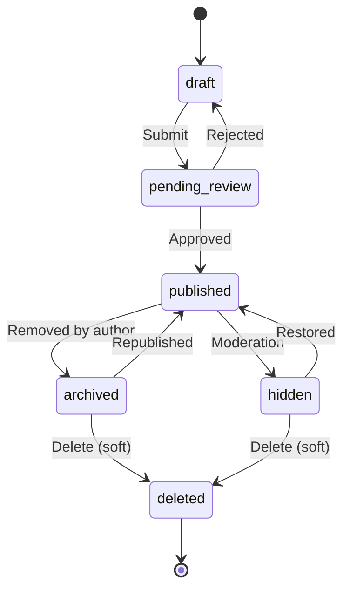
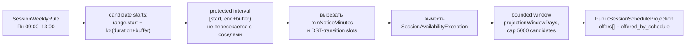
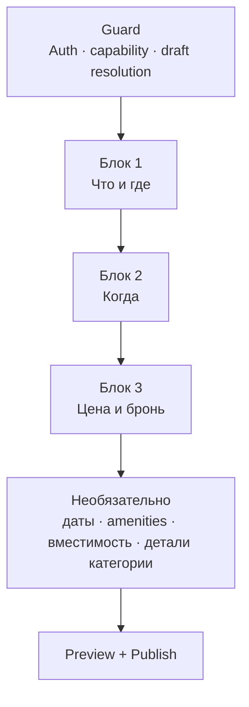

# RECHARGE — Bookable Session Create Block Spec

- Статус: **Draft for review** — Proposed; не Accepted и не Approved slice spec
- Версия: **1.1**
- Дата: 2026-08-20
- Канонический type id: `session`
- Название в UI: `Bookable session`
- Предлагаемое имя implementation slice: `SES-CRT-01`
- Эффект на runtime на дату документа: **none**

Документ фиксирует целевую продуктовую и доменную модель раздела
Create → Bookable Session. Он не разрешает изменения Flutter runtime,
Firebase, backend, Payments, production moderation или authoritative
Booking. Реализация может начаться только после отдельного утверждения
slice и его точного file plan.

> Эта версия — не патч поверх черновиков от 2026-08-17–19. Это независимая
> сквозная ревизия после contradiction audit: часть более ранних решений
> этого документа (включая примеры допустимых категорий и заявленное
> «переиспользование» Event DST-policy) при проверке против кода и
> `CATEGORY_SYSTEM.md` оказались фактически неверны. Нумерация версии
> сознательно начинается заново с `1.0`, чтобы не выдавать это за
> инкрементальный патч — детали в §23.

## На один экран

| Вопрос | Ответ v1 |
|---|---|
| Что создаётся | Карточка времени у одного фиксированного ресурса/услуги на одной площадке: сауна, корт, кабинет, студия, escape room |
| Ключевая модель | Регулярное недельное расписание → детерминированная проекция одинаковых слотов → ручные закрывающие исключения |
| Чем отличается от Event | Event владеет явными occurrences; Session владеет повторяемым правилом доступности и одинаковой длительностью слота |
| Чем отличается от Rental | Rental передаёт физическую вещь и inventory; Session предоставляет один временной интервал у фиксированного ресурса |
| Вместимость v1 | `maxPartySize`: максимум людей в одной внешней брони, 1–20. Число параллельных независимых броней не моделируется |
| Availability | Только заявленное Creator расписание; не live-занятость и не остаток мест у внешнего провайдера |
| Booking MVP | Только безопасный HTTPS `externalBookingUrl`; внутри Recharge нет hold, confirmation, waitlist или оплаты |
| Auth | Любой Viewer авторизован. Viewer может сохранить разрешённый local pre-verification draft; submit/publish требуют verified Creator и capabilities |
| Publisher | Канонически `{type: user \| page, id}`; page требует exact-page membership и page-scoped grants |
| Форма | Общий Create form engine, guard + 3 обязательных блока на одной прокручиваемой странице (Что и где / Когда / Цена и бронь) + ненавязчивая зона «Необязательно»; отдельного Session-приложения/визарда нет |
| Rollback | Typed payload сохраняется и round-trip'ится; feature flag отключает новый UI без destructive downgrade |

## 1. Назначение и нормативность

Спецификация отвечает на четыре вопроса:

1. Какие данные Creator вводит для Bookable Session.
2. Как из локального недельного правила получается ограниченная проекция
   временных предложений.
3. Что Recharge вправе обещать Viewer при внешнем бронировании.
4. Как перейти с текущих generic `eventSlots` без угадывания и потери
   данных.

При конфликте применяется приоритет `AGENTS.md`:

1. Accepted ADR;
2. Approved spec активного slice;
3. `LAUNCH_STATUS.md`;
4. `VISION.md`;
5. этот Draft.

До отдельного product-owner approval все новые решения этого файла имеют
статус **Proposed**. Фактический runtime описан отдельно от target
contract и не выводится из наличия документа.

## 2. Фактический baseline на 2026-08-20

### 2.1 Что уже есть

- `CreateObjectType.session` и taxonomy id `session` находятся в
  `apps/mobile/lib/features/create/domain/entities/create_draft_entity.dart`;
- runtime taxonomy использует `RechargeContentType.session` в
  `apps/mobile/lib/core/config/recharge_taxonomy.dart`; `ContentType.session`
  остаётся каноническим продуктовым именем в `CATEGORY_SYSTEM.md`;
- общий `CreateBlockConfig` задаёт `Bookable session`, category `sport`,
  subcategory `tennis`, `requiresStartDateTime = true`, `Bookable venue` и
  `Booking price`;
- generic Create UI разрешает для Session `CreateAvailabilityKind.eventSlots`
  **или** `none`; default/runtime validation по-прежнему ориентирован на
  Event-подобный список дат;
- общий local/mock draft/publish pipeline, taxonomy и базовые поля формы уже
  существуют.

### 2.2 Чего нет

- typed `SessionDraftData` и отдельного mapper;
- недельных правил Session, slot duration, buffer, notice и исключений;
- детерминированного bounded materializer и стабильного `slotKey`;
- разделения public projection и приватных exception/audit данных;
- Session-интеграции Create Templates: текущий runtime CRT-TPL-01
  обслуживает Event, хотя контракт спроектирован расширяемым;
- одной общей runtime `AmenitiesSection`: Event и Place сейчас имеют
  отдельные конфиги/rendering;
- Session-specific Discover/Details projection;
- Booking client, repository, backend или Firebase runtime.

ECL-03B реализует shared Booking schemas/fixtures и pure mobile domain для
Event. ECL-03C-P остаётся Review-планом с runtime effect `none`.
`apps/backend`, Firebase Functions и authoritative Booking физически не
созданы. ADR 0019 описывает target Event Booking architecture и сам по себе
не распространяет её на Session.

## 3. Главный продуктовый инвариант

**Bookable Session — это предложение одного стандартного временного
интервала у одного фиксированного ресурса или услуги на одной площадке.**

Следствия:

- один листинг = один ресурс + одна точка + одна timezone;
- v1 использует одну `slotDurationMinutes` на листинг;
- слоты порождаются из локальных weekly rules, а не вводятся Creator
  построчно;
- исключения только сужают расписание и никогда не открывают
  дополнительное время;
- один слот предполагает не более одной независимой внешней брони ресурса;
- `maxPartySize` описывает людей внутри этой брони, а не число параллельных
  броней, работников, кортов или inventory units;
- несколько ресурсов — несколько листингов через явное duplicate действие;
- Session не становится Event, Rental, Place или Class/Workshop из-за
  выбранной категории;
- внешняя booking-система остаётся источником истины о фактической
  занятости, цене checkout и подтверждении.

Если бизнесу нужны три взаимозаменяемых корта, несколько специалистов,
параллельные группы или остаток мест, требуется отдельная
inventory/resource model. v1 не кодирует это одним числом.

## 4. Термины

| Термин | Нормативное значение |
|---|---|
| `SessionDraftData` | Type-specific payload внутри общего Create draft envelope |
| `SessionSchedule` | Versioned weekly rules, timezone, duration, buffer, notice и projection policy |
| `SessionWeeklyRule` | Один непересекающийся локальный диапазон конкретного ISO weekday |
| `SessionAvailabilityException` | Приватное Creator-правило, закрывающее дату/время поверх weekly schedule |
| `SessionSlotProjection` | Производный bounded read model; не Booking и не отдельный source of truth |
| `slotKey` | Стабильный внутри schedule revision технический ключ projected-слота; не Booking id |
| `offered_by_schedule` | Creator объявил это время и локальные правила его не закрыли; фактическая availability провайдера неизвестна |
| `maxPartySize` | Максимум людей в одной брони ресурса; v1: 1–20 |
| `scheduleRevision` | Монотонная revision активного расписания листинга |
| `externalBookingUrl` | HTTPS-страница конкретного ресурса/услуги у внешнего провайдера; не обещает deep link выбранного времени |
| `legacyOneTimeSlots` | Read-only compatibility payload текущего generic Session draft |

Термины `open`, `available`, `remaining seats`, `sold out` и `fully booked`
запрещены для Session public projection v1 без authoritative
provider/Booking данных.

## 5. Источники продукта и перенос решений

### 5.1 Внутренние источники истины

- [VISION.md](../VISION.md) — Bookable Session среди 10 Create-типов,
  `RecurrenceScheduleSection`, `AmenitiesSection`, диапазон 30 мин–3 ч,
  party size 1–20 и external booking MVP;
- [CATEGORY_SYSTEM.md](../CATEGORY_SYSTEM.md) — `ContentType.session` и
  `applicableTypes` marker `S`;
- [IDENTITY_PUBLISHER_SLICE_SPEC.md](../IDENTITY_PUBLISHER_SLICE_SPEC.md) —
  mandatory auth, pre-verification draft, operation capabilities и
  PublisherRef;
- [EVENT_CREATE_CORE_SCHEDULE_SLICE_SPEC.md](EVENT_CREATE_CORE_SCHEDULE_SLICE_SPEC.md)
  — IANA timezone, deterministic projection, DST resolver и reversible
  schedule changes; Session переиспользует инфраструктурный принцип, но не
  Event aggregate и не точную Event policy (см. §11.4 — расхождение
  проверено против кода и заявлено явно, а не скрыто);
- [CREATE_TEMPLATES_SLICE_SPEC.md](CREATE_TEMPLATES_SLICE_SPEC.md) —
  независимый draft, authority stripping и type isolation;
- [ADR 0013](../../adr/0013-domain-policy-baseline.md) — lifecycle, IDs,
  offline/sync, privacy и audit;
- [ADR 0015](../../adr/0015-authenticated-viewer-verified-creator-professional-page.md)
  — authenticated Viewer, verified Creator и exact Publisher authority;
- [ADR 0019](../../adr/0019-authoritative-internal-booking-ledger.md) — target
  Event Booking backend; не Session runtime authorization.

### 5.2 Проверенные индустриальные источники

Источники проверены 2026-08-20. Они используются как evidence паттернов, а
не как нормативная зависимость или provider integration:

- [Peerspace: listing details](https://support.peerspace.com/en/articles/10119358-how-to-edit-individual-listing-details)
  — раздельные listing fields: media, pricing, amenities, minimum hours и
  capacity;
- [Peerspace: availability](https://support.peerspace.com/en/articles/10119397-how-do-i-manage-availability-on-peerspace)
  — собственный календарь, confirmed bookings и manual blocks;
- [Calendly: availability rules](https://help.calendly.com/hc/en-us/articles/1500004754122-Managing-additional-rules-for-your-availability?locale=en-us)
  — minimum notice и booking date range;
- [Calendly: buffers](https://help.calendly.com/hc/en-us/articles/14048208107287-How-to-use-buffers?locale=en-us)
  — buffer как защищённое время до/после встречи;
- [Fresha: resources](https://www.fresha.com/help-center/knowledge-base/calendar/19-create-and-manage-resources)
  — resource availability и сауна как resource-only пример;
- [Fresha: booking window](https://www.fresha.com/help-center/knowledge-base/calendar/102433-manage-online-bookings-settings)
  — minimum notice и future window;
- [Fresha: client booking](https://www.fresha.com/help-center/knowledge-base/online-profile/101646-learn-how-clients-book-appointments-online)
  — real-time availability строится из authoritative calendar/team/resource
  state.

### 5.3 Что переносится и что не переносится

| Паттерн | Решение Recharge |
|---|---|
| Listing media/amenities/capacity disclosure | Переносится как Create fields |
| Weekly hours, fixed duration, notice, window | Переносится как deterministic local schedule |
| Manual blocked dates | Переносится как закрывающие exceptions |
| Calendar/date + offered-time chips | Переносится как **заявленная** schedule projection |
| Provider calendar conflicts и confirmed bookings | Не переносится: данных нет |
| Remaining capacity, sold-out, waitlist | Не переносится без authoritative Booking/inventory |
| Payment, deposit, refund, payout | Не входит в v1 |
| Dynamic pricing и provider sync | Не входит в v1 |

## 6. Canonical boundaries и зависимости

### 6.1 Create architecture

Session остаётся одним declarative type внутри общего Create form engine.
Допустимы type-specific section, typed payload, mapper, validator и
materializer. Запрещены отдельный Session repository flow, отдельная draft
collection или бизнес-логика в presentation.

После включения typed flow `CreateBlockConfig.session.requiresStartDateTime`
становится `false`: единственный authority времени —
`SessionDraftData.schedule`. Generic `startDateTimeUtc`,
`scheduleSlots/eventSlots` и availability picker остаются только
compatibility-read полями старой схемы; новый Session writer их не
создаёт.

### 6.2 Identity и Publisher

Target envelope хранит один immutable `PublisherRef`:

```text
PublisherRef { type: user | page, id: ULID }
```

Активный workspace задаёт default только новому draft. Переключение
workspace не переписывает PublisherRef существующего draft.

`manage_page` не является разрешением публиковать Session. Для page
publisher нужны verified Creator, active membership exact page и
page-scoped capability конкретной операции.

### 6.3 Booking boundary

Session v1 публикует расписание и внешний handoff, но не создаёт Booking.
Нельзя:

- сохранять local `confirmed`/`reserved` state;
- уменьшать capacity после CTA;
- выдавать внешний redirect за подтверждение;
- применять Event ECL-03 contracts к Session без отдельного Accepted
  решения;
- передавать party size, slotKey или PII во внешний URL через ad-hoc query
  parameters.

### 6.4 Runtime prerequisites

Будущий `SES-CRT-01` обязан либо:

1. оставаться personal-publisher local/mock slice; либо
2. зависеть от отдельно разрешённой all-ten-type PublisherRef migration.

Он не может молча расширить IDP stabilization exception, добавить
production page authority или создать backend.

## 7. Категории и unresolved taxonomy gap

Category picker использует только канонический каталог и проверяет
`applicableTypes` с marker `S`. Собственный whitelist запрещён.

Подтверждённые примеры текущего каталога:

| Категория/подкатегория | Статус для Session | Подсказка формы |
|---|---|---|
| `wellness_recharge`: sauna, spa, massage, pirts ritual | Разрешено | 60 минут; amenities душ/раздевалка |
| `sport`: tennis, padel, squash и другие не переопределённые sport items | Разрешено по inherited `[E,A,S]` | 60 минут; buffer 0/10 как подсказка |
| `dance` items с inherited `S` | Разрешено | 60/90 минут |
| `escape_room` | Явно `[E,P,S]` | duration из provider rules; party size |
| `pet_photo_session` | Явно `[E,S]` | одна party; amenities: экипировка |

Нельзя выводить право Session из одного `profileId`. В текущем каталоге:

- `game_session` является default profile категории `games_indoor`, но сама
  категория имеет `[E]`; это **не** разрешает board games/LAN для Session;
- bowling сейчас `[E,P]`, не `[S]`;
- `photography` существует в `workshops_masterclasses` и наследует
  `[E,C,S]`, но его default profile `hands_on_class` описывает обучение, а
  не однозначно аренду студии или фотосессию как услугу; отдельного generic
  `photo_studio`/`photo_session` item нет.

`SES-OD-01` — **требуется решение владельца продукта до начала
реализации**: подтвердить, что `photography` покрывает Bookable Session
«фотосессия/студия», либо отдельной ревизией Category System добавить
точный item/profile. Этот Draft не переопределяет семантику Accepted
taxonomy молча.

Адаптивные defaults — только подсказки. Они живут в declarative
`SessionCreateConfig`, а eligibility остаётся в Category System.

Начиная с v1.1 dynamic criteria секции категорийного профиля
(`CATEGORY_SYSTEM.md` §5 — поля вроде `skill_level*`/`equipment_provided*`
у `hands_on_class`) для Session рендерятся только как advisory
`Recommended details` и никогда не блокируют публикацию, независимо от
`*` в профиле (см. §12 «Необязательно», §13.2). Это снимает практическую
срочность `SES-OD-01` — форма для владельца фотостудии больше не
заставляет отвечать на вопросы про обучение, чтобы опубликоваться — но не
закрывает сам таксономический вопрос: по смыслу `hands_on_class` остаётся
профилем про преподавание, а не про бронирование ресурса, и это всё ещё
может путать Creator при заполнении необязательных полей. `SES-OD-01`
остаётся открытым.

## 8. Scope v1

### 8.1 В scope target contract

- typed Session draft и forward-compatible mapper;
- category-filtered basics, media, location и amenities;
- один resource, одна location, одна IANA timezone;
- weekly schedule, fixed duration, post-slot buffer и minimum notice;
- platform-owned bounded projection window;
- closing exceptions и Creator preview;
- max party size 1–20;
- free/fixed public price disclosure в minor units;
- safe external booking URL и optional external terms URL;
- sanitized Session templates и explicit duplicate;
- public Discover/Details projection с honest availability wording;
- local/mock implementation, tests, flags, migration и rollback.

### 8.2 Вне scope

- internal Booking, holds, confirmation, cancellation и waitlist;
- сбор party size от Viewer внутри Recharge;
- параллельные resource/inventory pools;
- provider calendar sync, webhooks и deep-link templates;
- Payments, packages, deposits, fees, refunds и payouts;
- contact-host booking mode и in-app chat;
- dynamic/day-specific pricing;
- разная длительность слота по дням/диапазонам;
- positive exceptions, overnight ranges и multi-location листинг;
- Firebase, production Auth/verification/moderation и backend;
- новые taxonomy entries — отдельная Category System revision.

## 9. Auth, capabilities и operation matrix

Нет Guest state. Cold start, logout, expired session или public deep link
без валидной session открывает Auth и сохраняет intended destination, где
это безопасно.

| Операция | Personal publisher | Page publisher |
|---|---|---|
| Открыть Details/CTA | Authenticated Viewer | То же |
| Подготовить local pre-verification draft | Authenticated Viewer policy | Active member с draft/view access |
| Создать durable draft | Verified Creator + семантика `create.session` | То же + exact-page create grant |
| Submit moderation | Verified Creator + семантика `submit.session` | То же + active membership + page submit grant |
| Direct publish | Только trusted `publish.session.direct` | То же + exact-page direct-publish grant |
| Edit/archive | Ownership/capability + lifecycle | Active membership + page-scoped operation grant |
| Manage bookings | Не существует в Session v1 | Не выводится из `manage_page`; отдельный будущий gate |

Точные capability codes версионирует implementation slice, но раздельная
семантика create/submit/direct-publish уже обязательна и не является
открытым вопросом.

## 10. Lifecycle и revision

Entity lifecycle общий:



- `draft` приватен;
- `pending_review` не попадает в public projection;
- `published` означает approved content, а не наличие свободной внешней
  брони;
- `hidden` задаётся moderation/system;
- `archived` задаётся уполномоченным publisher;
- `deleted` следует soft-delete policy ADR 0013.

Schedule имеет `scheduleRevision`: draft начинается с `0`, первая active
published schedule — с `1`. Изменение timezone, weekly rules, duration,
buffer, notice, projection policy или exceptions увеличивает schedule
revision и создаёт material content revision. Изменение location, max
party size, price или external URL создаёт content revision, но не
вращает slot keys без изменения schedule. Пока candidate revision не
принята, public Details продолжает показывать предыдущую active revision.

Отсутствие projected times не меняет entity status. Exact-date availability
filter может исключить карточку, но общий text/category search вправе
показать её с нейтральным `No times listed in the current window`.

## 11. Schedule contract

### 11.1 Weekly rules

`SessionWeeklyRule` использует ISO weekday: `1 = Monday … 7 = Sunday`.

```text
SessionWeeklyRule {
  id: ULID
  isoWeekday: int              // 1..7
  startMinuteLocal: int        // 0..1439
  endMinuteLocalExclusive: int // 1..1440
}
```

Правила v1:

1. `start < end`; overnight range запрещён и разбивается Creator на два дня.
2. Не более 4 ranges на weekday и 28 active ranges на listing.
3. Ranges одного дня не пересекаются и не дублируются.
4. Базовые candidate starts внутри каждого range равны
   `range.start + k × (slotDuration + buffer)`, `k ≥ 0`.
5. Slot полностью помещается в range.
6. `slotDurationMinutes` — 30..180 включительно.
7. `bufferAfterSlotMinutes` — 0..180.
8. Effective protected interval каждого offer:
   `[start, end + buffer)`; projected offers не пересекаются.
9. Кандидаты всех ranges дня сортируются; конфликтующий с предыдущим
   protected interval кандидат не публикуется и показывается Creator как
   preview warning.

Пример: range 09:00–13:00, duration 60, buffer 10 даёт starts 09:00, 10:10,
11:20. Кандидат 12:30 не создаётся, потому что сам slot закончился бы после
13:00.



### 11.2 Notice и projection window

- `minNoticeMinutes`: Creator value 0..10080 (0..7 дней), default 0;
- `projectionWindowDays`: platform config snapshot, v1 default 30,
  допустимый deployment range 1..90; Creator не редактирует его в v1;
- если локальная дата `generatedAtUtc` равна `D`, projection включает даты
  `D … D + projectionWindowDays - 1`; end boundary — local midnight
  `D + projectionWindowDays`, exclusive, преобразованный в UTC через
  listing timezone;
- slot раньше `generatedAtUtc + minNoticeMinutes` получает internal reason
  `inside_notice_window` и не входит в public offers;
- один materialization ограничен 5000 candidates; overflow fail-closed и
  блокирует publish вместо усечения молча.

Materializer принимает clock параметром. `DateTime.now()` внутри domain
usecase запрещён.

### 11.3 Closing exceptions

```text
SessionAvailabilityException {
  id: ULID
  startDateLocal: LocalDate
  endDateLocal: LocalDate
  allDay: bool
  startMinuteLocal: int?
  endMinuteLocalExclusive: int?
  privateNote: String?          // max 140; никогда не public
  createdByUserId: ULID
  createdAtUtc: Instant
}
```

- date range inclusive и `startDate ≤ endDate`;
- partial exception требует valid same-day time range;
- exception закрывает любой slot, пересекающий её interval, а не только
  slot с совпадающим start;
- overlaps объединяются детерминированным union;
- исключение не может открыть время;
- не более 366 active/future exceptions на listing;
- public projection не содержит `privateNote`, creator id или audit
  timestamp.

### 11.4 Timezone и DST policy v1

`timezoneId` обязателен и валидируется через IANA database. Он
определяется в таком порядке:

1. provider-neutral timezone resolver по подтверждённому geo;
2. market default как initial suggestion;
3. явное подтверждение/исправление Creator.

Device timezone не становится authority. Publish блокируется, если geo и
timezone противоречат известному resolver result и Creator не подтвердил
исправление.

Session использует Event timezone port/library, но собственную fixed
policy — это сознательное расхождение, проверенное против фактической
реализации Event
(`materialize_event_schedule_usecase.dart`: `EventDstGapPolicy.shiftForward`,
`EventDstOverlapPolicy.earlierOffset`), а не заявленное дословное
переиспользование:

```text
dstPolicyVersion = 1
gap = skip_transition_intersecting_slot
overlap = skip_transition_intersecting_slot
```

Любой candidate, чьи start/end/protected-buffer interval пересекают DST gap
или overlap transition, не входит в public offers. Creator preview
показывает дату и reason `dst_transition_skipped`. Это намеренно
консервативнее Event `shiftForward`/`earlierOffset`: регулярный
коммерческий слот не должен незаметно менять wall-clock label или
фактическую длительность, а Session — не именованное разовое мероприятие,
где сдвиг на час предсказуемо приемлем.

### 11.5 Stable slot identity

Для published revision:

```text
slotKey = base64url(sha256(
  "session-slot-v1|listingId|scheduleRevision|localDate|startMinute|timezoneId"
))
```

- одинаковый input даёт одинаковый key при повторной materialization;
- новая schedule revision даёт новые keys;
- draft preview key может быть временным и заменяется при permanent
  listing id;
- key не является секретом, Booking id или доказательством availability;
- analytics пишет только key/revision/reason, без URL, note или address.

### 11.6 Projection statuses

Internal Creator projection может содержать:

```text
offered_by_schedule
blocked_by_creator
inside_notice_window
past
dst_transition_skipped
outside_projection_window
```

Public projection получает только `offered_by_schedule` и отдельный флаг
`providerAvailabilityUnknown = true`. Точные blocked/past intervals не
показываются Viewer: они создают ложную live-семантику и раскрывают
операционный календарь Creator.

## 12. Create flow

С v1.1 форма не является жёстким пошаговым визардом: guard открывает
**одну прокручиваемую страницу** с тремя обязательными блоками, отдельной
ненавязчивой зоной «Необязательно» и нижней областью preview/publish.
Autosave и один source of state — общий Create controller/application
flow; блоки — те же декларативные секции form engine, что и раньше,
просто отрендеренные без пошагового гейта между ними (правило 4
`AGENTS.md` не нарушается: это конфигурация раскладки уже существующих
секций, не новый параллельный флоу).



### Guard

1. Auth/session restore.
2. Load existing draft without publisher rewrite.
3. Resolve allowed draft operation.
4. Viewer without Creator eligibility может продолжить разрешённый local
   pre-verification draft, но видит locked submit/publish и Upgrade
   action.
5. Durable/create/submit operations проверяют exact capabilities.

### Блок 1. Что и где

| Поле | Требование |
|---|---|
| `title` | Required; 5–80 characters |
| `categoryId/subcategoryId` | Required; canonical item с `S` eligibility. Категорийные dynamic criteria (`skill_level`, `equipment_provided` и т.д.) здесь **не** рендерятся — они переехали в «Необязательно» ниже |
| `shortDescription` | Required; 20–180 characters |
| `fullDescription` | Required; 50–2000 characters |
| `cover` | Required; rights confirmation + локализованный alt text |
| `resourceName` | Required; один ресурс, не business network |
| `venueName` | Required |
| `geo` | Required confirmed pin |
| `addressLine1` | Required в private/authorized projection; public precision следует geo/privacy policy |
| `timezoneId` | Required; resolver suggestion + подтверждение одним тапом |
| `gallery` | Optional; общий media-policy лимит |

Если общей runtime Amenities section к началу slice всё ещё нет, file plan
должен включить bounded extraction с unchanged Event/Place behavior и
regression tests. Создавать третью независимую taxonomy запрещено.

### Блок 2. Когда

- быстрые пресеты недельного расписания (`Каждый день 9:00–21:00`,
  `Будни 9–18`, `Свои часы`) — один тап сразу даёт валидный `weeklyRules`,
  ручной weekday editor с copy-to-days остаётся доступен под пресетами;
- 1..4 ranges per active day;
- fixed duration 30..180 через чипы с default по категории (§7);
- post-slot buffer 0..180 и notice — используют defaults `0`/`0` и не
  требуют действия Creator для публикации; custom bounded value доступен,
  если нужен;
- 7-day preview из того же materializer, что publish/Details, обновляется
  сразу по выбору пресета;
- preview reasons для rejected candidates, включая DST.

### Блок 3. Цена и бронь

```text
SessionPriceDisclosure {
  mode: free | fixed
  amount: Money?          // required only for fixed
}
```

- Money только minor units + ISO currency;
- fixed amount > 0; free не хранит фиктивный zero Money;
- `externalBookingUrl` обязателен, HTTPS, без embedded credentials;
- URL должен вести на страницу этого ресурса/услуги, а не generic
  homepage;
- optional `externalTermsUrl` — HTTPS;
- UI сообщает: `Final availability, price and booking terms are confirmed
  on the provider site`;
- `maxPartySize` предзаполнен дефолтным значением (категорийная подсказка
  §7 или платформенный fallback), остаётся валидируемым 1..20 (§13.1), но
  не требует отдельного действия Creator — значение уже стоит в поле, его
  можно просто оставить;
- package pricing, deposits и Recharge cancellation policy отсутствуют в
  v1.

### Необязательно (не блокирует публикацию)

Единая ненавязчивая зона, доступная с любого места страницы и после
публикации в любой момент:

- заблокированные даты (`SessionAvailabilityException`, §11.3) — month
  calendar + list, all-day или partial closing exception, private note
  явно помечена `Only you and authorized page members`; пустой список
  валиден;
- `amenityIds` — общий taxonomy/config-контракт, без Session-local дубля
  словаря;
- ручное изменение `maxPartySize` — по умолчанию уже заполнено (Блок 3);
- **Рекомендуемые детали категории** — та же dynamic criteria секция
  (`CATEGORY_SYSTEM.md` §5), что рендерится и для остальных 9 типов, но
  для Session помечена advisory: ни одно её поле, включая помеченные `*`
  в профиле, не входит в blocking-список §13.1 (см. §13.2 и §7).

### Нижняя область — preview и публикация

Preview строится из того же typed payload и public projector, что
publish. Creator видит:

- карточку;
- ближайшие schedule offers с `Provider availability not checked`;
- price disclosure;
- внешний handoff;
- validation summary со ссылками на конкретные поля/блоки;
- PublisherRef и доступное operation: Save draft / Submit / Publish
  direct.

Double tap использует один client request id. Local/mock publish может
вернуть только честный local result (`pending_review` по действующей
policy), но не Booking или provider confirmation.

## 13. Validation contract

Один typed validator используется preview, save readiness, submit, publish
и update. Presentation отображает issues, application/domain принимает
решение; production backend в будущем повторяет authoritative checks.

### 13.1 Blocking issues

| Код | Условие |
|---|---|
| `session_category_not_allowed` | Категория/подкатегория не разрешена для `S` |
| `session_resource_missing` | Нет resource/location/confirmed pin |
| `session_timezone_invalid` | Нет valid IANA timezone или unresolved geo mismatch |
| `session_schedule_empty` | Нет valid weekly rule |
| `session_weekday_invalid` | weekday не 1..7 |
| `session_range_invalid` | start/end bounds, overnight или empty range |
| `session_range_overlap` | Ranges одного дня пересекаются/дублируются |
| `session_duration_out_of_range` | duration вне 30..180 |
| `session_buffer_out_of_range` | buffer вне 0..180 |
| `session_notice_out_of_range` | notice вне 0..10080 |
| `session_projection_overflow` | Более 5000 candidates |
| `session_exception_invalid` | Invalid date/time или лимит exceptions превышен |
| `session_party_size_out_of_range` | maxPartySize вне 1..20 |
| `session_price_invalid` | fixed без positive same-market Money |
| `session_booking_url_invalid` | Нет safe HTTPS resource/service URL |
| `session_media_incomplete` | Нет cover, rights или required alt text |
| `session_publisher_ineligible` | Submit/publish authority неизвестна/отозвана |
| `session_legacy_review_required` | Legacy slots не прошли explicit migration decision |

`session_party_size_out_of_range` формально остаётся в blocking-списке
(значение обязано лежать в 1..20), но на практике не требует действия
Creator: `maxPartySize` предзаполняется дефолтом при создании черновика
(§12 Блок 3), поэтому пустое значение не встречается в нормальном flow.

Категорийные dynamic criteria поля (`skill_level`, `equipment_provided` и
другие из общего словаря `CATEGORY_SYSTEM.md` §4) **никогда** не
появляются в этом списке для Session — независимо от `*` в
соответствующем профиле. Это явное type-level решение (§22 SES-D14), не
пробел.

### 13.2 Warnings requiring acknowledgement

| Код | Значение |
|---|---|
| `session_no_offers_in_window` | Расписание/исключения не дают public offers в current window |
| `session_candidates_dropped_for_buffer` | Range layout породил candidates, отброшенные protected buffer logic |
| `session_dst_slots_skipped` | В окне есть slots, пересекающие DST transition |
| `session_external_state_unknown` | Provider availability/price/terms не проверяются Recharge |
| `session_material_revision` | Published schedule/price/location меняется через новую revision |
| `session_category_criteria_incomplete` | Рекомендуемые детали категории (§12 «Необязательно») не заполнены — soft nudge, publish не блокирует |

Warnings не превращаются в зелёный Booking status. Acknowledgement
сохраняет versioned warning codes, draft revision и actor id для audit.

## 14. Typed domain и projection boundaries

Common title/media/location/lifecycle/Publisher fields остаются в общем
Create envelope. Session не дублирует их в параллельном aggregate.

Schedule, timezone, max party size и price имеют по одному
type-specific source of truth ниже. Пока общий Create envelope сохраняет
legacy `timezone`, `maxParticipants` или price fields, mapper поддерживает
их только как односторонние compatibility mirrors из `SessionDraftData`;
изменение mirror не перезаписывает typed payload и не создаёт второй
authority.

```text
SessionDraftData {
  schemaVersion: int
  resourceName: String
  timezoneId: String
  timezoneConfirmed: bool
  amenityIds: Set<String>
  maxPartySize: int

  schedule: SessionSchedule
  exceptions: List<SessionAvailabilityException>

  price: SessionPriceDisclosure
  externalBookingUrl: HttpsUrl
  externalTermsUrl: HttpsUrl?

  legacySchedule: LegacySessionSchedule?
  unknownFields: OpaqueMap
}

SessionSchedule {
  scheduleRevision: int
  dstPolicyVersion: int
  slotDurationMinutes: int
  bufferAfterSlotMinutes: int
  minNoticeMinutes: int
  projectionWindowDays: int
  weeklyRules: List<SessionWeeklyRule>
}

SessionSlotProjection {
  slotKey: String
  scheduleRevision: int
  localDate: LocalDate
  startAtUtc: Instant
  endAtUtc: Instant
  timezoneId: String
  internalStatus: SessionProjectionStatus
  internalReasonCode: String?
}

PublicSessionScheduleProjection {
  scheduleRevision: int
  generatedAtUtc: Instant
  validUntilUtc: Instant
  providerAvailabilityUnknown: true
  offers: List<PublicSessionOffer>
}

PublicSessionOffer {
  slotKey: String
  startAtUtc: Instant
  endAtUtc: Instant
  timezoneId: String
}
```

### 14.1 Инварианты

- mapper round-trip сохраняет unknown fields;
- unknown future major schema fail-closed и не перезаписывается старым
  writer;
- public projector allowlist-based; private exception/audit data туда не
  копируется;
- price currency соответствует active market policy;
- `projectionWindowDays` — snapshot config для воспроизводимости revision;
- generated projections кешируемы, но не становятся source of truth;
- public cache всегда имеет `generatedAtUtc/validUntilUtc`; presenter
  выводит `fresh | stale` из injected clock, а не доверяет сохранённому
  boolean;
- URL, private notes, address precision и actor IDs не попадают в
  analytics;
- если Creator заполняет «Рекомендуемые детали категории» (§12), ответы
  пишутся через тот же общий `sectionData['criteria']` механизм, что и у
  остальных 9 типов (`CATEGORY_SYSTEM.md` §5), не дублируются полями
  `SessionDraftData` — Session не заводит второй source of truth для
  category criteria.

## 15. Draft, templates, duplicate и legacy migration

### 15.1 Draft persistence

- local draft autosave после 700 ms debounce и при step transition;
- partial invalid draft сохраняется;
- `loc_*` допустим только до первого durable autosave. Первый успешный save
  атомарно выдаёт permanent ULID draft и child records; submit/publish
  дополнительно блокируются при любом оставшемся temporary relation;
- offline save разрешён; external handoff и publish требуют online state;
- conflict policy — version/revision check + user warning; никакого silent
  publisher rewrite.

### 15.2 Templates

CRT-TPL-01 является архитектурным основанием, но Session runtime
integration — новая работа `SES-CRT-01`.

Template может копировать taxonomy, descriptions, amenities, weekly
schedule shape, duration, buffer, notice, max party size и price
disclosure. Он не копирует:

- IDs, lifecycle, PublisherRef и audit metadata;
- exact exceptions;
- media/rights grants;
- external URLs;
- geo/address/timezone без явного `Reuse this venue` выбора;
- generated slots или legacy payload.

Приложение создаёт новый независимый draft и применяет дефолты активного
market/timezone/currency до валидации.

### 15.3 Duplicate published listing

`Duplicate this listing` использует тот же sanitized materializer, но не
создаёт скрытый сохранённый template. Для клуба с несколькими ресурсами
action может предложить `Same venue and timezone`; Creator обязан
подтвердить location и изменить resource name. Новый listing и child
records получают новые IDs.

### 15.4 Legacy `eventSlots` migration

Текущий Session draft может содержать произвольные generic `scheduleSlots`.
Нельзя угадывать weekly pattern по нескольким датам.

```text
LegacySessionSchedule {
  sourceSchemaVersion: int
  legacyOneTimeSlots: List<CreateTimeSlotDraft>
  state: unreviewed | superseded_by_weekly_schedule
}
```

Migration steps:

1. Mapper загружает legacy slots read-only и сохраняет исходный payload.
2. Step 3 показывает `Previously entered dates — old format` и требует
   explicit `Create weekly schedule`.
3. Сохранение weekly rules меняет state на
   `superseded_by_weekly_schedule`, но **не удаляет** legacy payload.
4. Publish использует только weekly schedule после explicit confirmation.
5. Legacy payload сохраняется для rollback/round-trip и не попадает в
   public listing projection.
6. Уже опубликованная legacy version остаётся active до успешного submit
   и принятия новой revision; открытие редактора ничего не переписывает.
7. Physical cleanup legacy fields — отдельный поздний migration slice
   после observation/consumer-zero evidence, не `SES-CRT-01`.

Unknown или malformed legacy slots остаются recoverable export/read-only
data; writer fail-closed и не очищает запись.

## 16. Publish и update pipeline

1. Валидация auth/session/account.
2. Проверка capability конкретной операции + резолвинг точного
   PublisherRef.
3. Чтение/миграция схемы черновика без разрушающей записи.
4. Нормализация строк, Money, geo, timezone и локальных диапазонов.
5. Доменная валидация и подтверждение предупреждений.
6. Проверка прав на медиа/alt-текста и безопасности структурированных URL.
7. Замена временных ID.
8. Построение public-проекции через allowlist-проектор.
9. Идемпотентная local/mock-мутация с использованием client request id.
10. Возврат типизированного lifecycle-результата; никогда не Booking
    confirmation.
11. Сохранение принятых постоянных ID/revision обратно в draft.
12. Privacy-safe analytics и audit-событие.

Правки опубликованного листинга создают candidate revision. Текущая public
revision остаётся доступной до принятия candidate. Archive/delete никогда
не уничтожают локальные draft/template коллекции как побочный эффект.

## 17. Discover, Details и external handoff

### 17.1 Discover

| Фильтр | Семантика v1 |
|---|---|
| Text/category | Общая проекция листинга |
| Distance | Подтверждённая public geo-проекция |
| Price | Базовый `SessionPriceDisclosure`; packages отсутствуют |
| Date | Есть хотя бы один `offered_by_schedule` public offer на local date |
| Today | Offer начинается после notice threshold |
| Party size | Requested people ≤ `maxPartySize`; это не remaining capacity |

Ranking не использует invented occupancy. Exact-date filter не заявляет,
что provider всё ещё свободен.

### 17.2 Results card

- badge `Bookable session`;
- title, category, cover, distance;
- fixed/free price disclosure;
- max party size;
- ближайшее `Time listed by host`;
- label `Provider availability not checked`.

Запрещённые labels: `Fully booked`, `1 spot left`, `Sold out`, `Instantly
confirmed`.

### 17.3 Details

1. Hero, media, title, save/share.
2. Resource, venue, amenities, max party size.
3. Calendar только с датами, имеющими public offers.
4. Time chips только `offered_by_schedule`; blocked/past slots скрыты.
5. Price disclosure и external-state disclaimer.
6. Publisher profile/verified presentation; verification не выводится из
   Creator role молча.
7. CTA `Check availability on provider site`.

### 17.4 CTA state matrix

| Состояние | CTA |
|---|---|
| Нет authenticated session | Auth flow → безопасный возврат в Details |
| Authenticated + есть public offers | `Check availability on provider site` |
| Authenticated + нет offers | Недоступен; `No times listed in the current window` |
| Offline | Недоступен; `Connect to continue to the provider site` |
| Небезопасный/отсутствующий URL | Недоступен; типизированная content-ошибка/report path |

Выбранный time chip остаётся UI context Recharge. Без Approved provider
adapter он не добавляется в URL и не обещает, что внешний сайт откроется
на том же времени.

## 18. Privacy, security, localization и accessibility

### 18.1 Privacy/security

- Auth обязателен для Details CTA;
- URL: HTTPS, нормализованный host, без userinfo/credentials, ограниченная
  длина, опасные схемы отклоняются;
- браузер показывает уведомление о переходе на внешний домен;
- exception notes и operational calendar reasons приватны;
- public address precision следует общей geo/privacy policy;
- page membership/capability проверяются exact IDs;
- client guards не являются production authority;
- сырые URL, заметки, адрес, телефон или actor ID не попадают в
  analytics/logs.

### 18.2 Localization

Все labels/errors/reasons имеют l10n keys для target `en/ru/lv`. Пока
общая localization infrastructure отсутствует, implementation slice не
объявляет полную en/ru/lv готовность и не размножает hardcoded strings вне
временного локального adapter boundary.

Timezone labels показываются в listing timezone и включают zone
abbreviation только как presentation; source остаётся IANA id. Money
formatting locale-aware, storage — minor units + currency.

### 18.3 Accessibility

- 360 dp и text scale 150% без overflow;
- schedule editor доступен без drag-only interactions;
- weekday/range controls имеют semantics labels и keyboard/focus order;
- color не единственный сигнал status;
- errors связаны с полями и доступны screen reader;
- alt text обязателен по media policy;
- external handoff и disclaimer объявляются до открытия browser.

### 18.4 Telemetry

Разрешены bounded events: step viewed/completed, validation code,
candidate count bucket, projection failure code, template/duplicate
action, external CTA domain category и rollback flag. Запрещены exact
schedule, private note, full URL, address, media metadata и identity
document state.

## 19. Предлагаемый implementation slice `SES-CRT-01`

### 19.1 Разрешённый file scope после отдельного approval

Точный file plan составляется перед кодом. Архитектурно ожидаются:

- domain: typed Session entities, materializer, validator, projector;
- data: mapper/local persistence compatibility;
- application: coordinator/controller commands and flags;
- presentation: declarative sections inside common Create flow;
- tests: unit/widget/migration/boundary;
- docs: factual status update after gates.

Не разрешены `apps/backend`, Firebase config, Payments, Event ECL-03
changes, ADR edits или production Identity expansion.

### 19.2 Acceptance criteria

1. **SES-AC-01:** `SessionDraftData` версионирован, типизирован и
   round-trip'ится с сохранением unknown fields.
2. **SES-AC-02:** Будущая неизвестная major-версия схемы fail-closed и не
   перезаписывается.
3. **SES-AC-03:** Session остаётся в общем config-driven Create flow;
   `requiresStartDateTime = false`, типизированное расписание — единственный
   источник времени, generic Event-поля — только read-совместимость.
4. **SES-AC-04:** Матрица auth/pre-verification/submit соответствует §9.
5. **SES-AC-05:** `PublisherRef` существующего черновика не меняется при
   переключении workspace.
6. **SES-AC-06:** Category eligibility использует канонический маркер `S`,
   без собственного whitelist.
7. **SES-AC-07:** Taxonomy gap `SES-OD-01` решён до заявления полного
   покрытия VISION.
8. **SES-AC-08:** Weekly rules используют ISO weekday и границы §11.
9. **SES-AC-09:** Overnight/пересекающиеся/дублирующиеся диапазоны
   блокируются.
10. **SES-AC-10:** Duration 30..180, `maxPartySize` 1..20.
11. **SES-AC-11:** Buffer защищает интервалы и даёт детерминированный
    preview.
12. **SES-AC-12:** Materializer использует injected clock, bounded window
    и candidate cap.
13. **SES-AC-13:** Одинаковые revision/input дают одинаковые
    offers/slotKeys.
14. **SES-AC-14:** Слоты, пересекающие DST transition, пропускаются
    fail-closed с указанием reason.
15. **SES-AC-15:** Exceptions закрывают пересекающиеся слоты и никогда не
    расширяют доступность.
16. **SES-AC-16:** Приватные exception/audit-поля отсутствуют в public
    projection.
17. **SES-AC-17:** Public-формулировки нигде не обещают live
    availability/capacity.
18. **SES-AC-18:** CTA — только safe external HTTPS handoff.
19. **SES-AC-19:** Выбранный слот не встраивается в URL без Approved
    adapter.
20. **SES-AC-20:** Нет local Booking/confirmed/remaining-capacity
    мутации.
21. **SES-AC-21:** Цена использует free/fixed + minor units;
    packages/deposits отсутствуют.
22. **SES-AC-22:** Legacy-слоты читаемы, сохраняются и не конвертируются
    автоматически.
23. **SES-AC-23:** Опубликованная legacy-версия остаётся активной до
    успешного submit и принятия новой revision.
24. **SES-AC-24:** Template очищает IDs, authority, медиа, URL, exceptions
    и legacy payload.
25. **SES-AC-25:** Duplicate создаёт независимые ID и не создаёт скрытый
    template.
26. **SES-AC-26:** Preview/publish/Details используют общий validator и
    projector.
27. **SES-AC-27:** Feature flags откатывают UI без даунгрейда typed
    payload.
28. **SES-AC-28:** Тесты 360 dp/150%, semantics, focus и field-error
    проходят.
29. **SES-AC-29:** Privacy-safe телеметрия не содержит запрещённых
    значений.
30. **SES-AC-30:** Целевые unit/widget/migration тесты проходят.
31. **SES-AC-31:** Полный `flutter analyze` — 0 замечаний.
32. **SES-AC-32:** Полный `flutter test` проходит без новых skip.
33. **SES-AC-33:** Boundary gate и `git diff --check` проходят без новых
    suppressions/whitespace-ошибок.
34. **SES-AC-34:** `LAUNCH_STATUS.md` и `AGENTS.md` обновляются только
    после фактических доказательств реализации.
35. **SES-AC-35:** Форма рендерит guard + 3 обязательных блока на одной
    странице (§12); блокирующая валидация не выходит за пределы §13.1.
36. **SES-AC-36:** Категорийные dynamic criteria поля для Session
    рендерятся только как advisory `Recommended details` и никогда не
    входят в blocking-список, независимо от `*` в профиле.
37. **SES-AC-37:** `maxPartySize` предзаполняется дефолтом при создании
    черновика и остаётся редактируемым; пустое значение не встречается в
    нормальном flow создания.

## 20. Rollout и rollback

### 20.1 Flags

- `sessionTypedCreateEnabled` — entry/new typed editor;
- `sessionScheduleProjectionEnabled` — materializer/preview;
- `sessionPublicSchedulePreviewEnabled` — Discover/Details offers.

Flags independent и default off до migration/tests. Disabling public
preview не удаляет listings; Details сохраняет neutral resource content и
external CTA только если product policy это разрешает.

### 20.2 Staged rollout

1. Mapper read/round-trip + тесты; без UI.
2. Typed draft/create за флагом; только personal local/mock.
3. Creator preview/materializer.
4. Public projection за отдельным флагом.
5. Наблюдение за чтением legacy/new схемы и validation failures.

### 20.3 Rollback guarantees

- writer не downgrade typed schema;
- legacy payload не удаляется;
- active published revision не заменяется incomplete candidate;
- flags отключают new mutation paths без bulk rewrite;
- rollback не меняет PublisherRef, IDs или templates;
- external side effects отсутствуют, потому что CTA не является mutation;
- physical legacy cleanup не входит в slice.

## 21. Известные ограничения v1

- Schedule честен только как self-declared Creator projection.
- External provider может показать другое время, цену или условия.
- Нет нескольких взаимозаменяемых ресурсов/работников в одном listing.
- Нет packages, deposits, waitlist, contact host или internal chat.
- DST transition-intersecting slots консервативно пропускаются.
- Один listing имеет одну duration, timezone и location.
- `projectionWindowDays = 30` — proposed platform default, не обещание
  provider booking horizon.
- Полная Professional Page authority и localization зависят от отдельных
  platform slices.

## 22. Decision register

| ID | Решение | Статус |
|---|---|---|
| SES-D01 | Session = один resource/одна location/одна timezone | Proposed |
| SES-D02 | v1: один независимый booking на слот; `maxPartySize` 1–20 | Proposed |
| SES-D03 | Booking MVP только `externalBookingUrl` | Canon-aligned; Proposed in this spec |
| SES-D04 | Public offers называются schedule projection, не availability | Proposed |
| SES-D05 | Duration 30–180, одна на listing | VISION-aligned; Proposed in this spec |
| SES-D06 | Buffer после слота 0–180 | Proposed |
| SES-D07 | Projection window задаётся платформой, default 30, максимум 90 | Proposed |
| SES-D08 | Offers, пересекающие DST transition, пропускаются | Proposed |
| SES-D09 | Только закрывающие exceptions; overnight исключён | Proposed |
| SES-D10 | Packages/deposit/contact_host исключены из v1 | Proposed |
| SES-D11 | `create`/`submit`/`direct-publish` остаются раздельной capability-семантикой | Canonical dependency |
| SES-D12 | Legacy payload сохраняется на протяжении rollout; очистка не входит в SES-CRT-01 | Canonical migration policy |
| SES-OD-01 | Решить вопрос покрытия таксономии для generic photo/video студии | **Требуется решение владельца продукта** (практическая срочность снята SES-D14, семантический вопрос открыт) |
| SES-D13 | Create flow — guard + 3 обязательных блока на одной прокручиваемой странице вместо 6-шагового визарда; заблокированные даты/amenities/вместимость/детали категории — ненавязчивая необязательная зона | Proposed |
| SES-D14 | Категорийные dynamic criteria (`skill_level`, `equipment_provided` и т.д., включая `*`-поля профиля) для Session — advisory-only, никогда не блокируют publish | Proposed |
| SES-D15 | `maxPartySize` предзаполняется дефолтом при создании черновика вместо пустого обязательного поля | Proposed |

Документ нельзя переводить в Accepted, пока `SES-OD-01` не закрыт явным
решением и Proposed decisions не подтверждены владельцем продукта.

## 23. Changelog

- `v1.1` (2026-08-20) — упрощение create flow по итогам обсуждения UX
  фотостудии. Guard + 6-шаговый визард заменён на guard + 3 обязательных
  блока на одной прокручиваемой странице (Что и где / Когда / Цена и
  бронь) + ненавязчивая зона «Необязательно» (§12); категорийные dynamic
  criteria поля (`skill_level`, `equipment_provided` и другие `*`-поля
  профиля) теперь advisory-only и никогда не блокируют publish для
  Session — снимает практическую срочность `SES-OD-01`, не отменяя сам
  таксономический вопрос (§7, §13); `maxPartySize` предзаполняется
  дефолтом вместо пустого обязательного поля (§12 Блок 3). Добавлены
  SES-D13/14/15 в decision register и AC-35/36/37.
- `v1.0` (2026-08-20) — первая цельная Draft-версия после contradiction
  audit. Зафиксированы factual current/target boundary, mandatory-auth и
  operation-capability matrix, one-resource/one-booking semantics,
  `maxPartySize` вместо неоднозначного capacity, honest external
  availability, bounded weekly schedule, explicit Session DST policy,
  stable slot identity, private/public projections, non-destructive
  legacy migration, sanitized templates/duplicate,
  accessibility/privacy/telemetry, implementation AC и staged rollback.
  Отдельно зарегистрирован unresolved Category System gap для generic
  photo/video studio.

  Эта ревизия заменяет более раннюю локальную историю черновика (три
  внутренние итерации 2026-08-17–19). При независимой проверке против
  `CATEGORY_SYSTEM.md` и `materialize_event_schedule_usecase.dart`
  подтверждено, что более ранние черновики содержали факт-ошибки: два
  примера допустимых категорий (`game_session`, боулинг-дорожка) на самом
  деле не имеют `S`-eligibility (§7), а заявленное «переиспользование»
  DST-policy Event на деле описывало другую политику, чем реальные
  `EventDstGapPolicy.shiftForward`/`EventDstOverlapPolicy.earlierOffset` в
  коде (§11.4). Обе категории ошибок исправлены в этой версии, а не
  унаследованы молча.
