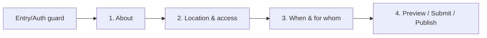
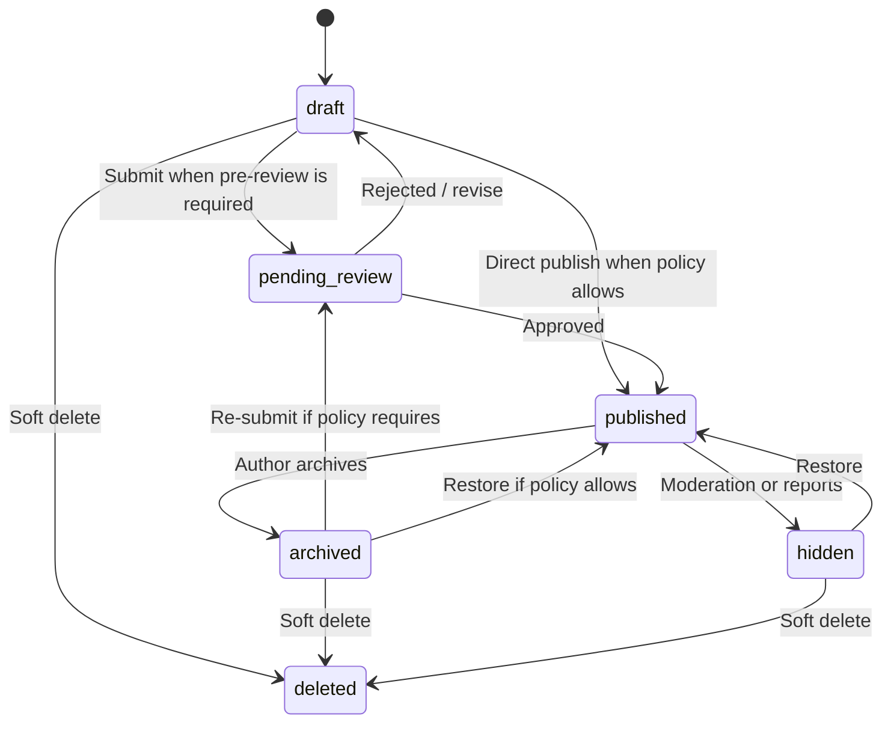

# RECHARGE — Recharge Activity Create Block Spec

- Статус: **Approved slice spec**. Первоначально утверждено владельцем
  продукта 2026-08-17; ревизия v1.4 утверждена запросом владельца продукта
  2026-08-20 как contract-hardening перед следующим implementation/conformance
  проходом. Это не Accepted ADR: термин `Accepted` зарезервирован за
  `docs/adr/`.
- Версия: **1.4**
- Дата ревизии: **2026-08-20**
- Slice: `ACT-CRT-01`
- Тип: `activity` (`CreateObjectType.activity`, `ContentType.activity`)

## Роль документа и фактический baseline

Этот файл — канонический продуктовый и функциональный контракт для
`Create → Recharge Activity`. Он определяет границу типа, данные, UI-flow,
валидацию, lifecycle, compatibility и acceptance criteria.

В текущем checkout уже существует реализация v1.3: typed `ActivityDraftData`,
четырёхшаговый Create UI, local/mock publish и Activity mock projection.
`LAUNCH_STATUS.md` ранее отмечал `ACT-CRT-01` как Done. Ревизия v1.4 не
утверждает повторную реализацию с нуля и не подтверждает соответствие
существующего runtime новым уточнённым AC. Следующая coding-сессия обязана:

1. сначала выполнить gap-аудит существующего кода против v1.4;
2. переиспользовать уже корректные части;
3. исправить только доказанные расхождения;
4. вернуть slice в Done только после всех гейтов §18.

Документ не разрешает Firebase, production backend, Payments, Booking,
provider integration или новый Create-тип. `activity` уже входит в целевые
10 типов Create Hub, поэтому bounded local/mock completion допустим во время
стабилизации по правилу 4 `AGENTS.md`.

## Источники истины и приоритет

При конфликте действует порядок `AGENTS.md`:

1. Accepted ADR;
2. эта Approved spec для `ACT-CRT-01`;
3. `docs/architecture/LAUNCH_STATUS.md`;
4. `docs/product/VISION.md`.

Связанные документы:

- [VISION.md](../VISION.md) — продуктовая граница Activity и Search direction;
- [CATEGORY_SYSTEM.md](../CATEGORY_SYSTEM.md) — `applicableTypes`, criteria,
  taxonomy governance;
- [S3_CRT_01_CREATE_SPEC.md](../archive/S3_CRT_01_CREATE_SPEC.md) — общий draft/publish
  runtime;
- [RECHARGE_ACTIVITY_CREATE_BLOCK_OPEN_QUESTIONS.md](RECHARGE_ACTIVITY_CREATE_BLOCK_OPEN_QUESTIONS.md) —
  шесть ответов владельца продукта, встроенных в эту spec;
- [ADR 0013](../../adr/0013-domain-policy-baseline.md) — lifecycle, permissions,
  moderation, ID, offline/sync, audit;
- [ADR 0015](../../adr/0015-authenticated-viewer-verified-creator-professional-page.md) —
  обязательная авторизация Viewer, Creator verification, capabilities,
  `PublisherRef` и Professional Page.

## На один экран

| Вопрос | Решение |
|---|---|
| Что это | Самостоятельная evergreen-подсказка «что можно сделать рядом», обычно на 30 минут–4 часа |
| Чего нет структурно | Даты/времени начала, recurrence, организатора-ведущего, Capacity, Booking и формальной Pricing-секции |
| Локация | Собственные подтверждённые координаты и честное описание доступа; ссылка на Place необязательна |
| UI-flow | Entry/auth guard вне stepper + 4 UI-шага: About → Location → When & for whom → Preview/Publish |
| Группа | Необязательная рекомендация; при включении UI предлагает 1–10, но это не Capacity |
| Длительность | 30–240 минут — рекомендуемый диапазон, а не жёсткая граница типа |
| Категории | Общий `CATEGORY_SYSTEM.md`; разрешены только активные subcategory с `applicableTypes ∋ activity` |
| Деньги | Только необязательная `optionalContribution`-подсказка; никогда не тариф и не условие доступа |
| Авторство | Viewer может хранить локальный pre-verification draft; Submit/Publish требует verified Creator и все применимые capability/publisher guards |
| Реализация | Только существующий config-driven Create engine и provider-neutral local/mock adapters |

## 1. Продуктовый инвариант

**Recharge Activity — самостоятельная evergreen-подсказка о лёгком занятии,
не привязанная к конкретному моменту времени и не требующая организатора,
брони или обязательной оплаты. Пользователь не записывается на Activity — он
может воспользоваться свободным окном времени и выполнить её самостоятельно.**

Следствия:

- в normalized Activity contract отсутствуют `startDateTime`, occurrence и
  recurrence;
- отсутствуют Capacity, attendance и Booking;
- отсутствует формальная Pricing-секция;
- `optionalContribution` не превращает Activity в платный объект;
- собственные координаты обязательны: Activity не наследует location от Place;
- ценность Activity — действие, а не карта трека, расписание или сбор людей.

Диапазоны 30–240 минут и 1–10 человек задают позиционирование и UI defaults.
Выход за них допускается с явным warning, если остальные инварианты типа
сохраняются; это не должно тихо превращать Activity в Event, Session или Route.

## 2. Граница с другими типами

| Если верно условие | Канонический тип |
|---|---|
| Есть конкретная дата/время начала | Event |
| Нужна бронь конкретного слота или места | Bookable Session |
| Есть ведущий и учебная/experience-программа | Class / Workshop / Experience |
| Ценность — постоянный объект/инфраструктура, а не действие | Place / Business |
| Ценность — непрерывный трек, GPX, elevation или POI по километражу | Route |
| Цель — публично собрать конкретных людей | Find People |
| Несколько остановок и логистика между ними | Quick Plan / Scenario |
| Курируемая подборка нескольких объектов | Collection / Guide |
| Есть обязательная цена входа, аренды или услуги | Event, Session или Rental по природе платежа |

Порядок разрешения спорного случая:

1. Дата/время → Event.
2. Бронь слота → Bookable Session.
3. Ведущий/программа → Class/Workshop/Experience.
4. Трек/дистанционная геометрия → Route.
5. Сбор людей → Find People.
6. Постоянная точка как самостоятельная ценность → Place.
7. Только если ничего выше не подходит → Activity.

## 3. Зафиксированные продуктовые решения

1. Activity не имеет даты/времени начала.
2. Activity не обязана ссылаться на Place.
3. Activity не имеет Pricing; `optionalContribution` — единственное допустимое
   денежное упоминание.
4. Viewer может сохранять локальный pre-verification draft, но не может Submit
   или Publish без Creator eligibility и capabilities.
5. Категорийный доступ определяется `CATEGORY_SYSTEM.md`, без отдельного
   Activity whitelist.
6. Четвёртая и последующие active informal Activity одного actor Creator
   получают `moderationStatus = flagged_for_review`, но soft-порог сам по себе
   не блокирует публикацию.
7. Используется общий report/block путь; отдельной Activity CTA нет.
8. Автоматического числового donation-порога нет; злоупотребление суммой —
   moderator playbook, а не client-side price rule.
9. Activity имеет отдельную discovery direction, не заменяющую
   Collection/Guide; её runtime scope разделён в §14 и §16.

Эти решения закрыты владельцем продукта. Ревизия v1.4 уточняет их техническую
семантику, не создавая альтернативной модели.

## 4. Ненормативный отраслевой референс

AllTrails использует явные пометки private/closed access, чтобы предупредить
пользователей и не поощрять незаконный проход. Для Recharge нормативен не
конкретный UI конкурента, а принцип: неопределённый или ограниченный доступ
нельзя прятать в общем описании.

Источник: [AllTrails Help — private property and closed trails](https://support.alltrails.com/hc/en-gb/articles/360058583191-Does-AllTrails-include-trails-on-private-property).

Google Maps/Time Out не являются источниками модели, API или acceptance
criteria этой spec.

## 5. Термины и ownership данных

| Термин | Значение |
|---|---|
| `RechargeActivity` | Опубликованный content aggregate / public projection |
| `CreateDraftEntity` | Общая оболочка Create draft: id, title, descriptions, taxonomy, media, shared lifecycle и timestamps |
| `ActivityDraftData` | Нормативное Dart-имя типизированной Activity payload внутри `CreateDraftEntity` |
| Evergreen | Нет scheduled occurrence; карточка актуальна до archive/hide/delete |
| `accessNotes` | Как добраться и что учитывать; обязательный текст доступа |
| `accessCaution` | Отдельное предупреждение именно о неофициальном/неясном доступе; сезонность, животные или сложный рельеф сами по себе не означают `isInformal = true` |
| `bestTime` | Необязательная рекомендация времени суток/сезона |
| `suggestedGroupSize` | Рекомендация, не Capacity и не учёт участников |
| `typicalDurationMinutes` | Диапазон для UI/Discover, не occurrence duration |
| `linkedPlaceId` | Необязательная exact-ID relation на Place; не источник Activity location |
| `optionalContribution` | Необязательная информационная подсказка; не Pricing, Booking или payment intent |

Общие поля не дублируются в `ActivityDraftData`. В частности, title,
descriptions, taxonomy, media, entity lifecycle и timestamps принадлежат общей
Create-оболочке. Activity payload содержит только типо-специфичные value
objects (§12).

## 6. Категории и criteria

Activity использует только активные category/subcategory, для которых
эффективный `applicableTypes` содержит `ContentType.activity`. Эффективное
значение учитывает inheritance и subcategory overrides из
`CATEGORY_SYSTEM.md`; нельзя проверять только parent category.

На дату v1.4 Activity встречается в:

- `wellness_recharge`;
- `outdoor_nature_walking`;
- `sport` с учётом исключений (`football`, `basketball`, `volleyball`,
  `beach_volleyball`, `frisbee`, соревнования и `gym` не наследуют Activity);
- `water_activities` с учётом исключений;
- `winter_seasonal` с учётом исключений;
- точечном override `parkour`.

Picker и authoritative validator используют один taxonomy resolver. UI не
держит собственный список. `profileId` выбранной subcategory определяет
`dynamic_criteria_section`; обязательные `*`-поля профиля блокируют Submit и
Publish.

Добавление/удаление флага Activity выполняется только через governance
`CATEGORY_SYSTEM.md` §11. Эта spec не дублирует каталог.

## 7. Identity, capabilities и Publisher

### 7.1 Draft

- пользователь обязан иметь authenticated Viewer session;
- signed-out состояние отправляется в Auth с безопасным intended route;
- Viewer может создать и локально сохранить pre-verification Activity draft;
- локальный draft не даёт Submit, moderation entry или publication authority.

### 7.2 Submit/Publish

Перед каждым privileged action fail-closed проверяются:

1. активная authenticated session;
2. verified Creator identity;
3. все применимые create/submit/publish content capabilities — их точные имена
   принадлежат общему Identity/Publisher contract, а не этой spec;
4. выбранный `PublisherRef`;
5. для `PublisherRef.type = page` — active exact-page membership и нужные
   page-scoped capabilities;
6. ownership/lifecycle/revision draft.

Утверждение «Creator role достаточно сама по себе» запрещено ADR 0015.
Client UI guard не authoritative; application usecase повторяет проверку, а
production backend обязан повторить её после отдельного разрешённого slice.

Если доступен только personal publisher, он может быть выбран автоматически.
Если доступно несколько eligible publishers, используется общий `Publish as`
selector. Смена active workspace не переписывает publisher уже созданного
draft молча.

## 8. Create flow

Entry/auth/capability guard не является stepper-экраном. UI содержит ровно
четыре шага:



### Шаг 1. About

| Поле | Требование |
|---|---|
| `title` | required, trimmed 5–80 символов |
| `categoryId` | required, active, Activity-applicable |
| `subcategoryId` | required, active child выбранной category, Activity-applicable |
| `shortDescription` | required, trimmed 20–180 символов |
| `fullDescription` | optional, trimmed, максимум 1000 символов |
| `coverImage` | минимум один валидный media ref для Submit/Publish |
| `gallery` | optional, общий media-policy limit |

### Шаг 2. Location & access

| Поле | Требование |
|---|---|
| `geo {lat,lng}` | required finite WGS84 coordinates и explicit pin confirmation |
| `addressLine` | optional presentation text; не relation и не authorization key |
| `accessNotes` | required, trimmed 10–300 символов |
| `accessCaution.isInformal` | optional boolean; только про неофициальный/неясный статус доступа |
| `accessCaution.note` | required non-empty при `isInformal = true`, максимум 200 символов |
| `linkedPlaceId` | optional permanent ID существующего Place; не заменяет geo/accessNotes |
| `optionalContribution.kind` | optional: `purchase \| donation \| other` |
| `optionalContribution.note` | required при наличии contribution, trimmed 10–140 символов |
| `optionalContribution.amountHint` | optional positive Money hint в minor units и currency активного market |

`accessCaution` и `optionalContribution` независимы. `isInformal = false` с
пустой note нормализуется в отсутствие caution. Activity не должна предлагать
или описывать trespass; local/mock slice не изображает юридическую проверку.

### Шаг 3. When & for whom

| Поле | Требование |
|---|---|
| `bestTime.timeOfDay` | optional: `morning \| afternoon \| evening \| night \| any` |
| `bestTime.season` | optional: `winter \| spring \| summer \| autumn \| any` |
| `typicalDurationMinutes {min,max}` | required positive integers; default 30–240; `min ≤ max` |
| `suggestedGroupSize {min,max}` | optional positive integers; при включении default 1–10; `min ≤ max` |
| `criteria` | поля effective criteria-profile; required markers обязательны |

Выход duration за 30–240 или group size за 1–10 создаёт warning, а не error.
Warnings показываются в preview и не блокируют сами по себе.

### Шаг 4. Preview / action

- Preview показывает именно public projection, включая access warning и
  contribution wording.
- Validation summary ведёт к точному step/field.
- Viewer видит Save draft и Creator-upgrade gate, но не получает authority.
- Eligible Creator видит `Submit for review` или `Publish` согласно
  moderation policy; UI не предлагает несуществующее действие.
- Повторный tap/retry использует тот же idempotency key для той же revision.

## 9. Validation contract

### 9.1 Error matrix

| Условие | Результат |
|---|---|
| Нет `ActivityDraftData` | `details_missing`, block |
| Нарушена длина title/description | stable field error, block |
| Category/subcategory отсутствует, inactive, не связана или не Activity-applicable | taxonomy error, block |
| Нет cover media ref | `cover_image_required`, block |
| lat/lng отсутствуют, non-finite или вне WGS84 range | location error, block |
| Pin не подтверждён | `pin_confirmation_required`, block |
| `accessNotes` не 10–300 после trim | access error, block |
| `isInformal = true`, но caution note пуст/длиннее 200 | caution error, block |
| `linkedPlaceId` не permanent ID или exact Place resolution доказанно invalid/deleted | relation error, block до очистки/замены ссылки |
| Contribution частично заполнен | contribution consistency error, block |
| Contribution note не 10–140 | contribution note error, block |
| `amountHint.amountMinor ≤ 0` | amount error, block |
| Currency отсутствует/не поддержана active market | currency error, block; currency не хардкодится в UI/domain |
| Duration/group values неположительные или `min > max` | range error, block |
| Нет required criteria field | criteria error, block |
| Publisher/capability/revision unknown или invalid | fail-closed authorization/concurrency error |
| В normalized publication присутствуют date/recurrence/Pricing/Booking fields | schema error; запрещённые поля не публикуются |

### 9.2 Warning matrix

| Условие | Результат |
|---|---|
| Duration вне рекомендуемых 30–240 | non-blocking warning |
| Group size вне рекомендуемых 1–10 | non-blocking warning |
| `isInformal = true` | visible preview warning; не блокирует само по себе |
| Четвёртая+ active informal Activity actor Creator | publication policy ставит `flagged_for_review`; действие не блокируется только из-за порога |

Один domain validator используется в preview, Submit, Publish и Update.
Presentation validation лишь отображает те же stable issue codes. Target
backend повторяет authoritative validation; local/mock runtime не выдаётся за
production authority.

## 10. Lifecycle и moderation

Entity status и moderation status ортогональны.

Default v1 policy для валидной Activity после всех identity/capability checks —
direct publish: первые три active informal Activity actor Creator получают
обычное `approved`, четвёртая и последующие — `flagged_for_review`, оставаясь
видимыми. Отдельные общие сигналы (duplicate/safety/account/page policy) могут
потребовать pre-review; сам informal soft-порог таким сигналом не является.



Нормативные комбинации:

| Сценарий | `entityStatus` | `moderationStatus` |
|---|---|---|
| Local draft | `draft` | `none` или сохранённый `rejected` context |
| Pre-review submission | `pending_review` | `pending` |
| Direct publication, обычная policy | `published` | `approved` |
| Direct publication, 4-я+ informal Activity | `published` | `flagged_for_review` |
| Moderator hides published item | `hidden` | `pending` или `rejected` по решению moderation contract |

`flagged_for_review` не означает `hidden` и не меняет видимость само по себе.

Soft-порог считается по authenticated actor Creator user ID, а не только по
`PublisherRef`: публикация через разные Professional Pages не должна
обнулять персональный anti-abuse сигнал. `PublisherRef` всё равно сохраняется
для ownership/audit. В local/mock slice counter — provider-neutral fixture;
authoritative cross-page count требует backend и не может заявляться Done до
production Identity/Platform gates.

`active informal` для этого soft-порога означает опубликованные и hidden
moderation records, исключая draft, pending_review, archived и deleted. Это не
заменяет общий velocity limit и duplicate/report rules ADR 0013.

## 11. Draft persistence, compatibility и idempotency

### 11.1 Draft

- autosave использует общий debounce и save-on-step-exit;
- хранятся `schemaVersion`, monotonic `revision`, UTC timestamps и dirty state;
- local-only draft может временно иметь `loc_*`; перед Submit/Publish content
  aggregate получает permanent client-generated UUID/ULID;
- relations (`linkedPlaceId`, `PublisherRef`) никогда не разрешаются по name;
- offline save разрешён; Submit/Publish offline fail closed;
- конфликт — version/revision check; общий fallback LWW + явное предупреждение
  применяется только там, где это разрешено ADR 0013.

### 11.2 Schema compatibility

1. Older known schema мигрируется вперёд детерминированно.
2. Newer unsupported schema не редактируется и не публикуется; возвращается
   typed incompatible-version state.
3. Unknown fields сохраняются при local read/write round-trip, но не становятся
   authority и не попадают автоматически в public projection.
4. Legacy generic Activity date, recurrence, base price, pricing model и booking
   fields не интерпретируются как Activity semantics и никогда не превращаются
   в `optionalContribution`.
5. ACT-CRT-01 исключает запрещённые legacy fields из normalized publication,
   но не выполняет destructive cleanup исходного local compatibility payload.
   Удаление возможно только отдельным migration/cleanup slice.

### 11.3 Idempotency

Логический ключ publication attempt детерминирован по:

```text
actorUserId + sourceDraftId + activityRevision + PublisherRef + actionKind
```

Retry той же revision возвращает тот же результат и permanent ID. Изменение
payload или publisher обязано увеличить revision и создать новый key. Double
tap не создаёт вторую Activity и не удваивает audit/outbox effect.

## 12. Domain contract

Точное разделение общей оболочки и Activity payload нормативно; конкретный
Dart constructor может следовать conventions репозитория.

```text
CreateDraftEntity {
  id
  objectType = activity
  title, categoryId, subcategoryId
  shortDescription, fullDescription
  media
  activityData: ActivityDraftData
  entityStatus, moderationStatus, visibility
  createdAtUtc, updatedAtUtc, publishedAtUtc?
}

ActivityDraftData {
  schemaVersion: int
  revision: int
  publisherRef: PublisherRef
  location: ActivityLocationDraft
  typicalDurationMinutes: IntRange
  suggestedGroupSize: IntRange?
  optionalContribution: OptionalContribution?
  bestTime: BestTime?
  criteria: Map<fieldId, value>  // may physically remain in shared sectionData
  unknownFields: Map<String, Object?>
}

ActivityLocationDraft {
  latitude: double?
  longitude: double?
  pinConfirmed: bool
  addressLine: String?
  accessNotes: String
  accessCaution: AccessCaution?
  linkedPlaceId: UUID/ULID?
}

AccessCaution {
  isInformal: bool
  note: String?
}

OptionalContribution {
  kind: purchase | donation | other
  note: String
  amountHint: Money?
}

Money {
  amountMinor: int
  currencyCode: ISO-4217
}

BestTime {
  timeOfDay: morning | afternoon | evening | night | any
  season: winter | spring | summer | autumn | any
}
```

Published `RechargeActivity` материализует shared + typed fields, immutable
`PublisherRef`, permanent IDs и lifecycle metadata. В нём структурно нет
start/recurrence/Pricing/Booking/Capacity.

## 13. Submit/Publish pipeline

1. Capture immutable attempt context: actor, source revision, PublisherRef,
   active market и action kind.
2. Validate session, Creator eligibility, capabilities и publisher scope.
3. Migrate supported draft schema; fail closed на future schema.
4. Normalize strings, empty optionals, WGS84 coordinates и Money.
5. Resolve taxonomy, criteria и optional linked Place by exact ID.
6. Run full domain validation §9.
7. Apply duplicate/velocity rules и informal soft threshold.
8. Replace temporary aggregate/relation IDs with permanent client IDs.
9. Remove forbidden legacy fields from normalized publication projection.
10. Execute idempotent local/mock write with the §11.3 key.
11. Set the valid lifecycle/moderation combination from §10.
12. Persist the confirmed result and reconcile the local draft.
13. Emit audit event. Analytics/telemetry must not contain raw coordinates,
    access notes, caution text, contribution note or other free text.

Local/mock slice may model these stages deterministically but cannot claim
authoritative moderation, cross-device idempotency, server rate limiting or
production publication.

D3.2 (2026-10-11, [ACTIVITY_D3_2_PUBLICATION_AMENDMENT.md](../ACTIVITY_D3_2_PUBLICATION_AMENDMENT.md)):
отдельный тестовый серверный путь, выключенный по умолчанию, проводит черновик
Activity из этой формы через Content, Media (обложка и галерея) и модерацию C2
только в локальном Emulator. Форма Create и её локальная публикация не
меняются. Пока владелец Catalog не проверяет существование Place, черновик с
`linkedPlaceId` на сервер не отправляется, а сервер такое тело отклоняет (fail
closed). Совместимость формы с сервером — проверенное подмножество. Discover для
Activity остаётся на локальном источнике.

## 14. Discover и public projection

### 14.1 Contract

Public Activity участвует в общем `search → filters → map → feed → details`:

| Filter/projection | Семантика Activity |
|---|---|
| Text | title и descriptions по общей search policy |
| Category | effective Activity-applicable taxonomy |
| Distance | собственный `geo` Activity |
| Time available | intersection с `typicalDurationMinutes` |
| Time of day / season | `bestTime`; season понижает ranking, а не скрывает |
| Free | Activity всегда считается free, включая `optionalContribution` |
| Price ranges | Activity не участвует, кроме общего free-path |
| Suggested contribution | может быть отдельным будущим facet; не price filter |

Только `visibility = public` и видимый lifecycle попадают в Discover.
`unlisted` доступна по допустимой прямой ссылке, но исключена из Search/Map/Feed.
Ranking не использует `amountHint` как цену.

### 14.2 Scope boundary

В `ACT-CRT-01` входит только provider-neutral Activity projection и
доказательство совместимости существующих Time available / Free filters на
local/mock fixture. Новый глобальный filter UI не создаётся.

Search quick-scenario `Recharge now` — Approved product direction в
`VISION.md`, но отдельный follow-up slice (`ACT-DISC-01`), потому что затрагивает
Search ranking/surface вне Create Block. Кандидат `Recharge nearby` на Home не
утверждён и не входит ни в `ACT-CRT-01`, ни в `ACT-DISC-01` без отдельного
решения владельца продукта.

## 15. UI contract

### 15.1 Feed/card target

- badge `Recharge Activity`;
- title, category/subcategory, cover, distance;
- recommended duration;
- optional best-time indicator;
- `Free`; при contribution — wording вида `Free · contribution welcome`, без
  Pay/Book semantics.

### 15.2 Details target

1. Hero, type badge, title, Save/Share.
2. Description.
3. Mini-map, access notes и отдельный visible caution.
4. Best time, duration и group recommendation.
5. Optional contribution как информационная плашка.
6. Criteria.
7. Publisher и общий report/block entry.
8. Linked Place, если exact relation доступна.

CTA: `Save`, `Share`, `Get directions`. Нет `Book`, `Register` или `Pay`.

Feed/Details rendering — consumer contract, но не обязательная новая
presentation surface `ACT-CRT-01`, если существующий Discover mock доказывает
только projection/filter semantics §14.2.

### 15.3 Presentation quality

- Domain values и IDs не локализуются и не заменяются display strings.
- Видимые строки готовы к будущему en/ru/lv l10n; текущий slice не создаёт
  параллельную localization систему.
- Stepper, validation summary и conditional fields не имеют overflow на
  ширине 360 dp и при text scale 150%.
- Warning не передаётся только цветом; controls имеют semantic labels и
  доступный порядок focus.

## 16. Scope

### Входит в `ACT-CRT-01` v1.4 conformance

- typed `ActivityDraftData`, versioned mapper и unknown-field preservation;
- четырёхшаговый config-driven Create UI с entry guard вне stepper;
- taxonomy/profile resolver без Activity whitelist;
- полная error/warning matrix §9;
- Viewer local draft + fail-closed Creator/capability/publisher actions;
- local/mock soft moderation semantics §10;
- safe compatibility §11.2 и idempotency §11.3;
- provider-neutral Discover projection/filter contract §14.2;
- focused, accessibility, analyzer, full-suite, boundary и diff gates.

### Не входит

- Firebase/Auth migration/production backend;
- authoritative cross-page moderation counter, queue или grants;
- media upload backend и production legal verification земли;
- Payments, Booking, Capacity, provider integration;
- Search `Recharge now` runtime (`ACT-DISC-01`);
- Home `Recharge nearby` rail;
- полный новый Feed/Details UI;
- destructive legacy cleanup;
- новый Create-тип или изменение Route/Scenario/Quick Plan aggregates.

### 16.1 Discovery follow-up

Этот compatibility subsection сохраняет устойчивую ссылку из `VISION.md` и
истории owner decisions. Нормативная граница находится в §14.2: `Recharge now`
остаётся отдельным `ACT-DISC-01`, а Home rail `Recharge nearby` не утверждён.
Ни один из них не входит в DoD `ACT-CRT-01`.

## 17. Acceptance criteria

| AC | Проверяемый результат |
|---|---|
| AC-01 | `CreateObjectType.activity` использует `ActivityDraftData`; shared поля не дублируются в typed payload |
| AC-02 | Config: no start datetime, no price label/section, `Where to go`; generic Event-shaped controls недоступны |
| AC-03 | Entry guard вне stepper; UI имеет ровно 4 шага из §8 |
| AC-04 | Location требует valid confirmed WGS84 pin и `accessNotes`; Place relation необязательна и ID-based |
| AC-05 | `bestTime`, duration, optional group, criteria и contribution реализуют exact semantics §§8–9 |
| AC-06 | Category picker и authoritative validator используют effective Activity applicability, включая overrides |
| AC-07 | Viewer сохраняет local draft; Submit/Publish fail closed без всех Creator/capability/publisher prerequisites |
| AC-08 | Lifecycle допускает только комбинации §10; 4-я+ informal считается по actor Creator и даёт `published + flagged_for_review` только когда direct publish policy разрешена |
| AC-09 | Versioning, future-schema failure, unknown-field round-trip и legacy forbidden-field quarantine покрыты тестами |
| AC-10 | Idempotency key включает Activity revision и PublisherRef; retry/double tap не создаёт дубль |
| AC-11 | Activity projection проходит существующие Time available/Free filters и исключена из paid ranges; unlisted не попадает в Discover |
| AC-12 | Telemetry не содержит raw geo/free text; local/mock UI не изображает production moderation/legal authority |
| AC-13 | Unit/widget/repository tests покрывают каждую строку error matrix и ключевые warnings/status transitions |
| AC-14 | 360 dp + 150% text scale widget gate проходит без overflow и с semantics для предупреждений |
| AC-15 | `LAUNCH_STATUS.md` и `AGENTS.md` отражают фактическое состояние и реальные результаты гейтов |

## 18. Verification и Definition of Done

Из `apps/mobile/`:

```text
flutter analyze --no-pub
flutter test --no-pub
```

Из корня:

```text
dart tools/scripts/check_boundaries.dart --repo-root . --format text
git diff --check
```

Focused minimum:

- entity defaults/copy/revision;
- mapper round-trip, older migration, unknown fields, future version;
- every §9 blocking rule and warnings;
- taxonomy inheritance/overrides;
- publisher/actor distinction и page-scope negatives;
- direct/pending/flagged lifecycle combinations;
- idempotency retry, double tap, publisher/revision change;
- legacy date/price quarantine;
- Discover time/free/unlisted behavior;
- four-step widget, conditional fields, 360 dp/150% accessibility.

Slice считается Done только при `flutter analyze` с 0 issues, полном
`flutter test` с 0 failures, зелёном boundary gate и clean diff check.
«Падение было раньше» не удовлетворяет этому DoD; skip допустим только по
явной TODO/task-ссылке согласно `AGENTS.md`.

## 19. Ограничения и safety

- Recharge не подтверждает право прохода по земле. `accessCaution` — disclosure,
  не юридическая гарантия.
- `isInformal` не должен использоваться как универсальный флаг погоды,
  животных или сложности маршрута; эти факты описываются access/criteria.
- Local/mock keyword checks не являются moderation authority и не должны
  обещать обнаружение trespass-инструкций.
- Duration, group size и best time — рекомендации, не наблюдаемые факты.
- Нет Booking/Capacity, поэтому продукт не знает фактическое число участников.
- Contribution не принимается, не проверяется и не подтверждается Recharge.
- Завышенный donation amount рассматривается вручную как возможный скрытый
  тариф; автоматического числового порога в v1.4 нет.
- Общий report/block механизм может физически отсутствовать в local/mock
  consumer surface; эта spec не объявляет его реализованным.

## 20. Deferred decisions

Все шесть исходных вопросов закрыты и встроены в §§3, 6, 7, 9, 10, 14 и 19.
История ответов остаётся в
[RECHARGE_ACTIVITY_CREATE_BLOCK_OPEN_QUESTIONS.md](RECHARGE_ACTIVITY_CREATE_BLOCK_OPEN_QUESTIONS.md).

Единственный deferred product decision: добавлять ли Home rail `Recharge
nearby`. До отдельного Approved Home/Discover slice ответ считается **не
принят**, rail не реализуется и не влияет на DoD `ACT-CRT-01` или
`ACT-DISC-01`.

## 21. Changelog

- `v1.4` (2026-08-20) — contract-hardening по запросу владельца продукта.
  Отделены current implementation, target contract и follow-up scopes;
  исправлен счёт шагов; разделены `CreateDraftEntity`, `ActivityDraftData` и
  published projection; capability policy приведена к ADR 0015; уточнены
  Publisher/actor semantics informal threshold; lifecycle дополнен direct
  publish path и нормативными status combinations; validation стала полной и
  проверяемой; добавлены safe legacy compatibility, schema/version behavior,
  Activity-aware idempotency, privacy/accessibility gates; `Recharge now`, Home
  rail и full consumer UI явно вынесены из `ACT-CRT-01`; отраслевой референс
  сделан ненормативным и source-backed. Изменений runtime этой ревизией нет.
- `v1.3` (2026-08-17) — документ утверждён как Approved slice spec для
  `ACT-CRT-01`; кодирование разрешено.
- `v1.2` (2026-08-17) — владелец продукта ответил на шесть вопросов: Viewer
  local draft; soft informal threshold 3; taxonomy governance; общий Report;
  moderator playbook по donation; отдельная Activity discovery direction.
- `v1.1` (2026-08-17) — добавлена необязательная `optionalContribution` без
  Pricing/Booking semantics.
- `v1.0` (2026-08-17) — первая версия: evergreen Activity без даты, Booking,
  обязательного Place и формальной цены.
