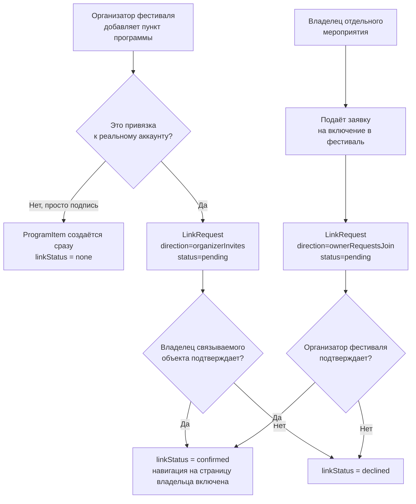

# RECHARGE — Multi-Festival Program Slice Spec

- Статус: **Draft for review** (Proposed; все открытые вопросы владельца
  закрыты 2026-08-19, ждёт явного перевода в Approved)
- Версия: **1.4**
- Дата: 2026-08-19
- Предлагаемое имя слайса: `MFP-01`
- Область: расширение уже существующего типа Create Hub `event`
  (`CreateObjectType.event`), **не новый Create-тип**

Название файла — «Multi-Festival» — отражает суть механики: объединение под
одной крышей (одним родительским Event) нескольких самостоятельных объектов
разных издателей, а не «фестиваль» как узкий синоним archetype `festival`
(механика применима и к `conference`, и к любому `multiVenue` Event, см. §2).

Этот документ — не разрешение на реализацию. Он фиксирует целевой Create-flow,
доменную модель и workflow подтверждения связей для той части
`EVENT_CLASSIFICATION_SPEC.md`, которая уже принята на уровне контракта
(§16 «Program Items»), но не реализована в коде. Кодирование — отдельный slice
после явного утверждения владельцем продукта, со своими acceptance criteria,
`flutter analyze`/`flutter test` и boundary-проверками, по правилу AGENTS.md
о специализированных секциях уже принятых 10 типов Create Hub (разрешённый
конфликт №4).

Связанные источники истины:

- [EVENT_CLASSIFICATION_SPEC.md](../EVENT_CLASSIFICATION_SPEC.md) — §7.1
  (`multiVenue` facet), §16 (`ProgramItem`, `childEventRef`/`parentEventRef`),
  §20.5 (пример «Городской фестиваль») — этот документ специфицирует их
  Create-реализацию, не переопределяет;
- [COLLECTION_GUIDE_CREATE_BLOCK_SPEC.md](../create/COLLECTION_GUIDE_CREATE_BLOCK_SPEC.md) —
  ближайший архитектурный прецедент id-only связей на чужой опубликованный
  контент и асимметрии self-service удаления vs добавления (§3.11 того
  документа); Multi-Festival Program не копирует его дословно — там подборка
  ссылок одним автором без согласия второй стороны, здесь двусторонняя связь
  с явным запросом-подтверждением;
- [EVENT_CREATE_CORE_SCHEDULE_SLICE_SPEC.md](../create/EVENT_CREATE_CORE_SCHEDULE_SLICE_SPEC.md) —
  принятый паттерн детерминированной материализации occurrences, на который
  опирается расписание точек программы;
- [S3_CRT_01_CREATE_SPEC.md](../archive/S3_CRT_01_CREATE_SPEC.md) — общий Create flow,
  черновики, автосохранение, публикация;
- `AGENTS.md` — разрешённый конфликт №4 (Create Hub), №2 (ID только по id);
- [ADR 0013](../../adr/0013-domain-policy-baseline.md) — lifecycle, ownership,
  permissions, moderation, ID, audit;
- [ADR 0015](../../adr/0015-authenticated-viewer-verified-creator-professional-page.md) —
  роли, Publisher, capability-based доступ.

При конфликте действуют приоритеты `AGENTS.md`: Accepted ADR → spec активного
slice → `LAUNCH_STATUS.md` → `VISION.md`. Этот документ приоритета spec
активного slice не имеет, пока не утверждён отдельно.

## Оглавление

1. [Назначение документа](#1-назначение-документа)
2. [Главный продуктовый инвариант](#2-главный-продуктовый-инвариант)
3. [Термины](#3-термины)
4. [Scope](#4-scope)
5. [Роли, capabilities и доступ](#5-роли-capabilities-и-доступ)
6. [Доменная модель](#6-доменная-модель)
7. [Workflow привязки: два сценария инициации](#7-workflow-привязки-два-сценария-инициации)
8. [Видимость дочернего объекта](#8-видимость-дочернего-объекта)
9. [Точки на карте (`EventVenueLink`)](#9-точки-на-карте-eventvenuelink)
10. [Жалобы и модерация](#10-жалобы-и-модерация)
11. [Create flow — пошагово](#11-create-flow--пошагово)
12. [Сквозная validation matrix](#12-сквозная-validation-matrix)
13. [Представление в интерфейсе](#13-представление-в-интерфейсе)
14. [Неофициальные (community) фестивали и claim](#14-неофициальные-community-фестивали-и-claim)
15. [Известные ограничения](#15-известные-ограничения-честно-зафиксированы-не-скрыты)
16. [Открытые вопросы](#16-открытые-вопросы-решает-владелец-продукта)
17. [Changelog](#17-changelog)

## На один экран

| | |
|---|---|
| Что это | Родительский Event с facet `multiVenue` (любой archetype — festival, conference, exhibition и др.), объединяющий под собой пункты программы — свои и чужие, с привязкой к точкам на территории |
| Что нового против generic-runtime | Шаг формы «Точки и программа»: `EventVenueLink` (точки на обычной карте, id-ссылки на Place) + `ProgramItem` (свой пункт или привязка к чужому опубликованному объекту) |
| Ключевое правило | Организатор подписывает и размещает **любой** пункт программы свободно, без подтверждения. Подтверждение стороны требуется, только если пункт **привязывается к реальному аккаунту Recharge** — тогда переход на страницу владельца открывается только после его согласия |
| Инициатор привязки | Обе стороны: организатор фестиваля предлагает существующему аккаунту войти в программу, либо владелец отдельного мероприятия сам подаёт заявку на включение в фестиваль |
| Модерация контента vs жалобы | Отдельные потоки: обычный lifecycle/moderation Event не меняется; жалоба на пункт программы (вводит в заблуждение, неверная привязка) обрабатывается отдельным review-потоком, не блокирует показ до решения модератора |
| Карта | v1 — обычная карта с пинами на существующие Place ID (`EventVenueLink`); кастомная арт-схема территории — открытый вопрос, вне scope v1 (§15, §16) |
| Авторство фестиваля | Может создать любой Creator/Page (`authorityStatus = community`), не обязательно реальный организатор — с явной пометкой «Неофициально задокументировано». Реальный организатор может позже подать заявку на claim (§14) |
| Статус документа | Draft for review — фиксирует целевую логику, не разрешает кодирование |

## 1. Назначение документа

`EVENT_CLASSIFICATION_SPEC.md` v2.2.3 (Accepted) уже вводит `ProgramItem` и
`childEventRef`/`parentEventRef` как часть канонического контракта Event
(§16), с явным примером «Городской фестиваль» (§20.5). Текущая реализация
Create Hub для Event — C0 + schedule-C1 подмножество: только явный список
`eventSlots`, без Program Items, без точек территории, без workflow
привязки чужих объектов. Этот документ закрывает пробел между принятым
контрактом и отсутствующей реализацией — так же, как `BOOKABLE_SESSION_CREATE_BLOCK_SPEC.md`
и `RENTAL_EQUIPMENT_CREATE_BLOCK_SPEC.md` закрывают аналогичные пробелы для
своих типов.

Источник задачи — пользовательский пример: фестиваль на одной территории с
десятками локаций (сцена, стенды организаций, зоны активностей), где в одно
и то же время параллельно проходят самостоятельные мероприятия разных
организаций (детская активность, мастер-класс, танцы), которые должны иметь
возможность явно привязаться к фестивалю.

## 2. Главный продуктовый инвариант

**Multi-Festival Program — это родительский Event, который объединяет под
собой пункты программы, часть которых являются самостоятельными
опубликованными объектами других издателей.** Это не Collection (курируемая
витрина чужого контента одним автором без согласия второй стороны) и не новый
Create-тип — это специализированный шаг формы, доступный для любого Event с
facet `multiVenue` (`EVENT_CLASSIFICATION_SPEC.md` §7.1), независимо от
archetype (решение §16 Вопрос 7: facet, не конкретный archetype, — уже
достаточный и явный сигнал).

Следствия:

- пункт программы либо **внутренний** (создан и полностью описан самим
  организатором, не ссылается ни на какой чужой аккаунт — фото, название,
  время, точка — организатор подписывает это свободно, без чьего-либо
  подтверждения);
- либо **привязан к существующему аккаунту Recharge** — тогда это связь
  между двумя независимыми Publisher (ADR 0015), которая обязана пройти
  двустороннее согласие, прежде чем со страницы фестиваля откроется переход
  на страницу владельца этого отдельного мероприятия/страницы (§7);
- до подтверждения привязанный пункт виден в программе как текстовая
  заявка/подпись без активной навигации на чужую страницу — организатор не
  может представить чужой объект как часть своего мероприятия без согласия
  его владельца;
- жалоба на пункт программы — самостоятельный поток модерации, не совпадает
  с процессом подтверждения привязки (§10);
- один листинг Event = одна родительская программа; child-объекты остаются
  независимыми Event/Place/Session/Class со своим `PublisherRef`, Multi-Festival
  Program не дублирует и не забирает их данные.

## 3. Термины

| Термин | Значение |
|---|---|
| `ProgramItem` | Пункт программы: внутренний (без привязки) либо ссылающийся на чужой опубликованный объект через `childEventRef` |
| `childEventRef` | Id-ссылка на связанный объект (`{objectType, objectId}`) — Event, Place, Bookable Session, Class/Workshop и другие принятые Create-типы |
| `parentEventRef` | Обратная ссылка на родительский фестиваль/конференцию на стороне связанного объекта |
| `EventVenueLink` | Точка на карте территории фестиваля — id-ссылка на существующий Place, с номером/подписью для программы |
| `LinkRequest` | Заявка на привязку `ProgramItem` к реальному аккаунту — хранит инициатора, получателя, статус, срок жизни |
| `LinkRequest.status` | `pending` · `confirmed` · `declined` · `expired` |
| `standaloneVisibility` | Настройка child-объекта: показывать его отдельной карточкой в общем каталоге (`standalone`) или только внутри программы фестиваля (`programOnly`) |
| `ProgramReport` | Жалоба на конкретный `ProgramItem` (вводит в заблуждение, ложная привязка, неуместный контент) — отдельный от `LinkRequest` объект |
| `authorityStatus` | `community` (создано без претензии на официальную организацию) или `official` (создано/подтверждено реальным организатором) — атрибут родительского Event, не пункта программы |
| `FestivalClaimRequest` | Заявка от Creator/Page на переход `authorityStatus community → official` с передачей `PublisherRef` — рассматривается модератором, не self-service (§14) |

## 4. Scope

### 4.1 В scope этого документа (local/mock, без Firebase)

- шаг формы Event «Точки и программа» для любого Event с facet `multiVenue`,
  независимо от archetype (§16 Вопрос 7);
- добавление точек территории (`EventVenueLink`) на обычной карте, id-ссылка
  на существующий Place (создание нового Place, если его ещё нет в каталоге,
  идёт обычным Create-флоу Place, не изобретается параллельно);
- добавление внутренних пунктов программы без привязки — свободно, без
  подтверждения;
- запрос на привязку существующего Recharge-аккаунта к программе, в обе
  стороны (§7);
- подтверждение/отклонение заявки владельцем связываемого объекта;
- ограниченная навигация на страницу владельца, включаемая только после
  подтверждения;
- настройка видимости child-объекта (`standalone`/`programOnly`) на стороне
  его автора;
- отдельный, минимальный механизм жалобы на конкретный `ProgramItem` (§10);
- тесты domain, application, data, widget.

### 4.2 Вне scope (post-MVP / отдельные gated slices)

- кастомная арт-схема территории (нарисованная карта вместо обычных пинов,
  §9.3) — открытый вопрос §16 (Вопрос 1, остаётся открытым);
- Booking backend для child-объектов — общий MVP-статус (externalBookingUrl),
  не расширяется этим документом;
- массовые/групповые приглашения (пригласить сразу несколько аккаунтов);
- полноценная модерационная очередь жалоб с SLA — используется тот же
  минимальный mock-механизм, что и у остальных report-потоков репозитория;
- Firebase, production backend, реальные push-уведомления — используются
  mock-адаптеры и локальные уведомления, как у всех текущих Create-блоков.

## 5. Роли, capabilities и доступ

- Добавление точек и внутренних пунктов программы — capability `create.event`
  (тот же бар, что у обычного Event, не вводится отдельная capability).
- Инициирование заявки на привязку (в любую сторону) — тоже `create.event`,
  доступно verified Creator/Page.
- Подтверждение/отклонение входящей заявки — доступно только `PublisherRef`
  связываемого объекта (тот же аккаунт/страница, что владеет им), проверяется
  так же, как остальные capability-gated операции (ADR 0015).
- Жалоба на пункт программы — доступна любому авторизованному Viewer, без
  Creator capability (общий принцип report-потоков).

## 6. Доменная модель

Целевой domain contract, расширяющий существующий Event по §16
`EVENT_CLASSIFICATION_SPEC.md`. Имена нормативны по смыслу; точный Dart API
утверждается implementation slice.

```text
Event {
  ...существующие поля Event...
  venueLinks: List<EventVenueLink>
  programItems: List<ProgramItem>
  authorityStatus: community | official
  documentedBy: { type: user | page, id: ULID }?
  acceptsJoinRequests: bool  // default true (§16 Вопрос 2)
}

EventVenueLink {
  id: ULID
  eventId: ULID
  label: String
  order: int
  placeRef: { id: ULID }
}

ProgramItem {
  id: ULID
  eventId: ULID
  title: String
  kind: act | session | screening | activity | break
  startAtUtc: Instant
  endAtUtc: Instant
  venueLinkId: ULID?

  childEventRef: { objectType, objectId }?
  linkRequestId: ULID?
  linkStatus: none | pending | confirmed | declined
  standaloneVisibility: standalone | programOnly  // default standalone (§16 Вопрос 5), задаётся владельцем child-объекта

  description: String?
  createdAtUtc: Instant
  updatedAtUtc: Instant
}

LinkRequest {
  id: ULID
  programItemId: ULID
  initiator: { type: user | page, id: ULID }
  target: { type: user | page, id: ULID }
  direction: organizerInvites | ownerRequestsJoin
  status: pending | confirmed | declined | expired
  createdAtUtc: Instant
  expiresAtUtc: Instant   // createdAtUtc + 14 дней, фиксированно (§16 Вопрос 3)
  respondedAtUtc: Instant?
}

ProgramReport {
  id: ULID
  programItemId: ULID
  reporterId: ULID
  reasonCode: misleadingAffiliation | inappropriateContent | other
  note: String?
  status: open | reviewed | dismissed
  createdAtUtc: Instant
}

FestivalClaimRequest {
  id: ULID
  eventId: ULID
  claimant: { type: user | page, id: ULID }
  evidenceNote: String
  status: pending | approved | rejected
  reviewedByModeratorId: ULID?
  createdAtUtc: Instant
  resolvedAtUtc: Instant?
}
```

### 6.1 Инварианты модели

- `childEventRef` не может указывать сам на себя и не может создавать цикл
  (Event не может быть program-родителем самому себе транзитивно);
- `linkStatus = confirmed` возможен только при существующей `LinkRequest` со
  статусом `confirmed` — обходных путей выставить `confirmed` напрямую нет;
- пока `linkStatus != confirmed`, UI не показывает CTA перехода на страницу
  владельца — только заявленное название/время/точку;
- `standaloneVisibility` управляется исключительно владельцем child-объекта,
  организатор фестиваля не может его переопределить;
- `ProgramReport` не меняет `linkStatus` автоматически — решение модератора
  вносится вручную через существующий moderation-механизм (§10);
- удаление/архивация родительского Event не удаляет child-объекты; их
  `parentEventRef`/`linkRequestId` остаётся для истории, но не блокирует их
  собственную публикацию;
- `authorityStatus = official` достигается только через одобренный
  `FestivalClaimRequest` (или если Event изначально создан верифицированной
  стороной, см. §14) — самостоятельно выставить `official` нельзя.

## 7. Workflow привязки: два сценария инициации



Правила:

1. **Организатор → существующий аккаунт.** Организатор находит опубликованный
   объект каталога (тот же id-only picker, что у `ItemsPickerSection`
   Collection) и создаёт `ProgramItem` с `childEventRef`. Это создаёт
   `LinkRequest(direction=organizerInvites, status=pending)`. Владелец объекта
   получает уведомление и должен подтвердить или отклонить.
2. **Владелец отдельного мероприятия → фестиваль.** Владелец на странице
   своего Event/Session видит опцию «Стать частью фестиваля» только если у
   целевого фестиваля `acceptsJoinRequests = true` (переключатель на стороне
   организатора, по умолчанию включён, §16 Вопрос 2), выбирает целевой
   фестиваль и подаёт заявку. Это создаёт
   `LinkRequest(direction=ownerRequestsJoin, status=pending)`. Организатор
   фестиваля подтверждает или отклоняет.
3. **До подтверждения** пункт программы виден в программе фестиваля с
   пометкой «Ожидает подтверждения», без активной ссылки на чужую страницу —
   организатор не может выдать непроверенную привязку за подтверждённую.
4. **После подтверждения** пункт получает `linkStatus = confirmed`, CTA
   «Открыть страницу» становится активным, и связь двусторонняя: со страницы
   child-объекта тоже видна ссылка «Часть фестиваля X» (`parentEventRef`).
5. **Отклонение или истечение срока** (`declined`/`expired`) — пункт остаётся
   в программе только как обычная подпись без привязки (организатор решает:
   удалить его или оставить как неподтверждённый текстовый пункт — то есть
   отклонённая заявка не обязана удалять сам `ProgramItem`, только снимает
   `childEventRef`/навигацию).
6. **Внутренние пункты программы** (без привязки к реальному аккаунту) не
   создают `LinkRequest` вообще — организатор подписывает их свободно, как
   заявлено в требовании.

## 8. Видимость дочернего объекта

После подтверждения владелец child-объекта на своей стороне выбирает:

| Значение | Поведение |
|---|---|
| `standalone` | Объект продолжает быть отдельной карточкой в общем Search/Feed/Map, плюс отображается в программе фестиваля — два способа его найти, как у Collection (§5.6 `COLLECTION_GUIDE_CREATE_BLOCK_SPEC.md`) |
| `programOnly` | Объект не участвует в общем поиске отдельно, найти его можно только через программу фестиваля (например, разовая детская активность, которую автор не считает нужным продвигать отдельно) |

Выбор доступен и изменяем в любой момент после подтверждения — не фиксируется
навсегда при первом ответе на `LinkRequest`. По умолчанию — `standalone`
(§16 Вопрос 5): самый дешёвый вариант с приемлемым риском, поскольку риск
«мёртвых карточек» для одноразовых появлений смягчается обычным
lifecycle/freshness Event — прошедший occurrence и так уходит из активной
выдачи независимо от этой настройки.

## 9. Точки на карте (`EventVenueLink`)

### 9.1 v1 — обычная карта (в scope)

Точка — обычный pin на существующей карте Discover (`S2_DISC_02_MAP_SPEC.md`),
`placeRef` указывает на реальный, уже существующий или только что созданный
через обычный Create Place. Номер и подпись — метаданные `EventVenueLink`,
не отдельная графическая система.

### 9.2 Редактор точек в форме

- список чипов «номер + название точки», добавление через существующий
  Place-picker (создать новый Place или выбрать из каталога);
- порядок точек (`order`) задаёт нумерацию в программе и в списке;
- точка без ни одного `ProgramItem`, ссылающегося на неё, разрешена (например,
  входная группа, WC) — используется только как ориентир на карте, не
  обязана быть связана с программой;
- **indoor-случай (нет отдельных координат у комнаты/зала).** Несколько
  `EventVenueLink` могут ссылаться на один и тот же `placeRef` (например,
  одно здание конференц-центра), различаясь только `label` («Зал A», «Зал
  B», «Комната 204»). На карте это один pin здания; в списке точек и в
  программе — разные подписи. Это осознанный v1-костыль для помещений без
  собственной геометки: он не заменяет кастомную схему этажа (§9.3), но
  закрывает базовый случай без неё.

### 9.3 v2 — кастомная арт-схема (вне scope v1)

Ручная схема-иллюстрация территории (как в примере, приложенном к задаче) —
изображение-фон с точками, размещёнными по нормализованным `{xPercent,
yPercent}` координатам, не по гео-координатам. Технически не сложнее
известного паттерна «карта этажа/зала», но:

- вводит новый тип медиа-актива (загружаемая схема), которого нет в
  `EVENT_CLASSIFICATION_SPEC.md`;
- требует tap-to-place редактор и, при большом числе точек (50+, как в
  референсе), zoom/pan/кластеризацию, иначе точки налезают друг на друга;
- расширяет принятый контракт (`venueLinkId` → стабильный Place id, не
  произвольные пиксельные координаты) — требует отдельного решения владельца
  продукта, вынесено в открытый вопрос §16 (Вопрос 1).

До реализации v2 indoor-события без отдельных координат покрываются
костылём §9.2 (общий `placeRef` здания + разные `label`), который не рисует
план помещения, а просто перечисляет залы текстом.

## 10. Жалобы и модерация

Жалоба — самостоятельный поток, отдельный от `LinkRequest` и от общего
lifecycle/moderation родительского Event:

1. Любой авторизованный Viewer может подать `ProgramReport` на конкретный
   `ProgramItem` (не на весь Event) с `reasonCode` и опциональной заметкой.
2. Подача жалобы не меняет `linkStatus` и не скрывает пункт немедленно —
   решение принимает модератор через существующий moderation-механизм
   репозитория (тот же паттерн, что у report/block остальных объектов
   каталога).
3. Модератор, рассматривая жалобу `misleadingAffiliation` (ложная привязка),
   может вручную перевести `linkStatus` в `declined` — это единственный путь
   принудительно снять подтверждённую привязку без действия самого владельца.
4. Автор жалобы не видит внутренний статус рассмотрения, кроме факта
   «жалоба принята»/«отклонена» — общий UX report-потока платформы.

## 11. Create flow — пошагово

Расширение существующего шага расписания Event, не отдельный параллельный
визард (правило 4 `AGENTS.md`). Новый шаг **«Точки и программа»** активен при
facet `multiVenue`, независимо от archetype (§16 Вопрос 7):

1. **Точки территории** — добавить/выбрать Place, задать подпись и порядок
   (§9.2). Не обязателен, если у Event нет facet `multiVenue`.
2. **Программа** — добавить пункт: свой (сразу сохраняется) или привязка к
   существующему аккаунту (создаёт `LinkRequest`, пункт отображается как
   pending до ответа).
3. **Live-превью программы** — список пунктов с временем/точкой/статусом,
   как в разработанном ранее мокапе экрана.
4. Автосохранение работает по общему контракту `S3_CRT_01_CREATE_SPEC.md`,
   включая незавершённые `LinkRequest` — они не теряются при выходе из формы.
5. Publish родительского Event не блокируется наличием pending-заявок —
   программа дополняется по мере подтверждений уже после публикации
   фестиваля (тот же принцип, что у Session §21.6 в части «шаг всегда
   доступен для повторного захода»).

## 12. Сквозная validation matrix

| Условие | Обязательное поведение |
|---|---|
| `ProgramItem.startAtUtc`/`endAtUtc` вне общего диапазона дат родительского Event | Форма предупреждает, не блокирует жёстко (пункт может начаться раньше общего открытия — например, аккредитация) |
| `venueLinkId` указывает на несуществующую/удалённую точку | Publish пункта программы заблокирован до исправления |
| `childEventRef` указывает на объект, которым управляет тот же самый Publisher, что и родительский Event | Разрешено без `LinkRequest` — self-link не требует согласия самого себя, `linkStatus` сразу `confirmed` |
| `childEventRef` указывает на несуществующий/удалённый объект | Publish пункта программы заблокирован |
| Попытка выставить `linkStatus = confirmed` без `LinkRequest.status = confirmed` | Заблокировано на уровне domain-инварианта, не только UI |
| `LinkRequest` без ответа дольше 14 дней от `createdAtUtc` | Статус переходит в `expired`, обе стороны получают уведомление; инициатор может переподать заявку заново без ограничений (§16 Вопрос 3) |
| Жалоба подана на internal `ProgramItem` (без привязки) | Разрешено — `reasonCode = inappropriateContent` применим и к внутренним пунктам |
| Число `ProgramItem` или `EventVenueLink` на одном Event превышает 30 | Мягкое предупреждение в форме («рассмотрите группировку по времени/точке»), Publish не блокируется (§16 Вопрос 4) |
| `FestivalClaimRequest` — заявитель не имеет `verificationStatus` verified Creator/Page | Заявка не создаётся, UI объясняет требование пройти verification сначала (§16 Вопрос 8) |
| Третья по счёту `FestivalClaimRequest` на один и тот же Event после 2 отклонений | Форма блокирует самостоятельную подачу, предлагает обращение в поддержку (§16 Вопрос 9) |

## 13. Представление в интерфейсе

### 13.1 Программа на Details родительского Event

- если `authorityStatus = community` — постоянный бейдж «Неофициально
  задокументировано» рядом с заголовком, не только в форме создания (§14.1);
- список пунктов, сгруппированный по времени и/или по точке;
- бейдж статуса: без бейджа — внутренний пункт; «Ожидает подтверждения» —
  `pending`; активная карточка с переходом — `confirmed`;
- тап по подтверждённому пункту открывает Details связанного объекта
  (Event/Place/Session/Class), не встроенный предпросмотр.

### 13.2 Страница child-объекта

- при `linkStatus = confirmed` — блок «Часть фестиваля» со ссылкой на
  родительский Event (обратная навигация через `parentEventRef`);
- при `standaloneVisibility = programOnly` — объект не появляется в обычном
  Search/Feed/Map, только через переход из программы фестиваля.

### 13.3 Уведомления

- владелец получает уведомление о новой входящей `LinkRequest` независимо от
  направления инициации;
- обе стороны получают уведомление о подтверждении/отклонении/истечении.

### 13.4 Discover-интеграция (§16 Вопрос 11)

- **Карта.** Multi-Festival Event получает отдельный, явный фильтр/точку
  входа «Фестивали» на карте Discover — не смешивается молча с обычными
  Event-пинами; тап открывает Details фестиваля с полной программой, не
  список отдельных точек территории как самостоятельных pin.
- **Search и рекомендации.** Обычный путь: фестиваль участвует в общем
  `search → filters → map → feed → details` наравне с остальным Event-
  контентом и всплывает в рекомендациях как «предстоящее событие» — по
  стандартной логике рекомендаций платформы, без отдельного алгоритма для
  Multi-Festival.
- `authorityStatus = community` не понижает ранжирование ни на карте, ни в
  Search/рекомендациях — бейдж (§13.1) уже даёт честный сигнал, скрытое
  понижение было бы непрозрачно для автора (согласуется с рекомендацией
  §16 Вопрос 11).

## 14. Неофициальные (community) фестивали и claim

Не всегда есть единый легитимный организатор в момент создания записи в
Recharge (децентрализованное народное гуляние, стихийная территория без
одного хозяина) — либо запись первым делает сторонний участник, а не
представитель организаторов. Это не запрещается, но явно помечается и не
даёт создателю прав, которых у него нет по факту.

### 14.1 Создание

- Любой Creator/Page может опубликовать festival/`multiVenue` Event с
  `authorityStatus = community` — тот же бар capability, что и у обычного
  Event (§5), без специальной проверки полномочий представлять реальную
  организацию.
- На карточке и Details такой Event несёт постоянный, не скрываемый бейдж
  «Неофициально задокументировано» (`documentedBy` показывает, кто ведёт
  запись — не обязательно юридический организатор).
- Внутренние пункты программы (§7 п.6) и точки территории добавляются той же
  свободной подписью, что и у official — статус `community` не ограничивает
  функциональность, только полномочия и доверие.

### 14.2 Claim: переход в `official`

1. Сторона, претендующая на реальную организацию, подаёт `FestivalClaimRequest`
   с `evidenceNote` (свободное текстовое обоснование — ссылка на официальный
   анонс, домен организации и т.п.; полноценная верификация бизнеса вне
   scope, см. §15). Подать заявку может только заявитель с уже пройденной
   identity/Creator verification (`verificationStatus = verified`, ADR 0015)
   — минимальный барьер, который уже существует в платформе, отдельного
   business-verification трека этот документ не вводит (§16 Вопрос 8).
2. Заявка не подтверждается автоматически и не подтверждается текущим
   `documentedBy` — рассматривается модератором вручную, по прецеденту
   pending-заявок на `ManagedPage` (`IDENTITY_PUBLISHER_SLICE_SPEC.md`,
   IDP-04A: self-service лимит + pending-заявка модераторам), поскольку
   передача полномочий — более высокий риск, чем обычная `LinkRequest` между
   равными сторонами.
3. Одобрение переносит `PublisherRef` на заявителя, выставляет
   `authorityStatus = official`, снимает бейдж «Неофициально задокументировано».
   Уже подтверждённые `ProgramItem`/`LinkRequest`/точки территории сохраняются
   без изменений — claim передаёт полномочия управления, не обнуляет
   накопленный контент.
4. Прежний `documentedBy` получает уведомление об одобренном claim и
   продолжает быть виден как «изначально задокументировал» (атрибуция, не
   Publisher-права).
5. Лимит попыток: не более **2 отклонённых `FestivalClaimRequest`** на один
   Event суммарно (независимо от заявителя — считается по Event, не по
   аккаунту). После второго отклонения самостоятельная повторная подача
   заблокирована в UI, дальше — только обращение в поддержку (§16 Вопрос 9;
   см. также §12 validation matrix).

### 14.3 Чего это не решает

- Дубликаты (два независимых `community`-Event на одно и то же реальное
  событие) — целевое направление принято: полноценный merge-flow (объединение
  точек/программы двух Event в один, с сохранением обеих историй
  `documentedBy`) утверждён как желаемый результат (§16 Вопрос 10), но не
  специфицирован и не входит в scope MFP-01 — отдельный последующий slice. До
  него дубликаты обрабатываются только через report + ручное архивирование
  одной из копий модератором.
- Настоящая верификация организации (домен, юрлицо, документы) не входит в
  этот документ — `evidenceNote` проверяется человеком-модератором вручную,
  не автоматическим сервисом, ровно как остальные IDP-слайсы на стабилизации.

## 15. Известные ограничения (честно зафиксированы, не скрыты)

- Кастомная арт-схема территории (§9.3) не входит в v1 — точки размещаются
  только на обычной карте с реальными координатами Place.
- Жалобы обрабатываются тем же минимальным mock-механизмом, что и остальные
  report-потоки репозитория — нет отдельной SLA-очереди или эскалации.
- `LinkRequest` не поддерживает переговоры/комментарии внутри заявки в v1 —
  только подтвердить/отклонить, без встречного предложения времени/точки.
- Booking backend для child-объектов не расширяется этим документом — общий
  MVP-статус (`externalBookingUrl`) сохраняется.
- Claim (§14) не включает автоматическую верификацию организации — решение
  принимает модератор вручную по свободному `evidenceNote`, тот же уровень
  строгости, что у остальных IDP-слайсов на стабилизации; реальная business
  verification — отдельный, не начатый трек.
- Дубликаты `community`-фестивалей на одно и то же реальное событие не
  сливаются автоматически в v1; полноценный merge-flow принят как целевое
  направление (§16 Вопрос 10), но это отдельный последующий slice, не MFP-01.

## 16. Открытые вопросы (решает владелец продукта)

Полный список с рекомендациями — в отдельном файле
[MULTI_FESTIVAL_PROGRAM_OPEN_QUESTIONS.md](MULTI_FESTIVAL_PROGRAM_OPEN_QUESTIONS.md).

## 17. Changelog

- `v1.4` (2026-08-19) — все 11 открытых вопросов закрыты владельцем:
  Вопрос 1 — кастомная арт-схема остаётся отдельным post-MVP slice,
  приоритет пересматривается при появлении реального крупного outdoor-
  кейса; Вопрос 5 — `ProgramItem.standaloneVisibility` по умолчанию
  `standalone` для всех типов child-объекта, без ветвления по типу (§6, §8).
  Companion-файл открытых вопросов закрыт целиком.
- `v1.3` (2026-08-19) — Вопрос 3 отвечен: `LinkRequest.expiresAtUtc` =
  `createdAtUtc` + 14 дней, фиксированно, без привязки к дате фестиваля
  (§6, §12).
- `v1.2` (2026-08-19) — перенесены первые ответы владельца продукта:
  applicable scope — любой `multiVenue` Event, а не только archetype
  `festival`/`conference` (Вопрос 7); `acceptsJoinRequests` переключатель,
  по умолчанию включён (Вопрос 2); мягкий лимит 30 на число `ProgramItem`/
  `EventVenueLink` (Вопрос 4); indoor-костыль — общий `placeRef` + разные
  `label` для помещений без своих координат; claim требует уже
  verified Creator/Page-заявителя (Вопрос 8) и ограничен 2 отклонёнными
  попытками на Event (Вопрос 9); merge-flow дубликатов принят как целевое
  направление, вынесен в отдельный будущий slice (Вопрос 10); добавлена
  §13.4 Discover-интеграция — отдельный фильтр «Фестивали» на карте,
  обычная логика Search/рекомендаций без понижения `community` (Вопрос 11).
  Вопросы 1, 3, 5 остаются открытыми (Вопрос 3 — ожидает решения после
  уточнения деталей).
- `v1.1` (2026-08-19) — добавлена модель неофициальных (`community`)
  фестивалей: `authorityStatus`, `documentedBy`, `FestivalClaimRequest`,
  claim-workflow с модераторским review по прецеденту IDP-04A, бейдж
  «Неофициально задокументировано», явные ограничения (нет автоверификации
  организации, нет автослияния дубликатов). Новые открытые вопросы вынесены
  в companion-файл.
- `v1.0` (2026-08-19) — первая версия документа. Зафиксирован продуктовый
  инвариант, доменная модель (`EventVenueLink`, `ProgramItem`, `LinkRequest`,
  `ProgramReport`), двусторонний workflow привязки с явным правилом «свободная
  подпись vs подтверждение реального аккаунта», видимость child-объекта,
  отдельный поток жалоб, пошаговый Create flow, validation matrix,
  UI-представление и открытые вопросы для будущей implementation slice.
  Реализации ещё нет; статус — Draft for review.
